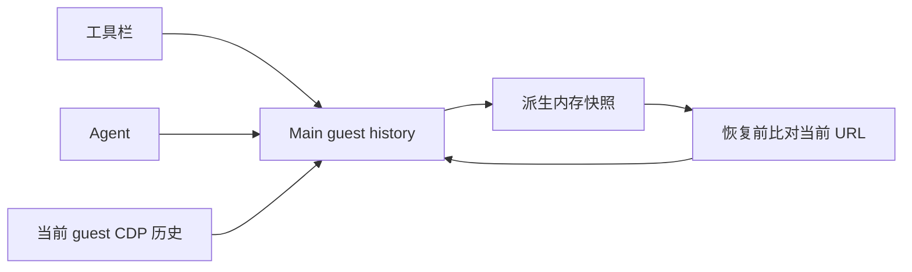

# CentOS 7 桌面与双平台发行规范

## 1. 权威与当前最高产品要求

根 [fork.md](../fork.md) 是需求入口。本次 CentOS 请求使用锚点 `fork-004-centos7-desktop-release`，不替代根文档既有的同号产品身份需求或 FORK-005。此次明确合并新 main，产品功能以 main 为准，只保留必要的底层兼容与构建适配；旧材料及历史通过记录不是本次发行证据。

**长期最高产品要求：这是个人项目，速度优先、功能优先，不要许可证处理，不要包检查。** 本轮只要求正常生成真实 ZIP、在 CentOS 7 实际启动并修复功能性启动报错。不新增或执行许可收集／强制校验、RPM／SRPM 许可提供链、补充 LGPL 全文、搜索工具许可合同、法律／源码审计、ELF／ABI／archive／完整性审计门禁或重复全仓 gates；已取消事项不保留为待办或验收项。依赖原本附带文件不额外折腾。

沿用现有布局与 `licenses/runtime-assets-manifest.json` 运行元数据路径；该路径只是既有消费格式，不代表许可审计。可生成 SHA256 供用户自用，不复验或作为审计阻断。不为取消检查建立替代审计、专用永久测试体系或额外配置框架。

相对 main 的兼容增量只保留真实消费者需要的实现。小型 preload 兼容函数保持在既有实现文件，不配置独立 managed 模块或 contract／example 模板；测试沿用 main 入口，不另设兼容性清单，也不为兼容层重复建立业务域专项套件。

主执行者统一执行本轮真实构建与启动。代码子任务不运行 build、测试、lint、formatter 或 gates；不追加 Windows 受影响检查，不重跑用户报告的失败以确认。

## 2. 目标运行环境与证据边界

- CentOS 7 x64：目标 Linux 3.10、glibc 2.17、Electron **28.3.3**，内嵌 Node **18.18.2**／Chromium 120。只有 CentOS 隔离构建固定旧 runtime；Windows、macOS 跟随当前上游 manifest／lockfile，不永久钉死本次历史源码 Electron 41.0.3。
- 内网技术约束来自用户提供的环境资料，不是本轮测试结果：内核 `3.10.0-1160.95.1.el7.x86_64`、`/bin/csh`、无独显，SSH X11 转发至 Windows Exceed v11.0，并非已确认 Citrix；资料记录 IBus 1.5.17 和文泉驿字体。不得复制内网地址、主机或账户信息。
- `/home` 为 NFS 且配额小，项目持久数据及备份使用有写权限 NFS；`/dev/shm` 仅用于易失、可重建数据。不用 `/local`、`/tmp` 或其他本地目录作项目存储回退，不恢复自动 shm 迁移／备份／恢复。
- 允许使用 WSL `CentOS-7`／WSLg 进行真实启动；结果只证明本次程序、库及实际使用的图形路径，不能证明真实 Linux 3.10、SSH X11／Exceed、GLX／XKB、IBus 1.5.17 中文输入或内网宿主已验收。这些证据边界不扩大为本轮额外测试要求。
- Electron 28／Chromium 已停止维护，默认软件渲染及 `--no-sandbox` 是明确安全限制，提醒避免不可信工作区；不伪称额外安全保证。

## 3. 不变功能与数据边界

不改变 UI 结构、入口、语言默认值、推荐内容、流式输出、动画或性能策略，不新增 CentOS 性能标记。不恢复旧网络锁定、离线拦截、遥测或日志静默策略。

不改变业务根、sessions-index、tasks-index、shm 活动根及 profile 所有权，不搬运用户数据，不创建 `~/.omp`／`~/.ompcode` 链接。OmpCode 与上游 ZCode 的产品身份、安装、数据根、凭据、单实例锁及更新边界仍遵循根文档，不结束已有 ZCode／OMP 进程。

本轮运行必须隔离应用安装和数据，以及 OMP 配置／技能／存储，不覆盖用户旧安装或配置，不停止已有进程。

## 4. 外部 OMP 与环境透传

OMP 是用户预先独立安装、适配目标宿主及当前协议的真实外部依赖，不随包分发，不自动下载、安装、升级或替换。用户配置命令或 PATH 后，非 root 解压应用不需联网补齐应用资产或安装宿主包。不消费 OMP artifact、producer run／token、私有 manifest，不恢复随包 JS adapter、旧 Agent 或会话 RPC 子进程架构。

沿用 FORK-003：Host 启动外部 `omp app-server --stdio --surface desktop`，业务由 app-server 内同进程 AgentSession 执行。显式非空 `ZCODE_AGENT_SERVER_COMMAND` 优先，显式空值报错，未设置默认 `omp`；由操作系统解析，不扫描 PATH／安装目录、不缓存候选、不失败回退其他 OMP。独立 args／cwd、实际 workspace、profile 和准备进程沿用现有合同。

准备与业务启动使用同一执行端、参数、profile 和环境；真实 storagePath、确认、storagePrepared、exit 0 监督仍生效，失败／EOF／取消阻断业务启动。外部 OMP 拥有配置、凭据、会话正文／队列与工作流事实，Host 拥有连接／attachment 路由、监督及组织元数据；每个 window Host 的 workspaceKey 最多一个 app-server。

启动器 → Main → Host → OMP 原样继承全部 `OMP_*` 与 `PI_CONFIG_DIR`，包括未知变量、空值和空白，以及 `OMP_OFFLINE=1`、NFS 配置目录与团队技能目录。不白名单过滤、归一化、派生离线状态或注入 `--offline`；配置、技能与离线含义由 OMP 解释。缺失或不兼容 OMP 保留真实诊断，不伪造准备结果、不自动修补依赖。

## 5. 构建与兼容实现

沿用现有 runtime assets、asar 重组、native search 和身份所有者，不建第二套发行系统。正常构建工具 Node **24.14.0**／pnpm **10.33.2**；native 在 glibc 2.17／GCC 11 构建器使用 Node **20.19.0 linux-x64-glibc-217** 和 node-gyp **11.5.0**，面向 Electron 28.3.3 headers／ABI 119。构建 Node、编译器和 rootfs 不进入产品。

`node scripts/prepare-centos7-build.mjs create <destination>` 在源码树外的新目录复制当前源码／lockfile，临时覆盖 Electron 28.3.3、运行闭包 undici 6.23.0、better-sqlite3 9.6.0，实际存在 Sharp 时覆盖 0.32.6；不污染源码或其他平台依赖。源码 better-sqlite3 保持 devDependency，仅隔离副本转 production dependency；已有 fast-glob 3.3.3 生产依赖是 Node 18 SSH glob 回退的明确例外。其他 overrides（含 React 19.2.7）保留。不为这些输入新增验真门禁。

原生构建 job 的 pnpm hoisted 安装在 GitHub runner 连续两次出现嵌套 esbuild `_tmp_*` rename ENOENT；固定该安装进程到 CPU 0，避免并发导入时替换父目录与写入子目录的竞态。仅限制依赖安装，不改变 pnpm 版本、依赖布局或 native 编译并行度；上游同类问题见 [pnpm/pnpm#12880](https://github.com/pnpm/pnpm/issues/12880)。

运行闭包收集必须把与 Node builtin 同名的 npm 依赖（如 `buffer`、`string_decoder`）解析为父包可见的真实 npm 包，不能把 builtin 名称当作文件路径向上查找 package.json。2026-10-23 真实 ZIP 因此误复制整个打包工作目录，超过 GitHub 单资产 2 GiB 限制；修复解析根因，仍保留单个正常 ZIP，不拆包、不裁剪产品功能。

- SQLite 继续使用单一共享门面：Node 22.x ≥22.16 或 Node ≥24 的完整 API 使用原生驱动，Node 23 及 CentOS Node 18 使用 better-sqlite3；不能只因存在 `node:sqlite` 就假定 backup／isTransaction／timeout 可用。不双写或迁移用户数据，不静态导入缺失 builtin，不泛 catch 静默换驱动。
- 保留 Electron 文件附件路径、导航、frame 和可信 main-world 脚本执行的真实能力分支。旧 runtime 保留原生历史条目和进程内完整 URL／title／index 栈，不宣称支持 Chromium 不透明 POST／表单／子框架 pageState 导入导出或持久化恢复。
- 保留 Node glob、import.meta 路径及 Promise 等实际等价回退，不以空数组或 no-op 代替。CSS 保留 field-sizing、retained planes、Pierre 样式及 GenUI 主题能力分支；PDF 使用实际 legacy alias／worker。不删除已实现兼容以取消审计。
- `fast-glob` 使用既有 CommonJS 外置依赖装配路径，不内联进 Main／Host／scheduler 的 ESM bundle；装配其真实运行闭包，避免 SSH 配置别名模块导入时触发 `Dynamic require of "os" is not supported`。不删除 glob 回退或 SSH 配置能力。
- CentOS runtime API audit 专用实现、报告和调用链已按用户要求删除，不保留替代入口或待通过要求。
- Host 使用自有 stdout／stderr 管道和结构化日志；EBADF／EPIPE 仅使相应原始 sink 不可用，不中断 Host／RPC／业务，不产生未捕获异常或递归日志。其他错误保持可见，不全局吞错或降日志等级。

### 5.1 旧运行时兼容修复验收

- 浏览器历史仍由 Main 的 guest history 唯一持有；工具栏和 Agent 的前进／后退读取、操作同一栈，不在 Renderer 另存历史。
- 恢复后连续提交多个导航项必须按原顺序保留；replace 不增加条目，分支导航截断 forward，同 URL 的不同条目不合并。
- crash／rebind 优先保留当前 URL；内存历史快照活动 URL 与当前缓存不一致时，丢弃该快照，继续已有恢复路径。
- 缺少原子 DOM 移动能力时保留同一 guest，但不能遮挡 Gen UI 复制／调整／放大按钮；不得用重挂页面丢失编辑状态来修复层级。
- 固定承载页面沿用消息层输入区遮罩边界；滚动时不绘制到 sticky composer 排除区域，浮窗与贴底状态仍遵循原消息层规则。
- Office 独立 PDF 构建在旧运行时同时选择 legacy 主模块与匹配 worker，保留 CJK 字体补丁；外部链接注释仍生成可点击热区。现代运行时的构建选择不变。

## 6. 真实运行资产与正常 ZIP

外发 CentOS 格式为 `OmpCode-<version>-centos7-x64.zip`，沿用单根目录及既有 `bin/ompcode-centos7`、`app/`、asar／unpacked、`resources/tools`、`lib/`、`fonts/` 布局，不为删除审计迁移路径。

正常装配真实 Electron dist、better-sqlite3 9.6.0、node-pty 1.1.0 及其 helper、cpu-features 0.0.10，搜索 bfs／ugrep／现有 musl ripgrep。实际 CUA 闭包存在时保留 Sharp 0.32.6／libvips 8.14.5 和 Koffi 2.15.6，不强行新增不存在的条件依赖。native 放现有模块和 unpacked 路径，不复制到 Electron 旁掩盖解析问题；不带可选 `sshcrypto.node`，SSH 使用 ssh2 JS 与 Electron crypto。

继续收集实际运行所需兼容库、SONAME 链接和配置，保留可移动的进程局部库路径，不替换宿主 glibc、不把现代宿主 prebuild 当作目标资产。按正常构建装配这些资产，不设置 ELF／依赖闭包、RPM header、摘要、链接或归档审计门禁；实际缺库、模块加载和路径问题以真实启动报错定位修复，不 mock 或隐藏。

保留 **wqy-zenhei 0.9.46-11.el7** 的真实 TTC 字节、fontconfig 配置、`fonts.conf`／`fonts.dtd`、所需库及启动器字体环境，使无宿主 CJK 字体时也能发现包内中文字体。不用未使用占位字体或依赖联网下载，不追加字体 RPM 验真审计。

正常 tar／ZIP 处理保留执行位、符号链接和既有布局；不增加 ELF 扫描、CRC 复验、解包完整性审计、摘要复验或许可阻断。可输出 SHA256 sidecar，但本轮验收依据是同包真实启动与功能性日志，不是包审计通过。

## 7. 启动器与 IBus

启动器按自身真实路径解析安装位置，不依赖 cwd，直接启动打包 Electron，默认 `--disable-gpu`／`--no-sandbox`；参数与合法 profile 正常转发。`--help`／`-h` 先于资源访问、目录创建、IBus 和 Electron 成功退出。不新增 `--home`／`--offline` 或数据迁移。

普通启动不向控制台输出 stdout／stderr；启动器告警、Electron 与子进程原始输出统一写入 `${XDG_CACHE_HOME:-$HOME/.cache}/ompcode-centos7/startup-<pid>.log`，保留真实错误用于排查，不过滤或降低日志等级。`--help` 仍显示帮助且不创建日志文件。日志目录不可写时静默返回非零状态。

仅设置子进程局部库、字体和既有私有 XDG 环境；先按原 HOME／XDG／DISPLAY 发现 IBus，再隔离 XDG，不改宿主配置或父 shell。仅 X11 且选择 IBus／无显式替代输入法时运行：

1. 按同 UID 与完整原 DISPLAY 枚举 daemon，以 NUL 数据读取 `/proc/<pid>/environ`，不 source／eval，不猜未知显示。
2. 仅接受本地 Unix session bus，`gdbus --session` 查询 IBus owner PID，须与 daemon 一致，每次最多 2 秒；已验证调用者总线优先，否则只选唯一有效候选。歧义、显式 IBUS_ADDRESS、当前显示已有但不可验证或归属未知的 daemon 均不得替换或二次启动。
3. 当前 DISPLAY 确无 daemon 且无显式地址时，`flock` 最多 5 秒并重查；其他 DISPLAY 的 daemon 不阻止本显示独立建立会话，锁 FD 不传后台。
4. 复用可连接且未注册 IBus 的本地调用者总线，否则 `dbus-launch --close-stderr` 最多 3 秒建新总线，输出按数据解析；原 HOME／XDG 下 `ibus-daemon --daemonize` 最多 5 秒，不用 `--replace`／`--xim`。在 5 秒就绪窗口按同 UID／DISPLAY／owner PID 校验。
5. 成功才导出选定总线；失败仅清理本次新建总线，具体告警后继续 Electron，不停止既有 daemon。成功的新会话归用户会话，关闭窗口不停止。
6. 未设置／空 GTK_IM_MODULE、XMODIFIERS 默认 ibus／@im=ibus，非空替代保持。显式 IBUS_ADDRESS 原样继承，否则隔离 XDG 前在选定总线执行 `ibus address`（最多 2 秒）。不改持久设置、不强制引擎。

该算法保留真实输入法功能，不构成本轮追加并发／多显示等测试要求；WSLg 启动不证明真实 Exceed／IBus 中文输入。

## 8. 双平台 workflow 与本轮验收

保留 `.github/workflows/release-windows.yml` 和 `release-centos7.yml` 两个手动入口，仅接受 `dev-centos7`，构建和发布使用触发 SHA。正常编译／打包／发布，不运行 UT、E2E、typecheck、lint、architecture、SSH 回环握手、许可处理或包审计；不要由 bundle hook 间接恢复取消的检查。不装配 OMP，不把 GitHub 发布成功冒充本轮启动结果。2026-10-23 用户已明确要求发布 CentOS 7 直到成功，并追加先在 WSL Ubuntu 本地测试成功后再触发流水线：先用当前源码、Electron 28 和真实外部 OMP 完成本地完整桌面构建与实际启动，再执行 CentOS workflow 并公开 Release，最后下载同一 ZIP 在隔离 CentOS 7 环境实际启动；本地失败时仅修复和重试本地，不触发流水线试错。

Windows 正常构建 NSIS EXE；CentOS 正常在隔离副本构建 desktop、在兼容构建器构建 native，tar artifact 装配 ZIP。沿用既有 tag、draft、权限与产物链；SHA256 可选供用户使用，不在装配、下载或公开草稿前复验，也不下载已上传资产进行完整性检查。CentOS 发布固定 `release-centos7` 并发组、`cancel-in-progress: false`、`queue: max`，保留每个请求触发 SHA 和 GitHub 100 pending 上限，不另建队列。可选 `CENTOS7_NATIVE_IMAGE` 沿用现有不可变镜像配置，未设时使用现有 Dockerfile，不要求额外私有构建输入。

本轮完成条件：同一真实 ZIP 在 CentOS 7 可启动、实际界面加载，Main／Host／renderer／原始 stderr 无功能性启动报错。使用真实独立外部 OMP，隔离安装及数据，修复真实根因，不过滤错误、降低日志等级、吞异常或伪造依赖。记录实际场景与结果，不提前宣称通过。

## 9. 当前证据而非通过声明

此前 Windows typecheck／lint、架构违规、零选中 affected UT 及旧 runtime 报告仅为历史观察，不代表当前 ZIP 已验收，也不形成重跑清单。此前 systemd RPM 校验及 GNU LGPL 下载失败属于已取消的审计链，不再要求修复或补齐许可。

主执行者已报告真实 native 编译和 collector 成功、外部 OMP 非 root 实际 session/list 成功且 stderr 为空。这不等于最终 ZIP、GUI 或完整启动日志通过，仍待同包真实启动结果。旧 Electron／IBus 历史记录、静态结果和 WSLg 结果均不冒充真实 Linux 3.10、Exceed、IBus 中文输入或内网实机验收；Windows 新安装／双装、签名、GitHub 实际发布也不因代码存在就记为通过，且不扩成本轮额外必须项。

2026-10-23 审查后的六项最小兼容修复：两个既有定向测试文件共 135 项通过；遮罩命中修正后重跑受影响的 2 项通过。最终 typecheck、architecture 检查通过，Lint 为 96 warnings／0 errors。默认根测试入口的聚焦列表未选中这两个文件，验证使用仓库外临时配置复用原有 alias／setup，不修改永久测试入口。

WSL CentOS-7 下以真实 Electron 28.3.3／Chromium 120.0.6099.291 执行生产历史适配器与页面承载层：工具栏原生 webview IPC 与适配器混合前进／后退、连续历史项、replace／分支截断、同 guest 未保存内容保留、宿主操作按钮及输入区几何命中验证通过。PDF 旧／现代 profile 均实际构建；旧运行时现代对照复现 `URL.parse` 注释丢失，legacy 实际 worker 保留外部链接和正文。临时夹具的父窗口 `sendInputEvent` 不路由 guest，改用 host CDP 输入路由后通过；未改产品输入逻辑。运行保留了 WSL 系统 D-Bus 与未打包夹具的安全警告，不声称原始 stderr 为空。这些结果是隔离组件烟测，不是完整桌面、最终 ZIP、外部 OMP 或内网实机验收。

2026-10-23 Ubuntu 本地发行入口验证：当前源码在 WSL Ubuntu 24.04 使用 Node 24.14.0／pnpm 10.33.2 隔离构建，复用 run `39935588755` 的 glibc 2.17 native stage（本轮 native 源码未变），经既有 build-zip 装配后由非 root 用户实际解压、运行 Electron 28.3.3。Main 窗口与设置可操作，Host channels、数据库准备及真实外部 OMP app-server stdio warmup ready；打包终端真实执行 `printf` 输出 `UBUNTU-CENTOS7-PTY-OK` 并返回 shell 提示符，Renderer errors 查询为空，原 `fast-glob` dynamic require 崩溃不再出现。此后才允许恢复发布流水线。

本地证据边界：隔离 OMP 无凭据／用户模型配置；以同一配置根运行真实 `models ls --json` 返回 0 个可用模型，GUI 保持等待／空目录，不声称完成模型请求。使用独立 Bun 运行当前外部 OMP 源码及真实 Linux native addon，不将 OMP 打入应用 ZIP。原始日志保留 WSL D-Bus／IBus／XDG 工具缺失、Ubuntu 加载 CentOS GUI 库的诊断、Chromium NOTREACHED、离线远端请求及 task-index 空 metadata 警告；不声称 stderr 为空，也未通过过滤、降级日志或修改会话数据规避。此前独立 OMP 336／337 的启动观察不冒充当前源码的模型与任务契约验收。

最终公开发行：[v20261023-101449-39937696157-1](https://github.com/jchanghong023/OmpCode/releases/tag/v20261023-101449-39937696157-1)，[workflow run 39937696157](https://github.com/jchanghong023/OmpCode/actions/runs/39937696157) 全部成功，源码 `bff188e543954a37bf829a85d242aa22cceea327`。`OmpCode-3.16.2-centos7-x64.zip` 为 226,472,076 字节；保持正常单 ZIP，不运行包完整性审计。

从公开 Release 下载的同一 ZIP 已在 WSL CentOS-7 7.9.2009 下隔离解压、非 root 实际启动：引导页与主界面加载，Host all channels registered、database startup ready、真实独立外部 OMP stdio warmup ready。包内终端执行命令实际输出 `CENTOS7-PUBLISHED-PTY-OK` 并返回 Bash 4.2 提示符；此前 Main 的 dynamic require 崩溃未再出现。外部 OMP 使用当前源码、宿主已安装的 Bun musl 运行环境与真实匹配 musl addon，不随应用分发。安装、HOME、XDG、应用数据和 OMP 配置均隔离，既有应用与用户数据未覆盖。

最终限制仍如实保留：不读取 login shell 环境的同配置原生模型目录为 0，GUI 等待目录；未执行真实模型请求。原始日志有 WSL system D-Bus／IBus／XDG 工具缺失、Chromium NOTREACHED、空 task metadata 及未确认原生 profile 时的标题同步诊断，未过滤或降级，也不宣称会话／模型端到端验收或 stderr 为空。上述证据证明公开 ZIP 的实际启动和终端原生路径，不证明 Linux 3.10、内网宿主、Exceed 或 IBus 中文输入。
