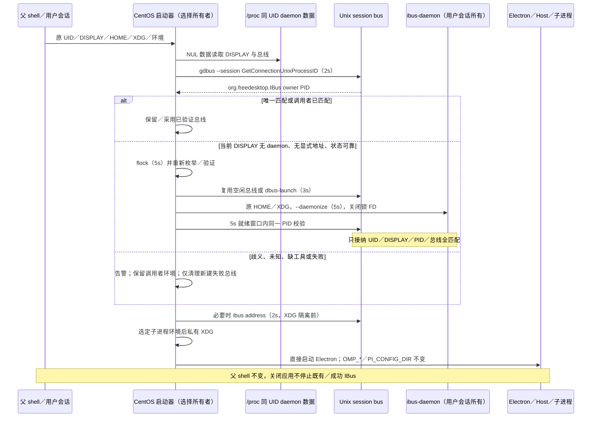

# CentOS 7 桌面与双平台发行规范

## 1. 权威、状态与实现边界

本规范是 `dev-centos7` 从当前上游基线重新实现 CentOS 7 桌面发行的 slice 0 交付，覆盖后续 slice 1–4；不是旧 `main` 的整体回灌。旧资料只通过 `git show main:<path>` 阅读，不 merge、cherry-pick 或 rebase `main`。没有因为旧代码存在就认定新实现完成。

根 [fork.md](../fork.md) 是需求入口。根文档已有 **FORK-004：OmpCode 产品身份、独立数据与 profile 隔离**，其编号、正文和效力不变；本次用户请求的 **FORK-004：CentOS 7 桌面发行** 是另一项同号请求，以根文档显式锚点 `fork-004-centos7-desktop-release` 和本文路径区分，不能默默重编号或覆盖原要求。现有 FORK-005 同样保留。

当前状态：**本规范修订不构成实现或验证证据；当前发行物、目标环境与新 workflow 验证均未完成。** 本次文档修订不运行任何检查，不启动或发布 GitHub workflow；本机验证记录由主执行者实际执行后补充。以下命令及检查均是待实施／待执行合同，不是通过记录。

### 1.1 不变基线与明确排除

- Windows 基线为 Electron **41.0.3**；当前 `packages/desktop/package.json` 的 Electron 声明保持 41.0.3，仓库提交的 manifest／lockfile 不切换为 28。旧 spec 的 44.x 不是本轮基线。
- CentOS 7 x64 目标为 Linux 3.10、glibc **2.17**、Electron **28.3.3**（内嵌 Node **18.18.2**、Chromium 120）。非 root 在 HOME 解压后启动，不安装宿主包，不联网补齐运行资产，不替换宿主 glibc、OMP 或用户安装。
- 不修改 UI 结构、入口、语言默认值、推荐内容、流式输出、动画或性能策略；不新增 `__OMPCODE_CENTOS7_DESKTOP__` 性能标记。不移植旧 CentOS zh-CN 默认值、网络锁定／离线拦截、遥测策略或日志静默策略。
- 不解析或归一化 `OMP_OFFLINE`，不派生 `OMPCODE_CENTOS7_LOCAL_ONLY`，不注入 `--offline`。OMP 自己解释所有 OMP 环境变量。不得以兼容打包名义恢复旧离线功能。
- 不修改业务根、sessions-index、tasks-index 的归属／迁移或 shm 活动根，不搬运用户数据，不创建 `~/.omp`／`~/.ompcode` 链接。不移植旧 shm、备份和自动恢复行为。身份与根目录遵循根文档已有合同，不在本文另立规则。
- 不新增或执行 CentOS 专用 UT、启动器回归、Linux／WSL／容器／VM／Citrix GUI 验收。本机只允许 Windows 门禁；GitHub 流水线只构建、装配及检查产物完整性，**不运行测试**。
- 发行只提供 Windows x64 EXE 与 CentOS 7 x64 ZIP 及各自 SHA256。没有 CentOS RPM、安装器、PRoot、Ubuntu rootfs 或用户可见的包装 runtime。开发工具不能进入发行路径。

## 2. 切片与交付合同

切片是可审查、独立提交的工程边界，不是缩小最终行为的理由；所有 slice 完成前不得宣称发行完成。

| Slice | 范围 | 完成条件 |
| --- | --- | --- |
| 0 | 根需求登记与本文 | 精确记录双 runtime、OMP、兼容层、IBus、双平台 workflow 与未验证边界；只改文档 |
| 1 | P0 启动器与 IBus | 安装目录重定位、帮助／参数转发及完整 IBus 选择／启动算法；不改变数据根 |
| 2 | 环境原样透传与 Windows UT | 启动器、Main、Host、OMP 准备／业务进程原样继承 `OMP_*` 与 `PI_CONFIG_DIR`；Windows 共享逻辑 UT |
| 3a | SQLite 兼容 | 共享 SQLite 单一驱动门面，保留 Windows 原生驱动及现有数据行为 |
| 3b | Electron／Node API 兼容 | 完整运行闭包 API 扫描及真实等价回退；Windows 41 不降级 |
| 3c | Host stdio 兼容 | 无效描述符不终止 Host、RPC、业务与结构化日志 |
| 4 | 原生资产、打包与双平台发布 workflow | 新鲜构建 glibc 2.17 native、完整资源／库／字体／许可及静态 ELF／manifest／ZIP 检查；重新实现 Windows 与 CentOS 两个入口，不运行测试、不实际触发／发布 |

实现复用当前仓库的 runtime assets、依赖闭包、asar 重组、native search、身份和 OMP artifact 所有者，不建立第二套平行发行系统。保留与本轮无关的上游源码及行为；只删除被本次切换直接淘汰的 fork 自有适配。

## 3. 构建工具链与临时依赖降级

### 3.1 工具与运行时分离

- 应用编译、pnpm、打包工具使用 Node **24.14.0**／pnpm **10.33.2**，与当前 Windows 工具链一致；不要把整个仓库切到 Node 18 或 Node 20。
- 原生模块和需要重编译的搜索工具在 glibc 2.17 x64 构建器以 GCC **11** 和 Node **20.19.0 linux-x64-glibc-217** 编译；Node 20 仅为 native 构建宿主，不是应用运行时，不进入 ZIP。
- 历史 Node 20.19.0 glibc-217 归档的 SHA256 为 `b06697853d80cbc2ca77408276a26234a83e9587a32a77161df2215cc3889a7f`。使用时必须验真；构建器镜像、源码、Electron headers、库／字体来源和依赖版本也要在构建计划中精确固定并记录摘要，不能依赖浮动 `latest`。
- `.node` 必须面向 Electron 28.3.3 的 headers／ABI 构建，而不是因 Node 20 编译成功就视为可加载。使用目标 headers、目标架构和编译标志；禁止 Node 24／宿主较新 glibc prebuild 混入。

### 3.2 临时工作区

CentOS 准备脚本在隔离临时工作区精确覆盖 Electron `28.3.3`、所有运行闭包中的 undici `6.23.0`，以及兼容审计确认必须降级的其他依赖。不能只钉 Desktop 的 undici 而漏掉 services／server 或嵌套副本。每项降级有版本、原因、作用域及锁定结果，禁止范围号、临时猜测或复用已删除旧分支 lockfile。

共享兼容封装所需 `better-sqlite3` **9.6.0** 放在 Desktop 的 **devDependencies**；不把 Windows 原生 `node:sqlite` 路径切为该驱动。CentOS 装配必须显式收集其 JS 运行闭包和目标 `.node`，不能依赖生产依赖收集器偶然保留 devDependency。新增该精确 devDependency 所需的正常 lockfile 更新可以提交；CentOS 临时 Electron／undici 覆盖及其解析结果不得回写源码工作区、提交或污染 Windows 构建。

Windows 保持正常 frozen-lockfile 安装；CentOS 在临时 manifest 上生成／使用精确锁定状态，必要的 `--no-frozen-lockfile` 只允许发生在该临时工作区。构建产物记录实际依赖闭包；只靠“顶层钉版”不足以证明可重现。

## 4. 当前 OMP artifact 与执行合同

### 4.1 单一权威与装配输入

OMP 接入沿用根 FORK-003 及其引用的 OMP 权威需求。实际业务为**外部 OMP app-server 进程内的 AgentSession 直接调用**，不是旧随包 JS adapter、旧 `glm/omp/omp`、`ELECTRON_RUN_AS_NODE` OMP 适配器或每个会话再起 RPC 子进程。不能回退旧 Agent、伪造准备结果或在 Host／UI 翻译协议。

- 显式非空 `ZCODE_AGENT_SERVER_COMMAND` 优先，显式空值报错。通用 Windows／默认发现合同不变：未设置时 Windows 标准安装位置后继承 PATH，Linux／macOS 继承 PATH。自包含 CentOS ZIP 的专用启动器可仅在用户未设置该变量时，将其设置为本包 `app/resources/omp` 中经 manifest 验证的真实入口；不覆盖用户命令、不把此选择扩展为通用默认发现规则。
- 默认参数 `omp app-server --stdio --surface desktop`，独立 args／cwd 覆盖、实际 workspace cwd、profile 及准备进程遵循现有合同。`--profile <name>`／`--profile=<name>` 如由启动器接受，应沿用有效名称规则、缺值／非法值报错和本次运行覆盖优先级，不建立新的 profile 设置体系。
- 外部 OMP 拥有配置、凭据、正文／队列、原生会话与工作流事实。Host 拥有连接／attachment 路由、监督与组织元数据。每个 window Host 的 workspaceKey 最多一个 app-server，可有多个同进程主会话；短生命周期 prepare-storage 进程不改变这一点。
- 准备和业务启动使用同一已解析执行端、参数、profile 和环境。沿用真实 storagePath／确认／storagePrepared／exit 0 监督合同；异常、EOF、取消或失败阻断业务启动。

装配输入为 `ZCODE_OMP_ARTIFACT_ROOT`。根 `omp-release.json` 精确包含 `{version, commit, protocolBaseline, artifacts: {<target>: <该平台 manifest SHA-256>}}`；平台 `<os>-<arch>/omp-artifact.json` 包含 `schemaVersion: 1`、相同版本／完整源码提交／协议基线、`target`、相对 `executable`、`files: {<完整运行资产相对路径>: <SHA-256>}`。协议基线为 **`c7c190724f3a00a2de998a0a5511201d5a2ba1a0`**。

由现有 `scripts/omp-artifact.mjs` 验证／装配；Desktop staging 为 `bundled-agents/<target>/omp`，发行位置为 `app/resources/omp`。Source Server 的 `runtime/omp` 及远端原有 archive 链路不在本轮另建。禁止越界文件、manifest 内符号链接、未列出的入口、另一平台二进制、虚构版本／提交／摘要；记录真实 OMP 版本／提交与 ZCode 触发提交。签名先于摘要，装配后不得改写 OMP 字节。

CentOS 输入不仅需标为 linux-x64，还必须实际满足 glibc 2.17、Linux 3.10 与完整 runtime closure；不能因 manifest schema 合法就认定现代 Linux OMP 可在 CentOS 运行。缺少真实兼容 OMP artifact 是明确的发行阻断，不得绕过、下载替代或拿旧 adapter 顶替。外部命令不强制具备随包 manifest；沿用既有准备／启动门验证可运行性。随包执行端在使用前按现有异步、流式摘要校验完整资产。

### 4.2 环境所有权（slice 2）

启动器 → Electron Main → Host → OMP 准备／业务子进程传递**全部继承的 `OMP_*` 与 `PI_CONFIG_DIR` 原值**，包括未知／未来 OMP 变量、空值、大小写与空白。不使用变量白名单，不去除前后空白，不映射别名，不重设配置根，不派生离线状态。除显式用户覆盖且符合现有启动合同外，各阶段不得过滤这些值。`OMP_OFFLINE` 仅由 OMP 解释，桌面不新增网络限制。

## 5. 运行时兼容与完整 API 扫描（slice 3a／3b）

### 5.1 单一 SQLite 门面（slice 3a）

所有本轮运行闭包内的 SQLite 使用同一共享封装，按实际 runtime 选择**一个**驱动：支持的现代 Windows runtime 使用原生 `node:sqlite`，Node 18.18.2 使用 `better-sqlite3@9.6.0`。不能双写、复制数据库、按调用点分别选驱动，不能静态导入缺失 builtin 导致 Node 18 在分支判断前崩溃。原生路径出错时不能泛 catch 后静默换驱动；只依据明确的 runtime 能力选择。

任务组织索引、自动化、Cookie 库及其他闭包调用方全部迁移同一门面，保留现有文件／schema／事务／pragma、读写权限、占位参数、同步返回、statement 生命周期、整数／BLOB／空值与错误行为；不得把 OMP 存储移交桌面。原生 Node sqlite 的具体构造器／选项不向 better-sqlite3 盲传；所需行为显式等价适配。Windows 与 CentOS 不另建数据模型，不执行用户数据迁移。

### 5.2 已知必查面（slice 3b）

- Electron：附件 `webUtils.getPathForFile` 存在时优先使用，仅缺能力时回退 `File.path`；两条路径均不得把空路径当有效本地附件。历史导航按能力选择 `webContents.navigationHistory` 或 Electron 28 的既有导航方法，保留 canGoBack／canGoForward、后退／前进、清除／跳转等实际使用语义。
- Node：`node:sqlite`；`fs/promises.glob`、`fs.glob` 及相应导入；`import.meta.dirname`／`filename`；较新的 fs／path／module／util／crypto／stream API 和构造参数；全局 fetch／Web API 及 undici 的 Node 版本需求。glob 必须真实保留实际调用所需模式、exclude、cwd、目录项、迭代／异步语义，不用空数组或仅单层 readdir 代替。
- JS／Chromium：实际使用的语言语法、内建方法和浏览器 API 在 Node 18.18.2／Chromium 120 的可用性，包括仅较新 runtime 提供的 Promise、Array、String 方法；按真实使用审查，不能因 TS 编译成功认定运行兼容。
- 全部 Electron imports／属性／方法／事件／选项及返回值合同，Main、Host、preload、worker、scheduler、renderer 和实际打包工具子运行时；检查启动阶段副作用和间接依赖。Node 24 纯构建脚本与应用 runtime 明确分区，前者无需无理由降级。

### 5.3 完整运行闭包扫描（slice 3b）

对实际运行闭包中的 Electron、Node 与 JS／浏览器 API 做全量扫描，不限于上述已知差异或本次 diff。范围包括 Main、Host、preload、worker、scheduler、renderer、相关 workspace 包和实际打包的传递依赖；区分 Node 24 纯构建脚本与 Electron 28.3.3／Node 18.18.2／Chromium 120 应用运行时。

slice 3b 必须将扫描交付为构建期可执行检查脚本 **`node scripts/audit-centos7-runtime-apis.mjs --check`**，并维护机器可读 API 库存。库存记录扫描范围、调用位置、运行域、最低版本依据、目标可用性及真实等价回退；检查覆盖别名、动态导入和间接依赖，未知或未处理的高版本 API 不得静默通过，不能只查四个名字或因编译成功就认定兼容。Windows 共享兼容 UT 仍需补齐现代分支与缺能力分支，但本轮不执行；构建期 API 静态检查不是运行时测试，其结果也不能冒充 CentOS 实机验收。

## 6. 原生资产、库与 ZIP（slice 4）

### 6.1 资产清单与落位

唯一 CentOS 外发名为 `OmpCode-<version>-centos7-x64.zip` 和同名 `.sha256`，ZIP 内单根 `OmpCode-<version>-centos7-x64/`：

```text
OmpCode-<version>-centos7-x64/
  bin/ompcode-centos7
  app/<Electron executable and its complete distribution resources>
  app/resources/app.asar
  app/resources/app.asar.unpacked/<native runtime module paths>
  app/resources/omp/<validated linux-x64 OMP artifact and manifest>
  app/resources/tools/bfs/bfs
  app/resources/tools/ugrep/ugrep
  app/resources/tools/ripgrep/<existing runtime plan executable>
  lib/<resolved glibc-2.17-compatible non-glibc runtime closure>
  fonts/<redistributable CJK fonts and font configuration>
  LICENSE
  NOTICE.md
  <third-party and font license files>
```

可执行文件名、搜索子路径及第三方 notices 文件名复用当前 packaging plan，不能为迁就历史 `app/zcode` 或旧 `glm/omp/omp` 路径复制另一份 runtime。树中尖括号是布局约束说明，不是允许用占位文件完成交付。

必需 native stage 至少包括：

- `app/node_modules/better-sqlite3/build/Release/better_sqlite3.node`；
- `app/node_modules/node-pty/prebuilds/linux-x64/pty.node`，以及 node-pty 当前包实际需要的 helper／JS；
- `app/node_modules/cpu-features/build/Release/cpufeatures.node`，由 ssh2 闭包实际消费；
- `app/resources/tools/bfs/bfs`、`app/resources/tools/ugrep/ugrep`；当前 Linux 搜索还需 ripgrep，必须携带现有计划规定的兼容资产，不能只带前两项。

native stage 的 `app/node_modules` 合并进 `app.asar` 的模块结构，`.node` 和必要可执行 helper 按现有规则放 `app.asar.unpacked`；搜索进入 `resources/tools`。不可把 native 随意复制到 Electron 可执行文件旁来掩盖错误解析。检查 asar 内 JS 与 unpacked 二进制匹配，没有较新宿主 prebuild 或其他平台副本抢先命中。现有 search 默认 Linux glibc 2.28 资产不能未经重编译／验证直接用于 CentOS；保留工具版本和搜索／压缩格式能力，不因兼容删除功能。

SSH 使用 `ssh2` 的 JS 路径和 Electron 内建 crypto；**asar 与 unpacked 中均禁止 `sshcrypto.node`**。历史原因是 Electron 28 的 OpenSSL 1.1.1 与 Node 20 构建头文件 OpenSSL 3 不匹配，不通过“模块可加载”判断可用。不要全删 ssh2、cpu-features 或必要 JS 依赖。

### 6.2 ELF 与动态库完整性

对 native stage、组装树以及最终 ZIP 解包树中的**每一个 ELF**递归检查，不以扩展名筛选：Electron、本地可执行文件、`.node`、`.so`、搜索、OMP 及其内嵌／外置可发现 native 都在范围内。记录 x86-64 架构、解释器、DT_NEEDED、RPATH／RUNPATH、版本符号与解析来源。

- 任一 `GLIBC_*` 需求大于 **2.17** 即失败；不捆绑 glibc、动态 loader 或以 LD_PRELOAD 替换宿主 libc。无法检查 OMP 内嵌 native 的输入必须提供可核对的生产清单和兼容证据，不能直接略过。
- 核对完整传递 DT_NEEDED 闭包；缺少宿主基线保证的非 glibc 库必须随包提供。C++ 运行时含 `libstdc++.so.6`／`libgcc_s.so.1` 及各自所需 GLIBCXX／CXXABI 符号，来自 glibc 2.17 可用工具链，不从现代 runner 任意拷贝。
- GTK／GLib／GObject／GIO、ATK／AT-SPI、Pango／Cairo／GdkPixbuf、X11／XCB／XKB、NSS／NSPR、ALSA、DRM／GBM、fontconfig／FreeType 及图形相关库按实际 ELF 闭包收集兼容版本，保留 SONAME 链接与合法 loader／font 配置。不能用一份有限名字清单取代完整解析。
- 区分宿主固有内核／图形会话服务和包内库；不声称静态 ELF 合格足以保证 Citrix XKB／GLX。拒绝构建器绝对 RPATH、越界链接、解析到现代构建器库或未声明的用户路径。
- 新增其他 native（如实际启用的图像、FFI、CUA 依赖）必须进入同一清单和 ABI／ELF 审计，不能只验三个已知 addon。无需本轮功能的其他平台资源按现有策略排除，不删除上游功能源码。

### 6.3 字体、许可与归档

即使宿主无 CJK 字体，包内合法可再分发字体仍须覆盖简体中文设置、菜单、正文和代码，同时英文可读。字体选择及版本／来源／摘要明确固定；打包真实字体文件、字体许可（如实际选用字体的 OFL）、fontconfig 配置与依赖，保证应用进程能发现它们。不能只放一份未使用字体或依赖联网下载；不改变语言默认值或 UI。

保留项目 LICENSE／NOTICE、Electron／Chromium notices、native 模块、搜索、库和字体的全部适用再分发许可及归属。来源／摘要／许可缺失、空文件、必需文件缺失、非可执行权限、悬空／逃逸链接都阻断打包。

阶段间使用 tar 经 workflow artifact 传输以保留权限与符号链接。ZIP 创建保留 Unix 执行位和包内相对符号链接，重定位和含空格路径可用；最终检查归档结构、CRC、唯一顶层根、实际条目模式、无绝对／`..` 路径、无 PRoot/rootfs、无构建 Node／编译器。OMP manifest 的禁止链接规则独立于 ZIP 库 SONAME 合法链接规则。

最终字节生成后写 SHA256 sidecar，格式为 `<lowercase sha256>  <archive basename>`；下载阶段重验同一文件。不能先计算摘要再改资源／签名／重压缩。只输出已满足 ELF、manifest、依赖闭包、字体许可和布局约束的 ZIP。

## 7. 启动器与 IBus（slice 1，P0）

### 7.1 启动器职责

`bin/ompcode-centos7` 从自身真实路径解析安装目录，不依赖启动 cwd；启动打包的 Electron，传递 `--no-sandbox` 和默认 `--disable-gpu`，保留软件渲染。用户需可用图形会话。Electron 28／Chromium 已停止维护且禁用 sandbox 是显式安全限制，发行说明提醒避免不可信工作区，不能隐瞒。

启动器只设置应用子进程的库路径、字体发现及既有私有 XDG 环境。**先**按原 HOME／XDG 和原 DISPLAY 完成 IBus 发现，再进行 XDG 隔离；不改宿主配置、不修改父 shell。正常参数依现有合同转发；`--help`／`-h` 在包文件检查、数据目录创建、IBus 或 Electron 之前打印帮助并成功退出，不因 OMP_OFFLINE 静默。帮助说明原样透传的 OMP 环境与 profile，不引入 `--home`／`--offline` 或根目录迁移。

### 7.2 IBus 所有权与算法

仅 CentOS 启动器拥有本次应用的输入法环境选择，IBus daemon 和成功的新会话总线归用户会话，不归窗口生命周期。仅 X11 且选择 IBus／没有显式替代输入法时运行此算法；保留显式替代 `GTK_IM_MODULE`／`XMODIFIERS`，不强制引擎。无 DISPLAY、缺工具或失败必须给出具体告警并继续启动 Electron，不能挂住应用。

1. 捕获初始 UID、**完整原 DISPLAY**、HOME／XDG 与调用者总线。只选择同 UID、与原 DISPLAY 完全相同的 `ibus-daemon`。按 NUL 分隔数据读取 `/proc/<pid>/environ`，绝不 source／eval，也不执行其中内容。未知 DISPLAY、读取失败和进程消失保守处理，不猜测。
2. 候选只接受本地 Unix session bus。以命令局部 `DBUS_SESSION_BUS_ADDRESS` 调用 `gdbus --session`，查询 `org.freedesktop.DBus.GetConnectionUnixProcessID(org.freedesktop.IBus)`，返回 PID 必须等于候选 daemon PID；每次探测 **2 秒**限时。UID、DISPLAY、PID 与总线全部匹配才有效。
3. 调用者总线已匹配并通过时保留它；否则只采用**唯一**通过校验的候选。多候选歧义、不可靠进程／总线或缺工具只告警并保留调用者环境，不任意挑第一个。
4. 无可验证候选时，仅当当前 UID **没有当前 DISPLAY 的 daemon**且没有显式 `IBUS_ADDRESS` 才允许自动启动。明确可读且属于其他 DISPLAY 的同 UID daemon 不阻止当前 DISPLAY；当前 DISPLAY 已存在但无法验证、未知显示归属、进程查询失败、歧义或显式地址均禁止替换／二次启动。
5. 在原用户缓存目录使用 `flock`，等待最多 **5 秒**；取得锁后重新枚举和校验，复用并发启动器刚建立的有效会话。锁 FD 不传入后台进程。
6. 可连接且尚未注册 `org.freedesktop.IBus` 的调用者本地 Unix 总线可复用；否则 `dbus-launch --close-stderr` 建用户新总线，最多 **3 秒**。输出按明确键值数据解析并校验地址／PID，不使用 eval 或把二进制输出按 shell 分词。
7. 原 HOME／XDG 下执行 `ibus-daemon --daemonize`，命令最多 **5 秒**；不使用 `--replace` 或 `--xim`，不接管共享 X server 的全局 XIM，不停已有 daemon。启动后在 **5 秒就绪窗口**内沿用同一 UID／DISPLAY／owner PID 校验路径轮询，每次查询仍最多 2 秒且不无限延长窗口。
8. 只有完全就绪才向 Electron／子进程导出选定总线。失败只清理**本次新建**总线，保留已有总线与 daemon，告警并继续。成功新会话由用户会话持有，关闭应用不主动停止它。
9. 未设置／空 `GTK_IM_MODULE` 与 `XMODIFIERS` 分别默认 `ibus` 与 `@im=ibus`；非空显式替代保持不变。显式 `IBUS_ADDRESS` 原样保留；缺失时在 XDG 隔离前、原 HOME／XDG 与选定总线上执行 `ibus address`（最多 **2 秒**），按结果设置应用子环境。失败不改持久配置、不强制引擎。



P0 原因：历史 IBus 1.5.17 GTK 模块独立监视 session bus 上的 `org.freedesktop.IBus`；只有私有 IBus 连接、libpinyin、FocusIn／光标通知不证明按键已启用。owner name 缺失时 `_daemon_is_running` 为 false，按键落入 simple input。目录链接不能修复分裂总线。必须保留同账号 DISPLAY A 已有、B 尚无时允许 B 单独建立会话的规则；未知归属仍禁止猜测。

### 7.3 Host 无效 stdio（slice 3c）

Main 创建 Host／工具子进程时使用自有 stdout／stderr 管道及既有结构化日志通道，不继承可能由 Citrix／shell 关闭的描述符。处理同步 write 错误与异步 stream `error`，`EBADF`／`EPIPE` 只使对应原始输出 sink 不可用；Host、RPC、业务状态和结构化日志继续工作，不能出现未捕获异常或日志递归。其他错误仍按现有通道可见，不 blanket catch／全局忽略异常，不新增平行日志系统或改变日志等级策略。

## 8. 双平台 GitHub 发布（slice 4）

主执行者已通过 `git show main:.github/workflows/` 阅读旧 main 的 workflow 目录，确认两个入口：**`.github/workflows/release-windows.yml`**、**`.github/workflows/release-centos7.yml`**。两者都迁入本次重新实现范围；不是只做 CentOS。只借鉴其装配／发布要求，不整份迁入旧运行时、旧 OMP 路径或旧测试行为。

### 8.1 共同行为

- 两个 workflow 都保持手动 `workflow_dispatch`。只接受 **`refs/heads/dev-centos7`**；错误分支立即失败，不继续从 main 构建。每个 checkout／构建／打包 job 固定 **触发的 `github.sha`**，不能再次解析移动分支头；发布 `--target` 使用同一 SHA。
- OMP 外部输入由 repository variables **`OMP_ARTIFACT_REPOSITORY`、`OMP_ARTIFACT_RUN_ID`、`OMP_ARTIFACT_COMMIT`** 和 secret **`OMP_ARTIFACT_TOKEN`** 提供：固定生产仓库、已成功完成的 producer run ID 及完整源码提交，从该 run 下载对应平台 **`omp-zcode-<target>`** artifact，`<target>` 沿用现有 OMP artifact 平台合同。下载前核对 producer run 成功状态及源码提交，验证 manifest 时将该提交传为 `expectedSHA`，确保真实来源与预期一致。token 仅用于读取该生产 artifact，不代替发布用的默认 token。这些真实固定输入是打包前提；缺失或不匹配明确失败，不取 latest、不虚构值、不从移动分支推导替代提交。
- 使用 Node 24.14.0／pnpm 10.33.2。生成日期时间 tag `v<UTC yyyyMMdd-HHmmss>-<run_id>-<run_attempt>`，校验 ref 格式、远端不存在同 tag；网络检查失败不当作不存在。tag 由校验／构建 job 单次生成并输出，发布 job 精确消费，重跑全部 jobs 不复用旧 tag。
- GitHub **不运行 UT、typecheck、lint、architecture 测试、E2E、GUI／启动器／SSH 握手或其他执行测试**。构建器实际编译与生成声明文件所需的编译命令可以保留，但不能用 standalone `pnpm typecheck`／`tsc --noEmit` 冒充打包必需项。检查打包脚本调用链，不能顶层删除 test step 后仍由 bundle hook 间接运行测试。
- 保留纯产物完整性约束：必需资产／大小、运行闭包、manifest／SHA256、ELF／ABI 静态信息、asar／ZIP 布局、权限／链接、CRC 与许可。这些是打包失败条件，不是测试通过证据。**旧 `verify-ssh.mjs` 回环握手即使曾称为完整性约束，本轮也不得执行或间接调用。**
- 最小权限：构建／装配 job `contents: read`，发布 job `contents: write`，使用 workflow 默认 `GITHUB_TOKEN`；不写死 PAT，不把 main 与默认 token 的历史关系当作 dev-centos7 已有权限证明。若仓库政策不允许触发提交／tag 的发布，应明确失败，不偷偷改发布目标或放宽规则。
- 各平台独立 artifact 与发布链，仅发布其校验通过的唯一成品及 sidecar。先创建 draft，核对上传资产名与大小／checksum，再取消 draft；失败不宣布正式发行。日期 tag 不改变应用 semver 文件名。发行说明如实记录未签名、安全限制及未验目标。
- 当前任务只实现 workflow 文件，**不得 dispatch、推送触发、等待、下载本次运行产物或实际创建／发布 release**。workflow 源码存在不等于 GitHub 已成功执行。

### 8.2 Windows workflow

使用 `windows-latest` 构建 Windows x64，正常 frozen lockfile、Electron **41.0.3**，复用现有 `pnpm bundle:desktop -- --os=win --arch=x64` 装配链及当前 OMP artifact 合同。不得应用 CentOS 临时覆盖或降级 Windows runtime。

输出 `OmpCode-<version>-win-x64.exe` 与 `.exe.sha256`，保持旧发行的唯一安装器、存在性及至少 50 MiB 大小约束；保留 installer 归属、项目许可和 OMP manifest 校验。签名状态必须真实，不把 unsigned 打包当作签名安装／双装验收。发布 job 下载固定本次 artifact，验证 SHA256 后按共同规则发布。

### 8.3 CentOS workflow

`preflight` 输出应用版本和 tag；通过后 `desktop` 与 `native` 在不同 runner 并行，新鲜构建。前者在临时依赖工作区产出 Electron 28 desktop，后者在 glibc 2.17／GCC 11 环境产出 native 和库。所有阶段固定触发 SHA、同一 OMP release 输入与精确依赖计划。

两组产物 tar 经 artifact 传递到依赖它们的 `package` job，重组 asar／unpacked、字体、库、OMP 与 launcher，再按第 6 节进行完整静态校验、生成 ZIP 和 SHA256。`publish` 仅下载此 package job 的 ZIP／sidecar。禁止缓存 native stage、最终 ZIP 或解包 app；依赖下载缓存不能代替每次原生编译与校验。构建器内部安装开发依赖不等于要求最终用户 root／宿主装包。

## 9. Windows 门禁、证据与未验证清单

### 9.1 每个切片的本机四项检查

原合同对**每个 slice（包括仅文档的 slice 0，以及 1、2、3a、3b、3c、4）**均记录以下 Windows 四项检查；`<slice-start>` 是该片开始前记录的真实基准提交，不是固定 main 或随意选择的提交。**最新执行指令优先：本轮只写代码，不执行任何测试、门禁或 formatter；主执行者仅进行必要静态检查／构建 smoke，不运行下列四项。** 已实际执行的基线检查事实不撤销、不重跑，由主执行者在最终证据中如实记录：

```powershell
pnpm --config.use-node-version=24.14.0 typecheck
pnpm --config.use-node-version=24.14.0 lint
pnpm --config.use-node-version=24.14.0 test:unit:affected --base <slice-start>
pnpm --config.use-node-version=24.14.0 architecture:check --changed
```

必要的一次依赖安装／现有包构建准备不冒充上述检查；UT 选择合同仅为 `test:unit:affected --base <slice-start>`，不是完整或白名单 `test:unit`，也不能把选择范围写成全量 UT 通过。本轮仍交付 slice 3b 的构建期 API 检查脚本与机器库存，不因暂停测试／门禁执行而省略实现。Windows 本机检查与 GitHub 仅打包政策分别成立，不向 workflow 添加测试门禁；构建期 API 静态检查属于兼容打包约束。真实验证记录由主执行者后续补入，不由本次文档修订预填结果。

Windows 适用断言包括：现代及缺能力 API 分支、真实 SQLite 行为、环境逐字节继承（含未知 OMP 变量和空白值）、profile 转发和无效 stdio 后结构化日志持续；不新增 CentOS 专属运行测试。已有架构失败或其他未通过项如实记录，不能放宽规则制造全绿。

### 9.2 历史材料不等于新验证

旧 `main:docs/requirements/centos7-release.md` 已完整阅读，以下只保留为**历史报告**：Electron 29.4.6 曾观测需要 GLIBC_2.18、30.5.1 需要 GLIBC_2.25，官方 28.3.3 曾在 glibc 2.17 非 root 环境打开窗口；这些不是本轮包、当前 OMP 或目标 Citrix 的新验证。

旧文档记载手工对齐 IBus 总线后中文恢复、另一用户手工新建总线后 PID 验证成功；2026-10-09 仅有静态／语法检查，2026-10-19 有 Windows Git Bash 桩覆盖 DISPLAY 判定。都不能证明本轮自动启动器、真实并发、多用户环境或打包产物已验收。旧 Windows 44／main-only／旧 OMP adapter、离线门控、语言／性能／shm 要求不迁入本规范。

### 9.3 必须保持未验证标记的项目

- 新 CentOS ZIP 的真实构建、所有实际 ELF／库闭包、Electron ABI 加载、字体发现与 OMP glibc 2.17 兼容性；
- Linux 3.10 非 root GUI、终端、搜索、SSH、真实 OMP 会话和存储准备；
- Citrix X Server XKB／GLX、软件渲染、无 CJK 宿主中文显示、真实 IBus 分裂总线／自动启动／并发／多 DISPLAY；
- 安装目录搬迁、真实 HOME 空格路径、全部 target 图形依赖和用户环境组合；
- Windows 新 EXE 安装／双装、签名，以及 CentOS 安全限制之外的任何安全保证；
- 两个新 workflow 的 GitHub 运行、默认 token／分支策略、artifact 传输、tag 生成、draft 到发布及最终线上资产；
- 上述各 slice（含 0）的本机四项检查与完整 API 扫描，直到主执行者实际执行并补充记录。

这些是准确的证据边界，不是新增 Linux 测试计划，也不能把“不要求执行”写成“已通过”。**不新增任何 CentOS 7 相关 E2E；中文输入、GUI、SSH 与 CentOS 实机运行由用户自行在内网验证，不作为本次代码交付的自动验收阻塞项。** Windows 本机共享兼容 UT 与四项门禁保持不变。缺少 OMP 真实兼容产物、许可来源或静态闭包证据时仍阻断对应发行产物装配，并指出具体缺项；这些静态打包约束不同于用户实机验收，不能给占位文件或宣称完整发行已验收。
