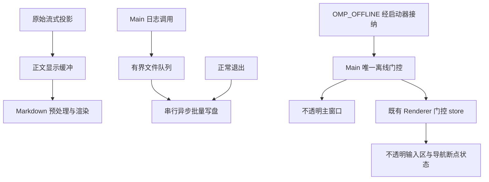

# CentOS 7 无 GPU 桌面性能

## 范围与依据

- 视觉与流式显示策略仅随 CentOS 7 发布构建启用（`__OMPCODE_CENTOS7_DESKTOP__` 构建标记）：减少动画、100ms 流式正文显示合并；Web 及 Windows 桌面构建保持原行为。该策略与 `OMP_OFFLINE` 离线锁定相互独立，不因锁定开关改变。
- 额外的窗口缩放优化仅在 CentOS 启动器接纳 `OMP_OFFLINE`、Main 的既有 `OfflineGateState.localOnly=true` 时启用：主窗口改为不透明底色；消息区取消动态渐变遮罩，输入区内容列及其留白使用不透明背景遮挡历史；历史导航宽度只在跨越既有断点时提交状态。非离线 CentOS、Windows、Web 保持原行为，不降低消息完整性或继续调整流式刷新频率。
- 静态证据：`MessageResponse` 原先对每次文本变化执行 citation、图片和数学文本预处理；`logger.write` 每条日志同步 mkdir/appendFile。正文 Streamdown 淡入本来已经关闭，不重复实现。
- CPU 软件绘制及共享远程 X 显示的实际收益不能由本地结果推断；目标主机仍未验证。本次取消 CentOS 专属自动测试及公司环境专项测试，不要求 AI 为验证进入 Linux、WSL、VM 或 Citrix，产品性能策略仍保留。

## 所有者与时序

- UI 根负责 CentOS 专用视觉策略：缩短 CSS 动画和过渡到完成态、停用背景模糊和平滑滚动；保留结束事件、布局、提示及功能。系统减少动画偏好同时供已有 JS 动画读取。
- `MessageResponse` 只缓冲展示文本，最多每 100ms 发布一次最新累计文本。首段、完成/中止、正文替换以及身份切换立即显示，取消旧定时器；卸载时取消。原会话投影、复制/保存、seq 和 Host 传输不改变。预处理和 Markdown 子树只消费缓冲后的文本。
- 离线绘制状态仍由 Main 唯一裁决：创建窗口时直接传给窗口外观选项，Renderer 经既有平台门控 store 读取同一事实，不另读环境变量、不新增持久设置。导航保留原断点、目录补拉、虚拟测高、滚动锚点及冷恢复；仅减少断点内无意义的宽度状态变化。
- Main 文件日志 writer 是唯一队列所有者：同一轮连续同文件日志合并，按入队顺序串行异步落盘；目录操作也异步。时间与容量上限必须在代码中显式定义为常量并被回归测试引用（CentOS 7 分支已验证的参考值为 25ms 合批窗口与 4MiB 队列上限、不含正在写的一批；实现可调整数值，但必须保持显式与被测试覆盖）。超限的文件日志计数并在后续文件记录中报告，允许的日志同时写入 console。磁盘错误不传播至业务调用，也不触发无限重试。该异步路径为唯一写盘路径，Windows 构建同样受益；不为单一平台维护第二条同步写盘路径。
- Main、Host 与 Renderer 的应用日志级别唯一遵循 [日志基础设施](logging.md) 的 `JCH_LOG_LEVEL`；离线绘制降级不改变日志策略，不再将日志压至 error。过滤仍在序列化、终端打印、跨进程转发和文件排队之前；连接进度与用户可见消息属于功能事件，不受日志过滤影响。
- 正常退出在 Host 清理后及最终退出前排空日志，共用最多 1 秒总预算，不逐次累加等待；强杀、磁盘失败或超时不保证日志落盘。

## 验收

本节保留产品行为与共享逻辑的 Windows 适用断言，不要求运行 CentOS 专用 UT、Linux 组件/GUI 或公司目标主机测试；现行测试计划见 [三级测试需求](test-gates.md)。取消测试不等于 CentOS 性能已验收。

- 同一组连续增量合并后最终全文一致，发布次数减少；持续输入不能无限延期，完成/切换/卸载不遗留旧文本或计时器。
- CentOS 发布构建的动画时长、结束事件、消息完成态和切换行为遵循上述策略；Windows 构建不减少动画。保留 Windows 本机验证，不另行执行 CentOS 浏览器或 GUI 测试。
- 构建标记只影响根视觉策略与正文显示合批；未启用 `OMP_OFFLINE` 的 CentOS 7 与 Windows 使用相同 reporter、目录及状态订阅路径。已退役的 ZCode 账号恢复两平台统一关闭，不以构建标记决定是否恢复账号。
- 模拟慢磁盘时日志调用不阻塞事件循环；同文件合批、跨日/目录顺序、失败恢复、队列上限、退出 flush 均有回归测试。
- 离线锁定与普通模式均遵循 `JCH_LOG_LEVEL`，DEBUG 不因平台或生产构建被关闭；功能事件（连接进度、用户可见消息）不受影响。
- 滚动、打字、流式回答及退出仍须满足产品行为；本地 Windows 测试只报告实际覆盖范围，不宣称公司 CentOS 7 的体验已验证，也不将目标主机测量作为 Windows 测试前提。
- 关闭或未设置 `OMP_OFFLINE` 时主窗口透明参数、消息渐变和逐像素宽度处理保持原样；启用时输入区留白不透出历史、输入和导航仍可点击，滚动、回到底部及跨断点导航行为不变。异步门控到达或切换不得重置离底阅读位置、滚动跟随和草稿。Windows 本机隔离组件冒烟只证明模式切换和布局行为，不证明 CentOS/远程桌面性能收益。

## 实现与验证状态

需求从 CentOS 7 专有分支的 spec 迁入并按单分支、`OMP_OFFLINE` 环境门控决策调整范围表述；未因当前实现降低要求。统一证据边界见 [需求索引](README.md#实现与验证状态)。

2026-10-09 文档核对曾记录 Main 初始化同步 mkdir 的缺口；当前源码已使用异步 `mkdir` / `appendFile`。日志级别、轮转与初始化验收统一维护于 [日志基础设施](logging.md)，历史测试不作为当前快照的通过结论。

- 2026-10-19：离线专用不透明主窗、消息遮罩降级及导航断点状态已实现。Windows 隔离 Electron 短冒烟使用真实时间线组件，验证普通/离线切换、断点附近缩放、明暗主题、草稿和输入操作、历史滚动、回到底部及离底阅读位置保留；主进程窗口模块类型诊断通过。未运行 CentOS、目标远程桌面或完整产品 E2E，不声明内网性能收益或 Linux 原生窗口效果已验收。
