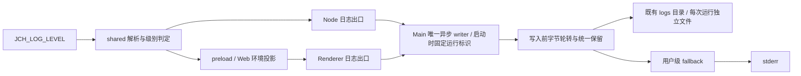

# 日志基础设施

## 产品规则与所有权

- 日志基础设施初始化遵循 `jch-logging-init`；不新增业务日志点、业务调用包装或跨文件关联链路，不改变业务结果。
- 唯一级别配置为继承的 `JCH_LOG_LEVEL`：去除首尾空白、不区分大小写，接受 `debug`、`info`、`warning`、`error`；未设置或无效时为 INFO。内部既有 `warn` 事件/字段拼写保留。用户环境变量不由应用或初始化任务修改；Windows 用户级变量需由新启动的父进程继承。
- DEBUG 包含四个级别，不采样；生产构建与离线锁定不再另行压低日志级别。既有显式测试日志禁用开关仅供隔离验证使用。日志级别不改变离线功能门控、连接进度或用户可见事件。
- `packages/shared` 拥有无 IO 的级别解析与判定；Node 进程读取继承环境，Desktop preload 在页面初始化前只读投影同一配置，Web 构建/开发服务器投影启动环境。Main 是桌面文件写入、轮转与队列的唯一所有者；Host、Renderer、服务与适配器复用现有共享 API 与转发链路。
- 保持既有 `getAppConfigDir()/logs`、本地日期前缀与 `.log` 扩展名、测试隔离目录及用户级 fallback 目录；不迁移日常日志。每个 Main 进程启动生成一次独立运行标识（启动时间、PID 与随机 UUID），活动文件名为 `YYYY-MM-DD.<运行标识>.log`，轮转历史为 `YYYY-MM-DD.<运行标识>.<序号>.log`。同日重跑、PID 复用或多个 Main 进程使用同一目录时不得追加到其他运行的文件；同次运行内 Host/Renderer 仍经现有链路汇入 Main，不拆分转发或改变记录中的来源 PID。stdout 为协议的进程继续只向 stderr 输出诊断。
- 单文件最多 1,048,576 字节，活动文件与本基础设施确认拥有的历史合计最多 10 个；原有 14 天过期限制保留，由同一保留机制同时处理年龄与数量。写入前按 UTF-8 字节计数并按完整记录轮转；只删除严格匹配本 writer 新旧命名规则的普通文件，不删除其他文件、目录或符号链接，不截断既存历史。旧日期活动文件与数字序号历史仅参与保留清理，不再追加或迁移；同日文件按运行启动顺序、运行内轮转序号由旧到新清理。
- 保持异步 IO、25ms 合批、显式有界队列与退出最多 1 秒总 flush 预算。过载丢弃属于有界队列保护而非 DEBUG 采样，沿用丢弃计数报告。日志故障不使业务失败；正常目录失败后尝试一次既有用户级 fallback，再保留 stderr；测试隔离目录不得逃逸到日常数据。
- 记录维持单物理行、毫秒时间与既有 event/身份字段契约，异常保留安全的类型、消息与代码；复用既有脱敏，不记录秘密、文件正文或批量载荷。沿用 logger 获取、事件发射、异常上下文与耗时 API，不建立第二套业务包装。
- 正常关闭必须按 [会话资源生命周期](session-recovery.md#产品规则与所有权) 完成订阅释放后才销毁 transport，不生成自身关闭竞态导致的 unsubscribe/flow disposed 错误或 task-index cleanup failed。真实断连、RPC 拒绝和清理失败仍经原日志链路可见，不将失败降级为正常清理。
- 已关闭的上游 CUA Helper/PiP 必须在生产者装配处复用现有功能边界：不创建 PiP 焦点路由、服务实例或生命周期回调，不订阅专用 active-task 同步，不向禁用服务发送事件。普通窗口焦点、Host 生命周期及 OMP 原生电脑工具保持原路径；真实已启用链路的缺服务、传输与交付失败仍保留原日志，不通过过滤警告或返回假成功消除正常操作噪声。

## 验收场景

1. `debug` / `DeBuG` 均启用四级；`warning` 仅启用 WARNING、ERROR；`error` 仅启用 ERROR；未设置、空串、`warn` 与其他无效值均回落 INFO。
2. 生产构建、离线锁定与普通开发态同样遵循配置；DEBUG 不因构建模式在适配器、服务、Host 中继或 Renderer IPC 丢失。测试禁用开关保持有效，连接进度不被诊断过滤吞掉。
3. 连续多字节记录在完整记录边界轮转；新写入文件均不超过字节上限，活动与拥有的历史总数不超过 10。跨日、重启与已有 14 天过期历史使用同一个保留机制；无关文件与链接保留。同日先后启动的两个 Main 进程写入不同文件，前次文件内容不变；同时运行也不得混写。运行内多次 flush 仍使用同一活动文件；跨日保留同一运行标识并更换日期前缀，轮转保留所属运行标识。旧日期日志不被重新打开追加，仍受既有年龄与数量限制。
4. 普通目录失败可进入既有用户 fallback；fallback 也失败时仅向 stderr 报告，业务不抛出日志异常。隔离验证不写日常目录。
5. 静态核对根 `AGENTS.md` 包含唯一提醒：`Key steps and exception branches in this project must have logs.`
6. Host 原始 console 写入或 stdout/stderr 的异步输出失败时，`EBADF`/`EPIPE` 不终止 Host，原日志继续经既有 Main 中继；其他输出错误经同一结构化通道报告安全的类型与错误码，不静默吞掉、不递归写入故障终端、不改变业务结果。此场景细化 [Host 输出边界](centos7-release.md#product-behavior)，不新增日志 writer 或重试。
7. Service Logger 模块可由无 Node `process` 的 Renderer/Web 安全导入并创建：复用浏览器 console/注入 sink 与共享级别、脱敏规则；PID 仅来自真实 Node 进程或显式注入，没有 PID 时按既有前缀规则省略。stderr 监听与最终故障出口只属于具备该流的 Node 环境；浏览器 sink 失效不得访问 Node API。Node 仍只报告一次 sink 故障，日志错误不改变业务结果。
8. 完成真实桌面对话并正常关闭，检查该运行的 stderr 和持久日志：正常关闭无自身释放竞态引起的 disposed/订阅清理失败；注入真实 RPC/transport 失败时，原始失败仍可见。仅正常关闭验收不能证明故障分支已验证。
9. 在上游 CUA Helper 关闭的真实 Windows 桌面正常启动、激活/失焦窗口与切换任务：无 PiP 专用订阅/IPC/Host 投递，不出现该无效生产者引起的 `focus event dropped: service unavailable` 或 `event delivery dropped / service-disabled`；普通窗口交互和 OMP 原生电脑工具不受影响。启用链路的真实失败日志保持可见；未执行真实 GUI 不计通过。

## 实现与验证状态

初始化任务以静态检查为主；上级规则要求的最小运行验证仅使用隔离临时目录与短桩，不运行 fulltest/slowtest，不向日常日志写样例。未执行的完整桌面 GUI、真实 OMP 和 CentOS 7 边界不计为通过。

- 本次静态检查与隔离运行验证已覆盖：级别归一化、生产/离线 DEBUG 与 WARNING 阈值、异常 cause/代码脱敏、适配器 stderr 与协议 stdout 隔离、Service Logger → Host relay → Main 的原 PID/event 保留、真实 preload → Renderer → IPC 的四级交付，以及主目录失败后的用户级 fallback / stderr 终态。仅使用临时目录与隐藏独立 Electron，不连接日常实例；临时日志与脚本已清理。
- 多字节轮转冒烟保留 10 个拥有的文件，最大文件 1,021,870 字节，无关 `.log` 保留；现存回归用例已更新为生产模式服从显式 DEBUG 与 WARNING 阈值，但本次不执行单测套件。
- 原有旧命名历史不再作为活动文件打开，即使已超过 1 MiB 也保持原件、不截断、不迁移，直到年龄/数量保留策略清理；新运行只写所属运行标识下的文件，新写入文件遵循字节上限。未对日常历史执行迁移或清理。跨日、链接保护及保留删除失败分支本次仅静态核对，未作运行验收。
- 2026-10-17 进程隔离：修改前已用两个真实 Node 进程复现同日追加同一日志；修改后隔离短桩验证先后重启与并发进程分别写入独立文件、前次文件内容不变、同次多次 flush 不换文件，启动事件中的 `logFile` 指向实际文件，DEBUG 与退出 flush 保持有效。350 条多字节记录完整轮转到 3 个文件、每文件不超过 1 MiB；连续重跑后仅保留 10 个拥有的文件，旧命名日志参与保留且不追加，无关 `.log` 不变。验证仅使用临时目录与实际 Main logger，不代表完整桌面 GUI、真实 OMP 或 CentOS 7 验收。
- 2026-10-19 PiP 生产者边界：依据隔离 Windows `computer3` 的真实 stderr 定位 Main 无条件焦点路由 → Host → 已禁用 PiP 服务；移除专用 active-task 同步 effect、平台桥接/IPC 与 Main 路由，服务实例及生命周期回调复用既有 CUA Helper 启用门控。保留通用窗口焦点与 Host/服务失败日志，不修改 OMP 原生电脑工具。本次仅修改源码和需求，未运行验证、formatter 或 GUI；修复后的真实桌面日志仍待集中验收。
