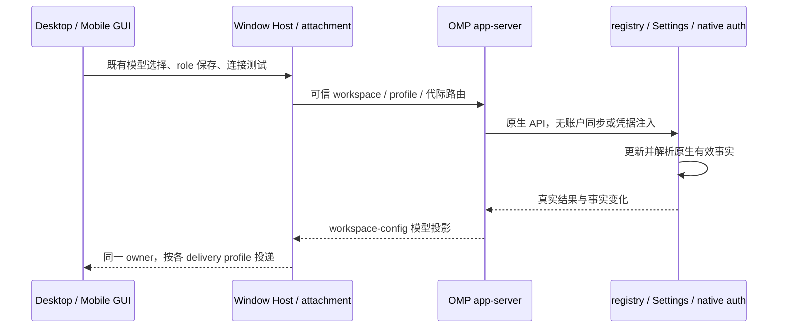

# 账号、OMP Profile、模型与命令

## 文档来源与适用边界

本文件从 `main_bak`（`0622caba58440a944d52243d8932d9a38618cec7`）的真实路径 `docs/requirements/models-and-commands.md` 恢复并按当前 app-server v2 合同改写，不是逐字恢复历史实现。当前权威入口为 [FORK-003](../../fork.md#6-fork-003通过-omp-app-server-替换-agent-核心)；OMP 生产端合同见 `F:/code2026/oh-my-pi/docs-zh-CN/requirements/rpc-ui-protocol.md`。不恢复历史独立 RPC、目录进程、内嵌 OMP、Main 直写 YAML 或旧组件回落，不将旧分支验证记录当作本次通过证据。历史离线存储与备份实现不随本文恢复，当前数据域隔离以 FORK-004 为准。

## 产品规则与唯一所有者

- ZCode 产品账号保留；模型 Provider 认证 GUI 退役，包括设置、欢迎页、侧栏、命令入口与会话提示中的登录、OAuth、API key 录入及登出。它不是临时禁用，也不规划第二期 GUI key 录入或凭据写入协议。其他管理面的不可用入口仍按 FORK-003 保留并说明原因。
- 同一配置根、运行 profile、cwd 与有效环境下，GUI 模型严格等于 OMP TUI 原生可用目录。OMP registry／Settings／native auth 是模型、认证、role 与思考档位的唯一事实 owner；app-server 只投影，Host 只路由及保留已接受投影，GUI 只持有草稿与展示态。
- OMP 原生 `getAvailable()` 包含源码内置、无需登录或用户配置的模型，GUI 直接展示并使用其原生可用性。无 key／无用户模型配置不等于未就绪；Host 和 Renderer 不得用旧 `providerRuntime.modelSelection`、ProviderSettingsView、登录或配置存在另加启动／发送／候选过滤门禁。需要凭据的模型仍由原生认证链判定，不伪造 ready。
- fork 桌面不注入 Host provider 配置环境源，不调用账户配置同步或其触发的 registry 刷新，不能保留隐藏但激活的注入路径。OMP `provider-config` 老 Host 兼容实现保留，但本 fork 桌面不调用。继承原生有效环境不是 Host 合成账户源的授权。

## 模型目录与热更新

- 目录来源为 `workspace-config.configOptions` 中 `id:"model"` 且选项非空的原生配置，保留具体模型身份、provider 名、支持的思考档位及默认思考档位；不按名称猜能力，不合并旧 ZCode 账户目录。
- `currentValue` 是 OMP `default` role 真实解析出的模型身份，不取第一候选或旧 Host 默认。目录到达后，未手选的新任务由现有草稿 owner 初始化 workspace 原生默认模型／档位，不继承前一会话的 task 局部目录或临时模型；同 scope 已手选的草稿与未发送文本保留。已有会话恢复其实际临时模型／档位，不被 default 覆盖。
- 非空原生模型来源具有绝对优先级；来源缺失或选项为空时，仅沿当前已有机制显示真实空态或等待态，原生目录真正 ready 前不得发送模型请求；不回落 Host 注入目录，不触发账户同步或源注入，不添加目录查询协议。
- 原生 registry、认证或 role 有效事实改变后，由原 owner 重新解析，app-server 发布 `workspace-config`；GUI 热更新目录、档位和 default 初值，不覆盖已经手选的草稿或会话运行事实。presentation 恢复只拥有 mode／slash command 元数据，不能清空已收到的模型配置。
- Host 对当前 workspace ingest 保留最后一次已接受投影，动态监听者注册后可获得当前事实；换代后由新快照替换。旧 workspace／profile／连接代际的请求、事件或保存结果不得覆盖当前目标，不建立第二套权威模型缓存。

## Profile、role 与会话临时选择

- profile 名称、配置根与运行身份由原生入口确定；App Settings 只持久化下次启动选择，完整退出重启后生效，不热切换或复制凭据。待重启期间设置页、工具栏和 Host 写入边界都拒绝向旧 profile 保存 role；临时模型仍使用当前运行 profile。
- 复用当前 `packages/ui/src/omp-configuration/` 的 controller、RoleRow 与配置面板，通过现有 `session/configure` 的 `get_model_roles`／`set_model_role` 展示完整内建角色、未配置项及自定义角色。保留用户值、项目值、有效来源、原始值与逐 role revision，不恢复历史旧核组件或 YAML 回落。
- 保存只修改目标 role，携带该角色最新 `expectedRevision`；冲突显式失败且保留草稿，不覆盖外部改动，不借直写文件绕过 CAS。成功回执更新下一次保存依据，真实失败／部分／未知结果不得显示成功。
- 模型 ID 中的冒号仍属于身份，思考档位仅按原生目录与配置合同解析。角色支持档位的保留、默认／继承／清除均使用既有原生语义，不写组件占位值。界面使用现有主题、Select、键盘操作与国际化。
- 临时模型仅改变显式目标会话，不写用户 role、Team 或新任务默认，也不改变其他会话。取消不写入，目标或连接换代后丢弃迟到结果。
- `provider/testModelConnectivity` 保留，使用目标 workspace/profile 的实际原生模型与认证链作最小真实请求；内置免凭据模型无需补 key。确实需凭据而缺失、认证失败与不可达按原生结构化结果展示，不修改持久凭据、默认 role 或已有会话。

## 命令目录与投递

- 斜杠命令使用当前 OMP app-server 原生目录与补全，workspace-config／presentation 只投影同一事实；命中原生目录时 UI 不抢占本地同名逻辑。已识别的 TUI 专属操作明确拒绝，不转成模型正文。
- 本地命令的输出、受理、完成与错误按当前公开协议投影及原生 admission 处理，不恢复旧独立 RPC 的 `prompt_result` 等私有帧。无模型推理的命令也须真实完成才能报告，失败不得伪装成功；迟到结果不关闭后续轮次。
- 原生 `/spec` 按 OMP [规范驱动编排需求](../../../oh-my-pi/docs-zh-CN/requirements/spec-driven-orchestration.md) 的三阶段流程执行，ZCode 仅通过同一命令目录、composer 和既有确认／选择交互消费 OMP 输出。规格、候选、计划及验收版本、暂停／恢复和任务状态均由 OMP 唯一持有；不复制 GUI 工作流状态，不新增工作流设计器（AC15）。隔离 localhost provider 的 Electron 验收只脚本化模型响应，文件、工具执行、Team、审批与本地提交仍由实际 OMP 完成。
- 模型、role、测试与命令均保留 workspaceIdentity、remoteSessionId、profile 和连接代际路由。桌面与手机使用同一个原生 owner，desktop-continuous 与 web-remote-replayable 分别保持各自订阅／恢复语义，不另起手机 Agent 或第二份队列。

## C 部署前提

Windows 用户部署前在用户级环境设置 `OMP_OFFLINE=1`，按需设置绝对路径 `OMP_CONFIG_ROOT`；完全退出并重启终端与应用，使 TUI／GUI 继承相同环境及 profile。部署使用用户级环境，不修改系统级环境、PATH、shell、用户模型配置或数据目录；部署说明本身不构成已执行证据。Windows offline 不等同 Linux shm／NFS 验收。

## 验收场景与状态

本次 v2 及原 17 项工作已在 Windows 当前源码的授权验收范围完成；当前证据与平台边界统一见 [v2 当前证据快照](../testing/omp-integration-blockers.md#v2-模型认证与-profile-当前快照)，不将历史 main_bak 或较早源码结果迁作当前全量证据，也不扩称安装版、Linux、手机、远端或跨平台全产品通过。主代理统一执行必要验证；真实模型调用与隔离 localhost E2E 分开记录，后者不能替代真实供应商认证、生产模型质量或目标平台验收。

1. 在同一配置根／profile／有效环境下，对比真实 TUI 与 GUI 的完整可用目录、provider 名、档位、默认档位和 default role 解析初值；内置免登录免配置模型直接可选且不触发旧 Host／Renderer 门禁。
2. 非空 `id:model` 原生来源绝对优先；来源缺失或为空时显示真实空态／等待态，不回落 Host 注入目录，不出现旧 ZCode 模型，不伪造 ready，不调用新增目录查询协议。
3. workspace-config 与 presentation 到达顺序互换、设置页晚订阅及冷恢复都不丢失目录；role 保存后热更新，新任务使用真实 default，已有会话与手选草稿不被覆盖。
4. 真实 role 保存、重开／重启读回、逐角色 CAS 冲突、失败保留草稿、profile 待重启写入拒绝及双 profile 隔离；工具栏与设置页复用同一行为，临时模型不写持久配置。
5. 所有模型登录、OAuth、key 输入、登出与提示入口消失，ZCode 产品账号保留；启动与账户变更不触发 provider 源注入／账户同步刷新，不改变 Skill、MCP 等管理面的原有保留边界。
6. 连接测试覆盖原生免凭据成功、确实需凭据的缺失／认证失败及不可达，核对凭据、默认角色及已有会话未改变；不通过注入测试 key 制造通过。
7. 桌面与手机投递到同一原生 owner，旧 workspace／profile／连接代际结果隔离；命令目录／补全及真实错误保留。不以 UT、源码存在或仅文档确认宣称 GUI smoke、移动端或整体验收通过。
8. 经明确授权后打开当前源码的真实 GUI 与 OMP TUI，在相同原生配置根／profile／有效环境下逐项比对实际可见目录，并分别通过 `openai-codex/gpt-6-luna` 完成真实请求；核对所选模型、实际会话模型及独立的助手响应。GUI 数据可隔离，但不得替换原生凭据、注入目录或以本地模拟服务冒充真实模型。真实调用证据与隔离 E2E 分开记录，失败时保留故障边界。
