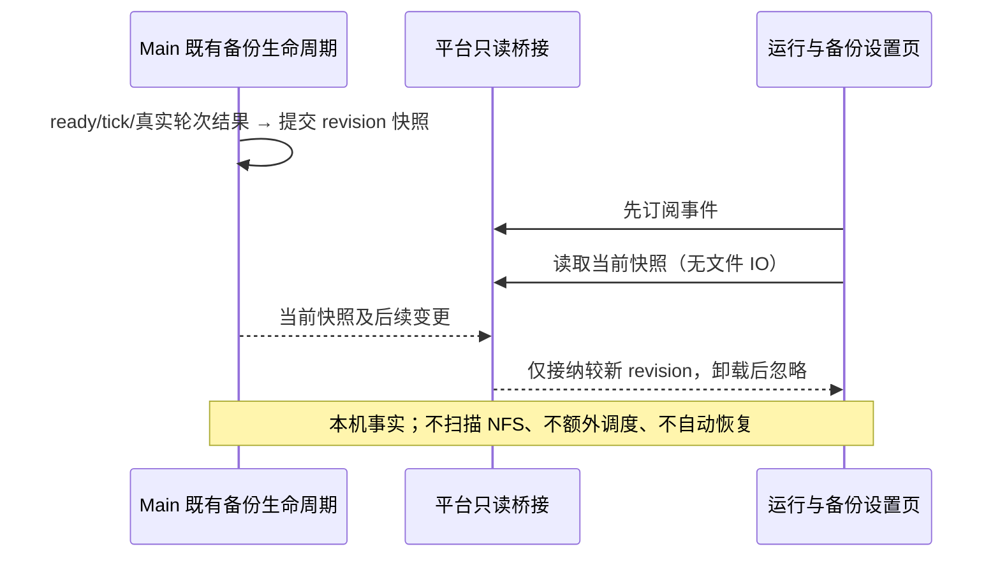
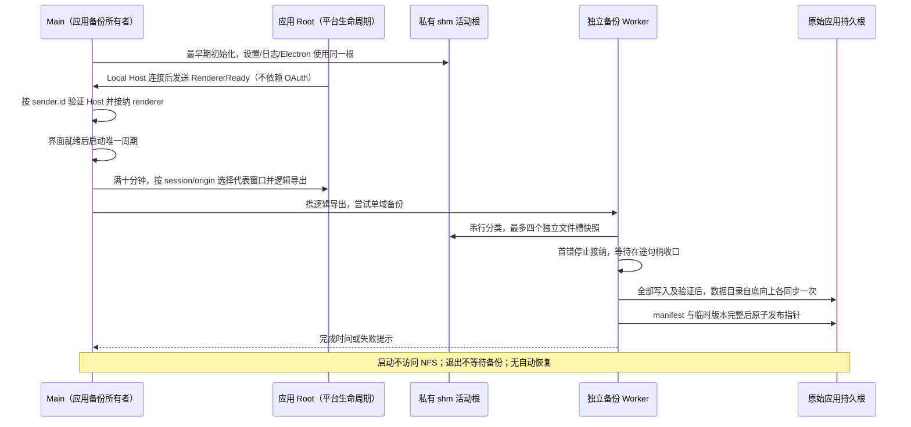
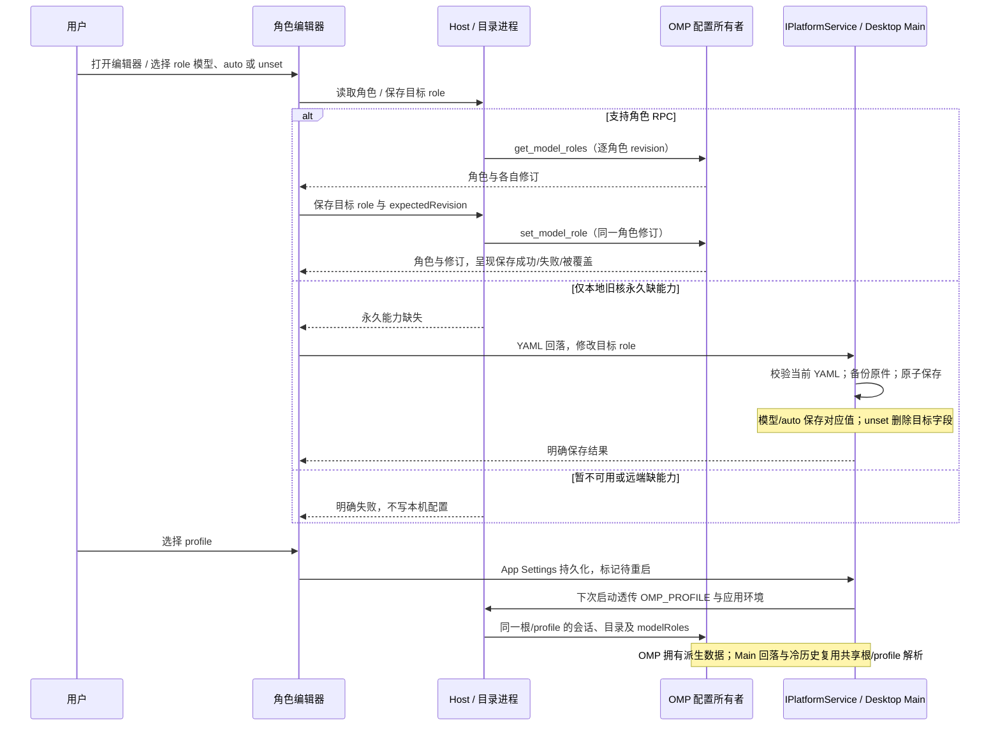
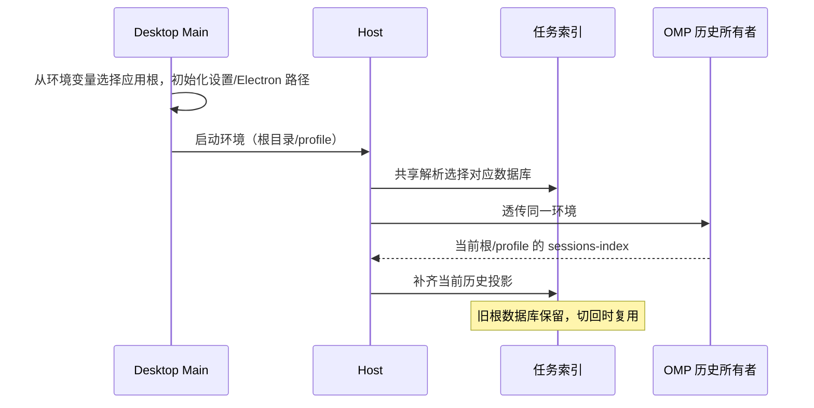

# 账号、omp Profile、模型与命令

## 产品规则与所有权

- 换核后 ZCode 账号体系整体废弃：启动登录门禁永久关闭、侧栏账号/套餐/用量 footer、命令面板登录登出、会话套餐配额横幅全部移除；凭据与模型走用户本机 omp 配置。

- omp 的模型目录是会话模型候选的事实源，当前有效根/profile 下的 `modelRoles` 由 OMP 持有。UI 通过 Host service 请求目录进程的 `get_model_roles`/`set_model_role`；仅本地旧核永久缺失角色能力时，才通过 `IPlatformService` 回落到 Desktop Main 的 YAML 读写。未就绪或暂不可用不得触发回落，远端缺能力不得写本机配置。模型目录更新由 workspace-config topic 推送，UI 不另建模型缓存或账号目录。
- 工作区恢复取得的 presentation 只拥有 mode 与 slash command 元数据，不得用仅含 mode 的结果覆盖 workspace-config topic 已下发的 omp 模型及思考档位目录。并发顺序无论先后，store 合并时各自保留其所有者字段；重复恢复不清空目录。
- workspace-config 的已接受快照由 Host syncer 在当前 workspace ingest 状态内保留最后一次投影；动态 UI 监听者注册时立即收到这一投影。这样初始 topic 帧早于设置页或侧栏监听时，目录不会因一次性事件丢失；runtime 换代时由新快照替换。
- 工作区首次 presentation 读取同时返回 omp 的模型目录快照，确保尚未建立 v4 background 订阅的冷启动设置页也有候选；后续更新仍由 workspace-config topic 投影。适配器复用同一个目录加载 flight 与结果，避免两个入口同时拉起目录进程。
- omp 的 `get_available_commands` 是斜杠命令目录事实源；workspace-config 与首次 presentation 返回同一命令投影。目录至少包含名字、描述、输入提示和来源，未知来源映射为自定义。命令目录加载失败时应显式记录并返回空目录，不影响模型目录。
- 本地斜杠命令的 `command_output` 投影为该轮文本；`prompt` 响应 `agentInvoked: false` 或关联 request id 的 `prompt_result: false` 必须结束轮次，即使没有 `agent_end`。晚到或无关的完成帧不能关闭后续轮次。
- `prompt_result` 仅在 `agentInvoked:false` 且属于当前本地命令时收口；agent 已启动的终态只由 `agent_end` 决定，失败和中断结果不得被后续完成帧改写。重复收口不产生状态补丁。
- Host 启动 omp 适配器不依赖旧 ZCode Provider Registry 的 provider/model 就绪门禁。适配器先启动并从 omp 读取目录，提交时才校验所选模型；omp 无可用模型时由其自身返回明确错误。
- 首屏及会话输入区不展示旧 ZCode 的“当前没有可用模型／升级／配置”横幅；旧注册表为空不能阻断 omp，真实 omp 错误仍按错误码展示。
- 更改角色时只改用户选择的 role，保留配置文件其他字段、注释与未触及的 role。写前备份，写入失败时原配置可恢复。模型名中的冒号属于模型 ID，只有目录确认的思考档位后缀才按档位解析。本地旧核 YAML 回落也必须提供「自动」（`auto`）与「未配置」（`unset`）选择；自动保存该角色的自动语义，未配置删除目标 role 的持久字段而非过滤掉这次变更或写入组件占位值。此要求不改变新核 RPC 优先及远端/暂不可用不回落的边界。
- RPC 角色编辑器保存时必须携带最新读取的目标角色 `revision` 作为 `expectedRevision`，不使用其他角色或目录整体的修订。成功返回的角色描述更新此角色的下一次保存依据；核心报告修订冲突时显式失败并保留待保存选择，不覆盖外部改动或绕过核心直写配置。旧核未提供角色修订时不补造修订值。验收从真实设置页依次保存 default/task 模型与 High，连续修改同一角色采用更新后的修订；两个角色独立保存，重开和重启读回一致。
- 角色选择器允许在模型支持的档位中选择思考等级。切换模型时保留新模型也支持的原等级；不支持时使用新模型的缺省等级，未设置缺省则不写档位后缀。
- omp profile 选择由 App Settings 持久化；Desktop Main 启动时读取并通过 `OMP_PROFILE` 传给 Host/内嵌 omp。默认或已有命名 profile 来自 omp 配置根目录，角色配置与历史扫描使用同一 profile 路径。保存后只标记待重启，不能热切换现有会话；待重启时角色编辑器不写旧 profile。
- 模型设置页的 profile、角色模型和思考档位选择器统一复用 ZCode 的 `Select` 组件及输入框/菜单主题，不使用系统原生下拉框；会话工具栏复用的角色编辑器及旧核回落分支采用相同样式。保持现有候选分组、键盘操作、禁用状态与保存语义。
- 当前应用环境沿 Main → Host → 适配器 → omp 传递，OMP 自身拥有配置、缓存、运行状态和浏览器 storage-state 等派生目录；应用不另建迁移机制。有效的 `OMP_CONFIG_ROOT` 优先于 `PI_CONFIG_DIR`，只接受绝对路径，支持 `~`、`~/`、`~\\` 展开；空值和相对值被忽略，再按既有 `PI_CONFIG_DIR`（相对用户主目录）或 `~/.omp` 解析原始持久根。Desktop Main 的 profile 枚举、角色配置回落、原生扩展/MCP/钩子目录与适配器冷历史扫描复用共享的活动根/profile 解析。项目级 `.omp/` 不随该变量改变；已有数据不自动移动、复制或删除。非 offline 的 Linux XDG 规则仍与当前 OMP 对齐；offline 活动根规则见下节。
- 有效的 `OMP_CONFIG_ROOT=xx/bb` 同时决定 OmpCode 原始持久根为 `xx/bb_ompcode`，没有有效该变量时使用默认 `~/.ompcode`；`PI_CONFIG_DIR` 不改变 OmpCode 持久根。配置、日志与索引位于活动根的 `v2`，Electron 数据位于其 `electron` 子目录；非 offline 且未覆盖时保留原 Electron 默认路径。启动早期即生效并透传到 Host，旧界面数据目录设置不再生效。界面只读显示实际活动根，启用 shm 时同时显示原始备份根、无自动恢复与可能丢失未备份数据的提示。目录只能通过环境变量调整，完全退出重启后生效，不自动复制、移动或删除旧数据。
- `OMP_OFFLINE` 原样传给目录进程、会话进程与 OMP 派生进程，不转换成已取消的 `--offline`。模型可见性与解析由 OMP 唯一裁决，应用使用 OMP 返回的可用模型目录，不维护 zcode-api/company 的第二套过滤。offline 进程始终不列出或解析 zcode-api，无公司配置时也不例外；其他已配置且凭据就绪的 lane 仍由 OMP 返回，普通启动保留正常目录。
- 任务索引是 omp 会话的本地投影，必须按实际解析后的 OMP 根目录与已启动的 profile 分库；默认根目录保留现有数据库命名，自定义根目录使用独立数据库。相同有效根目录的不同环境变量写法使用同一索引；无效覆盖值遵循 OMP 的回落规则。切回原根目录/profile 时，原任务及分组、排序、置顶、归档、未读与自动化关联仍保留。Host 启动准备与所有索引 Repo 必须解析到同一路径；切换根目录不迁移或删除旧历史，不在 UI 混入其他根目录的任务。
- 设置侧栏“模型设置”始终展示全部内建 omp role 的选择器，已有配置的自定义 role 追加展示；会话工具栏“管理模型”复用同一编辑器。当前 profile 没有配置文件时显示未配置的内建角色，首次保存仅创建所选角色的 `modelRoles`，不写入空角色；两处只允许选择 omp 目录已有模型，不提供供应商或模型新增操作。该编辑器的目录与保存走 OMP RPC（目录进程 `get_model_roles`/`set_model_role`，全部可配置 role 含未配置项、逐 role 自动保存与保存中/失败/被覆盖状态），本地 YAML 读写仅作 OMP 无 v3 能力时的回落；两条路径的入口与状态语义见 [omp-core-integration.md](omp-core-integration.md)。

## Linux 离线活动根与备份

- 仅 Linux 且 `OMP_OFFLINE` 去除首尾空白后为 `1`、`true`、`yes`、`on`（忽略大小写）时启用。Windows 和非 offline 的路径及运行行为不变，不创建 shm 目录、不启动或检查备份。
- 原始持久根与 shm 活动根明确分离，`OMP_CONFIG_ROOT`、`PI_CONFIG_DIR` 保留原值传给内嵌 OMP，不能替换为 shm 路径。OMP 活动根严格对齐 OMP 的 `hostname + UID + 原始持久根` SHA-256 算法及 `/dev/shm/omp-<uid>-<domainId>/<原目录名>` 布局；OmpCode 使用相同身份算法和独立 `ompcode` 域，应用持久根沿用上节规则。目录名不写死 `.omp`，profile 保留原相对布局。
- OMP 的会话、配置、profile 枚举与本机回落均读写 OMP 活动根；offline 不检查旧 XDG 锚点。OmpCode 配置、任务索引、会话快照、附件、日志、崩溃、内部默认工作区、Electron userData/sessionData 及缓存均从应用活动根派生；自有临时文件使用同一完整数据域身份派生的短私有 shm 目录，避免 Chromium 单实例 socket 路径超限。最早的设置、日志和崩溃初始化前必须生效。任务索引的 OMP 身份仍由原始 OMP 根及 profile 决定，不把临时路径误当持久身份。
- 只允许 `/dev/shm` 活动数据与 NFS 持久备份；不使用 `/local`、`/tmp`、`/run/user` 或其他磁盘回退，不需要 sudo，不调整系统挂载或 Swap。私有目录须归当前用户并保持 0700，不跟随外部植入的符号链接；shm 不可用或空间不足时明确失败，不静默回写 NFS。
- 启动只计算路径并初始化本机活动目录，不访问、遍历或检查 NFS 备份根，不迁移、不预热、不回源、不自动恢复。已有 shm 数据直接使用；空 shm 是全新环境，用户需自行人工恢复。安装文件、项目源码、项目级 `.omp/`、EDA 文件、共享技能与外部认证输入保持原位置，不承诺消除这些输入的 NFS I/O。
- Main 是应用备份生命周期唯一所有者；前台就绪满 10 分钟后首次调度，独立 Worker 执行文件及数据库操作，之后每 10 分钟触发。同一数据域跨进程只允许一轮备份，未完成时合并触发，不积压；OMP 数据由 OMP 自己备份，不被应用重复备份。退出停止所属 Worker，不等待 NFS、不进行同步最终备份，不新增常驻服务。
- 前台就绪由 Root 的通用平台生命周期发出，不依赖已停用的 OAuth/账号开关。Main 仅接纳已注册 Local Host 的应用 renderer，按 `webContents.id` 查询 Host 注册表并记录可备份窗口；不能把 `BrowserWindow.id` 当作同一身份。重复就绪、多窗口及 renderer 重载仍只保留一个应用级周期。
- 应用备份发布到原始应用持久根的私有版本目录，按主机、UID、原始根隔离；SQLite 复用统一 `backupDatabase` 在线一致快照，普通文件以完整版本发布，Electron 持久浏览器状态经逻辑导出保存，不能直接复制活动 LevelDB 冒充一致备份。可重建缓存可排除，socket、锁、PID、运行中临时文件不得备份。保存 manifest、当前及上一轮完整版本；失败不损坏前一版本，不清空旧持久数据，不无限保留失败临时文件。
- 备份优化仅发生在上述 offline 生命周期内，不给非 offline 新增调度、扫描或浏览器导出。独立文件使用最多 4 个处理槽，每槽独立复用有界 buffer；单目录 SQLite 分类先完成，保持 sidecar 排除和在线快照语义。首个失败/取消停止接纳新文件，等待已启动任务关闭句柄后才清理临时版本，不能让并发写入越过发布或清理边界。
- 备份的数据目录在所有普通文件、SQLite 快照和浏览器逻辑文件完成且验证通过后，自底向上各同步一次，再进入原有 manifest/版本/指针发布流程；不以删除必要 fsync 或完整性校验换取速度。
- 浏览器逻辑导出在 Main 按 session 对象身份及非 opaque origin 选择代表窗口，同组只执行一次全量 localStorage 导出；不同 session 不跳过导出，无法可靠识别的 origin 不提前合并，持久 Cookie 与备份格式保持原契约。代表窗口销毁、跨存储域导航或导出失败，以及存活的被去重窗口进入尚未导出的存储域时，不发布不完整版本；被去重窗口关闭、已覆盖存储域内的路由变化或同文档 hash 变化不使有效快照失败。不增加重试或长期缓存。
- 备份失败记录脱敏日志并有界提示用户，前台继续使用 shm，后续周期再尝试。重启、断电或外部清理可能丢失自最近成功备份以来的修改，失败持续时可能超过 10 分钟；退出前没有最终同步保证。tmpfs 可能使用 Swap，不声称绝不落盘。
- Desktop continuous 与 Web replayable 会话交付、workspaceIdentity、owner/lease 和 stale run 规则不变。内嵌资产必须包含相同 shm 契约的 OMP 实现；本地未提交 OMP 源码不等于已更新 Release 或打包资产，缺少真实边界验收必须记录为未验证。

### 离线运行与备份状态页

- 设置侧栏提供独立「运行与备份」分区；Windows 与 CentOS 7 使用同一界面。Web 不伪造本机备份能力；无法提供该能力的环境明确显示不可用。页面仅展示本机 Desktop Main 的事实，不混用当前远程工作区 Host 的目录或 profile。
- 页面只读展示本次运行的实际 profile、应用活动根/原始持久根、离线 shm 是否启用、备份阶段、周期、最近尝试、最近成功、下次周期触发时间及脱敏错误码。非 offline 显示未启用，不创建目录、Worker、计时器或备份；运行 profile 在启动环境和 App Settings 决定后读取，不用待重启设置冒充当前值，不调用会枚举配置目录的 API。
- 现有 Main 备份生命周期继续是唯一可变状态所有者。状态阶段为 disabled/waiting/running/completed/busy/failed；busy 仅表示跨进程备份 lease 占用，不表示成功，本进程重叠触发仍合并并保持 running。只有真实轮次完成更新最近成功；失败保留上次成功并沿用既有有界提示。错误只公开校验后的 code，不包含底层 message、stack、凭据或文件清单。
- 状态通过平台只读 snapshot/event 提供，带本次 Main 生命周期内单调 revision。UI 先订阅再读取快照，只接纳更新版本，卸载/平台换代后忽略旧响应；重新打开立即取得最新事实，不补发 RendererReady 或备份操作。目录取 Main 已解析的本机路径，不为状态查看读取 NFS、manifest、文件大小或历史备份。
- 最近尝试/成功只反映本次应用运行以来的记录，未知时明确说明。下次时间是固定周期的下一触发点，不保证备份一定执行，也不改成完成后再等十分钟。停止时清除计划并丢弃迟到完成，不把退出取消当作成功。
- 页面不提供立即备份、自动恢复、恢复导入或路径修改；继续展示 shm 易失、可能丢失自最近成功备份以来的修改、无启动自动恢复及无退出最终同步保证。复用现有样式与国际化，长路径在窄窗口内可读，不横向撑开页面。

验收：受控时钟覆盖等待、运行、完成、busy、失败、重叠、重复 ready 和退出迟到结果；读取状态无执行副作用。Windows 隔离 Electron 验证真实 IPC/平台读面，UI 验证晚快照不覆盖新事件、重新打开、不可用/读取错误、中英/浅深及窄宽布局。非 offline 产品页面显示未启用且无备份调度；注入本机临时根的 offline 场景不冒称 CentOS/shm/NFS 验收。

### 离线存储验收

- 根解析覆盖四种真值、关闭值、Windows、默认/绝对/无效根及命名 profile；同名不同原始根、不同用户和主机隔离，OMP 活动路径与其源码算法一致，非 offline 保留原规则。
- 空 shm 不读取旧设置、不显示旧任务、不检查 NFS；最早期设置、日志、崩溃和 Electron 持久数据路径位于活动根，Main/Host/适配器共享环境，项目读写仍使用原 workspacePath。启动工作区恢复读取同一活动根的设置；临时目录追加 Chromium 单实例 socket 后仍满足 Linux 路径长度限制，安装目录移动到 shm 不改变这一要求。
- 从真实应用公开入口验证设置保存与重启；应用备份真实执行后 SQLite 可独立打开、配置及浏览器逻辑导出可读，用户人工恢复后可使用。持续写入、备份重叠、普通文件变化、失败及退出不破坏前轮完整版本。
- 就绪入口覆盖账号功能停用、窗口 ID 与 webContents ID 不相等、重复通知及无 Host 的非应用 renderer：真实 Root 通知能启动唯一的十分钟调度，未接纳的 renderer 不能触发调度或进入浏览器逻辑导出集合；不能只手动调用 `rendererReady()` 代替入口验收。
- 备份覆盖多目录、多种普通文件与 SQLite 的并发隔离，验证完整内容、每槽独立 buffer、有界并发、失败/取消收口及旧版本不变；数据目录的必要同步只执行一次且子目录先于父目录，逻辑导出新增的祖先目录不遗漏。多窗口同 session/origin 只导出一次，不同 session/origin 和 opaque origin 不错误跳过；代表窗口跨域、销毁及导出失败不能发布。代表窗口仍有效时，关闭被去重窗口、同源路由/hash 变化及 file 同文档 hash 变化保留完整快照；被去重窗口转入未导出 origin 仍拒绝。
- Windows 可执行可注入平台的局部回归与独立 Electron 场景；不得伪装成 CentOS/shm/NFS 实测。完整门禁和 CentOS 测试仍遵循根 AGENTS.md 授权边界，跳过及缺少匹配内嵌 OMP 均不算通过。

## 时序与失败语义

本地 YAML 回落路径中，配置不存在时读取为空角色并显示内建角色；首次保存仅在目标文件仍不存在时原子创建最小配置，不覆盖并发创建的文件，也不制造虚假的备份。已有配置写入前保留原件备份。YAML 语法无效、`modelRoles` 类型错误或保存失败时显式报错；重复保存同一内容不创建无意义备份。

## 验收场景

1. 隔离桌面开发态不配置任何 ZCode Provider Registry，首屏不出现旧模型横幅，Host 仍启动 omp 适配器并显示其模型目录；从 omp 历史恢复会话、订阅消息；新会话选择 omp 模型，发送后流式展示、工具写文件并能再次恢复。
2. 设置侧栏“模型设置”打开后直接列出已配 role 与 omp 目录，且不出现“添加供应商”；更换含冒号模型 ID 的 role 并保存。重新打开仍显示正确模型，配置文件其他字段、注释、未触及的 role 保留，备份可恢复原件。
3. 无配置时「模型设置」仍显示全部内建 role；选择一个 role 保存后仅创建该角色的 `modelRoles` 最小 `config.yml`（原子创建、不覆盖并发创建、无虚假备份），其他 role 保持未配置。无模型目录、无效 YAML 和保存失败均有明确状态，不允许静默落入 ZCode 模型目录。
   3a. workspace-config 先于工作区恢复或反过来先到时，设置页与 composer 都持续显示 omp 模型目录；冷恢复已存在任务后仍可编辑 role。
   3b. 隔离桌面实例准备默认与命名 profile 的不同模型/角色配置及历史任务；切换 profile 保存后仍显示待重启且不改旧配置；重启后只显示目标 profile 的角色、目录与历史会话；切回默认 profile 后原任务仍可见。
   3b0. 在浅色和深色主题下打开 profile、角色模型及思考档位菜单，触发器、菜单背景、选中标记和悬停样式与 ZCode 设置页一致；键盘可选择，保存中/不可配置项不可操作。未配置、自动、目录外已配置值及缺省档位正确显示，组件内部占位值不得写入 OMP 配置。
   3b1. 设置绝对或 `~` 展开的 `OMP_CONFIG_ROOT`，同时设置指向另一目录的 `PI_CONFIG_DIR`：内嵌 omp、profile 列表、角色配置回落、原生集成目录与冷历史读取使用目标根和同一 profile；相对/空的新变量回落旧规则。默认与命名 profile 的恢复、续聊和删除作用于目标目录；项目 `.omp/` 与旧目录保留。Linux 的 XDG sessions 锚点已存在/不存在时分别与当前 OMP 路径一致。
   3b1a. 默认根目录已有稳定 UUID 历史任务时，以同一 profile 切换到空的新根目录并重启，侧栏不得显示旧任务或触发其恢复；新根目录创建的任务可恢复。切换两个自定义根目录亦保持隔离；切回原目录后，其任务组织信息仍在。显式指定默认根、`~` 展开、尾部分隔符与无效相对覆盖值按有效路径选择同一索引。
   3b1b. 设置 `OMP_CONFIG_ROOT=xx/bb` 后启动，Main/Host 的配置、日志、崩溃、索引、非项目默认工作区及 Electron 缓存均位于 `xx/bb_ompcode` 下；OMP 仍使用 `xx/bb`。旧 setting.json 的 dataBaseDir 不覆盖新根；未设置有效新变量时回到默认应用根。界面只读展示当前路径与 Windows/Linux 的环境变量修改方式，没有目录选择/保存。新根为空不导入旧设置或恢复旧任务，切回原根后仍可读取。
   3b2. `OMP_OFFLINE=1` 原样进入 OMP 且 argv 不含 `--offline`；有/无公司配置时应用模型目录均与 OMP 一致，不出现 zcode-api；未启用时使用普通目录。
   3c. fake omp 返回含内置与自定义命令的目录；工作区 presentation 与 workspace-config 均能展示这些命令，输入框输入 `/` 能补全。真实 omp 二进制也能返回合法目录。本地命令同步或延迟完成时，输出可见且会话控制恢复空闲。
   3d. 角色目录读取或自动保存尚未返回时切换工作区、关闭后重新打开编辑器；旧请求不得回写新目标的角色、待保存选择或保存状态。同一角色快速重复操作只接纳当前请求；失败时所选值保留供重试。远端旧核不支持角色 RPC 时不得回落写本机 profile。
   3d1. 在本地旧核永久缺角色能力的回落入口，将已有目录内模型的 role 改为「自动」，重新打开仍显示自动；再选「未配置」，保存后目标 role 持久字段被删除且重新打开保持未配置，其他 role、配置字段及注释不变。设置页与会话工具栏均覆盖此路径；新核继续调用角色 RPC，暂不可用和远端缺能力仍不得写本机 YAML。
   3e. 设置保存不同 profile 后、重启前，设置与会话工具栏两个角色编辑入口均禁止写旧 profile；模型目录和其他会话临时选择仍按当前运行 profile 保持。
   3e1. 工作区目录进程返回 `sessionModel: { model: { provider, modelId } }` 而没有会话身份时，角色目录仍通过宿主运行时校验并显示全部角色；不得凭空补入会话 ID，也不得把有效目录误报为进程暂不可用。若返回会话身份，仍严格校验其字符串类型。
   3f. 命令参数补全在光标位于词中、候选替换区间跨空格及目录更新时正确：请求携带完整单行文本与 UTF-16 光标，接受候选严格使用返回区间；越界与过期候选不可插入，旧请求不得覆盖新文本或目标。
4. 源码类型检查、lint、omp 协议 E2E 与架构检查通过；GUI E2E 使用当前源码的开发态运行，不执行安装包生成。

## 命令路由与角色覆盖

- omp 当前目录中的内置斜杠命令（如 `/model`、`/switch`、`/compact`、`/rename`、`/mcp`、`/usage`）在对话输入框可用；目录变化（`available_commands_update`）实时推送刷新补全面板；`skill:*` 命令在技能候选分组展示。
- `/rename`、`/model` 等的状态回投（`session_info_update`/`config_update`/`model_changed`）同步到会话标题与模型状态。
- UI 本地拦截让位：命令名命中 omp 目录时按 omp 语义透传执行，核心命令、`/compact` 参数及兼容别名规则统一见 [核心 rpc-ui 命令接入](omp-native-commands.md)。
- 多角色（`modelRoles`）按本文件角色配置规则在设置与会话工具栏完整适配，角色清单与 omp 内建角色（default/smol/slow/vision/plan/commit/tiny/memory/task/advisor/image/web/speech/dictation/judge）一致并随配置追加自定义角色。

技能目录与调用见 [skills.md](skills.md)；提交时的临时模型选择见 [composer.md](composer.md)；恢复、guide/queue 及文件变更事实见 [session-recovery.md](session-recovery.md)。
辅助入口 `/side` 与 `/btw` 的独立接入按 [OMP 辅助对话](omp-core-integration.md#辅助对话原生-btw唯一需求权威)，不进入普通 slash/prompt 分流；输入区取消计划切换按钮、保留 `/plan` 命令的规则见 [输入区](composer.md)。

验收还应检查：登录/套餐/配额入口全部移除；命令热更新、重命名和模型状态回投可见；命中目录的命令由 omp 执行；真实失败不能呈现为成功。

## 实现与验证状态

需求从原有权威 FORK 与对应 spec 迁入，未因当前实现降低要求。既有实现及历史验证不等于本次验收；统一证据边界见 [需求索引](README.md#实现与验证状态)。

### 2026-10-17 离线热路径优化

- 已实施四槽独立文件 buffer、失败收口及数据目录单次自底向上同步；Main 在既有 offline 生命周期内按 session/origin 去重浏览器全量导出，未新增普通模式入口或调度。
- Windows 临时短冒烟通过：十二份跨 buffer 文件逐字节一致，峰值四个文件输出；逻辑导出的新增祖先目录均进入单次、子目录优先的同步屏障（仅 helper 追踪，Windows 不执行目录 fsync）。注入复制失败时四个已打开输出全部关闭，旧指针/旧内容不变，下一轮成功；取消前置拒绝、扫描失败收口、浏览器导航及独立 session/opaque 来源失败均保持拒绝。
- 隔离 Electron 三个隐藏且不可聚焦窗口实际共享 localStorage，仅一次全量导出，持久 Cookie 保留、临时 Cookie 排除；当前源码打包的备份 Worker 发布成功，独立 SQLite 快照只含 WAL 已提交事务。证据在 `%TEMP%/ompcode-offline-optimization-VOd6zS/evidence.json`。未运行 fulltest/slowtest、Linux/CentOS、真实 shm/NFS 或完整产品 GUI，不将本机 helper/引擎场景宣称为内网性能或完整产品验收。
- 审查后修正窗口失效判定：采集前固定 session 身份，不读取已销毁的原生 webContents 属性；只因代表窗口失去存储身份或存活窗口进入未覆盖存储域而拒绝。Windows 十一个定向短冒烟场景通过，独立 Electron 另确认真实被去重窗口关闭、同源 History/hash 及 file fragment 变化保留有效快照，未覆盖 origin 仍拒绝；全部窗口隐藏且不聚焦，证据在 `%TEMP%/ompcode-capture-fix-lMtZ4y/electron-evidence.json`。仅更新既有 offline helper，不改变非 offline 调度；本轮未执行完整门禁或 Linux/NFS 验收。

### 2026-10-16 离线存储实现

- 已实施共享活动根解析、OMP profile/冷历史对齐、最早期 Desktop/Host 数据根切换、独立备份 Worker、跨进程本地 SQLite lease、原子版本发布及只读目录界面。OMP 运行根算法按 `F:/code2026/oh-my-pi-dev` 当前未提交实现对齐；保留核心词法根语义（包括尾分隔符），不擅自改写传给核心的环境值。应用索引身份继续使用规范化的原始根。
- 应用完整版本位于 `<应用原始持久根>/.offline-shm-backups-<domainId>/generations/`，`current.json` 记录当前与上一轮。该私有域直接位于原始根下，不创建公共可写备份容器、不修改原始目录权限；空新 shm 的 manifest 不把旧数据当作明确删除。
- 真正 Electron 冒烟曾暴露 Chromium 活动 DIPS 等数据库的独占锁；已修正为浏览器逻辑导出，原始 Chromium profile 不作为一致快照复制。`electron/<应用名>/first-party-browser-state.json` 保存应用 origin 的 localStorage，以及默认会话／内置浏览器分区的持久 Cookie；临时 Cookie 排除。当前应用没有自有 IndexedDB 持久化入口，不把此导出宣传为第三方站点 IndexedDB、完整 Chromium profile 或全局事务备份。
- 人工恢复先停止相关应用进程，按完整 manifest 选择版本，把 `data/` 中的应用文件复制到对应私有 shm 活动根并保留权限，不覆盖原始 NFS 数据。浏览器 sidecar 是逻辑数据，需通过 Chromium 的 origin/分区 API 人工导入 localStorage/Cookie；单纯复制 JSON 不会自动恢复浏览器状态，应用不提供自动导入或恢复命令。
- Windows Node 24.20.0 / pnpm 10.33.2：最终功能代码 `fastcheck` 通过，`total=8.5s / compile_excluded=0.0s / budgeted=8.4s / limit=60.0s`，Lint 0 告警、架构 0 违例。验收 HEAD `2185bce2824064a5f609bc3b5adb878f10fa019b`，功能代码及当时文档快照指纹 `9365311d2c35e82116d2f0fce0860e8094d2418138aaad2aef1d9396e74c1696`；随后仅补充本段验收记录。
- 8 个定向回归文件共 49 项已通过；按实际改动分批复验，未把早期失败计为通过。最终备份／Desktop 两文件 24 项通过，覆盖 WAL 已提交／未提交事务、持续日志追加、后续设置保存、重叠进程、死 owner、失败保留前轮、取消和安全路径。早期门禁曾因本次类型及文件行数失败、定向断言曾误假定 SQLite 行原型与尾分隔符规范化；修正后相关检查通过，未放宽业务判据。
- 桌面 `tsup` 实际构建通过；Windows 独立 Electron 冒烟通过真实 localStorage、持久／临时 Cookie、十分钟调度参数及注入 tick、构建后的备份 Worker、独立可读 SQLite/WAL 快照，证据为 `%TEMP%/ompcode-offline-electron-ks70Ph/evidence.json`。浏览器真实组件另验证中英／浅深主题、只读活动及备份根、非 offline 单路径，以及备份失败 toast 去重、可关闭、无模态遮挡且前台可输入。临时 fixture 和诊断脚本已删除，测试不接日常实例、不调用模型；启动器仅通过 Windows Git Bash 语法检查。
- 未运行 fulltest/slowtest、Linux/CentOS/WSL、真实 shm/NFS、完整产品设置保存重启与人工恢复、真实模型或匹配内嵌 OMP 的 CentOS 链路；未发布或更新安装包。Windows helper 注入的本机目录不是生产 Linux 开关，也不能代替目标环境验收；内嵌 OMP 资产须另行包含同一存储契约，当前未把本地源码存在视为资产验收通过。
- 就绪链路审查修复：`RendererReady` 从已退役 OAuth effect 移至 Root 通用平台 effect，Main 按发送端 `webContents.id` 而非 `BrowserWindow.id` 验证 Host，并记录首次接纳日志。原先独立备份 helper 冒烟未覆盖此产品接线，不能作为该入口已经通过的证据。
- 修复后 `fastcheck` 通过（`total=3.5s / compile_excluded=0.1s / budgeted=3.4s / limit=60.0s`，Lint 0 告警、架构 0 违例），绑定本轮功能代码与当时文档快照 `20b38fe186eb4eeabbe8ec3de42408a69caff0d251e192af5943d480aef7066e`；随后仅补充本记录。既有 `offlineDesktop.test.ts` 11 项通过，桌面 `tsup` 构建通过。Windows 隐藏产品进程实际挂载 Root、连接 Local Host，经真实 preload/IPC 接纳 ID 为 `1/2` 的窗口；账号仍停用，重复就绪只创建一个 `600000ms` 调度，启动未访问备份根，日志只接纳应用 renderer。推进捕获的生产计时器后，真实 Main 导出当前应用 origin，构建后的 Worker 发布含 31 个条目的完整版本；证据在 `%TEMP%/ompcode-readiness-fix-LiMdIf/readiness-evidence.json` 及同目录 `stdout.log`。探针只注入 Windows 私有本机目录与本机目录初始化器，没有修改生产平台判断、Root、Host、IPC、接纳或备份逻辑；这是 Windows 产品链路定向冒烟，不是 CentOS/shm/NFS 或真实十分钟墙钟等待验收。临时探针已删除，专用进程树已退出，未修改用户配置、暂存区或发布产物。

### 2026-10-17 运行与备份只读状态页

- 独立「运行与备份」设置页已接入 Main 唯一生命周期快照与变更事件，经公开平台服务展示本次运行 profile、实际运行/持久根、六种阶段、周期、最近尝试/成功、下次计划及安全代码；刷新只重读内存，不扫描目录、不备份/恢复。Web 无平台能力时明确不可用。
- Windows 隐藏隔离产品通过真实 preload/IPC 返回并展示 `default`、`disabled`、`600000ms`、空历史时间与空下次计划；页面根目录与 Main 快照一致，不冒充 Linux offline 运行。证据：`%TEMP%/ompcode-four-deliverables-HopN5z/final-runtime-backups.json` 与同名 PNG。
- 生命周期定向回归与真实 Electron 组件覆盖六阶段、成功时间保留、重叠运行、取消/迟到事件、刷新、A→B→A 代际及读取/订阅错误；中英、浅深和 1100/360 CSS 宽度已验证。组件证据：`%TEMP%/omp-product-tools-V2s8Np/`。这些是 Windows 定向证据，不宣称 CentOS/shm/NFS 运行、十分钟真实墙钟等待或人工恢复已验证；完整门禁以本轮命令输出及其快照为准。

### 历史验证记录

- 2026-10-08：OmpCode 数据根改为由有效 `OMP_CONFIG_ROOT` 派生的 `_ompcode` 兄弟目录；移除旧设置路径启动覆盖和界面迁移动作，设置返回只读的实际路径。Electron userData/sessionData、配置、日志、索引、内部工作区、日志导出与存储管理使用该根。Node 24.19.0 原生 TypeScript 加载下，共享路径、设置读写、任务索引隔离、桌面 Electron 路径与存储根回归共 12 项通过，CentOS 启动器测试通过；lint、格式与架构检查通过。完整类型检查缺少 `@typescript/typescript-linux-x64`，未执行 Windows/CentOS 7 GUI 的完整启动、路径展示及恢复验收。
- 2026-10-08：任务索引补充有效根目录隔离，默认根沿用旧数据库；自定义根以路径摘要选择独立数据库，Host 启动准备、任务、自动化与错峰索引共用同一解析入口。Node 24.19.0 的原生 TypeScript 加载下，`ompProfileTaskIndexPath.test.ts` 4 项回归通过（含真实 SQLite 的根切换、稳定 UUID 隔离及切回保留置顶/归档/未读），lint、变更格式与架构检查通过。完整 `pnpm typecheck` 因缺少 `@typescript/typescript-linux-x64` 无法运行；tsx 入口缺少 esbuild，采用原生加载执行上述测试。Windows/CentOS 7 GUI 的历史恢复与续聊未验证，不视为完整功能验收。
- 2026-10-08：已实施 `OMP_CONFIG_ROOT` 共享路径解析、适配器到目录/会话进程的环境透传，移除启动器 `--home`、`--offline` 与旧目录迁移/锁定逻辑。配置、历史和模型目录仍由 OMP 持有；未改动 Desktop continuous 与 Web replayable 时序。已补充路径、profile、冷历史读删、进程环境与启动器回归场景。Node 24.14.0 / pnpm 10.33.2 下 lint、变更 TypeScript 格式、Shell 语法与全量架构检查通过（0 违例）。本次按用户要求不运行 UT、真实核心或 GUI E2E，功能尚未验收；`pnpm typecheck` 被原提交已存在的 `packages/desktop/src/host/index.ts:2062` logger 类型错误阻断（缺少 `debug`），不记为通过。

- 2026-10-09 核心体验续作：旧核角色配置的自动/清除语义、命令目录失效与目录进程生命周期定向回归通过；OMP 全集 374/374、0 跳过，包含安装核真实目录/命令场景。此前类型检查环境限制不是本次结论；本轮重建并实际运行隔离 GLM 桌面，完整门禁及两平台发布仍独立验证，见 [核心体验续作验收](../test-reports/performance-hot-paths-2026-10-09.md#核心体验续作验收)。未修改用户模型角色或凭据。
