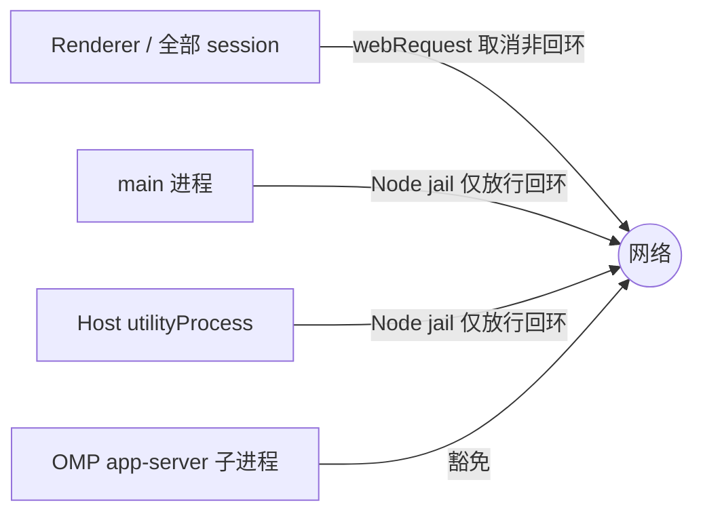

# 桌面进程离线网络隔离

## 文档来源与适用边界

- 本 fork 的产品需求：桌面应用**不登录 ZCode 产品账号**，且除 OMP app-server Agent 子进程外，**所有进程不得发起任何出站网络连接**。
- 关联 [FORK-003](../../fork.md#6-fork-003通过-omp-app-server-替换-agent-core)：模型目录、认证、role 与思考档位的唯一 owner 已移交 OMP 原生 registry，见 [models-and-commands.md](./models-and-commands.md)（含 `OMP_OFFLINE=1` 部署前提）。
- 本文只约束桌面端自有进程：Electron main、Host utilityProcess、Renderer（含全部 session / webview / 插件沙箱 guest）以及它们装配的 `@zcode/services`、`@zcode/server` 代码在桌面进程内的执行。
- **豁免范围**：OMP app-server Agent 子进程（`app-server --stdio`）及其拉起的辅助子进程、用户系统浏览器（`shell.openExternal`）、构建与测试期进程。

## 产品规则与唯一所有者

- 出站连接唯一放行边界：回环地址（`localhost` / `127.0.0.1` / `::1`）与本机命名管道 / Unix socket。dev 模式 Vite dev server（localhost）属放行范围。
- 构建期可选能力（ARMS RUM、事件遥测、自动更新）保持关闭：本 fork 不携带 `config/private/build-defaults.json`，`scripts/build-time-config.mjs` 默认解析为空端点 / 禁用；构建环境不得注入 `ZCODE_ARMS_RUM_ENDPOINT`、`ZCODE_TELEMETRY_REPORT_ENDPOINT`，不得启用 `ZCODE_AUTO_UPDATE`。
- main 进程不装配 `/api/v1/client/configs` 灰度请求链：`desktopContextPromptRollout` 保持未创建（既有 `if (!rollout)` 短路使首个 Host fork 不再等待灰度裁决门，冷启动更快）；`rendererActionTraceRollout` 使用离线 stub fetcher（fetch 立即失败，按关闭 fail-open）。
- 帮助 / 社区配置读取不再经 Electron `net.fetch` 出网：读取失败由 `openFeedback` / `openCommunity` 既有逻辑回退本地配置。
- Host 不注册 `IMarketingTouchService`：营销触达与云内容在离线版为不可用能力，renderer Provider 已有服务存在性守卫，展示为无数据而非报错。
- Agent spawn（`resolveSpawnEnv`）不得触发 `providerRuntime.start()` 的 registry 远端刷新，与 [models-and-commands.md](./models-and-commands.md)「不调用账户配置同步或其触发的 registry 刷新」一致；off-peak 等消费方仍按需自行 start。
- Renderer 侧所有 session（defaultSession 与全部 partition，含后续新建）经 `webRequest` 拦截取消非回环 `http/https/ws/wss` 请求；拦截器复用 `subscribeBeforeRequest` 组合入口，不破坏资源管理器网络观测。
- main 与 host 进程入口安装 Node 网络 jail：patch `globalThis.fetch`、`node:http(s).request/get`、`node:net/tls.connect/createConnection`，非回环目标同步抛错（毫秒级快速失败优于离线超时挂起）。undici、ws、ssh2 等库构建在 `node:net/tls` 之上，统一被拦。Electron `net` 模块走 Chromium 网络栈、不经过 Node 通道，其使用点（遥测、灰度、帮助配置）已在装配层停用，禁止新增。
- jail 在测试进程（`VITEST`）不安装，避免破坏单测网络桩；测试环境的联网约束由测试自身管理。
- 未登录状态下的既有静默路径（远控、配额、bots、分享、反馈、内网探测等）不做拆除：登录 UI 按产品账号保留，但离线版实际不可用，残余调用由 jail 快速失败兜底。

## 验收场景与状态

本文对应的实现改动由 Agent 直接交付；因其他任务并行占用测试资源，本轮不执行测试，验证按用户安排另行执行，未验证项不宣称通过。

1. 断网冷启动：窗口出现与会话可用不等待任何网络请求（首个 Host fork 无灰度裁决等待）。
2. 除 OMP app-server 子进程外，任一桌面进程无 `http/https/ws/wss` 出站；非回环调用在 jail 处毫秒级失败并留下可检索的错误信息。
3. 营销位 / 推荐词 / 灰度默认关闭或真实空态，无失败重试风暴。
4. `openFeedback` / `openCommunity` 使用本地回退配置，无远端请求。
5. dev 模式 Vite（localhost）可用；本地媒体代理、Chrome 导入 CDP 等回环链路不受影响。
6. Agent spawn 不触发 provider registry 远端刷新；模型目录仍由 OMP 原生 `workspace-config` 投影供给。
