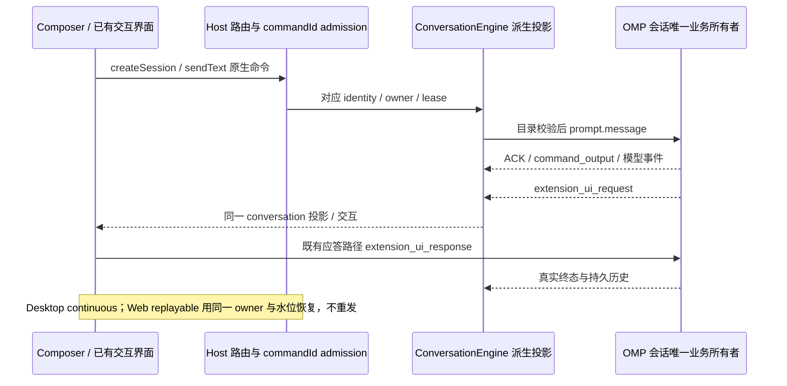
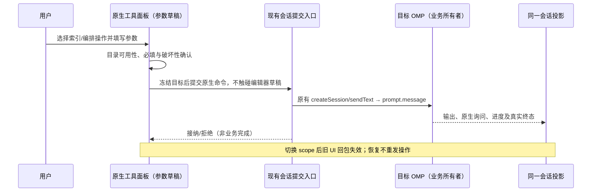
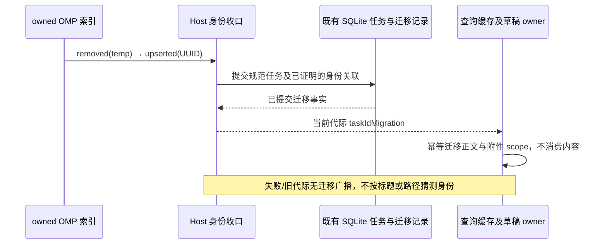

# OMP rpc-ui 核心命令接入

本功能域是本 Fork 的核心接入需求，命令规则唯一在此维护；[OMP 核心接入](omp-core-integration.md) 规定进程、交互与双链路。产品目的、协议优先和新增界面的限制以 [FORK 总纲](FORK.md#本-fork-的目的) 为准：优先复用 ZCode 已有交互；Wiki/Repo 因原界面缺失只增加简单显示与管理，不为覆盖 OMP 全部功能继续扩建 GUI。消费本机当前 OMP 的公开 `rpc-ui` 协议，不在 ZCode 中复制 OMP 业务；尚无协议支持的能力在本域记录缺口，待 OMP Fork 协同完善。

## 必须接入的入口

| 入口                                      | 原生行为与可观察结果                                                                               |
| ----------------------------------------- | -------------------------------------------------------------------------------------------------- |
| `/wiki`                                   | 索引查看、检索、建立与删除；确认、进度、取消和失败沿用 OMP                                         |
| `/repo`                                   | 代码索引状态、确认建立、更新、重建及删除；进度与取消沿用 OMP                                       |
| `/team <问题或需求>`                      | OMP 多模型只读规划讨论，参数和结果由 OMP 处理；空参数显示原生用法                                  |
| `/plan [任务]`                            | OMP 计划模式、只读工具、计划 role 临时模型、计划正文与批准/拒绝；批准后由 OMP 恢复模型与工具并执行 |
| `/loop`                                   | OMP 公开的次数/时长、可选间隔、任务及关闭；停止复用已有 Stop，不编造暂停/恢复子命令或 Host 计时器  |
| `/goal`                                   | OMP 目标创建/替换、查看、暂停、恢复、删除和预算调整；不复用旧 ZCode goal 状态机                    |
| `/advisor`                                | OMP 开关、状态与记录；`configure` 的 TUI 编辑器明确显示不支持，角色配置仍走既有接口                |
| `/ultrathink`、正文 `ultrathink`          | 命令和正文魔法关键词分别按 OMP 规则执行，正文关键词不是 `/advisor` 参数                            |
| `/orchestrate`、`/workflowz`、`/fullsend` | OMP 原生命令/魔法关键词流程，不另造编排实现                                                        |
| `/skill:<name>`                           | 实际可执行技能目录与原生 token；技能目录规则仍见 [skills.md](skills.md)                            |
| `/compact [参数]`                         | 原生命令参数完整交给 OMP，压缩过程、结果、错误和用量回投可见                                       |

## 产品规则、接口与所有权

- 命令与别名来自目标工作区 OMP 的实际注册目录 `get_available_commands`；参数补全沿用 `complete_command`。上表规定必接能力，不作为人工目录或硬编码允许清单。Windows 与 CentOS 7 使用同一入口与界面。
- 命中原生目录的输入以原文经现有 v4 `createSession` / `sendText` 到对应会话进程的 `prompt.message`，保留参数与空白。GUI 不以旧 `/plan`、`/goal` 或 `/compact` 本地业务覆盖原生命令；未登记的兼容别名仅保留既有行为。未知或 TUI-only 输入明确报错且不得作为普通提示发给模型；带附件命令沿既有明确拒绝规则处理。
- 结果和状态由 `command_output` 进入现有会话时间线；选择、确认、输入与计划批准由 `extension_ui_request` / `extension_ui_response` 进入已有交互组件。审批原生选项及会话许可边界唯一按 [OMP 核心接入](omp-core-integration.md#产品规则) 处理，不固定选项数量、不恢复旧 ZCode 权限卡。显示失败、拒绝和取消的真实结果；受理 ACK 不等于模型轮或长操作完成。OMP 原生输出的可见历史与冷恢复须一致，不重发已执行的命令。
- 当前 OMP 的后台索引/压缩命令可先 ACK、后发无请求 ID 的输出，且 `command_output` 未写原生 journal。适配器必须接收当前会话进程的迟到输出，以独立行呈现；仅为 GUI 冷恢复持久保存这些已收到的派生输出，不复制模型历史或 OMP 业务状态。稳定会话身份、行 ID、去重和删除一致性由同一适配存储路径负责；未提供终态的操作不凭 ACK 推测完成。
- `/team` 等命令的可见 `custom` 结果也必须可冷恢复：OMP 父会话尚未经过模型轮时，原生 lazy journal 不保证写出这些消息。复用上述派生显示存储保留结果；原生日志随后落盘时，仅对同类型、同正文的对应显示记录去重，不删除合法重复消息，不复制模型回复。隐藏的 `display:false` 消息不保存或展示。
- OMP 是索引、计划、团队、目标、循环、advisor 与压缩状态唯一所有者，文件和持久配置按 OMP 原生规则维护。`ConversationEngine` 只投影进程事实，Host 只路由，UI 只持有草稿与 pending overlay。计划/命令临时模型变更随真实事件回投，不被下一次陈旧草稿选择覆盖。
- OMP 自主提交的 loop/goal 后续轮依据真实用户消息与运行事件建立派生时间线，后续回复、工具与终态完整显示；不得因没有 GUI sendText 就丢弃输出，也不得为显示补发原命令。已接受的 GUI/排队轮与原生运行事件须对账，不能生成重复轮。
- 保留会话身份、workspaceIdentity、owner/lease、进程实例 fence 与 commandId 幂等边界；停止沿已有 abort 通道，等待交互或长命令不得阻塞它。关闭或 EOF 后 OMP 不得向其他会话续跑。运行中提交的处理遵循 OMP 与既有 admission 语义，不能将原生命令悄悄改成模型正文。

## 项目索引与原生编排操作面板

- 会话输入区提供「原生工具」入口，同一对话框中分为「知识与代码索引」与「编排快捷操作」两页；两平台与 Web 使用相同组件，窄窗口可滚动且不横向溢出。入口明确显示当前项目和会话目标，不因既有草稿非空而覆盖或清除正文、富节点及附件。
- 知识与代码索引页提供 Wiki/Repo 的原生管理入口和代码索引检索。Wiki 提交裸 `/wiki`，在原生 select/input/confirm 中完成状态、新建、检索/分页与删除；当前公开能力没有 Wiki 原地更新/重建。Repo 提交裸 `/repo`，在原生交互中完成状态、建立、更新、重建及删除，破坏性确认仍由核心负责；不得编造 `/wiki search`、`/repo build` 等不存在的子命令。代码检索明确标为「通过当前会话模型使用 repo 工具」，接收检索词后直接提交独立查询请求，结果进入所属会话；它不是无模型的索引查询 RPC。检索词为空时不可提交。不另建索引器、数据副本、NFS 共享数据库管理或共享路径设置。
- 代码检索沿同一模型提交链路调用 OMP 当前公开设备接口：先以 `read` 读取 `xd://repo` 的工具说明，再以 `write` 将恰一行 `{ "action": "search", "query": 原始检索词 }` JSON 作为 `content` 发往同一 `xd://repo`；该地址是 OMP 工具设备，不是普通文件，不要求会话存在顶层 `repo` schema，也不新增查询 RPC 或工具别名。检索词只作为 JSON 字符串数据，保留首尾空白、换行、斜杠及注入样式文本，不能成为额外指令、命令或设备地址；不得附带编辑器草稿、执行 shell/斜杠命令、修改普通文件或自动维护索引。
- 设备说明读取、查询执行与结果回投均由当前会话真实 OMP 工具完成，UI 不推断索引可用性或制造成功。模型须区分设备/工具不可用、查询失败、缺少索引与真实搜索结果，如实报告覆盖范围和警告；`status: missing` 等缺索引结果即使工具调用未标为错误，也不是查到索引或查询命中，不得自动建立、更新或重建索引。
- Repo 历史区分模型上下文与 GUI 证据：OMP 可将被同文件后续成功读取取代的旧 `read` 的 `message.content` 压缩为原生 superseded notice；这不代表当时 HTTP continuation 收到的正文发生改变。15 个真实 issued/completed、同一 journal owner、调用 ID/实参/先后顺序/错误状态、六次设备查询 details 与命中及当时 HTTP 原始输出仍须逐项严格核对，不对设备说明、查询结果或当前未压缩 read 放宽字节比较。
- 文件 read 的初始文件、追加更新后的完整两行文件、重建后的文件各有独立夹具证据，均须核对持久 `details.displayContent.text/startLine/lineNumbers`、`meta.source`、`totalLines` 与 `fileSize`。仅在旧 read 确为原生 superseded notice 且存在更新成功 read 时允许模型上下文正文与当时 HTTP 输出不同；未知压缩状态、缺失或不符的显示元数据均失败，不读取当前磁盘文件冒充旧版本，也不调用产品解析函数生成 expected。
- GUI 的 live 与冷恢复沿用真实 read 卡片的紧凑来源摘要与完成状态检查；该卡片不展开工具全文，文件名按钮用于打开文件预览，不能据此证明历史版本正文。三个当时版本的完整显示证据由上述协议/持久历史字段和原始 HTTP continuation 独立核对；模型上下文裁剪不等于删除这些证据。冷恢复不重新读文件或发送模型请求，验收不固定无关提示措辞。
- 编排快捷操作页提供 Goal、Loop、Team 及 Orchestrate/Workflowz/Fullsend 的常用动作、参数提示与命令预览；仅发送公开命令，不新建循环计时器、调度器、Goal 状态机或旧 workflowRun API。Goal 使用 set/show/pause/resume/drop/budget；Loop 使用核心的次数/时长、可选间隔及任务语法，裸 `/loop` 为关闭/切换，不编造 pause/resume 子命令，暂停仍使用既有 Stop。Team 和魔法命令仅接受任务正文，不编造并发数等参数。未公开的状态、预算和进度不伪造。
- Loop 的 Stop 是原生暂停而非关闭：它取消当前模型请求和待派发续轮，但保留 Loop 模式；下一条显式模型输入会按核心规则成为新的循环正文并恢复循环。需要后续普通查询只执行一次时，须在暂停后经裸 `/loop` 明确关闭，核对真实 `Loop mode disabled.` 输出，再进入独立查询；GUI 不把 Stop 偷换成额外 `/loop`，也不按同文抑制合法输入。
- 候选可用性来自当前目标工作区 OMP 的真实命令目录，执行时由目标会话核心再次严格校验，不声称工作区目录进程等同于会话实例；不使用静态白名单冒充能力发现。命令不存在、目录加载失败或当前模式不支持时，保留入口并显示明确原因，不把命令改成普通模型问题。代码检索是用户显式选择的模型工具查询，不作为不存在命令的回退。
- 点击执行直接复用现有 createSession/sendText 提交链路与同一身份、owner/lease、commandId 去重边界，不仅把命令填入编辑器。UI 只持有未提交参数与在途接纳状态；提交前冻结目标，切换项目/会话后旧回包不得写入新面板，快速重复点击最多接纳一次。不携带未提交草稿中的附件或其他上下文。当前会话运行中、等待交互或队列需要选择时，操作明确禁用并说明先完成/停止当前操作，不能把 confirmationRequired 当作成功。
- 命令响应、确认、进度、错误及取消继续进入所属会话时间线与原生交互组件；面板清楚引导用户到该处查看，不将 ACK 显示为索引/编排任务完成，不解析自由文本伪造结构化状态。Desktop continuous 与 Web replayable 仍由同一投影所有者交付，重连/打开面板不重发命令。
- 界面复用现有 Dialog、Button、Input、Select、标签与文本层级，具备中英语言、浅深主题、键盘标签和移动窄宽度适配。关闭面板不取消已接纳命令；停止仍使用会话既有停止入口。

身份迁移的来源是当前 owned OMP 索引，不是标题相同或调用方快照中的自报字段。临时草稿尚未有 SQLite 行时，也须在同一工作区规范目标行已真实提交后，将已证明的临时 ID→UUID 关联写入既有迁移记录；这不冒充搬迁不存在的源行。只有持久化成功且订阅/runtime 代际仍有效，才发布迁移元信息。正文及附件 owner 均消费同一事实；附件保持 File/ref/operation、上传进度与 controller 连续性，不提前 adopt 或清理，也不能在点击 UUID 侧栏项后消失。

### 面板验收

本域自动化验收统一使用真实 OMP + 本地模拟模型，遵循[测试契约](test-gates.md#本地模拟模型契约)；其他调用规程仅见 [e2e.md](e2e.md)。历史记录保留当时结果，不代表本轮已验证。

- 从真实公开入口打开两页，当前工作区身份与命令目录一致；缺失能力、加载失败、空参数及不支持模式均有明确反馈，无模型误发。
- Wiki/Repo 裸命令从面板进入真实原生管理交互，展示状态概况并选择维护/检索及破坏性确认；代码检索明确调用当前会话模型和 repo 工具，检索词与结果可核对，不冒称无模型查询。Goal/Loop/Team 等快捷动作生成并执行正确命令；核心真实结果/错误在时间线可见，原生确认可应答，受理和完成区别明确。
- Wiki 分别经原生 Search 与 Grep 查询实际索引。Grep 使用可区别于普通搜索的正则并核对已知源文件和完整命中片段；超过核心单页上限的确定性语料必须通过 Next page 验证跨页来源不重复、不遗漏、末页结束，再退出浏览。大小写行为沿用核心，当前 GUI 未提供独立大小写开关，不伪造该控件。
- 原生管理取消按真实请求结束、会话回到空闲、索引内容不变及无模型请求验收，不要求核心未发送的取消文案。索引身份将实际状态中的名称、来源根和计数与隔离根中的真实注册及存储记录关联；物理落盘证据不冒充 GUI 展示过数据库路径。
- 索引内容指纹须无损读取 SQLite 64 位整数并保留 INTEGER 与 TEXT 的类型区别；不能把超出 JavaScript 安全范围的索引 ID 转为 Number，也不能仅转成与文本列相同的十进制字符串。取消、删除及冷恢复仍比较同一真实索引内容，不缩减表或行覆盖。
- Goal 生命周期须逐次读取新输出，核对完整目标正文、精确状态和请求预算，并保留之前各行的稳定身份、正文与顺序。预算按 OMP 已累计用量生效，而不是从调整时重新计数：恢复后先验收 `active`；当请求预算不高于实际已用 token 时，验收核心返回的 `budget-limited` 及精确预算，再验收暂停和删除，不把预算受限冒充 `active` 或命令失败。
- Goal 删除确认取消沿核心真实行为验收：原生确认关闭、会话回到空闲、未发模型请求、原会话及 journal 不变，已有命令行不增删改排；随后显式查看，目标正文、暂停状态、累计用量与预算均与取消前相同。核心取消分支没有 `command_output` 时不得要求额外取消文案或由 GUI 补造响应。
- 输入区已有正文、富节点及附件时执行面板操作，这些草稿仍保留且不被附带提交；连续点击、切换会话/工作区、失败、关闭/重开面板不产生重复副作用或串入其他目标。首发为立即完成的原生命令时，创建 ACK、索引身份迁移及后续普通消息必须仍属于同一个会话；实际 OMP UUID 出现后侧栏不能同时留下临时 ID 与 UUID 两条记录，冷恢复不能丢失原生命令历史。点击该规范 UUID 侧栏项后，原来未提交的正文与附件仍在，普通发送可以消费真实附件内容；源任务尚未落库也不能省略这条链路。
- 迟挂载或重新订阅时，已提交的身份迁移回放与实时事件都必须通过既有严格 wire schema；回放仅携带工作区与迁移关联，不混入完整任务元数据或旧任务状态。覆盖 UUID 行在身份关联之前/之后提交两种顺序，确保迟订阅的正文与附件 owner 能接纳同一迁移事实。
- Windows 隔离产品 GUI 覆盖入口到真实 OMP 结果，并验证中英、浅深及窄宽布局；纯参数边界使用确定性 UT，局部模拟不替代产品与真实 OMP 边界。既有冷恢复与两种交付语义保持原验收。
- Team 本地模型夹具必须遵循实际请求中各阶段的闭合 `yield.data` schema（独立提案、对齐、交叉审查、汇总），不能把通用报告对象当作所有阶段结果。每个实际子调用仍须先读取隔离文件再提交本阶段结构化结果，按真实持久 participant 身份及 read/yield ID 关联；工具确认正文为核心的 `Result submitted.`，结构化数据从 yield 入参及持久 details 核对，不能冒充序列化工具正文。最终报告标记只由真实汇总模型的 `reportMarkdown` 发出，并须经核心公开 `team-result` 和 GUI 时间线可见；标题模型请求不计为调查或汇总。

## 验收场景

1. **N01 目录与补全**：真实安装 OMP 和 GUI 命令面板包含上述全部入口及实际技能；参数补全使用真实目标目录。未知、TUI-only、`/advisor configure` 不支持和带附件失败可辨识，零误发模型。
2. **N02 统一执行**：每个入口从真实公开提交入口执行到可观察结果；参数、别名与正文 ultrathink 保留，命中目录的 `/plan`、`/goal`、`/compact` 无本地截获。
3. **N03 索引与交互**：在隔离临时项目验证 wiki/repo 状态、确认建立、检索/更新、取消/失败与删除；不改用户项目。计划正文、批准/拒绝与模式/模型恢复使用真实 OMP 交互回路。
4. **N04 状态生命周期**：team 讨论与 advisor 开关/查询；goal 创建、暂停、恢复、预算及删除；loop 有限轮次、停止和会话隔离；魔法命令与技能的模型结果；compact 参数、过程与终态。由真实 OMP + 本地模拟模型完成自动化验收，不修改用户配置。
5. **N05 历史与双链路**：本地命令输出及模型输出 live/冷恢复可见且不重复；Desktop continuous 与 Web replayable 重连不重发副作用；并行会话与旧进程延迟结果不串流，停止通道可用。
6. **N06 Windows 门禁**：仅在 Windows 本机执行相关 UT、集成、真实 OMP + 本地模拟模型 E2E 与隔离桌面 GUI，包含 `pnpm typecheck`、`pnpm lint`、架构与变更格式检查；不追加 CentOS/Linux/WSL 场景或发布流水线测试。跳过、失败和未经过的边界必须记录，不以 OMP 打桩或静态检查代替核心验收；两平台产品入口与行为一致的规则不变。

## 实现与验收状态

2026-10-08：核心对接已实施，按用户明确选择完成 Windows 验收；安装核为 `18.8.4+fork.304`。相关 UT、真实 OMP API、隔离 GUI、Desktop/Web 双链路及完整 GUI 冷恢复通过。CentOS 7 本次未验证，不计通过；全仓格式检查仍有本次未修改的既有失败。实际结果与保留失败见 [验收报告](../test-reports/omp-native-commands-2026-10-08.md)。

2026-10-08（第二阶段）：分支合并本地 `main`（Agent 交互页功能）后重建产物完整复验：静态门禁、UT、真实 OMP E2E 五用例、GUI live/capture/cold（94 行深度相等）全部通过。修复三处实证缺陷：stdio team 提示词与 yield schema 冲突；`team-dispatch` journal-only 通知进入冷时间线破坏 live/冷一致；`/skill:` 轮 journal 无用户消息导致冷恢复轮合并、正文 ultrathink 回复被组内 latest-assistant 隐藏。行为仍以本文件规则为准，未新增需求；复验与证据见同报告「合并 main 后复验」。

### 2026-10-17 索引与编排面板

- 已接入会话输入区「原生工具」及索引/编排两页：真实命令目录、参数校验、完整预览、破坏性确认和同一会话提交；未新增索引器、编排状态机或模型查询伪 RPC。
- Windows 隔离产品实际跑通 `/repo` 状态/确认建立（2 个文件）、`/wiki` 新建文档索引（1 篇 Markdown）及代码检索表单；原生 `/goal show` 与显式确认后的 `/goal drop` 结果在原会话可见。中英、浅深和窄/宽布局另经真实 Electron 组件验证。
- 首轮真实验收发现并修复未提交附件提升、本机绝对路径 ref 消费、临时 ID/UUID 双侧栏及点选 UUID 后附件丢失。历史产品验证：原生首发后正文和附件保留，点选规范 UUID 后仍在；同根新进程恢复原生命令及会话历史不重复，后续会话链路仍为同一 UUID。无源任务行时的身份关联由 owned 索引证明并在 SQLite 提交，附件 scope/controller 消费同一持久元信息。相关确定性回归已纳入现有门禁；早期失败与挂起夹具轮次不计为通过。
- 证据位于 `%TEMP%/ompcode-four-deliverables-HopN5z/`：`final-repo-search.json/png`、`final-wiki-created.png`、`canonical-attachment-selection-success.json/png`、`canonical-attachment-model-success.json/png`、`canonical-native-cold-continuity.json/png`。这些是本轮新增面板链路，不据此宣称逐项重跑 N01–N06 的所有历史能力；CentOS/Linux/WSL、Citrix、真实 NFS/shm 与发布未执行。最终完整门禁结论以本轮命令输出及内容快照为准。

### 2026-10-18 Goal 预算状态验收修正

- 隔离真实 native 运行 `F:/Temp/User/ompcode-core-gui-3oMKY9` 在 Goal 预算调整后等待 `active` 超时。实际 journal 已记录同一目标从 `active` → `paused` → `active` → `budget-limited`；最后一条派生命令记录和失败日志中的 GUI 行均为完整目标正文、`Status: budget-limited`、`Tokens: 56 / 37`，并非投影丢行或虚拟列表未读到。
- 只读核对 OMP 权威源码 `packages/coding-agent/src/goals/runtime.ts` 的 `onBudgetMutated`：累计已用 token 不低于新预算时由核心切为 `budget-limited`；`src/modes/rpc/rpc-goal.ts` 的 `show` 原样输出该状态。因此修正 consumer 验收顺序：恢复后独立确认 `active` 和真实累计用量，确认本例预算确实不高于该用量，再调整预算并精确确认 `budget-limited`。保留目标正文、预算、后续暂停/删除及历史行不变断言，不修改产品状态或扩大成功匹配。本次修改未运行验证，不计为通过。
- 后续隔离根 `F:/Temp/User/ompcode-core-gui-N7Oyrx`（runner `artifact://95`）已走过上述预算状态断言，随后因等待删除取消文案超时。派生输出最后为 `Goal mode paused.`，journal 同一目标仍为 `paused`、`tokensUsed: 56`、`tokenBudget: 37`，没有删除迁移。权威 `rpc-goal.ts` 的 drop 确认收到 false 后直接返回，仅确认 true 才执行 drop 并输出 `Goal dropped.`；因此取消按请求结束、历史/journal/会话不变和显式状态复查验收，不新增产品响应。本次修正未运行验证。

### 2026-10-19 Team 阶段协议验收修正

- 隔离根 `F:/Temp/User/ompcode-core-gui-YksjdZ` 中，父 journal 的 `team-result` 明确为 `team-incomplete`，三个提案子 journal 均先成功读取 `NATIVE_REAL_READ_731`，再因模拟模型提交对象缺少 `proposal` 等真实必需字段而收到 HTTP 400；保存的请求同时公开完整提案 schema。派生命令输出也记录 A/B/C 失败，未生成真实汇总报告；等待报告超时不能归因为虚拟列表。
- 夹具按权威 Team 各阶段公开 schema 提交三个提案、一次对齐、三次交叉审查及一次汇总，每个子调用均保留真实 read→yield。终端 yield 不再等待不存在的后续模型请求：从实际子 journal 核验成功状态、完整结构化 data、先后顺序和不同 participant 身份，并核对发出 yield 前实际 HTTP 请求收到自己的真实 read 结果。报告标记只在汇总模型的 `reportMarkdown` 中生成，父公开结果须包含同一正文，再验收 GUI 可见；既有命令 append-only、冷恢复与零冷模型调用断言不变。仅修正 consumer 夹具/断言，未改 OMP 或产品投影；本次未运行门禁、GUI 或格式化，不计为通过。

### 2026-10-19 Loop 暂停与关闭验收修正

- 隔离根 `F:/Temp/User/ompcode-core-gui-1J4A1N` 的第六次 Repo 查询只收到一次 GUI `sendText`（`electron-stdout.log:5678-5682`），真实 journal 第 105–112 行已完成 `native_34_read` → `native_35_write`，如实返回缺索引并保存 `NATIVE_REPO_UNAVAILABLE_731`。随后第 113–118 行的三次同文用户消息与 HTTP 400 来自 OMP Loop 自动续轮，不是面板重复点击或 owner queue 回放；核心日志 `omp/logs/omp.2026-10-19.47780.log:2365-2379` 明确记录 800ms 的 Loop 调度与提交。
- 权威 `rpc-loop.ts` 明确规定 host abort 仅暂停并保留 enabled，下一条手动模型输入经 `capturePrompt` 恢复；原验收在 Stop 后未关闭 Loop，误把后续 Repo 请求当作独立单轮。修正为保留真实 Stop/HTTP 取消和无迟到回复断言，再通过原生面板确认发送裸 `/loop`，核对独立新增的关闭输出、既有历史不变及零新增模型调用；随后仍严格验收六次 Repo 查询和完整冷恢复，不增加夹具 case、重试或重复抑制。本次未运行验证，不计为通过。
