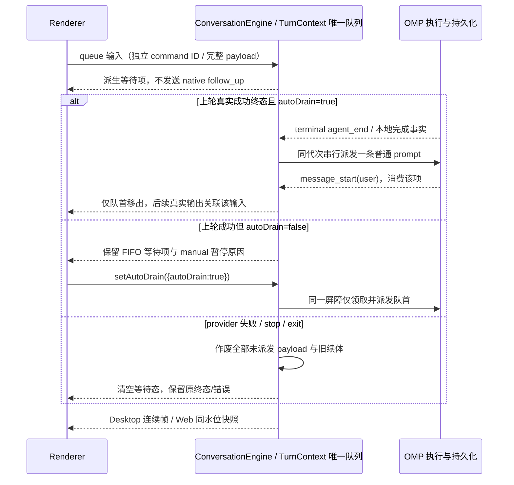
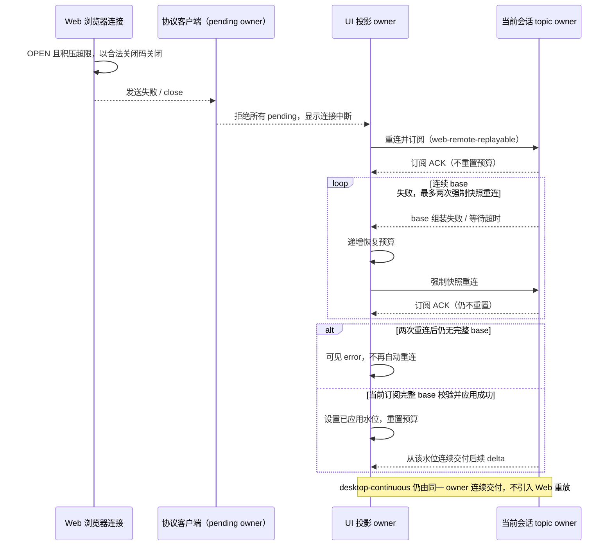
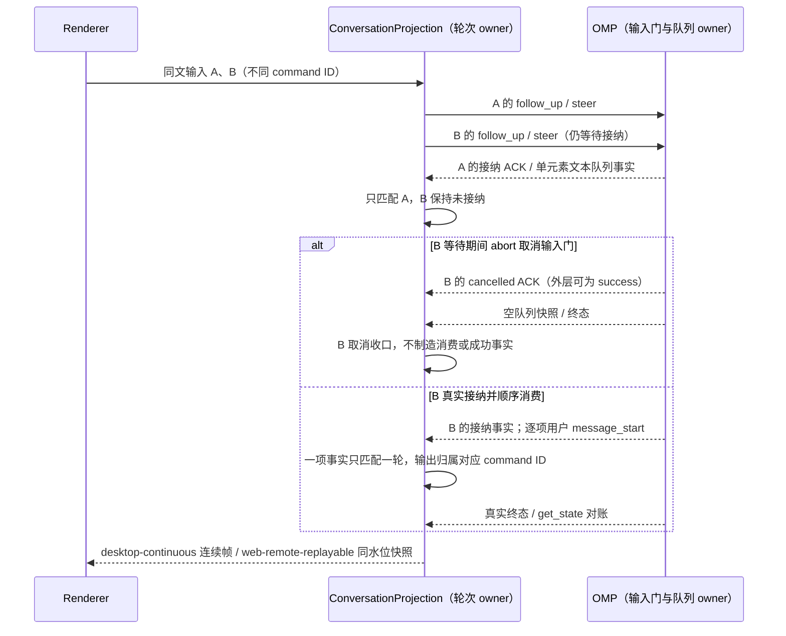
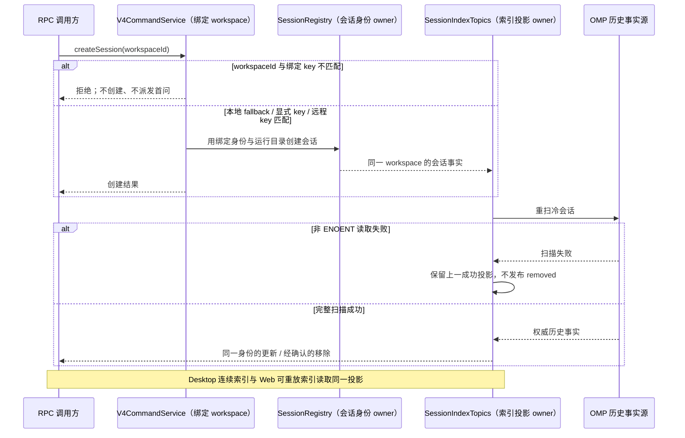

# 会话身份、恢复与故障语义

## 产品规则与所有权

- 协议客户端拥有未完成请求：响应、超时、取消或销毁可以先于 transport.send 完成，响应 Promise 必须立即建立拒绝处理，再向调用方保留原始错误；不产生 unhandledRejection 或 rejectionHandled。验收覆盖发送尚未完成时的错误响应、销毁、取消、超时及发送失败。
- Host 是 attachment 与本地服务释放顺序的唯一所有者：先停止接纳 attachment 事件，等待已登记 attachment 的 `closed` flow 与 topic unsubscribe 完成，再等待 task-index 的 sessions-index/workspace-config unsubscribe，最后释放协议客户端与 transport。重复关闭共享同一释放结果；正常关闭不因自身抢先销毁客户端产生 disposed 错误。真实 RPC、传输或清理失败保留原有失败结果与日志，不以降级日志、吞异常、重试或新增超时替代生命周期收口。

- 进程拓扑按 [omp-core-integration.md](omp-core-integration.md) 执行：每会话一个惰性 omp 进程 + 每 workspace 一个常驻目录进程；会话身份沿用「临时 ID → omp 会话文件 UUID」迁移规则，本文件其余身份、恢复与收口规则不受拓扑影响。
- v4 topic 的生产者与组装器使用同一物理帧计量函数。帧上限覆盖 CLI NDJSON 与 Channel socket 两种承载；超过上限时生产者先分片，组装器只接受合法帧。逻辑快照的序号和重放语义不因分片变化。
- omp 会话引擎拥有当前轮、排队轮和待回答交互。命令发送失败或核心退出时，引擎将相关轮次与交互终结；本地命令没有 `agent_start` 时，按关联的完成事实终结其排队轮。已完成轮次不得被迟到的结果再次更改。
- 用户停止先在 `ConversationEngine` 唯一队列 owner 中作废全部尚未派发的 payload 与等待投影，再通过 OMP 原生 `abort_and_restore_queue` 原子撤回在途 native guide 并中断当前轮；不能使用保留 native 待处理输入的普通 `abort`，也不能拆成清核心队列和停止两条命令。停止/退出 fence 在异步派发前生效，每个配置与命令解析 await 后都复核原租约；原生请求、pending、ACK 与 `prompt_result` 保持同一命令 ID，旧 ID 或旧代次响应不得取消之后的新输入。GUI 保留三条等待项停止后全部移出、零残留模型调用及同会话显式续发验收，不以隐藏面板代替真实 owner 作废事实。
- 远端 server 和 Agent 的部署根统一为 `~/.ompcode/server`。启动 wrapper 只执行当前部署的 Node 和 Agent 文件，不读取 `~/.zcode`。
- HTTP server 在无鉴权凭据时只监听回环地址；显式指定非回环监听时必须配置鉴权凭据，否则启动失败。WebSocket 断开时客户端拒绝未完成 RPC，Web 页面显示连接中断并重新建立服务连接。
- Desktop Main 是 window-scoped Host 的生命周期所有者。Host 非预期退出时通知 renderer 并重建连接；旧 Host 的迟到 exit 事件不得注销新 Host。退出清理预算与 Main 强杀预算一致，不能依赖超时掩盖未完成清理。

## 时序与失败语义

```text
omp 输入 → 会话引擎 → omp RPC → prompt_result / agent_end / 发送失败
                         └→ 同一轮次所有者终结投影与 pending 交互

desktop: continuous ──┐
                      ├─ 同一 Host owner / topic seq → UI 投影
web: replayable ──────┘

Host 旧进程退出 → 比对当前登记身份 → 仅清理旧登记 → 重建或通知当前窗口
```

重连只能以当前 workspace identity 和 session owner 为准。重复关闭、迟到回调、重复 commandId 必须幂等；失败须在 UI 或 RPC 结果中可见。既有数据不迁移，现有用户设置与未提交工作区改动保留。

## 验收场景

1. 超过 1 MiB 物理上限的会话帧在生产者分片后通过两种承载的相同上限校验，接收端可组装快照；不超限的帧直接交付。
2. omp 发送拒绝、核心退出、流式期间本地命令和已取消交互都能收口，不留下永久 running 或假 accepted。
3. 干净远端只部署 `~/.ompcode/server` 仍能启动 Agent；无 token 的 HTTP 入口不暴露在非回环接口。
4. Web 断线拒绝挂起 RPC，恢复后重新订阅；Host 意外退出后窗口能恢复或明确显示失败。
   同一 workspace 首次并发执行共享一代启动结果，所有调用都可继续；启动中释放或换代后旧调用必须失败，不向新进程派发，也不能让旧续体注销新登记。启动失败后下一次调用能重新启动。
5. 命令目录与不可用命令的可见行为分别按 [模型与命令](models-and-commands.md) 和 [能力边界](FORK.md#已知与允许的差异) 验证。
6. 通过真实桌面公开入口完成一轮对话后正常关闭窗口/应用；Host 先完成 attachment closed/unsubscribe，再完成 task-index unsubscribe，最后关闭 Agent transport。`electron-stderr.log` 与本次独立运行的 `*_ompcode/v2/logs` 均不得出现自身关闭顺序导致的 `v4/conversation/unsubscribe`、`v4/connection/flow` disposed 或 sessions-index/workspace-config 清理失败。真实 RPC 拒绝/断连仍保留失败日志，不以强杀根作为正常关闭证据。

## 资源生命周期与已知限制

- 缺陷证据须来自当前 Fork 可达路径。账号体系与插件运行时范围分别见 [模型与账号要求](models-and-commands.md) 和 [原生集成](integrations.md)，休眠分支不能冒充当前产品能力。
- 会话轮次由 `ConversationEngine` 持有；omp 崩溃时先固化恢复文件，再终结在途轮次并复位进程级流式状态。相同 commandId 的在途请求只派发一次，附件 staging 按最后一次成功分片活动计时并回收。
- 远程连接由未认领注册表移交给 WebSocket；未认领超时释放，认领后随连接关闭释放。Docker/WSL 后端仅清理各自登记的子进程。桌面 Host 退避按连续短命故障计数。
- 命令与子代理文件操作在服务层校验路径；项目级删除接口当前缺少 workspace 身份，目录形状校验只能缩小风险范围，不能证明路径属于当前工作区，不得宣称任意路径删除已完全封闭。
- 终端会话释放失败是生产环境可用的生命周期诊断，应经 UI logger 的 lifecycle 通道写入桌面日志；不得在生产构建中静默丢失。

验收包括与改动关联的 UT、真实 E2E、类型检查、Lint 和架构检查；对休眠分支的纯函数断言不作为当前产品缺陷的证据。

## 冷历史与身份连续性

- omp 当前根/profile 下的 sessions 是会话历史事实源（默认 `~/.omp/agent/sessions`）；根目录环境规则唯一维护在 [模型与命令](models-and-commands.md#产品规则与所有权)。任务索引只保存其投影。冷恢复按 omp 会话文件的稳定 ID 绑定，首次订阅的可恢复失败由 UI 投影层发起最多两次强制快照重连。
- Agents 真实 GUI 的 live 收据先记录父与全部真实子代理 journal 的逐字节长度/SHA256、精确历史与身份；只有该轮 owned GUI 完成正常 shutdown 后才能定版。定版必须证明原有字节前缀完整不变，每个 journal 只允许零条或一条 `custom/session_exit`（`reason=dispose`、`kind=normal`、合法关闭时间与原尾链衔接）追加；不能忽略全部 custom/退出记录、放弃 SHA256 或接纳任意新快照。fulltest 与独立阶段 runner 共用同一定版入口，失败不得产出已定版收据。新进程同 root 冷恢复只与 post-shutdown 精确快照及全部 journal 字节 hash 比较，读取期间任何追加、正文/工具/消息/身份变化均失败。
- 同一 agents 收据内的 compact-panel Stop 独立父/子 journal 也属于上述定版事务：live 时保留其完整字节基线，关闭时经过同一个 normal-exit 追加校验器后才更新嵌套 snapshot 与字节 hash；任一原始或嵌套 journal 校验失败均不写已定版收据。冷恢复的 `recoverPanelStop` 必须消费这个已验证的 post-shutdown 嵌套基线，不继续引用 live 指纹，也不能在失败 recovery 已关闭的旧根上重新定版。
- **协议缺口（懒落盘）**：OMP 普通会话在首个 assistant 消息（或显式 `ensureOnDisk`）之前不写会话 JSONL（上游 `docs/session.md`「A new ordinary session remains memory-only until it contains an assistant message or a caller invokes `ensureOnDisk()`」；`session-manager.ts` 的 lazy gate 注释「sessions that never produce output never create a file」），且 RPC 面不暴露 `ensureOnDisk`/`isSessionOnDisk`，适配层无法要求核心提前落盘。因此会话在首个 assistant 消息落盘前被强杀（SIGKILL）时，磁盘上不存在该会话文件：适配层按事实拒绝 `session/resume`（-32004），不伪造空历史、不复制模型历史、不以新会话冒充原会话（OMP 对缺失文件执行 `--resume` 直接 `exit 1`「Session not found.」）。用户可见结果是这种崩溃会连同未落盘的输入一起丢失该会话；首个回合成功落盘后，冷恢复、队列撤销与「不重放等待输入」语义不受影响。真实 E2E 的 exit 场景据此先完成一个真实回合让 journal 落盘，再验证杀核后的冷恢复。
- 会话列表不得因固定数量截断而隐藏仍存在的 omp 历史；按 ID 恢复与删除必须直接定位该工作区的会话文件，不依赖列表展示窗口。历史分页可渐进加载，但不得把读取预算当作已删除的历史，较早的消息应能继续读到。
- `deleteSession` 表示永久删除：先确认 omp 文件删除成功，再移除索引和广播删除事实。已加载和冷会话遵守同一结果；存储失败时返回失败且历史仍可重新打开。`session/close` 只释放当前引擎，保留已落盘历史。
- 关闭的登记边界由 `SessionRegistryGates` 唯一维护，`SessionRegistry` 唯一持有在途恢复；关闭不仅覆盖已登记引擎，也作废关闭开始前尚在创建屏障、冷摘要查找或历史水合中的同身份恢复。作废依据请求 ID 和冷摘要确认的 canonical ID，不把尚未解析的旧 alias 当作另一会话；workspace 与会话文件 epoch 的既有 owner 校验保持不变。
- 关闭不等待在途冷恢复的读取完成，不新增重试、超时或永久关闭墓碑；关闭窗口结束后新显式恢复可重新读取历史，不能复用已作废的恢复 Promise。旧恢复晚到时按既有 `-32004` 不可用语义拒绝，不登记引擎、不覆盖新 owner 或清掉新 owner 的索引；永久删除墓碑和 registry dispose 仍优先拒绝登记，删除失败仍按既有语义回滚。
- 验收事件顺序：真实 OMP 已持久化历史并关闭 → 发起冷恢复且阻塞实际冷摘要/历史读取（此时无已登记引擎）→ 通过同一会话的另一 alias/canonical 地址发起并等到 `session/close` 返回 → 释放旧读取 → 原恢复返回 `-32004`，alias/canonical 均没有残留引擎；随后新显式恢复成功、历史内容保留且旧/新地址只解析到同一 owner。覆盖 alias 恢复/canonical 关闭及 canonical 恢复/alias 关闭，并覆盖关闭返回后新恢复先于旧读取完成的交错。相同原始地址受既有协议请求尾链串行保护，应先完成恢复再执行关闭，不强造关闭先返回的不可达交错；不以假 OMP、时间等待或放宽断言充当证据。
- 主进程角色设置和适配器冷会话扫描使用同一共享根/profile 解析，遵循 [根目录环境规则](models-and-commands.md#产品规则与所有权)。每个 topic 订阅的逻辑帧序号严格递增，取消订阅后清理计数，防止帧组装器把后续会话索引判为冲突。
- Windows 临时工作区位于用户主目录内时，冷会话扫描按 omp 的临时目录编码定位历史文件；重启后能按稳定 ID 恢复该工作区的主会话及子代理记录。
- write/ask/task 的真实冷恢复验收先观察公开 sessions-index 完成临时 ID → 原生 UUID 迁移，再以精确 toolCallId 将 UUID 与原场景关联；轮次终态本身不是身份元数据屏障。关闭并冷订阅使用该稳定 UUID，不把未持久化的临时创建地址当作原生会话 ID。冷子详情以同一实际子代理 ID 和父工具调用为证据，视图地址绑定恢复后的 canonical 父 ID；文件、ask 结构化答案和子记录均必须保留，冷读取不能重发模型任务。
- 冷 journal 水合发布完整历史快照，不重放或补造 live 的 `turnHeader` / `agent_end`。验收等待本次订阅的快照实际到达后立即核对原始输入、精确工具 ID、参数、成功结果及已完成正文；不能用等待 live 轮次终态的 helper 判断冷历史是否完成，也不能因没有 live 头行而延长等待或重发输入。
- 原生可见 custom（含 `team-result` 完整最终报告）与 live `command_output` 的冷恢复合并由现有 `mergeOmpCommandOutputHistory` 唯一负责。已有派生显示记录与同一 session epoch 的原生 custom 按类型、完整正文、原生时间因果顺序一对一匹配后，只消除对应的原生重复显示行，保留 live 已发布的 `omp-command-output:<id>`、完整正文和显示时间；不能因 journal 后落盘而删除 live 身份，也不能按同文全局去重吞掉不同事件。没有派生记录的原生历史仍按原生身份显示，不造 ID、不造报告、不新增持久源。
- 原生 journal 的 custom 正文事实不等于 GUI 已发布的显示身份事实。`OmpCommandOutputStore` 是派生 `command_output` 持久记录的唯一 owner：无论核心在事件前还是事件后落盘，均通过既有串行写链、association/alias 与 flush 保存原始 `id/text/createdAt` 及已有 epoch 关联；同 ID 追加幂等，不按同文吞掉独立事件。仅由 domain merge 消除对应的原生重复显示，store 不以“正文已在 journal”为由丢弃 GUI 身份，不新增 schema、索引或第二份状态。已有删除/epoch 隔离和持久错误传播语义保持不变；验收须覆盖公开 append → flush → 新 store read → domain merge，精确恢复全文、身份和顺序且仅一次可见。
- 显示时间与原生因果时间是两个不同角色：`OmpCommandOutputBridge` 统一以实际接纳/发布时的 `Date.now()` 生成 emit 与 custom 的 `createdAt`，它属于已发布 GUI 收据，持久化及冷恢复必须原样保留；custom 的 `nativeTimestamp` 单独保留原生事件时间，仅供同 epoch journal 的因果一对一匹配，不参与替代显示时间。根因是原生报告在生成时间之后才送达，若 custom 沿用较早的原生时间，而先收到的「讨论完成」使用发布时间，冷合并按 `createdAt` 会把报告错误排到完成提示之前。修复不增加时钟状态、序号、schema 或迁移兼容层。
- 时间角色回归必须经过真实 `OmpCommandOutputBridge` → `ConversationProjection` 与增量消费者 → 真实 store 保存/flush/重开 → 原生解析/合并/冷快照：先 emit 完成提示，再接纳原生时间更早的完整 custom 报告；原生先落盘与后落盘两种顺序均保留 live 全部 ID、全文、显示时间和顺序，同文独立报告各显示一次，journal 字节不变。原生 entry 时间晚于事件时间但早于显示时间时仍须匹配，证明匹配使用 `nativeTimestamp` 而不是 `createdAt`。
- custom 冷恢复验收：真实 native `team-result` journal 已持有最终 Markdown，live 显示收据也已有该事件；经冷解析、既有显示历史合并、水合及公开快照读取，逐条比较所有 command_output 的 ID、完整正文和顺序，恰好一次；同文不同事件与相邻命令输出保持独立。重复纯合并必须幂等；重复公开订阅/读取由 `SessionRegistry` 复用已登记 owner（在途恢复共享加载），不得再次向同一投影追加初始化历史。`hydrateRows` 是无订阅者的新投影初始化入口，不约定为重复追加的幂等 API；验收以公开重复请求而非直接重复初始化为准。不启动模型、不追加 journal；`team-dispatch` 仍不作为 live 从未收到的时间线结果补入。
- 成功 `read` 的 GUI 工具输出优先使用同次 OMP 结果持久化的 `details.displayContent.text`，并在存在 `details.meta.source.value` 时保留原来源；live 与冷恢复经同一 domain 转换写入现有 `output.text`，UI 不读取 OMP 帧或当前文件。模型上下文的压缩/替代文本不是 GUI 历史正文的唯一事实；同一路径不同调用的原版与更新版分别按各自结果保留，不能用当前内容回填旧读取。无有效 displayContent 的读取、非 read、错误或取消结果保留真实工具正文与终态，不从 display 元数据伪造成功。该转换不改变工具身份、输入、行序、序号、终结时间或会话活动时间，不新建持久层或历史 owner。
- read 显示验收：对真实 journal 的旧原版、更新版及普通/错误工具结果，分别经 live `ConversationProjection.upsertToolCall` 和冷 `rowsFromOmpEntries` → `hydrateRows` → `buildSnapshot` 读取公开工具行；正文与来源按独立预期逐项核对，原/更新版本不得互相覆盖。缺失或畸形显示元数据、空显示正文和错误读取保持确定语义；消费快照及标准增量的客户端看到同一结果。真实 journal 只读，验收不得重读源文件重建旧正文。
- `ConversationEngine` 及既有 `TurnContext`/队列唯一接纳应用 queue 输入，每项仅持一份完整 `text/originalText/images/modelSelection/sourceCommandId/clientId` 与实例代次；不新增平行 Map、队列日志或 Renderer 已接纳状态。运行中 queue 不预塞 native `follow_up`。上轮真实成功终态后，仅当既有 `queue.autoDrain=true` 时，经同一串行 owner 屏障派发队首的普通 `prompt`；`false` 保留所有未消费 FIFO 等待项，暂停原因沿用协议 `pauseReason: manual`。真实用户 `message_start` 才激活该项、移出等待态并关联后续输出，ACK 不等于消费。provider 失败、停止或进程退出仍先作废所有未派发 payload 与等待投影，保留原始错误；旧代次的配置/派发续体不得启动新轮。
- 既有公开 v4 `setAutoDrain({ autoDrain: boolean })` 直接更新同一投影/owner，不改命令名、载荷、幂等 ACK 或 GUI 恢复入口。`false` 不打断已派发轮；`true` 清除暂停原因，闲态经同一串行屏障推进一项，忙态只武装成功后续派发，重复 `true`、迟到终态与旧代次不得重复领取或重启失败/停止已取消的项。native `guide` 继续使用真实 `steer`，同文输入各有独立 command ID；终态与 steer 在途/转等待竞态由同一 owner 收口，失败时不隐式重发 guide。无模型内容的本地 slash 完成按原命令身份终结一项，再按同一 `autoDrain` 策略推进下一项；附件字节与每项模型选择必须保留到该项真实派发。Desktop 连续流与 Web 可重放快照仍读取同一投影，编辑、重排、删除与立即发送的能力禁用矩阵不变。



- `edit` 文件变更以成功的工具结果为准。默认 hashline `input` 中的文件段提供路径，工具结果中的统一 diff 提供实际增删行；多文件调用分别归入当前轮。无可验证路径或 diff 时不编造增删数。
- `SessionRegistry` 是会话对外身份与 sessions-index / workspace-config 序号的所有者。临时 ID 绑定 omp UUID 后，索引、会话 topic、快照和 legacy 读取必须指向同一会话；迁移期间已建立的旧 ID 订阅继续可用。恢复快照的 `toSeq` 必须是该 topic 当前水位，恢复后的下一条 delta 从该水位连续前进。
- Host 的持久任务索引保留用户组织信息，并按 [根目录/profile 隔离规则](models-and-commands.md#产品规则与所有权) 选择数据库。切换 OMP 根目录后，不从旧根的索引恢复 UUID；旧目录与索引保留供切回使用。临时 ID 迁移至 UUID 时，任务行、分组、排序、置顶、归档、未读和定时任务关联作为同一任务迁移；冷启动对账只清理真正不再存在的旧行。
- Host 的任务索引同步器是任务 ID 迁移关系所有者；持久化 rekey 成功且当前 workspace 代际仍有效后，在现有 `workspace_task_list_changed` 事件发布可选 `taskIdMigration: { fromTaskId, toTaskId }`，事件的 taskId/taskMeta 使用目标 ID。不另建 RPC/topic、不改运行中身份或 seq/ACK。UI 经现有 workspace 事件入口将映射交给草稿 owner，具体草稿冲突与恢复规则唯一维护于 [输入区需求](composer.md)。失败或过时代际不发布迁移成功，重复事件不得制造重复任务/草稿。
- 同一 rekey 事务将权威 `taskIdMigration` 保存在既有任务 `meta_json`，不另建表或第二份映射所有者；后续 runtime snapshot/meta 更新保留该字段，不能由 Agent 的旧投影清除或伪造。已有任务列表读面返回此元信息，用于 Renderer 未收到事件或 Host 重启后的草稿补迁；校验目标 ID 必须等于任务 ID、来源与目标不同。没有权威映射的历史记录保留，不猜测、不回填虚假关系。
- Desktop Main 在创建窗口时将本次实际 profile 同步投影给 preload/Renderer；草稿正文与 Recent 模型偏好按该运行 profile 隔离，不读取设置页尚待重启的选择。默认 profile 沿用已有存储键，非默认 profile 使用独立键域；切回时读取原值，不迁移、不清除其他 profile 的未提交内容。
- 冷会话文件系统时间戳进入 Host/任务索引前要规范为安全整数毫秒，避免列表校验失败、临时任务未清理。
- 会话列表的活动时间来自会话输入、回复、工具结果或可见命令输出，不来自列表查询、冷恢复水合、`get_state`、订阅或正常 `custom/session_exit`。冷恢复读取与正常关闭不得把查看过的任务提升为最近活动任务；持久任务索引和实时摘要沿用同一历史活动事实，保留既有严格侧栏顺序验收，不通过排序后比较集合掩盖重排。
- 辅助主题的空地址到真实主题地址绑定与 sidecar 冷恢复按 [OMP 辅助对话](omp-core-integration.md#辅助对话原生-btw唯一需求权威)；不从主 transcript 推测辅助历史，不因恢复自动重发问题。

```text
omp 首轮终态 → 临时 ID 终态通知 → UUID 绑定 → 索引身份迁移
  → Host 持久行及 meta_json 的 from/to 同事务迁移成功
  → 现有 workspace 事件发布 from/to / 断线后从既有任务列表读取 from/to
  → UI 唯一草稿 owner 原子迁移并重定向保存 → 会话 topic / legacy / UI 同源

desktop: continuous ── 实时帧 ───────────┐
                                         ├─ 同一身份和单调序号
web: replayable ───── 快照 + 断档恢复 ───┘
```

- 新会话首轮前后、继续对话及重启后只有一条任务；旧订阅不丢帧，UUID 订阅收到同 topic 帧；持久组织信息不丢失。重复身份迁移与重复恢复不产生重复行或回退水位。
- 索引/配置恢复后下一条 delta 连续，桌面实时与 Web 恢复语义均不退化。

- 冷会话标题取 title 或首条用户消息，行按 omp 文件内容作防御式投影；用户显式删除会话时删除对应 omp 会话文件，不静默清理历史。
- 验收：冷恢复失败最多自动重试两次；profile 路径一致；guide/queue 的轮次归属、失败收口与文件变更统计在两种交付链路一致，缺少事实时不编造。
- 验收：Windows 隔离 GUI 使用真实 OMP + 本地模拟模型，按[测试契约](test-gates.md#本地模拟模型契约)连续三次输入 `hello`，队列展示独立条目，消费后逐项移出且输出可关联；失败、停止、进程退出与快照重放不得留下虚假的工作中条目。Todo 写入三个内容为 1–3 的文件并删除，开启「显示待办」时界面展示真实进度；子代理返回 `hello` 时运行态、完成态和只读详情与核心记录一致。其他调用规程仅见 [e2e.md](e2e.md)。
- queue cutover 验收：成功只逐项派发、三条同文保持独立身份和 HTTP 一一对应；provider 失败/stop/exit 后所有未派发输入均不进入模型请求，显式续发不携带残留；停止与配置/图片准备/派发交错时旧代次不得续跑。每项图片、合并文本及模型选择保持原值；本地 slash 的无内容完成推进正确一项；guide 在途 ACK、真实消费与终态交错不重复发送或假成功。原始错误、已消费历史及同根冷恢复内容不删除、不伪造。
- autoDrain 验收：通过既有 v4 命令在当前请求期间暂停，三项独立 FIFO 输入在成功终态后均保留、无新模型请求、`autoDrain=false/pauseReason=manual` 可见；闲态恢复后逐项恰一次派发并仅由真实消费移出，忙中重复恢复不抢跑。失败、停止、退出后恢复不得重启已取消输入；Desktop 与 Web 读取相同队列状态，不启用编辑、重排、删除或立即发送。
- 验收：超过 100 个会话仍可列出并按稳定 ID 恢复；超过 4000 条记录的历史能够回读较早消息；已加载和冷会话永久删除都删掉对应文件并更新索引；模拟文件删除失败时命令失败、文件和索引不被报告为已删除。
- 验收：在 Windows 用户目录下的系统临时目录创建会话并执行子代理，关闭并重新启动桌面应用后，任务列表中的稳定 ID 能打开完整主会话及子代理记录。

## 上游审查补充验收与所有者时序

以下边界补充既有规则，不更改历史验收结论；审查 ID 用于逐项记录本次可观测证据，不表示已通过。

- **F001 — 浏览器背压关闭与 pending 收口**：真实浏览器连接处于 OPEN 且发送积压超过既有 16 MiB 阈值时，客户端使用浏览器允许的关闭码（1000 或 3000–4999）关闭，不同步抛出 `InvalidAccessError`；关联发送失败、连接 close 与所有未完成 RPC 的拒绝均可观察，不能遗留 pending。Web 页面显示中断并沿既有入口重连、重新订阅，恢复后可继续正常请求；积压未超限时仍正常发送。该浏览器关闭/恢复边界属于 `web-remote-replayable`，不得借此要求 `desktop-continuous` 增加 WebSocket 重放语义。
- **F027 — 强制快照重连预算**：UI 投影 owner 对一次连续恢复失败最多发起两次自动强制快照重连。订阅 ACK、分片开始、部分帧或尚未应用的 initial/recovery 都不重置预算；只有完整 base 通过组装和序号校验、成功应用到当前身份/订阅的投影后才重置。验收连续三轮“订阅 ACK 成功但 base 组装失败或等待超时”：首次失败后重连 1、再次失败后重连 2、第三次失败进入可见 error 且不再自动重连。另验收第二次重连取得完整 base，后续 delta 从该水位连续前进，之后新的恢复故障可重新使用两次预算；旧订阅迟到 base 不得重置当前预算。`desktop-continuous` 保持连续交付，`web-remote-replayable` 保持水位增量/缺口快照，不混用两条链路的恢复方式。



- **F010 — success ACK 不是消费事实**：运行中 `steer`/`follow_up` 在输入门等待时被 abort 取消，RPC 外层仍可能返回 success 且不携带取消结果；因此 ACK 不能登记为已见/已消费。验收成功 ACK 后的空队列快照不能把该输入标为成功完成；独立 command ID 对应轮以取消/失败收口，不留工作中条目，也不显示假成功。正向对照为未取消输入按核心真实队列快照、消费及终态事实收口。
- **F018 — 同文命令一对一匹配**：两条同文本、不同 command ID 的排队输入先后建立独立轮，第二条 RPC 尚未接纳时，核心单元素队列快照只能匹配第一条，不能把两条一起记为已消费。核心只有文本快照时按顺序和条目数量一对一匹配，单个事实不得复用；消费一项只移出一项并关联其输出。验收停止边界的空快照先于第二条 ACK 到达时，未接纳的第二条不能假成功；两条均被真实接纳并逐项消费时各自正确收口。重复投递同一 command ID 仍幂等，迟到 ACK 不改写已终结轮。



- **F013 — 冷扫描失败不等于删除**：已有冷会话投影后触发重扫，模拟目录或派生历史的非 ENOENT 读取失败；失败可观察，保留上次成功的会话摘要及其身份/索引，不广播 `session.removed`，仍存在的文件不被清理。扫描失败时返回空数组或局部结果不得冒充完整成功扫描。读取恢复后，后续正常重扫应更新标题等事实；只有成功的权威扫描确认缺失，或既有永久删除流程确认文件删除成功，才发布对应移除事实。已加载与冷会话都不能因同一次失败误报删除。
- **F016 — createSession 归属与运行目录一致**：公开 RPC 的 `payload.workspaceId` 必须与当前 Agent 绑定的 workspace key 一致，运行目录仍为该绑定的 workspacePath；本地未配置显式身份时沿用绑定路径 fallback，远程或已配置身份时使用绑定 key，不能把另一 workspace 的 key 当作同一路径的别名。验收绑定 W1 却提交 schema 合法 W2 的创建请求，包含有/无 `firstInput` 两种：明确拒绝且不创建引擎、进程、会话文件或 W2 索引行，不发送首问；匹配的本地 fallback、显式本地 key 和远程 key 均可创建，首问进程 cwd、会话索引及订阅归属指向同一绑定工作区。



## 实现与验证状态

需求从原有权威 FORK 与对应 spec 迁入，未因当前实现降低要求。既有实现及历史验证不等于本次验收；统一证据边界见 [需求索引](README.md#实现与验证状态)。

- 2026-10-09 核心体验续作：F001 的真实 Chromium 积压/关闭/待处理 RPC 拒绝/重新连接读取通过；F010/F018 的取消 ACK 与独立同文消费身份、F013 的冷扫描失败保留、F016 的创建身份及 F027 的 ACK/有效内容恢复预算边界回归通过。OMP 全集 374/374、0 跳过，UI/Host 定向组合通过；真实桌面完成首次 UUID 迁移、旧 scope 草稿、正常退出与 R7 cold。协议模拟不冒充真实网络断线或每种中断时序的产品 GUI；完整门禁另行执行，证据见 [核心体验续作验收](../test-reports/performance-hot-paths-2026-10-09.md#核心体验续作验收)。
- 2026-10-18 定向真实 GUI（已安装 OMP + 本地模拟模型）：`F:/Temp/User/recovery-profile-final-inter-1810` 的 interactions live→recovery 均 `SUITE_EXIT=0`；`F:/Temp/User/recovery-profile-final-models-1810` 的 models live→profile→default 均 `SUITE_EXIT=0`，证据在各根 `evidence/`。修复开发态 renderer origin 漂移、强杀前 Chromium 存储未刷盘、空启动 profile 覆盖 GUI 设置，以及 Composer 草稿/Recent 缺少运行 profile 键域。桌面定向 tsup 构建通过；没有运行门禁套件、Lint 或格式化，新增 `composerProfileStorage.test.ts` 尚未执行。本记录仅证明这两个 suite 的指定相位，不代表完整产品验收。
