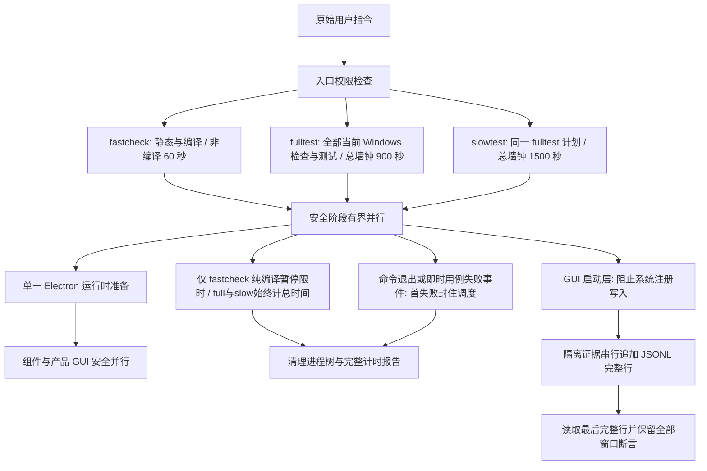
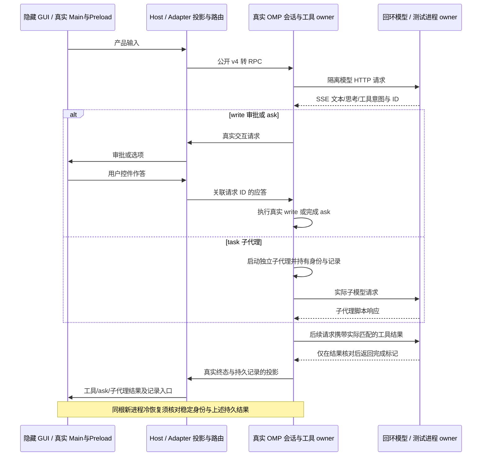

# 三级测试入口

本域维护 **Windows 本机**现有 OMP 核心及上游保留测试的三级编排、覆盖关系与验收。不执行 CI、发布、Computer Use 或接管全局鼠标/前台焦点的测试。项目没有适用的 WSL 测试扩展，AI 不执行 CentOS/Linux/WSL 测试；slowtest 报告 `SKIPPED_NOT_APPLICABLE` 并与 fulltest 覆盖相同。产品两平台分发要求不属于测试通过结论。

## 所有者与入口

- 根 `package.json` 提供 `pnpm fastcheck`、`pnpm fulltest`、`pnpm slowtest`；三个入口只允许 Windows 执行测试。Node 支持范围沿用根 `package.json` 的 `engines.node`（当前 `>=24.0.0`）；`mise.toml` 的 Node 固定版本仅用于可复现开发基线，不是门禁精确版本准入条件。脚本复用并记录当前 Node，不自动降级或安装；pnpm 仍按 `mise.toml` 校验固定版本，不清除缓存。
- `scripts/test-gates.mjs` 拥有入口权限、最终状态及快照；过程模块是单一计时、阶段准入、首失败记录与所属子进程树所有者。命令的失败事件直接通知调度所有者，不等待阶段 `finally` 或流关闭；收尾不能吞掉原失败或将其拖成超时。只调整编排，复用原有检查、编译和测试原语，不修改产品代码、测试断言或质量配置。结果绑定 HEAD、未提交差异、内容指纹及工具版本。
- `fastcheck` 只运行增量 TypeScript 编译、Lint、变更架构和格式检查；根检查之外复用 formal-proof 的独立 typecheck 与 Lint 原语，纯 TypeScript 编译均按编译计时。不执行任何 UT、集成、GUI、冒烟或门禁自检。大量变更格式名单按 Windows 命令行上限分批，不截断。安全独立阶段有界并行，非编译预算最多 **60 秒**。
- `fulltest` 包含 fastcheck 全部检查原语（全量检查可覆盖其变更子集，不重复运行）、全部现存适用 Windows 核心/上游测试、门禁自检、真实 OMP + 本地模拟模型 E2E，以及当前 Main/Host/Preload/Renderer 构建、工具详情和真实产品 GUI 启动/身份/同根冷恢复。模型模拟只替换模型响应，不替换 OMP、工具、审批、协议、持久化或 GUI。复用现有本地资源准备与 Electron unpacked 打包原语和 afterPack 校验，显式 `--publish never`，不调用发布入口；不等同正式安装器或两平台分发。**总墙钟最多 900 秒，包含编译、准备、测试、报告与清理。**
- `slowtest` 复用 fulltest 相同计划一次，不再用 GUI 或较慢的当前平台测试区分层级。项目已取消 WSL 测试扩展，不探测或启动 WSL，也不额外增加环境、CI、远程阶段或重复 fulltest。**总墙钟最多 1500 秒，包含编译；不是可暂停的非编译预算。**
- 先前用户授权精简的 Fork 新增专项保持已删除；上游原有测试与有效断言仍全部保留。不再按耗时移动层级、删除现存测试或缩减覆盖。当前快照没有预算超限依据，不启用 `fork-affected` 缩域；不宣称已验收历史删除专项或两平台打包。
- 编译前后复用既有 `tsc -b` composite/incremental、固定 dist/out 和稳定 Vite 缓存，不调用 clean 或为计时删除/切换缓存。只将纯编译原语标记为编译；staging、初始化、准备、静态检查、测试、等待、快照、聚合与清理均计入非编译时间。GUI 中的 Vite 懒编译是混合测试阶段，保守全部计费。
- 每个入口只有一个单调时钟：`budgeted = total - compile_excluded`；排除观察到的“至少一个编译活跃且没有非编译工作活跃”的区间并集用于诊断。只有 fastcheck 按 `budgeted` 限时；fulltest/slowtest 始终按 `total` 限时，编译、并发、连续阶段及收尾均不暂停或重置截止时间。
- 编译、检查及独立离线测试安全并行；adapter 编译先于 staging，桌面编译先于产品 GUI，同根 live/cold 先后执行。独立 GUI 使用不同根/端口/进程；依赖或共享不兼容产物的阶段保留屏障。
- Electron npm 运行时是组件及产品 GUI 的共享依赖；门禁在并行运行它们之前，串行调用同一 Desktop 包解析得到的 `require("electron")`，完成缺失二进制的下载与解压。准备阶段计入非编译预算，失败阻止所有 GUI；既有安装直接复用，不修改依赖安装器、不清缓存，也不让并发测试同时改写共享可执行文件。
- 预算包括入口准备和最终所属进程树清理，提前预留清理余量；只有 fastcheck 的纯编译区间暂停非编译定时器。fulltest/slowtest 从入口起使用不可暂停的总时限；首失败立即收尾，硬截止在收尾期间仍保持有效，不能因等待用例、验证回调、进程关闭或清理 Promise 而无限等待。到时强制非零退出，停止全部所属子进程，不再启动后续阶段。`--budget-seconds` 只能下调 60/900/1500 秒上限。
- 每个成功、失败、缺环境、超时和已处理取消路径均输出 `status / total / compile_excluded / budgeted / limit`，秒数至少一位小数。必须等编译完成且所有在范围内阶段成功才允许 PASS；缺工具/测试跳过不冒充通过。
- 任意检查、编译、测试、启动、工具缺失、未处理异常或阶段首个非通过结果立即停止调度并终止全部门禁所属进程树，不等待并行同伴或整个嵌套测试组完成。Node 测试必须在任意文件或并发子测试首次失败时报告，不得被早先挂起用例的 TAP 顺序缓冲；TypeScript 在首个 error 诊断到达时中止编译树。保留原断言、失败内容和非零状态。失败后的阶段及快照聚合不再启动，取消的阶段不能记为 PASS。

## 环境与失败语义

- 真实 OMP 使用本机安装版本；源码权威及无安装时不验证的规则见 [FORK.md](FORK.md#omp-侧依赖)。缺少安装、二进制或测试发生跳过时，记录未验证而非通过，不静默使用旧缓存核或临时安装。fulltest/slowtest 不读取用户模型凭据、不连接真实提供者、不允许外部模型覆盖或失败后回退；两级使用同一套本地模拟模型计划，不把真实模型调用转移到 slowtest。
- adapter 编译只依赖源码、构建工具和 workspace 依赖，不以本机安装 OMP 为前提；缺 OMP 只阻止真正使用它的真实核心和产品 GUI 阶段，并记录未验证，不能误跳过离线编译。
- 产品 GUI 必须由专用隔离 fixture 提供；保留真实启动、工具结果呈现和 `identityMigration` 的 before/after 同根新进程冷恢复，不连接日常实例。被删除专项不再构成缺环境阶段，也不得在测试结果中声称已验证。
- GUI 判据基于产品契约与独立真实持久记录，不把自动生成的会话标题当作稳定身份。身份迁移按实际稳定会话 ID 验证唯一侧栏项及同根重启连续性。
- 工具结果组件入口自己创建临时 Vite/Electron/userData，不调用模型；它补充工具结果显示验证，不代替真实产品 GUI。
- 产品 GUI 必须使用当前构建的真实 Main/Preload。Preload 需内联其第三方运行依赖，保持既有沙箱与 context isolation 设置；不能因沙箱无法加载 npm 模块而留下空白 Renderer，也不能注入假 bridge、关闭沙箱或加空值兜底冒充通过。
- 产品 GUI 由 `ompCore.launch.mjs` 创建专用临时根、独占端口和当前真实 Electron/renderer；通过 Electron 测试启动层在任何产品 BrowserWindow 创建前设置隐藏、不可全局聚焦，保持真实 Main/Preload、沙箱和安全边界。Playwright/CDP 只驱动目标页面 DOM，不调用 Computer Use、全局输入或通知焦点操作；隔离性须观察实际所有测试窗口，而非仅凭工具名称推断。本地模型配置及测试专用假密钥仅写入隔离根，不读取或复制用户认证库。
- GUI 启动层在导入真实 Main 之前拒绝协议客户端注册及 `reg.exe add` 系统写入；这些系统集成不属于此沙箱 GUI 的验收覆盖，拒绝不能伪装为成功。隔离证据串行追加 JSONL，每次读取最后完整行，仍核对当前 PID、所有窗口状态和新鲜度；不通过重试、忽略写入错误或放宽窗口断言处理 Windows 文件替换失败。
- 隐藏窗口采用 Electron 离屏渲染保持真实 DOM/动画帧可运行；准备及验收截图统一通过该 Electron 进程的 `webContents.capturePage`（保持隐藏、保持唤醒）采集。专用回环临时端口只返回该 fixture Renderer 的 PNG；不通过展示/聚焦窗口获得截图，也不依赖可见合成面。GUI 准备不增加独立的 Playwright 默认截止，仍由外层同一非编译预算终止所属进程树；既有 DOM 验收断言不变。
- 全新 GUI 根必须通过产品公开的首次引导跳过入口完成准备；不能直接改 store 或设置文件伪造完成。就绪须证明引导已关闭、真实主界面入口可用，并保留页面截图；准备失败立即让阶段失败，启动器仍由门禁持有并清理整棵进程树。
- 三个测试入口不接受 `--publish-releases`，不发现或检查 workflow、不调用 GitHub CLI，不推送、不创建 Tag、不发布。CI 不是测试环境或验收步骤；既有分发 workflow 不改动、不触发。
- 源码变化后不能沿用此前测试结果。所有 Windows 测试阶段记录耗时，失败、取消、跳过和缺环境保持非通过状态；CentOS 产品支持及构建期产物完整性约束不因此取消。

## 本地模拟模型契约

- fulltest/slowtest 必须从真实 OMP 和隐藏 GUI 入口覆盖工具调用、子代理与 ask：真实 `write` 审批及文件落盘；真实 `task` 启动的子代理具有独立身份、实际子模型请求、结果和可读取记录；真实 `ask` 的选项在 GUI 作答后回到模型并完成。冷恢复保留工具结果、问答结果和子代理身份/记录，不以父代理最终回复替代子代理运行证据。两级使用同一计划，不将真实模型调用移到 slowtest。
- 测试引擎来自 OMP `57672f546162e16b019484626c3b5fa9300aafef` 的 `packages/ai/src/providers/mock.ts`，事件流支持来自 `packages/ai/src/utils/event-stream.ts`，Anthropic SSE 传输模式来自 `scripts/repo-ui-smoke.ts`。源文件、原始内容摘要、适配范围和未改动的 MIT 许可证登记于 `third-party/copied-components.json` 与 `third-party/upstream/omp-mock.LICENSE`；运行时不依赖相邻 OMP 源码目录、Bun 或生产模型包。全局 provider 注册、catalog 分类及库专属错误类型属于未复制的集成依赖，不以空实现冒充保留；响应脚本、事件、终止与错误的可观察语义必须保留。
- `ompMockModel.mjs` 拥有进程内脚本状态和调用记录，`ompMockStream.mjs` 拥有事件流，`ompMockScenarios.mjs` 拥有严格场景脚本状态、prompt 归一化及工具结果/子模型请求关联，`ompMockServer.mjs` 拥有回环 Anthropic HTTP/SSE 传输、隔离配置及服务生命周期，并调用场景模块；后两者均由同一 `scripts/repo-ui-smoke.ts` 来源适配拆分。真实工具、子代理、交互及会话仍唯一由 OMP 执行。每个服务独占 `127.0.0.1` 临时端口，由所属测试/GUI 启动器持有和关闭；独立 OMP 进程只通过隔离 `models.yml` 连接 `zcode-mock/scripted`。测试假密钥只写隔离根，清除继承的角色/profile/模型覆盖，禁用后台标题生成；不读取用户凭据或复用日常模型配置。
- 模拟测试的隔离边界同时覆盖门禁与可独立运行的核心/GUI 入口：清除继承的认证 broker、`PI_CONFIG_FILES` 配置叠加和 `CLAUDE_CONFIG_DIR` 凭据目录，禁用继承的离线公司模型发现；`HOME` / `USERPROFILE` 指向本次拥有的空目录，避免用户 home `.env` 重新注入凭据或配置根。
- `--no-title` 只禁用会话自动标题；真实 task 仍可能发起任务标签与自动思考档位判断。两类辅助请求也必须由本地模拟服务明确应答，但不得计作子代理执行证据；只有真实子任务 assignment 请求、独立子会话记录及关联结果才能证明子代理已执行。
- 未知场景、错误路径/模型、未配置响应、模拟服务异常或缺失/不匹配/失败的工具结果必须明确失败，不能通用回复成功、仅凭原始 prompt 结束工具场景，或回退到外部模型。HTTP fixture 不写目标文件、不代答 ask、不伪造子代理进程或结果；完成标记须由实际匹配的工具结果驱动，子代理另须观察真实子模型请求及可读取记录。
- 下表是 full/slow 必须满足的能力与证据矩阵，不是通过记录。引擎与传输入口分别为 `packages/omp-agent/test/mockModel.test.ts`、`mockServer.test.ts`；核心入口为同目录 `real-omp.e2e.test.ts`（real 指已安装的 OMP，不指真实提供者）。GUI 入口为 `packages/desktop/test/ompStartup.gui.e2e.mjs` 和 `ompReviewedDefects.gui.e2e.mjs`，均经 `packages/desktop/test/ompCore.launch.mjs` 使用真实 Main/Host/Preload/Renderer/OMP。

| 能力组                 | 进程内引擎验收：`mockModel.test.ts`                                                                                        | 回环传输 / 真实 OMP / 产品 GUI 证据与边界                                                                                                                                                                                                            |
| ---------------------- | -------------------------------------------------------------------------------------------------------------------------- | ---------------------------------------------------------------------------------------------------------------------------------------------------------------------------------------------------------------------------------------------------- |
| 文本、思考和工具块     | 字符串及显式 text、thinking（含签名）、toolCall 的有序 start/delta/end 和最终内容                                          | `mockServer.test.ts` 验证实际 HTTP SSE 文本/思考/工具事件；核心与 GUI 验证流式回复和工具呈现，不据此宣称模型具备推理能力                                                                                                                             |
| 工具参数与身份         | 对象参数与原样字符串参数、显式 ID 与自动递增 ID、实例间计数隔离                                                            | 传输验证 JSON 参数与工具 ID；核心/GUI 实际 `write`、ask、task 按工具 ID 关联后续结果，不能用最终回复替代关联证据                                                                                                                                     |
| 顺序与动态来源         | 数组、同步/异步 iterable、异步 context/options handler、调用记录                                                           | `mockServer.test.ts` 经实际请求验证脚本/handler 驱动，不以 mock fetch 回显代替传输；不要求 GUI 暴露脚本 API                                                                                                                                          |
| push、reset 与优先级   | 构造序列 → push 队列 → fallback；reset 清调用/追加队列/工具计数，但不重放构造序列；实例隔离                                | 属于进程内状态能力，以引擎验收为准，不宣称 HTTP 或 GUI 提供 push/reset 接口                                                                                                                                                                          |
| 耗尽与异常             | 无响应、handler/iterator 抛错、显式 throw 及 onResponse 回调拒绝在事件迭代和 result 中的可观察结果                         | 传输验证未知请求、错误模型、无脚本及工具结果关联失败明确失败；引擎异常不冒充真实提供者错误认证                                                                                                                                                       |
| 延迟与取消             | 正常延迟、已取消 signal 和延迟期间 abort 的终态                                                                            | 传输验证客户端取消/断连及 fixture 关闭；GUI 经真实发送/停止入口观察状态与 Tooltip，保持隐藏不可聚焦                                                                                                                                                  |
| 终止原因               | 默认 stop/toolUse、显式 stop/length/toolUse/error/aborted，错误正文与 error/done 事件                                      | 传输覆盖 Anthropic 可表达的 stop 映射与错误；核心验证工具后续轮和成功收口；不要求所有引擎 stop 字段在 GUI 原样可见                                                                                                                                   |
| 用量与费用             | 缺省零、部分字段、cache 与 orchestration token 合计、显式 totalTokens 优先；费用分量合计及显式 cost.total 优先             | 传输验证 Anthropic 可表达的 input/output/cache token 字段；cost、orchestration 与任意显式总量的完整语义由引擎验收，不声称全部透传到 OMP/GUI                                                                                                          |
| 响应元数据             | responseId、serviceTier、stopDetails、fallbackCreditHandle；onResponse 的小写 header、status/requestId、默认状态及回调错误 | 任意 serviceTier、结构化 stopDetails、内存 fallbackCreditHandle 和合成 onResponse 回调只作为引擎证据；HTTP 只验实际可传输的消息 ID/头与状态，不声称 GUI/真实提供者支持全部字段                                                                       |
| 真实工具、ask 与子代理 | 引擎仅生成工具意图，不执行或证明工具成功                                                                                   | `real-omp.e2e.test.ts` 经公开 v4 输入/响应验证真实 write/always-ask 审批/精确文件内容、ask 应答投影及 task 子代理；GUI live 通过产品 DOM 控件审批、选答、打开子代理详情，recovery 同根新进程核对工具结果、问答结果、子代理真实 ID/记录和两条消息标记 |

- GUI 保留真实用户入口、两轮消息、发送/停止交互、唯一任务身份及同根新进程冷恢复；截图、隐藏不可聚焦窗口和系统集成写入隔离要求不变。组件展示测试只补充局部呈现，不替代真实核心/产品 GUI/冷恢复。
- 验收结果标记为“真实 OMP + 模拟模型”，不声称真实提供者认证/可用性、真实模型任务质量或外网连通性已通过。既有真实模型历史记录保持原样，不改写为本次模拟验收；所有通过结论仍必须绑定实际运行的源码快照。

以下所有权与时序必须由真实边界满足；回环模型仅提供脚本响应，不持有工具、交互或会话事实：

## 验收

1. 三个入口存在；full/slow 需要本次用户明确执行指令，未授权时在检查前拒绝；`--human-authorized` 仅为原始执行指令的软约束，不提供独立授权。不扩展到 CI、发布、Computer Use 或全局鼠标测试。
2. fastcheck 无测试；fulltest 包含其全部原语和现存适用当前平台测试；无适用 WSL 的 slowtest 与 fulltest 计划相同且只执行一次，报告明确 WSL 不适用。
3. fastcheck 验证单一 60 秒非编译预算；fulltest/slowtest 验证单一 900/1500 秒总墙钟截止。所有退出路径均报告计时：成功、失败、缺工具、超时、已处理取消。只有 fastcheck 的纯编译可超过短预算；full/slow 的纯编译、编译与非编译重叠、连续阶段和收尾均受同一总时限约束。
4. 临时短桩验证实际并行、依赖顺序、缓存保留、失败传播、所属孙进程终止、参数不能增加上限、未授权拒绝及禁止操作；不修改现存产品测试断言、不调用真实 CI 或全局鼠标。
   Electron 缺失时，所有并行 GUI 必须等待共享运行时准备成功；已有运行时直接复用，准备失败不得启动其消费者。组件和产品 GUI 的现有断言保持不变。
   普通成功、失败和缺工具短桩的预算须容纳 Windows 子进程启动及清理，不能让计时器抢先覆盖待验证状态；专门的短预算、编译排除和累计预算场景仍使用各自短预算。自检无论通过或断言失败都清理自己创建的临时目录和进程，不修改任何既有断言或产品测试判据。
   三个入口分别注入首阶段失败与长时间并行孙进程，full/slow 另注入原生 Node runner 首测试失败，以及较早文件/并发子测试挂起、较晚用例先失败。证明后续阶段/测试未启动、同伴进程树终止、原失败未被 TIMEOUT 覆盖且完整计时非零退出。命令失败后即使阶段 `finally` 不结束，也必须保留该失败并立即退出。再注入不结束的操作、验证及清理 Promise，证明 full/slow 不等待它们超过硬截止。
   全部活跃阶段都是编译时，首失败的所属进程树终止与等待仍必须计入同一非编译预算；不能把清理排除为编译。分别在 TAP/TypeScript 诊断的 stdout 分片之间插入 stderr，首失败识别仍须可靠，不能跨流拼成或切断结果。
   真实生命周期的 verify 回调发现源码变化后必须拒绝 PASS；首失败不再执行 verify，失败、超时或取消报告仍保留运行前绑定的快照及工具版本。
5. 实际运行必要的 fastcheck/fulltest/slowtest，记录完整命令、退出码、总/编译排除/非编译耗时、预算与源码快照。GUI 必须实际证明没有可见或可聚焦窗口，且真实 OMP + 模拟模型回复和冷恢复判据仍通过。
6. 系统 Node 满足项目支持范围但不同于 mise 固定版本时，三级入口的只读计划可正常生成并记录实际 Node；普通 fastcheck 可进入并执行检查。full/slow 的授权、预算与 pnpm 版本拒绝语义不变，不能把入口准入通过冒充完整测试通过。

## 实现与验证状态

以下为此前门禁方案的历史记录，不代表本次技能迁移后的定义。2026-10-10 用户先授权减重与小于 5/10 分钟总时限，随后明确要求“一切以技能的描述为准”；现行规则改为 60/900/1500 秒非编译预算和上文固定三级语义。此前结果、失败、缺环境及发布证据不改写，也不提供后续授权。

### Windows-only 切换前的历史记录

本节的 slowtest 范围、旧发布参数及 Linux 环境排查均为旧编排证据，不是可复用的当前命令或验证前提。

- 2026-10-09，Node 24.14.0 / pnpm 10.33.2、Windows x64：fastcheck 重跑耗时 5.0 秒（现有暖缓存，未验证冷缓存）。类型、Lint、变更架构及 18 项快速单测通过；整体 FAIL，原因是本次门禁任务之外的 9 个已修改/新增文件格式不合规，未修改或排除它们。首轮 6.3 秒期间还发生并发源码变化，入口如实拒绝合并为同一快照通过结论；随后复跑上述受影响阶段。
- 入口自检 2.6 秒通过，覆盖临时桩的失败传播、缺工具、Node spec reporter 跳过识别、预算不能放宽、未授权拒绝、前序失败阻止远端、CI 反递归及超时进程树清理。没有运行真实 fulltest/slowtest、WSL 或流水线。
- 只读计划与文件对照确认：当前 Windows fulltest 包含 46 阶段、147 个现有测试文件和 21 个产品 GUI 阶段，未遗漏当前测试文件，未混入 WSL/远端；slowtest 追加 WSL（含 CentOS 运行时、字体与启动器）、三项既有目标环境验收缺口及两条既有发布流水线。GUI fixture 配置及跨平台/发布环境尚未执行验证。
- 新增的六个 `scripts/test-gates*.mjs` 文件分别执行 `node --check <文件>`，均通过；显式指定这六个文件的 `pnpm exec oxlint <文件列表>`（0 警告/错误）与 `pnpm exec oxfmt --check <文件列表>` 通过。没有按目录或全仓执行新入口的专项豁免检查。
- 续作发现并修复源码指纹的两种误判：LF/CRLF stderr 诊断曾混入 diff；逐 Buffer 解码还会在中文 UTF-8 字符跨管道边界时产生数量不稳定的替换符。现在两条流各自连续 UTF-8 解码，指纹只取成功 Git 命令的 stdout，失败保留 stderr。实际临时 Git 仓库覆盖大段中文 diff、警告开关、真实编辑与缺失目录诊断；新增回归修复前失败，最终自检 4.7 秒通过，当前 87 项变更连续两次指纹一致。未关闭保护或放宽快照条件。
- 授权完整执行 `pnpm slowtest --human-authorized --publish-releases`：干净快照 `6338b0885bd84445e6d930f3e313654fe860fceb`，Node 24.14.0 / pnpm 10.33.2，916.1 秒，整体 **FAIL**。类型、Lint、格式、全量架构、普通 OMP 366 项、真实 OMP 3 项、构建及 Windows 本地测试包通过；原生命令 4/5，另有 services/UI 测试失败、6 项跳过，Knip 未通过，组件与 21 项 GUI fixture 未完成。不得将此前核心 374/374 或独立 GUI 通过合并为该门禁通过。
- 收尾修正只限验证正确性：TTL 测试从首次扫描前统一受控时钟；`/btw` 测试删除已取消的旧上下文字段和实现文案断言，保留真实附件/上下文拒绝与草稿不变约束，定向 28/28 通过。Electron 门禁按 Desktop 的实际模块解析定位已提升至根目录的运行时；外部 fixture 固定 Node 24.14.0 并删除 `ELECTRON_RUN_AS_NODE`，不以空字符串冒充禁用。
- 原生命令 fixture 缺少 `OMP_NATIVE_E2E_ROOT`，已关联此前真实计划验收的隔离目录，未改用户配置。WSL 实际 Node 为 20.19.0 / 24.21.0，未发现精确 24.14.0；真 VM、Citrix IME 与目标网络盘缺统一自动入口。两条发布阶段因前序非通过被门禁拒绝，**未触发正式发布**，不能标记成功。

### Windows-only 切换后的历史记录

以下通过/失败和发布结果仅适用于各条明确绑定的快照，不能作为当前 HEAD 或完整 Windows 门禁已通过的声明。

- Windows-only 切换实际复验：调整后的 Windows 路径、RPC 参数、数据根、环境白名单、正常 HTTP 重定向、node:sqlite、门控、TTL 与 `/btw` 相关定向测试 **49/49**，0 失败、0 跳过；真实 CLI 自检 **6.9 秒通过**（只读 full/slow 计划一致、旧发布参数拒绝、权限/指纹/超时与自有进程清理）。`fastcheck` **11.0 秒通过**，类型、Lint（0 警告/错误）、变更架构、20 项快速用例与 26 个变更文件格式通过；该次内容指纹 `281c158cde9abb60b263de152d0ffdbc06929fb83327146c7eb2b58c54b28508`。不代表完整 Windows 门禁通过。
- Electron 运行时定位修正后，通过真实组件 E2E 的门禁入口实测 `PASS`。隔离 R7 测试版 GUI 已重新打开并实际截图，专用 CDP 9268 / renderer 5268、既有沙箱数据根；不连接日常实例。全新 GUI fixture 的原侧栏超时已由失败截图定位为首跑职业引导；外部准备器按真实三步“跳过”入口完成引导，8.92 秒准备成功，实际页面断言确认引导消失、目标项目侧栏与 Lexical 输入区可见，并截图。原 GUI 冒烟命令完成；它的旧 textarea 诊断仍为 false，不用该字段冒充富输入框验证。
- 正式发布独立使用既有已推送业务快照 `main@6338b0885bd84445e6d930f3e313654fe860fceb`；本轮测试范围与 Knip 配置调整和该业务版本分离。修正真实 bundle、GUI 与性能入口后，完整 Knip 仍报告 122 个未使用文件及依赖/导出等诊断，不记为通过，也不扩大到已取消功能的产品清理。Windows 完整门禁尚未全部通过；发布成功不替代测试结论。
- 独立正式发布已完成：Windows [run 37865831354](https://github.com/jchanghong023/OmpCode/actions/runs/37865831354) 与 CentOS [run 37865830627](https://github.com/jchanghong023/OmpCode/actions/runs/37865830627) 均为 `completed/success`，自动 Tag 指向上述业务快照，正式 EXE/ZIP 及 SHA256 资产上传完成。这里只记录已授权发布的操作结果，不是流水线测试；没有执行 CentOS 测试。

### 2026-10-10 门禁修复的阶段性证据

- 首轮 `fulltest` 从 `b6c10bb3a73f62aaeb2d1c49cc1c29d7dee48d0f` 开始，794.0 秒 **FAIL**：Knip、原生命令计划 fixture、缺少性能/GUI 环境等未通过，运行期间源码变化也记录为未验证；这些阶段结果不能合并为当前快照通过。
- 根据实际消费者清理已取消的旧供应商/账号/套餐、插件市场、静态 Hook 管理及空模块；内部 helper/type 不再暴露出口，重复公共别名迁移到唯一实际 schema，协议与状态所有者不变。仅精确登记动态调用、组件 fixture、架构契约、平台工具和生产打包闭包，保留有效测试断言。
- 独立 `pnpm knip` 已以零退出码完成，仍有配置提示而非未使用项失败。两项真实 Electron 组件冒烟均通过：性能完整场景 21.84 秒，工具详情深浅主题/1100 与 360 宽度 20.34 秒；环境与截图位于本轮仓库外临时目录，不调用模型、不连接日常实例。
- Windows 大量变更曾使格式阶段的命令行超过上限，未执行检查便失败；修复后真实 `fastcheck` **29.7 秒 PASS**，三批检查全部 294 个现存变更文件，类型、Lint、架构及 20 项快速用例通过。本次内容指纹 `838c1895630aabeb97b2b035c53e91d846c273d6d76544fb6a466cc01e843ce2`，仍是局部门禁证据，不替代最终完整运行。
- 上述是局部验证，不代表 `fulltest` 已通过；最终完整结论必须来自修复后稳定快照的完整门禁输出，发布仍须在该结论之后独立执行。
- 随后的稳定修复快照 `73b7a5c` 进入真实 GUI 后仍全灰，已取消该失败运行并清理其专用窗口。实际 Electron 控制台报 `Unable to load preload script` / `module not found: zod`：preload 产物外置了 Zod，沙箱无法加载，`window.zcode` 未注入。此前静态/组件检查不能替代该产品 GUI 边界，此快照没有完整通过，也未触发发布。
- Preload 内联 Zod 后，当前 Main/Preload/Renderer 已实际重建；真实宿主窗口截图确认侧栏、项目和输入区恢复，启动 GUI 检查以零退出码完成，目录外的已配 default role 保留且可打开真实 GLM 候选。删除 GUI 对旧原生 `select/options` 的实现假设，改用现有可访问菜单；Profile `before → 同根新进程 after` 两阶段亦以零退出码完成，保存后仍使用旧 profile、重启后命名配置生效。以上仍是定向验收；最终完整运行采用新的隔离根，不复用已切换 profile 的诊断 fixture。
- 稳定快照 `e71ca87eb98ce594189f40454ade759cc508e871` 的 `fulltest` **1672.2 秒 FAIL**：真实原生命令 team、交互页 cold、原生命令 GUI live/capture/cold、恢复准备器、身份 live/recovery 与技能候选未全部通过。启动/Profile、子代理状态、执行页 live/cold、性能 live/stable/cold、mentions、组件、构建与打包等已完成阶段不能合并成完整通过；两平台发布尚未触发。
- 修复后的定向真实原生命令执行 **4/4、0 失败、0 跳过**，300.3 秒：独立 team 完成有效结构化报告、只读文件约束、失败面及双链路冷历史；完整对象用原生 `yield {data: object}` 单次终结，不再误提交到 proposal 正文字段。小会话压缩拒绝、真实模型命令/有限循环/目标/压缩/计划及延迟控制场景也通过；未将该定向结果冒充原生命令全文件或完整门禁。
- 原生命令 GUI `live → capture → 同根新进程 cold` **404.9 秒通过**：只执行一次真实压缩，保留失败拒绝；同一 UUID 的 91 项真实助手行完整采集并逐项冷恢复。身份 GUI `live → recovery` **75.0 秒通过**，两轮真实 GLM 回复、唯一侧栏项及同一持久 UUID 连续性均保留，不再用截断标题定位。
- 新隔离根上的交互页 `live/cold`、技能设置/`$`/原生 `/skill:` 候选及工具会话真实写读后同根冷重启，联合定向执行 **234.1 秒通过**。交互页从实际沙箱项目建任务，避免全局新任务逃逸到没有验收 agent 的默认工作区；独立证据读取覆盖原生顶层 async-result，并按父子身份核对终态。技能沿既有 GUI 默认预算等待真实目录结果，不用额外五秒门限截断核心启动。恢复准备器记录实际持久 UUID，关闭已核对身份的 renderer target 并等待原进程退出，避免等待 Electron 退出时丢失的 `Browser.close` 应答；不替换会话、不注入工具结果。
- 上述仍为修复阶段定向证据；正式完整门禁使用另一套全新隔离根及稳定快照，不能跨此前失败、定向运行或源码快照合并通过结论。

当前标准入口为 `pnpm fulltest --human-authorized` 与 `pnpm slowtest --human-authorized`；`--plan` 只读查看精简计划与总预算。slowtest 自动准备上述最短隔离 GUI，不需要旧的仓库外配置，不能添加发布参数。

### 2026-10-10 精简后的完整门禁实测

- Windows x64、Node 24.14.0 / pnpm 10.33.2，既有暖缓存，未清缓存、未测冷缓存。两个完整入口均绑定 HEAD `f86d9868153ca9714a1cd1465683fb6bff431226` 和运行时内容指纹 `702b9a3243d0e6d8acbb1db72abdbcaed1d9c5a2d4345b0fb24d88ff4dc86a52`；工作树包含未提交改动。此指纹是追加本段实测记录之前的快照，不将结果冒充其他快照通过。
- `pnpm fulltest --human-authorized`：**PASS，32.2 秒**。静态质量、上游保留测试、OMP 离线核心及真实 GLM 流式输出、审批通过、write 文件精确落盘全部通过，无跳过。审批用真实 `always-ask` 模式和 v4 选项响应；测试结束关闭 stdin，等待 adapter 正常释放数据库，不用强杀伪造完成。
- `pnpm slowtest --human-authorized`：**PASS，116.4 秒**。包含上述核心阶段及当前 adapter/Main/Host/Preload 构建、工具详情组件、真实启动 GUI、两轮真实 GLM 回复和同根新进程冷恢复，无跳过。GUI 截图确认主界面、输入区和恢复后的两条回复可见；启动 22.9 秒、身份 live 28.0 秒、recovery 11.9 秒。
- 门禁入口自检通过：有界并发、依赖顺序、失败传播、权限、源码指纹、禁止增加总预算、禁止发布参数，以及三个入口的短预算超时和自有孙进程清理。自检中故意失败的短桩不是实际门禁失败。
- 删除路径与当前 `upstream/main` 的上游测试路径无交集；四个上游测试已恢复并登记到核心计划。只删除 Fork 新增的非核心、非 OMP、冗余或长耗时专项。本次没有调用 CI、提交推送、创建 Tag 或发布；没有执行两平台打包，也不声称已验收被删除专项。

### 2026-10-10 按技能非编译预算迁移后的实测

- Windows x64、Node 24.14.0 / pnpm 10.33.2，既有暖缓存；未清理编译或 Vite 缓存，冷缓存未验证。以下最终结果绑定 HEAD `f86d9868153ca9714a1cd1465683fb6bff431226`、未提交工作树及内容指纹 `2d5eb6b7180e7faa6499cd8310e02ceed0b9ee6372adba974f445825a8a2b36d`，该指纹为追加本段记录前的快照。
- 通过固定 Node 的 `scripts/mise-run.mjs` 执行 `pnpm fastcheck`：退出码 0，**PASS**，`total=51.9s compile_excluded=0.8s budgeted=51.1s limit=60.0s`；只执行类型、Lint、架构和格式检查，没有测试。
- 同样执行 `pnpm slowtest --human-authorized`：退出码 0，**PASS**，`total=390.4s compile_excluded=22.8s budgeted=367.7s limit=1500.0s`，32 阶段全部通过。包括完整静态质量、现存测试、构建、Windows 本地未发布打包、真实 GLM 流式/审批/write、工具详情组件、真实启动 GUI、两轮回复及同 UUID 冷恢复。fulltest 未另行重复执行；本次 slowtest 只包含一次相同的完整当前平台计划，WSL 为 `SKIPPED_NOT_APPLICABLE`。
- 完整运行内的独立入口短桩自检 **PASS，82.4 秒**，不属于 fastcheck；覆盖三个入口的状态/计时输出、纯编译排除、重叠计费、累计预算、取消/进程树清理、并行和缓存保留。GUI 隔离记录证明窗口始终隐藏、不聚焦、不可聚焦；最终冷恢复截图可见两条真实回复。
- 先前同任务完整 slowtest 的 **FAIL**（`282.4/29.2/253.2s`）及 **TIMEOUT**（`1510.3/13.5/1496.8s`）保留，不与最终通过结果合并；三项数字依次为总时长/编译排除/非编译计费。Windows 证据替换失败、隐藏窗口截图停滞及启动后的依赖优化重载均由测试编排修复，没有改写产品测试断言或提高预算。
- 首轮未修复的 GUI 启动日志确认曾注册 `zcode` 协议并安装/更新 Explorer 右键菜单；此前注册值未知，未擅自恢复或删除。后续测试启动层已阻止这些系统写入；最终每个 GUI 进程记录了被阻止的协议注册和注册表写入。这一历史副作用不因最终门禁通过而隐去。
- 仅清理本任务三个一次性 Windows 打包目录中的 `win-unpacked`，保留诊断日志、GUI 截图、隔离数据及所有可复用缓存；没有调用 CI、发布、WSL、Computer Use 或共享鼠标测试。

### Electron 首次准备并发修复

- HEAD `11b82dfc4930872e1138f095a5d715c010d78b0e` 的干净快照上，首轮 fulltest 退出码 1：`total=158.1s compile_excluded=9.2s budgeted=148.9s limit=900.0s`。组件与产品 GUI 同时打印 Electron 下载日志，组件启动报 `spawn EBUSY`；其他通过阶段不能合并为整体通过。
- Electron 44.4.5 的 `index.js` 在二进制缺失时由 `require("electron")` 同步运行安装器，多个消费者会同时解压同一个运行时。修复只在 full/slow 共享计划中增加计费的串行准备屏障，保留并行测试、所有断言和编译缓存；fastcheck 不新增测试。
- 临时隔离桩冒烟退出码 0：验证 full/slow 计划一致、准备计为 check、消费者在准备完成后并行运行，及准备失败阻止消费者；临时文件已清理。修复后的完整通过结论以随后实际门禁输出和源码指纹为准，不沿用首轮失败结果。

### Node 精确版本限制移除

- 用户要求移除 Node 24.14.0 的精确准入限制；保留根 `engines.node` 支持范围、mise 可复现基线、pnpm 版本校验和全部门禁权限、预算及检查定义。
- 系统 Node 24.20.0 的三个公开入口只读计划均成功并记录实际运行时；未授权 fulltest 仍退出 2，错误 pnpm 版本仍退出 1。入口语法检查通过；只读计划不执行测试，也不代表该 Node 下 fulltest/slowtest 已通过。

### 2026-10-11 slowtest 失败修复

- 用户明确授权运行并修复至完成。首轮 `pnpm slowtest --human-authorized` 在 HEAD `5791be9292c947dc346fa2c9e997b8a78ce89d2d` 与原有未提交日志改动上退出 1：`FAIL total=4.9s compile_excluded=1.2s budgeted=3.8s limit=1500.0s`；类型、Lint、格式通过，但架构阶段发现 `OmpAgentInteractionStore.ts`、`OmpBtwStore.ts`、`v4Commands.ts` 分别为 411、418、428 行，超过现有 400 行上限，后续阶段未运行。
- 三个文件均属于 Fork 独占的 `packages/omp-agent`；已缓存 `upstream/main` 没有该包，当前未提交差异分别新增/净增日志代码。此失败归属本地变更，不归因于上游。修复仅将交互快照纯组装、BTW 状态 patch 计算、命令诊断格式拆到同模块 helper；保留日志、公开接口、状态 owner、进程 fence、幂等、事件顺序与门禁判据，不修改需求或提高策略上限。
- 临时隔离冒烟已从三个实际公开 Store/Service 入口验证后代身份歧义、终态与实核观察优先级、分页/缓存/cursor fence，BTW delta 与最新追问的成功/取消/错误/中断及冷读取，命令在飞/已完成去重和诊断字段/级别；使用隔离 core/store 端口，不冒称真实模型或 GUI。既有 `v4InteractionAck.test.ts` 3/3 通过、0 跳过；临时脚本已清理。本段定向证据不替代修复后稳定快照的完整 slowtest 输出。
- 第二轮 `slowtest` 的架构、类型、Lint、格式、OMP 核心 204/204 与入口自检通过，但 Knip 报告两个未使用文件和七个未使用导出，最终 `FAIL total=36.3s compile_excluded=0.0s budgeted=36.3s limit=1500.0s`。无引用的 Fork Host 输出 helper 与离线同步读取口已删除；仍被模块内部调用的六个日志 helper/常量只收回直接导出，实现与现有 logger 对象入口保留。
- `schedulerProtocol.ts` 与已缓存上游版本一致，当前仍有四个实际消费者及调度构建入口，不能按 Knip 报告删除有效源码。根因是本地 source 目录中已被 `.gitignore` 标为旧 tsc 残留的 `.js` 优先于 `.ts` 被 Knip 解析；精确删除该文件的 `.js`、`.d.ts` 及两个 source map 后，保留源码、既有 out/dist/增量与 Vite 缓存。残留本次生成的具体命令未追溯，不归因于上游协议缺陷。修复后独立 `pnpm knip` 退出 0；29 条配置提示不属于未使用项失败，未改扫描配置或豁免。
- Host 原有 catch-all/空输出错误 handler 隐藏非 `EBADF`/`EPIPE` 错误，与既有可见性要求不符。修复仅经 Main 既有结构化日志通道报告安全类型和错误码，仍不抛回业务或递归写坏终端。临时隔离脚本通过 AST 载入当前三个真实 Host 函数、模拟 Main 接收端；修复前同步/异步非管道错误 0/2 可见而失败，修复后通过，含关闭管道容错、敏感正文不复制和中继故障不递归。它不是完整 Host 进程或 CentOS 验收；临时脚本已清理。
- 第三轮完整门禁的静态检查、现存 UT/协议测试、构建、Windows 未发布 unpacked 打包、真实 GLM 流式/审批/write 与工具组件通过，但两个产品 GUI 都在就绪前白屏，整体 `TIMEOUT total=1511.1s compile_excluded=15.6s budgeted=1495.5s limit=1500.0s`、退出 124；恢复阶段未运行。Renderer 明确报 `serviceLogger.ts` 无条件注册 `process.stderr` 导致 `ReferenceError: process is not defined`。该初始化代码为 Fork 新增，不是上游协议或模型故障。
- 修复把 Service Logger 的 Node PID、stderr 监听及故障最终出口限定在实际 Node 环境；浏览器使用既有 sink、共享级别/脱敏与无 PID 前缀，不注入假的 process 或 PID。新增 `serviceLoggerRuntime.test.ts` 覆盖无 process 的真实模块加载/日志结果及 Node sink 故障；浏览器场景修复前失败，修复后与现有诊断回归合计 12/12、0 跳过，并加入 full/slow 原有 services 测试阶段，不改变其他检查或断言。
- 修复后单独复用原隔离启动 GUI 阶段进行实际冒烟，24.1 秒通过，截图可见真实模型设置和候选；窗口隐藏、未聚焦且不可聚焦，系统注册写入被阻止。该单阶段结果显式标为 `targeted-gui-startup-smoke-only`，不是完整 slowtest，通过结论仍须来自随后稳定快照的完整运行；临时启动脚本已清理，截图和隔离证据保留。
- 第四轮完整 `slowtest` 在内容指纹 `aaba8f15466d951e542d4a0ef962c7c0c00899d221864bc6a48d3acd9ce336a6` 上退出 0，33 个阶段通过：`PASS total=224.9s compile_excluded=13.2s budgeted=211.8s limit=1500.0s`。真实 GLM、模型启动 GUI、两轮回复及同根冷恢复均完成，恢复 UUID 与唯一侧栏项保持一致。但真实发送/空闲转换还输出三次 Tooltip 受控模式切换诊断。
- Tooltip 根因在当前 Composer 与已缓存 `upstream/main` 都存在：同位置的发送/停止分支无独立身份，React 复用同一 `ControlHintTooltip` 实例，但发送传受控 open、停止不传 open。修复为两种控制建立独立生命周期，不改公共 props、消息状态、快捷键、服务、协议或持久化；不是压制诊断。既有两轮真实 GUI 增加发送/停止悬浮、移开关闭、停止提示截图及 Renderer 警告/异常检查；仍执行原回复、UUID 和冷恢复断言。修复后的完整门禁结论以随后本次命令的稳定快照 receipt 为准，不把第四轮指纹的通过跨快照沿用。
