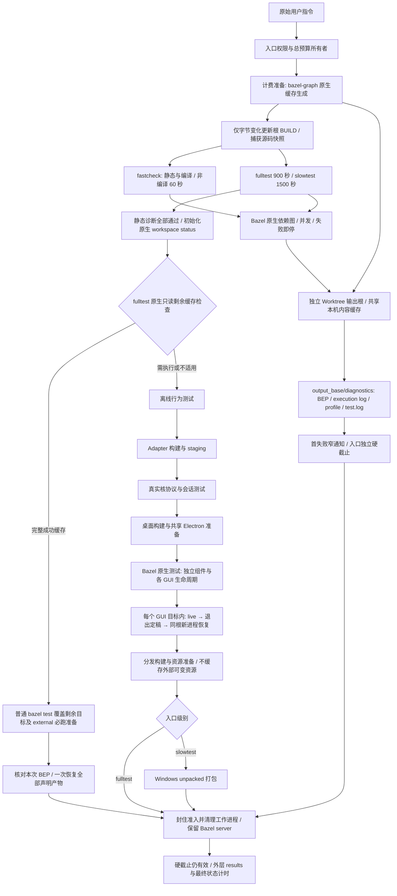
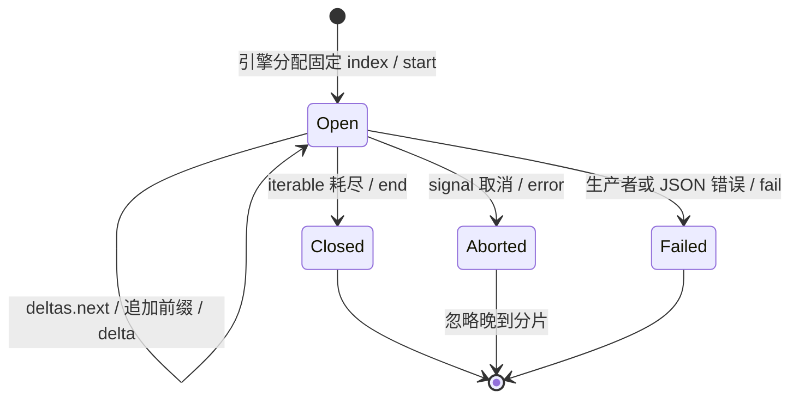
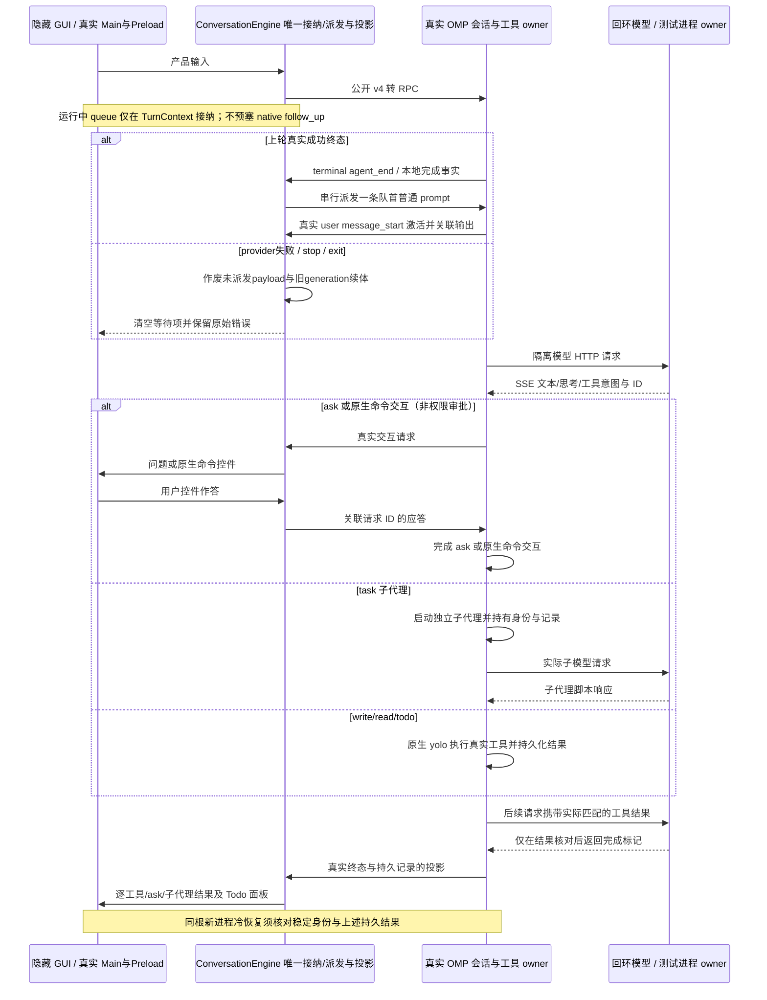

# 三级测试入口

本域维护 **Windows 本机**现有 OMP 核心及上游保留测试的三级编排、覆盖关系与验收。不执行 CI、发布、Computer Use 或接管全局鼠标/前台焦点的测试。项目没有适用的 WSL 测试扩展，AI 不执行 CentOS/Linux/WSL 测试；slowtest 的 WSL 扩展报告 `SKIPPED_NOT_APPLICABLE`，但仍在 fulltest 之外执行本地打包验证。产品两平台分发要求不属于测试通过结论。

## 所有者与入口

- 根 `package.json` 提供 `pnpm fastcheck`、`pnpm fulltest`、`pnpm slowtest`；三个入口只允许 Windows 执行测试。Node 支持范围沿用根 `package.json` 的 `engines.node`（当前 `>=24.0.0`）；`mise.toml` 的 Node 固定版本仅用于可复现开发基线，不是门禁精确版本准入条件。脚本复用并记录当前 Node，不自动降级或安装；pnpm 仍按 `mise.toml` 校验固定版本，不清除缓存。
- 普通 `pnpm build` 与 `pnpm build:bootstrap` 也复用统一 Bazel 构建基础设施，从工作区 package manifests 的既有 build 命令和依赖自动推导构建图，不夹带测试或本地打包。bootstrap 保留 desktop `build:no-runtime-assets` 的原语义。仅测试三级入口受 Windows-only 与 full/slow 执行授权约束；普通构建不新增该平台限制，独立发布脚本仍不接入门禁。
- `scripts/test-gates.mjs` 拥有入口权限、最终状态及快照；`scripts/test-gates-clock.mjs` 唯一维护预算上限和单调时钟，过程模块拥有阶段准入、首失败记录与所属子进程树。命令的失败事件直接通知调度所有者，不等待阶段 `finally` 或流关闭；收尾不能吞掉原失败或将其拖成超时。门禁编排复用原有检查、编译和测试原语；覆盖维护只新增或强化需求对应的行为断言，不修改产品代码、不放宽原断言或质量配置。结果绑定 HEAD、未提交差异、内容指纹及工具版本。
- `fastcheck` 只运行增量 TypeScript 编译、Lint、变更架构和格式检查；根检查之外复用 formal-proof 的独立 typecheck 与 Lint 原语，纯 TypeScript 编译均按编译计时。不执行任何 UT、集成、GUI、冒烟或门禁自检。大量变更格式名单按 Windows 命令行上限分批，不截断。安全独立阶段有界并行，非编译预算最多 **60 秒**。
- `fulltest` 包含 fastcheck 全部检查原语（全量检查可覆盖其变更子集，不重复运行）、全部现存适用 Windows 核心/上游测试、门禁自检、真实 OMP + 本地模拟模型 E2E，以及当前 Main/Host/Preload/Renderer 构建、工具详情和真实产品 GUI 启动/身份/同根冷恢复。模型模拟只替换模型响应，不替换 OMP、工具、交互、协议、持久化或 GUI；工具权限审批不在本次自动化验收范围，真实入口统一使用下述原生 yolo 契约。按最新用户分级，**不执行 electron-builder 打包或 afterPack 打包校验**；编译和现有资源检查保留。**总墙钟最多 900 秒，包含编译、准备、测试、报告与清理。**
- `slowtest` 继承 fulltest 全部检查和测试一次，再执行 Windows Electron unpacked 打包与原 afterPack 校验，显式 `--publish never`，不调用发布入口；不等同正式安装器或两平台分发。项目没有 WSL 测试扩展，不探测或启动 WSL，也不额外增加环境、CI、远程阶段或重复 fulltest。**总墙钟最多 1500 秒，包含编译；不是可暂停的非编译预算。**
- 先前用户授权精简的 Fork 新增专项保持已删除；上游原有测试与有效断言仍全部保留。本轮唯一分级调整是用户明确要求把打包从 fulltest 移至 slowtest，不删除打包断言、不借此缩减其他测试。当前快照没有预算超限依据，不启用 `fork-affected` 缩域；不宣称已验收历史删除专项或两平台打包。
- 编译前后复用既有 `tsc -b` composite/incremental、固定 dist/out 和稳定 Vite 缓存，不调用 clean 或为计时删除/切换缓存。只将纯编译原语标记为编译；staging、初始化、准备、静态检查、测试、等待、快照、聚合与清理均计入非编译时间。GUI 中的 Vite 懒编译是混合测试阶段，保守全部计费。
- 每个入口只有一个单调时钟：`budgeted = total - compile_excluded`；排除观察到的“至少一个编译活跃且没有非编译工作活跃”的区间并集用于诊断。只有 fastcheck 按 `budgeted` 限时；fulltest/slowtest 始终按 `total` 限时，编译、并发、连续阶段及收尾均不暂停或重置截止时间。
- full/slow 按“报错概率优先、依赖约束优先于排序”组织：静态诊断 → 局部行为测试 → 真实核心 → 产品 GUI/冷恢复 → 分发构建与资源检查；只有 slowtest 在这些结果成功后追加 unpacked 打包。静态检查全部成功后才准入离线测试；真实核只等待其实际依赖的构建/staging，不等待下载或打包。保留全部测试与断言，风险顺序不伪称为实测失败率排名。
- 并发、动作依赖与目标级失败即停统一交给 Bazel（`--jobs=4`、`--local_test_jobs=4`、`--nokeep_going`、`--notest_keep_going`）；测试目标以原生 `sh_test` 的 timeout 声明受监督，目标耗时与分析开销由原生 BEP/profile 记录，不在 Node 重建调度器、目标定时器或重复日志汇总。文件级真实核并发仍为 2。风险组之间只保留原有准入屏障，组内由原生依赖图调度。Bazel 的单目标超时不能代替入口全程预算；Node 用例级首失败和 GUI 的正常关闭/收据定稿仍由最小协议适配层通知统一监督。
- fulltest 始终先执行原静态组；这也由普通原生执行初始化当前 server 的 workspace-status 动作，不能只凭上次 server 遗留的状态文件推断可查询。静态组通过后可用一次 Bazel `--check_tests_up_to_date` 原生只读检查覆盖剩余可缓存目标，该选项同时禁止构建动作执行。完整缓存证据只用于合并后续调度，不物化产物、不作为验收结果。全部命中后仍须用一次普通 `bazel test` 覆盖全部剩余目标（含三个 external 必跑准备）；静态组与该次调用的本次 BEP 共同覆盖原完整目标集合，声明产物各恢复一次。真实核心并发仍为 2，准备后的 Electron 内容身份必须不变。miss 保留剩余原风险分组，其他查询错误保持失败，不重试失败用例；缺真实 OMP 或 Electron 尚未准备时保留原屏障。slowtest 不绕过原分组与打包。所有准备、查询、真实调用、回填及汇总计入原预算，不新增成功账本或减少目标。
- 规则生成期可在单次生成实例内按绝对路径复用配置查找、原始文件文本、固定 glob 分类与路径存在性（含本轮负结果）；新 analyzer/实际重跑的生成动作必须重新发现文件。配置解析仍记录每个消费者实际读取的全部依赖，源码 AST、模块解析与分析事实仍按原配置/模式隔离。全根递归 glob 可按本次实际根条目拆为根文件与各未整体排除子树的 glob，保留点目录、未知目录和符号链接、原 exclude 及 subpackage 边界，不维护目录白名单；优化前后的原生标签集合必须等价。这些解析事实不跨生成进程持久化，不按 mtime/size 判等，不能吞掉读取异常或以文本复用漏掉依赖边；生成 BUILD 产物的跨运行复用由第 45 条的 Bazel 动作缓存负责。
- 根 package 的相同全仓源码集合由一次原生 glob 求值得到，静态 repo scope 直接复用，图生成只剔除根 BUILD；不重复遍历同一全仓集合。其他精准 scope 的排除与包边界不变，不扩大业务输入。原生标签等价验收覆盖点目录、未知目录、符号链接及 subpackage，保留全源码发现与新增/删除失效。
- 同一次入口中的 fast/full/slow 与构建计划可共享按绝对配置路径缓存的 TypeScript 解析结果，避免相同配置重复枚举源码；保留原解析诊断、`references` 递归与 build/noEmit 输出计算，编译仍调用原始命令。配置缓存仅在当前进程内有效，最终源码快照变化仍使验收失败，不跨运行复用解析结果。
- 本机增量优化以 Bazel 常驻 server 的分析缓存、各 Worktree 固定 `output_base` 和共享本机 `disk_cache` 为唯一跨运行复用机制，遵循 [迭代性能建议](https://bazel.build/advanced/performance/iteration-speed)；不引入远端服务、持久化源码分析缓存或第二份成功账本。规则生成与计划可共享本轮配置解析、目录发现和清单数据，但仍完整追踪配置、源码及动态保守输入。所有 Bazel 调用保持一致的启动选项和 Git Bash 路径，不通过清缓存或重启 server 提速。
- Electron 运行时、内嵌 OMP 与 native 资源准备保留官方 `sh_test` 的 `external` 必跑调度，但使用轻量准备执行器，不加载 GUI/模型测试包装器；普通构建动作的 `no-cache` 不代替本地必跑保证。保留原参数/环境/校验、跳过不通过及失败阻断。只有不重叠的声明产物可有界并行物化；重叠输出保留原覆盖顺序，恢复内容与 owner 可写性，不能用 mtime/size 或硬链接到共享缓存省略恢复。准备、缓存验证、回填与收尾仍计入原预算。
- Electron 准备的内联命令以计划中同一个 Desktop 包清单路径构造 `createRequire` 上下文，并显式声明完整 `sourceInputs`；生成器组合该输入契约、既有入口/包装器静态闭包、根配置及 gate-toolchain，不附带未消费的 GUI helper 或全仓业务源码。该契约只用于已证明的实际读盘范围，不从 `preparation` 属性推断；OMP/native 等资产准备仍保留原有源码、资源及无法证明时的保守范围。官方 `sh_test` 的 external/no-cache 必跑与准备失败屏障不变。
- Windows 链接边界的原生物化将内容复制与 owner 写权限恢复分离：Robocopy 的 Tweaked 分支即使报告 copied 也可能仅恢复属性；原生回退先对齐声明输出的目的属性，再强制复制内容，最后仅对声明的工作区输出清除只读属性，各步均须检查失败。真实冒烟须同时覆盖可写/只读缓存源、缺失文件、同 size/mtime 的内容篡改与可写性，不能只看 Robocopy 退出码，不修改共享缓存源。
- 声明产物的普通文件及目录优先使用当前 Node 进程的异步文件 IO 恢复内容与工作区可写性，不逐文件或逐普通目录启动 Robocopy/attrib；缺失目标正常创建，非缺失错误必须传播。普通文件只有实际读取并比较当前源、目的字节完全相同时才可省略内容写入，仍须恢复目的 owner 写权限；不得以 mtime、size、存在性、上次复制收据或成功账本代替字节比较。长路径和目录符号链接必须保持既有语义，必要时仅链接边界继续走原生复制路径，不解引用共享缓存链接；验收覆盖只读源/目的、同 size/mtime 篡改、缺失、长路径和链接边界。
- 产物回填以原声明顺序展开独立输出，每批最多四个不重叠路径；遇到首个重叠路径先完成当前批次，不能越过冲突挑选后续输出。每个路径的字节比较、必要复制与权限恢复作为同一操作完成，首失败封住后续批次、取消本轮复制并等待已准入操作退出。所有声明产物仍核对真实内容，不按 mtime/size/存在性跳过。
- `scripts/test-gates-plan.mjs` 唯一维护 full/slow 的测试范围与真实核分类；从现有 Node `--test` 文件参数自动展开，每个独立测试文件生成一个稳定路径标识的 Bazel 测试目标，保留原文件、断言、CLI 参数、UI tsconfig 别名及真实核门控，不手写第二份 BUILD 文件名单，不执行用例收集来生成规则。文件内的 `test()`/子测试仍属于同一次执行，不宣称单用例缓存。真实核文件目标只等待 adapter 构建/staging，以 Bazel 的本地测试并发上限 2 调度；离线文件和 GUI 目标保持原有并发上限。首失败、所属进程树与总预算仍由统一门禁监督。
- Bazel 原生测试缓存是成功结果的唯一所有者：采用固定版本 `rules_shell 0.6.1` 的官方 `sh_test` / `sh_binary` 与 runfiles 库处理 Windows 原生启动和 manifest；构建树产物采用 Bazel Central Registry 的 `bazel_lib 3.0.0` `run_binary(out_dirs)`，不为已有规则能力重复手写 Starlark rule。只保留连接现有命令、工具链和声明产物的薄宏。声明源码、配置、控制文件和工具链输入，不自行实现摘要或 runfiles 解析、不维护第二份成功账本。根 `BUILD.bazel` 仍由计划确定性生成；桥接读取 Build Event Protocol 的目标状态与 `cachedLocally` 证据，不能以控制台文本或空执行集合推断通过。失败、跳过、缺环境与不完整结果不得缓存为成功；不得在一次失败运行中自动重试。
- 独立文件目标的 JS/TS 产品源码输入以 TypeScript 官方模块解析得到的本地导入闭包为准，不因同属一个 workspace 包就依赖该包全部业务源码；本文件、实际导入的其他测试入口、字面量引用的源码数据文件都必须声明。公共输入保守保留配置、非代码资源及非入口测试 helper/fixture。动态模块、代码数据读取或目录扫描无法可靠分析时，该目标恢复原包源码范围，不能漏报依赖以制造缓存命中。
- 产物生产者、staging 和有明确执行入口的组件/GUI 目标也剔除未消费的测试入口，避免经构建链间接扩大失效；GUI 仍声明全部生命周期入口、真实构建产物和共享 fixture，产物实际变化时必须失效。tsconfig 实际包含的测试文件不能漏掉；全局静态检查、自检审计和无法可靠分析的入口保持保守范围。本轮仅修改门禁、输入依赖声明与相关约定，不修改业务实现，不减少测试覆盖或改变断言。
- 禁止由目标名称中的 `package`、`install`、`prepare` 等子串推断是否禁用缓存；只有明确标注外部可变准备、共享运行时准备或打包的阶段使用原生 `no-cache`。文件目标不因路径含 `packages/` 或测试名称而意外失去缓存。
- `gate_test` 的必跑准备目标除动作级 `no-cache` 外统一带原生 `external` 标签，禁止 `--cache_test_results=auto` 复用本地测试结果；不能只禁用磁盘/远端动作缓存后把必跑阶段当作本地测试缓存成功。
- 每套 GUI 的 live → 正常退出/收据定稿 → 同根新进程 recovery（models 为 live → profile → default）组成一个原子 Bazel 测试目标。阶段仍调用原有启动器、隔离检查和断言，任何一步失败立即取消所属进程树；只有全生命周期成功才产生可复用结果，不能单独缓存 live 后在缺少其持久根时执行 recovery。组件和 Windows 离线冒烟各为独立目标。GUI 目标声明消费的当前构建产物、源码、fixture、真实 OMP 和 Electron 工具链身份；缺少安装核在缓存查询前拒绝。随机隔离根不参与语义缓存键，固定环境及工具链参与。
- 编译与 staging 作为 Bazel 构建动作声明真实产物，缓存命中后必须物化实际 dist/out/暂存产物，不能以“以前命令成功”代替产物；沿用原 tsc/tsup/Vite 原语与稳定编译缓存，不清缓存。资源下载、共享运行时准备及 unpacked 打包也统一作为 Bazel 目标调度；其外部可变资源无法声明完整时使用原生 `no-cache` 标记，不复用未经验证的成功。正常入口不终止 server、不删除输出或磁盘缓存。
- 生产者重跑前须恢复其已声明工作区产物的 owner 写权限，包括旧缓存回填后遗留的只读文件或目录内文件；权限准备与依赖回填都计入非编译时间。只处理该目标声明的工作区输出，不删除编译缓存、不改源码或共享 Bazel 缓存权限，真实读写错误仍失败。
- 构建元数据由 Bazel 原生动作声明输出并物化到既有 `out/metadata/build-meta.json`，仍调用原 `collectBuildMetadata()`；其输入按实际读取的根/desktop 包清单、安装依赖版本身份、元数据执行脚本与静态依赖、HEAD 声明，不夹带未读取的业务源码或测试 fixture。包构建的既有完成顺序由组准入屏障保留，不把未读取的包产物当元数据缓存输入。局部业务代码修改不能仅因同包而重新生成 `buildTime`、连带失效整个桌面及 GUI。元数据实际输入或 HEAD 改变时正常重建；元数据内容、产品读取方式与编译判据不变，不以自制快照账本决定是否重建。
- 无改动热运行优先于修改后的增量优化。验收固定同一项目、环境、配置和完整目标集合：第一次 `pnpm fulltest --human-authorized` 成功后不修改文件，立即重复同一入口，第二次从外层脚本启动到退出的墙钟时间必须小于 30 秒，包含准备、Bazel、缓存核对、回填、汇总及清理。只读 `--check_tests_up_to_date` 只作诊断或风险组选择，不能代替正常 `bazel test` 的完整目标验收；命中率高或 fastcheck 小于 30 秒均不是本验收通过。
- 每次开发验证自动保存本轮与上一轮的独立诊断证据（不作成功缓存或准入依据）：外层单调计时、Bazel profile/BEP、explain/verbose explanations、服务器 PID/output_base/版本/启动参数及命令。报告总耗时、启动与锁等待、加载/分析区间并集、实际执行动作数、测试缓存命中/重跑数及外层开销；缺失证据明确为待定位，不把所有开销统称冷启动。Windows 原生 TestRunner 内部只补充现有 shell/runfiles 与 Node 子进程日志的时间戳，不另建调度、超时或计时账本。不使用 clean、shutdown、batch 提速；常驻状态基线配置保持简单，cache-debug 仅令不允许的分析缓存丢弃显式失败。
- 默认固定版本的已安装 Bazelisk 路径可直接读取其原生安装 metadata，并重新计算 launcher 与已安装核心的内容身份，避免为展示版本额外启动一次 `--version`。实际命令仍经原 launcher 执行；显式工具、环境覆盖、动态选择、本地选择配置或 wrapper 不适用这一快速路径。安装声明不冒充本次实际版本；实际版本与核心路径由本次 BEP 的 `started.buildToolVersion` 和原生命令行证明。该身份仍写入既有工具链输入，不新增跨轮成功缓存、路径/mtime 命中表或另一套版本选择器。
- 原生诊断证据与失效索引写入 Worktree 专属 `output_base/diagnostics/`，不在源码树中持续新建日志目录。Windows 实测即使目录被 glob 排除，在其中新建文件仍可使 package/glob 重新加载；源码树外写同样日志不触发该失效。日志写入、读取和汇总仍在原入口计时内，不移动必要准备到计时之外；`gates/inputs/` 只承载必要的本轮控制输入。
- 自动失效反馈展示“变更文件 → 受影响 target/action → 失效原因 → 本次重跑耗时”；只用实际依赖和原生执行证据建立关联，explain 未给出具体输入时标记待定位，不凭变更文件名猜测因果。必要时保存上次与本次 compact execution log 比较输入摘要、命令和环境身份；日志和对比不得展示环境凭据。诊断文件排除于产品目标输入，读取与汇总开销仍计入门禁。每轮只优化一个经计时证明的瓶颈，并给出修改前后第二次外层总耗时与失效差异；本轮不继续扩大到修改后增量优化，直到无改动验收通过。
- 每个 Git Worktree 拥有独立 output_base，使用同一本机 Bazel `disk_cache` 共享基于内容和依赖的构建/测试成功结果；不同分支相同语义输入可复用，不以 HEAD 或 mtime 代替内容判定（确实消费提交身份的 metadata 除外）。动作参数与显式环境不包含 checkout 绝对路径；必要路径通过 runfiles、执行根或本次运行配置解析，依赖锁、实际工具链与必要语义环境仍参与缓存身份。修改共享输入必须失效所有相关目标，不能影响无关目标。
- 局部修改验收在同一工作区、同一完整 fulltest 目标集合上执行：临时修改一个真实业务源码输入，运行正常入口，以本次 BEP/execution log 证明关联测试重跑、至少一个无关测试保持缓存，且不是全测试重跑；恢复源码后再次核对原生缓存。源码修改只用于验证依赖失效，不永久改动业务、不删减计划、不把只读查询当成实际测试运行。无改动热运行与局部修改两项验收都必须完成。
- 规则从现有 pnpm workspace manifests、锁文件、TypeScript 官方配置解析器（`references`、`extends`）和门禁计划自动生成，以 glob 管理源码，不逐文件维护 BUILD 清单；少量工具输出/GUI 生命周期属于显式产品契约。已评估 [Aspect Gazelle JS/TS](https://github.com/aspect-build/aspect-gazelle/blob/main/language/js/README.md)、[rules_js pnpm 转译](https://github.com/aspect-build/rules_js/blob/main/docs/pnpm.md) 和 rules_ts：Gazelle 可生成常规源码/import 依赖，但不能自动推导 OMP/GUI 生命周期和三级范围；rules_js 的隔离依赖树/phantom hoisting 限制须与本仓现有 hoisted 安装等价验证；rules_ts `ts_project` 不能直接当作当前 `tsc -b` 的等价替换。本轮保留成熟 pnpm 与现有编译判据，由原生 Bazel 动作缓存，不新增第二套包管理器。未发现 Rust/Python 产品清单，不引入无关的 rules_rust/crate_universe/rules_python/Gazelle 依赖。
- 生成职责分离：`test-gates-bazel-sync.mjs` 负责目标、作用域与生产者输入组合；`test-gates-source-dependencies.mjs` 负责配置、模块和源码数据闭包；`test-gates-source-bindings.mjs` 通过 TypeScript 单源符号绑定区分真实文件/进程操作、同名属性及局部遮蔽。源码事实仅在当前生成进程内复用，不写持久化缓存或第二份成功账本。
- 实际 gate/build 入口在同一计费准备阶段通过 `ensureBazelGraph(context)` 接入 `bazel-graph` 生成目标，成功后才捕获验收源码快照；生成器本身由既有 `gate_action` 薄宏和官方 `run_binary` 构建动作接管，声明生成器、配置、全源码、工具链及确定性的 Git 变更文件集合等实际输入，缓存输出 `gates/inputs/generated-build.bazel`。桥接只在字节内容不同才更新根 `BUILD.bazel`，不能因缓存回填改写未变 BUILD 而丢分析缓存；不维护自制摘要命中表或跨轮次 AST 缓存。生成动作因输入变化重跑不等于全部业务目标失效：后续目标仍按各自实际输入和生成语义判定复用。含环境及配方的临时传输在退出时清空为零字节占位，不保留凭据或可执行旧配方；live 帧和生成产物的工作区传输同样保留稳定文件名，避免删除/新建反复失效原生 glob。非敏感的 `gates/toolchain.json` 保留稳定路径，每次入口从真实工具链重新计算并覆盖，不读取它推断成功或省略验证。生成/普通执行复用 `runBazelStage`、同一常驻 server、诊断链与入口总时钟，准备仍计入原预算；`--plan` 与 `--snapshot` 保持只读。保留 `node scripts/test-gates-bazel-sync.mjs` 作为显式生成入口与首次生成工具，不要求逐文件手工补目标。

- 图生成目标自身只使用全源码 glob、工具链及本次控制输入，不依赖上一版 BUILD 枚举的 runner helper 清单。合法删除或重命名 helper 并同步 import 后，普通入口必须能先生成新图，不能因旧清单中的缺失路径阻断自举；业务目标仍各自声明实际 runner 闭包。
- 现有 `--check-tests-up-to-date` 无需执行授权，始终只读：先以原生 `--check_tests_up_to_date` 检查图生成目标，仅当缓存有效且已有原生生成产物与根 BUILD 字节一致时继续查询其余目标。图缺失或过期报告 `DIAGNOSTIC_OUT_OF_DATE`，不得生成、物化或写根 BUILD；工具、语法、分析等真实错误保持失败，不降格为缓存 miss 或自动重试。该诊断不作为完整验收，未授权普通 full/slow 仍拒绝执行。
- 配置迭代提供 `--analyze-only`，无需 full/slow 执行授权，使用同一 Worktree server、启动选项与构建配置，以原生 `build --nobuild --keep_going` 分析现有根 BUILD 中的图生成目标及所选计划全部目标；不执行生成、编译、测试、准备或产物物化，不要求运行时 OMP/Electron。只报告 `ANALYSIS_ONLY_NOT_RUN` 或真实分析失败，不写入成功目标集合；明确 `generatedGraphVerified=false`，分析通过不证明生成图当前有效、源码可编译或测试通过。该模式不能与 `--plan`、`--check-tests-up-to-date` 混用。
- 过期检查使用原生 `--check_tests_up_to_date --keep_going`，不得附加 `--nobuild`；保留已有图有效性准入边界。逐目标保留原生 failureDetail 和 BEP 位置，将明确的 `ACTION_NOT_UP_TO_DATE` 标为 `OUT_OF_DATE`，被过期上游或其他缺失证据阻断的目标标为 `NOT_CHECKED`，不冒充测试失败或缓存命中。纯过期仍为 `DIAGNOSTIC_OUT_OF_DATE`；同时出现配置、工具等真实错误时整体仍失败，不因已有过期目标吞掉错误，也不自动重跑。explain 只说明原生已观察的失效原因，不把 ActionKey、未检查目标或空执行集合当作完整缓存预测。
- 审查修正边界：构建动作和测试分别声明实际执行包装器的完整静态模块闭包（包括跨包 helper），不能把整个 `scripts/`、`gates/` 或规则生成器作为每个目标的公共输入；目标自身实际读取的脚本、配置、动态入口仍由其依赖分析单独声明。无关临时脚本或只改变生成器但生成语义不变时，不失效未消费它们的目标；包装器传递依赖变化必须失效消费者。配方声明不是产物读取，linked worktree 的 `.git` 文件不参与缓存。变更架构检查以显式、确定性的变更文件集合执行并缓存；格式检查在实际工具启动边界保留 Windows 有界参数批次。静态阶段不提前要求 Electron 可执行文件，共享准备成功后才读取其内容身份并准入消费者。
- 通用 Node 测试/静态执行包装器只消费普通命令、环境隔离及失败监督；GUI fixture、收据定稿和窗口关闭实现仅由 GUI 生命周期入口加载和声明。不能因为普通 runner 复用执行函数就把所有 GUI helper 隐式变成每个离线测试的公共缓存输入。打包状态仍由唯一所有者保管并在取消后恢复，不引入另一条执行或隔离路径。
- 本地 ESM 模块引用中的 query/hash 属于模块身份，不是源码文件名；声明对应本地源文件并继续追踪其依赖。仍无法证明完整的动态读取/执行入口仅对其消费者保留 `scripts/`、`gates/` 的保守候选范围；不能把该回退变成所有目标的公共输入，也不能删除回退来制造命中。全仓静态审计仍按原范围执行。
- GUI 生命周期的既有首失败帧必须在退出或清理完成前通知外层门禁，不依赖 Node `--test` reporter 注入。打包共享模板原文由外层门禁在准入前持有，所属子进程树停止后恢复，不能只依赖会被终止的 executor `finally`。
- Worktree 专属 `output_base/diagnostics/` 中的 Bazel 原生 BEP、execution log、test.log 和 profile 是目标状态、日志位置、缓存来源及目标耗时的权威；外层 `results` 和最终计时负责入口状态、完整目标覆盖、源码快照及总预算结论，两者必须对应同一次运行。BEP 判目标完整结果、测试缓存和时长，构建动作的本地/磁盘缓存来源由官方 execution log 的 runner/cacheHit 证明，不从缺失动作事件猜测。输出必需/新执行/缓存/不完整目标及最慢目标。Node 原生测试报告器保留用例定位与耗时，窄首失败通道只补充目标结束前的通知，不另建日志采集或重试框架。最小适配还负责既有权限、产物物化、GUI 生命周期和已准入且不可取消的 IO 收尾；收尾仍受统一预算约束，不把目标 PASS 当作整个入口 PASS。既有自研 worker、重复成功账本、阶段计时和已被原生能力替代的自检实现随切换删除，不保留双轨入口。
- 验收必须实际覆盖三个入口、原生并发和依赖屏障、首/后续用例失败、超时与挂起清理、真实 Git Worktree 跨输出根共享命中、mtime-only 不重跑、共享输入失效和无关结果复用、失败日志定位与慢目标统计；保留所有现存业务测试及断言。以本轮重构前 fulltest 实测作为比较基线，最终相同快照连续两次 fulltest 通过并对比总耗时，不把 fixture 验证冒充产品全量验收。
- 原生并发夹具以三个真实 Bazel 测试进程均写入 `start` 收据作为完成屏障，再沿用原工作与重叠断言；不得仅靠固定 700ms 假定全部进程已获调度。屏障由实际文件变更通知驱动，仍受原生测试及外层截止约束，不新增重试或放宽并发断言。
- 嵌套 Bazel 夹具显式保持其独占 server 的空闲生命周期，避免继承 `TEST_TMPDIR` 后原生 15 秒空闲默认值在断言前自行停机。所有 fixture 调用使用同一启动参数；这不是延长测试或门禁预算。成功、失败、超时和取消均保留 server，不主动关闭；核对原生 PID、非 server 哨兵、worker 回收和另一 Worktree 的身份隔离。应用清理不依赖 server PID 文件，也不得移动或修改该原生元数据：[Bazel 9.3.0 PidFileWatcher](https://github.com/bazelbuild/bazel/blob/9.3.0/src/main/java/com/google/devtools/build/lib/server/PidFileWatcher.java) 每三秒检查它，缺失会主动终止 server；人为隐藏 PID 文件后要求同一 server 复用不是有效的取消验收前提。server 存活及复用按下方性能验收核对。
- 本轮统一基础设施迁移前的实测基线：`pnpm fulltest --human-authorized`，HEAD `714878a33fda800a4b29034214e7760801bf0a31`、dirty 内容指纹 `b11bf7b4950abf24afdb4b3a28322e0a3f4d7fbbaccb5368f19fa2b8ed013049`，Node 24.20.0 / pnpm 10.33.2 / Bazel 9.3.0，PASS、退出 0，total 865.3 秒、compile_excluded 28.0 秒、budgeted 837.3 秒。28 个测试目标均为本次执行；该结果只证明迁移前快照，不作为迁移后通过证据，也不是清缓存制造的冷样本。
- Electron npm 运行时是组件及产品 GUI 的共享依赖；门禁在并行运行它们之前，串行调用同一 Desktop 包解析得到的 `require("electron")`，完成缺失二进制的下载与解压。准备阶段计入非编译预算，失败阻止所有 GUI；既有安装直接复用，不修改依赖安装器、不清缓存，也不让并发测试同时改写共享可执行文件。
- 三个测试门禁的阶段统一清除宿主继承的 `ZCODE_BUILTIN_PROVIDER_CONFIG_FILE` 与 `ZCODE_PERSONAL_PROVIDER_CONFIG_FILE`：门禁宿主在 ZCode 产品会话内时，宿主会把本机安装运行时与个人 provider 配置注入这两个变量，继承会使同一源码快照的构建期 Release 校验、打包嵌入与 GUI 运行时随宿主环境漂移。清除后门禁构建校验与打包统一使用仓库受控 `config/provider/zcode-builtin.json`，GUI 不读取用户日常配置；校验、打包与断言判据本身不变。普通 workspace build 保留原有显式 provider 构建配置，其路径与内容参与对应目标身份。
- 预算包括入口准备和最终所属进程树清理，提前预留清理余量；只有 fastcheck 的纯编译区间暂停非编译定时器。fulltest/slowtest 从入口起使用不可暂停的总时限；首失败立即收尾，硬截止在收尾期间仍保持有效，不能因等待用例、验证回调、进程关闭或清理 Promise 而无限等待。到时强制非零退出，停止全部所属子进程，不再启动后续阶段。`--budget-seconds` 只能下调 60/900/1500 秒上限。
- 已确认的失败或取消进入所属进程树清理后，清理预留点不能将其提前改判为 TIMEOUT；GateRun 向同一预算监督者及独立 watchdog 发布终态清理标记，停止软预留通知，但保留原硬截止。截止前完成必须保留 FAIL/CANCELLED；真正达到硬截止仍须 TIMEOUT、非零退出并终止所属树。不更改既有超时上限或自检断言。
- Windows 所属进程树终止统一使用 `SystemRoot/System32/taskkill.exe`，按 Windows 环境变量大小写无关语义解析系统根（包括 Worker 收到的 `SYSTEMROOT`），不经可变 PATH 查找；短预算的 OS 清理预留不能被工具路径搜索消耗。独立监督者在强制终止前只能报告请求时刻及未知实际退出码，不能把“已发出终止请求”表述为“已观察到全部退出”。
- Windows 取消时，外层仅清理本轮客户端与动作/测试工作进程，不主动终止对应 `output_base` 的 Bazel server；server 即使脱离客户端也不属于应回收的本轮工作进程。正常取消 Bazel 当前命令不等于关闭 server；进程树强制终止路径必须排除 server，不能以 PID、Java 进程名或命令行子串匹配绕过该边界。完整最终报告、首失败停止调度与硬截止仍须保留。
- 短预算监督夹具只在对应 GUI/打包场景的受监督工作或清理阶段加载真实环境适配层；纯超时/阻塞场景不得在时钟启动前加载无关的 GUI、模型与 TypeScript 计划。原 1.5 秒预算和外层实际退出断言不变，不能通过漏计初始化或放宽时限消除失败。
- 监督者从未接纳子进程、原生目标或附加进程清理器时，硬终止仅需直接终止自身，不启动 `taskkill /T` 枚举整机进程。进程准入前同步发布单调共享标记；一旦有过准入就保守保留完整进程树终止路径，不从异步心跳或当前空注册表猜测没有后代。该优化不改变截止、自检时限或终态断言。
- 独立 watchdog 的超时报告使用非阻塞写入；写入完成后才发出终止，避免无后代的直接终止丢掉尚未提交的 JSON。报告写入最多使用原清理预留内的 25ms，且不得超过当前剩余硬预算；管道阻塞仍必须终止，不新增宽限期。
- 每个成功、失败、缺环境、超时和已处理取消路径均输出 `status / total / compile_excluded / budgeted / limit`，秒数至少一位小数。必须等编译完成且所有在范围内阶段成功才允许 PASS；缺工具/测试跳过不冒充通过。
- 虚拟时间线浏览仅操作真实 DOM viewport，沿用已有命令历史验收的 wheel 意图、同步 `scrollTop` 与 `scroll` 通知路径；隐藏窗口中两帧 RAF 不代表异步 wheel 已生效。先从真实顶部完整浏览，再按实际滚动进展推进，不能因尚未派发的 wheel 把扫描提前结束。原生索引模型检索先经既有 `idle` 完成屏障，再浏览和断言定稿回复及工具结果：运行中 live tail 与定稿 virtual history 是不同 DOM 所有者，流式文字出现不代表节点身份已稳定。目标可见性、精确身份、模型、详情与持久记录断言保持不变，不增加 sleep、超时或自动重试。
- 模型检索先观察本次精确回复已出现，证明异步面板输入已被接纳，再等待停止控件脱离及时间线 live-tail 脱离；提交后短暂显示的旧发送分支不是完成信号。`idle` 保留停止控件数量为零的原断言，但先等待该控件真正脱离。浏览成功以目标与实际滚动视口相交为准，不能把仅处于 overscan 的节点当作已展示；原有精确唯一计数与工具断言不变。
- 任意检查、编译、测试、启动、工具缺失、未处理异常或阶段首个非通过结果立即停止调度并终止全部门禁所属进程树，不等待并行同伴或整个嵌套测试组完成。Node 测试必须在任意文件或并发子测试首次失败时报告，不得被早先挂起用例的 TAP 顺序缓冲；TypeScript 在首个 error 诊断到达时中止编译树。保留原断言、失败内容和非零状态。失败后的阶段及快照聚合不再启动，取消的阶段不能记为 PASS。
- 关键日志必须能区分“已准入、正在等待、已失败、正在清理”：记录组/阶段开始与结束、阶段 ID、所属 PID、耗时；运行中的长阶段周期报告当前活跃阶段、进程和已用预算。首失败在等待进程关闭或阶段 `finally` 之前立即报告阶段和原失败；一旦失败封住准入，不等到最终汇总才显示。
- GUI 日志记录 suite/phase、隔离证据根、launcher/Electron PID，以及 fixture、模型、Renderer、引导、验收和关闭各准备点；launcher 在 READY 之前或之后异常退出均立即通知所属阶段，正常关闭不误报失败。日志不输出命令实参、环境变量、模型凭据、问题/答案或消息正文。
- 挂起的操作、GUI 准备、verify、进程关闭及 cleanup 均受同一总截止约束，不因心跳或输出重置预算，也不添加阶段独立的提前终止时限。超时先打印活跃阶段/进程及清理开始，硬截止保留至最终报告完成；清理器失败必须记录且保持非零结果，不把“门禁已退出”当作子进程树清理成功。
- 取消/首失败时，进程所有者须在等待客户端退出前捕获本轮工作进程的附加清理器，避免客户端关闭后注销导致工作进程漏清理；不得登记关闭或终止 Bazel server 的清理器。打包恢复失败仍必须清理本轮控制文件，并保留非零结果。原生索引取消验收须在已发起的维护操作及隔离会话后台 Repo discovery 真实完成后采集基线，完成依据须对应真实所有者的提交收据；不得以固定延时、数据库稳定采样或放宽数据库不变断言掩盖并发写入。

## Bazel 性能优化需求

本节适用于统一构建与三级门禁的 Bazel 调用、规则生成及嵌套验证夹具。以下为需求与验收条件，不表示已经实现或验证；性能证据沿用既有 `output_base/diagnostics/`，不另建缓存或计时账本。

| 项目                 | 必须满足的规则                                                                                                                                                                                                                                                                                                                                    | 验收场景                                                                                                                                                                                                                                                            |
| -------------------- | ------------------------------------------------------------------------------------------------------------------------------------------------------------------------------------------------------------------------------------------------------------------------------------------------------------------------------------------------- | ------------------------------------------------------------------------------------------------------------------------------------------------------------------------------------------------------------------------------------------------------------------- |
| 文件变更通知         | 启用 `--watchfs`；Windows 同时启用 `--experimental_windows_watchfs`，由 Bazel 原生文件变更通知减少重复文件系统扫描。普通构建与门禁的有效配置保持一致，不以通知优化省略真实输入。                                                                                                                                                                  | 核对实际生效参数；同一常驻 server 下新增、修改、删除实际源码及配置，关联目标正确失效，无关目标仍可复用。                                                                                                                                                            |
| 文件摘要缓存         | 设置 `--cache_computed_file_digests=500000`，扩大 Bazel 原生文件摘要缓存，不增加自制摘要表或以 mtime/size 替代内容判定。                                                                                                                                                                                                                          | 核对实际生效值为 `500000`；无改动复跑保留常驻状态，内容变化仍使消费者失效。                                                                                                                                                                                         |
| 包发现与目标扫描     | 维护根 `.bazelignore`，排除经实际依赖核对不属于构建/测试输入的目录，减少无关包发现与递归目标扫描；与源码 `glob()` 的排除职责区分，不把 `.gitignore` 或仅有 glob exclude 当作等价实现。不按目录名猜测排除，不屏蔽有效源码、配置、fixture 或必要生成输入。                                                                                          | 记录各排除目录及无关依据；比较调整前后的有效业务目标与输入集合，证明无遗漏；无关目录内增删文件不扩大包发现，有效目录内新增文件仍正常发现并使关联目标失效。                                                                                                          |
| 常驻 server 生命周期 | 不管测试成功还是失败，均不得主动杀死或关闭 Bazel server；缺环境、异常、超时、取消及夹具收尾同样适用。禁止 `bazel shutdown`、直接终止 server PID、通过进程树清理连带杀 server，或以重启/清缓存代替当前命令取消。本文所有“所属进程树清理”均仅指本轮客户端及动作/测试工作进程，不包含常驻 server；保留原首失败、总预算、非零退出及工作进程清理要求。 | 分别覆盖成功、失败、超时与取消：本轮工作进程退出，server PID/身份保持存活，后续同 `output_base` 调用可复用；嵌套夹具同样不得主动关闭自有 server，另一 Worktree 与非 server 哨兵不受影响。                                                                           |
| 精简构建依赖图       | 必须修改规则生成逻辑及必要的 BUILD/Starlark 规则，移除未消费的依赖边，减少重复或过宽的 `glob()`、无必要的全仓扫描及复杂宏展开，降低 Loading/Analysis 开销；不能只调运行参数。沿用实际输入闭包、必要动态保守依赖、薄宏与单一生成所有者，不用手写逐文件清单、漏报输入或减少测试范围制造提速。                                                       | 在相同环境、完整目标集合与可比较常驻状态下，对比修改前后原生 profile 的 Loading/Analysis 区间并集、加载包/配置目标规模及外层总耗时，证明加载/分析耗时降低；同时证明目标覆盖不变、关联输入变化正确失效、无关目标不被额外依赖拖累。无改动复跑与局部修改验收继续适用。 |

## 环境与失败语义

- 真实 OMP 使用本机安装版本；源码权威及无安装时不验证的规则见 [FORK.md](FORK.md#omp-侧依赖)。缺少安装、二进制或测试发生跳过时，记录未验证而非通过，不静默使用旧缓存核或临时安装。fulltest/slowtest 不读取用户模型凭据、不连接真实提供者、不允许外部模型覆盖或失败后回退；两级仅使用同一套本地模拟模型计划。
- adapter 编译只依赖源码、构建工具和 workspace 依赖，不以本机安装 OMP 为前提；缺 OMP 只阻止真正使用它的适配器 E2E、真实核心 E2E 和产品 GUI 阶段，并记录未验证，不能误跳过离线编译。
- 产品 GUI 必须由专用隔离 fixture 提供；保留真实启动、工具结果呈现和 `identityMigration` 的 before/after 同根新进程冷恢复，不连接日常实例。被删除专项不再构成缺环境阶段，也不得在测试结果中声称已验证。
- GUI 判据基于产品契约与独立真实持久记录，不把自动生成的会话标题当作稳定身份。身份迁移按实际稳定会话 ID 验证唯一侧栏项及同根重启连续性。
- 工具结果组件入口自己创建临时 Vite/Electron/userData，不调用模型；它补充工具结果显示验证，不代替真实产品 GUI。
- 产品 GUI 必须使用当前构建的真实 Main/Preload。Preload 需内联其第三方运行依赖，保持既有沙箱与 context isolation 设置；不能因沙箱无法加载 npm 模块而留下空白 Renderer，也不能注入假 bridge、关闭沙箱或加空值兜底冒充通过。
- 产品 GUI 由 `ompCore.launch.mjs` 创建专用临时根、独占端口和当前真实 Electron/renderer；通过 Electron 测试启动层在任何产品 BrowserWindow 创建前设置隐藏、不可全局聚焦，保持真实 Main/Preload、沙箱和安全边界。Playwright/CDP 只驱动目标页面 DOM，不调用 Computer Use、全局输入或通知焦点操作；隔离性须观察实际所有测试窗口，而非仅凭工具名称推断。本地模型配置及测试专用假密钥仅写入隔离根，不读取或复制用户认证库。
- GUI 启动层在导入真实 Main 之前拒绝协议客户端注册及 `reg.exe add` 系统写入；这些系统集成不属于此沙箱 GUI 的验收覆盖，拒绝不能伪装为成功。隔离证据串行追加 JSONL，每次读取最后完整行，仍核对当前 PID、所有窗口状态和新鲜度；不通过重试、忽略写入错误或放宽窗口断言处理 Windows 文件替换失败。
- 隐藏窗口采用 Electron 离屏渲染保持真实 DOM/动画帧可运行；准备及验收截图统一通过该 Electron 进程的 `webContents.capturePage`（保持隐藏、保持唤醒）采集。专用回环临时端口只返回该 fixture Renderer 的 PNG；不通过展示/聚焦窗口获得截图，也不依赖可见合成面。GUI 准备不增加独立的 Playwright 默认截止，仍由外层同一非编译预算终止所属进程树；既有 DOM 验收断言不变。
- 全新 GUI 根必须通过产品公开的首次引导跳过入口完成准备；不能直接改 store 或设置文件伪造完成。就绪须证明引导已关闭、真实主界面入口可用，并保留页面截图；准备失败立即让阶段失败，启动器仍由门禁持有并清理整棵进程树。
- 三个测试入口不接受 `--publish-releases`，不发现或检查 workflow、不调用 GitHub CLI，不推送、不创建 Tag、不发布。CI 不是测试环境或验收步骤；既有分发 workflow 不改动、不触发。
- 源码变化后不能沿用此前测试结果。所有 Windows 测试阶段记录耗时，失败、取消、跳过和缺环境保持非通过状态；CentOS 产品支持及构建期产物完整性约束不因此取消。

## 本地模拟模型契约

- fulltest/slowtest 及可独立运行的真实核心/产品 GUI 入口使用同一本地模拟模型计划；用户最新五项测试范围唯一维护于下方[本轮五项必验与排除范围](#本轮五项必验与排除范围)，其他功能域与根入口只引用该规则，不维护第二份范围。
- 测试引擎来自 OMP `57672f546162e16b019484626c3b5fa9300aafef` 的 `packages/ai/src/providers/mock.ts`，事件流支持来自 `packages/ai/src/utils/event-stream.ts`，Anthropic SSE 传输模式来自 `scripts/repo-ui-smoke.ts`。源文件、原始内容摘要、适配范围和未改动的 MIT 许可证登记于 `third-party/copied-components.json` 与 `third-party/upstream/omp-mock.LICENSE`；运行时不依赖相邻 OMP 源码目录、Bun 或生产模型包。全局 provider 注册、catalog 分类及库专属错误类型属于未复制的集成依赖，不以空实现冒充保留；响应脚本、事件、终止与错误的可观察语义必须保留。
- `ompMockModel.mjs` 拥有进程内脚本状态和调用记录，`ompMockStream.mjs` 拥有事件流，`ompMockScenarios.mjs` 拥有严格场景脚本状态、prompt 归一化及工具结果/子模型请求关联，`ompMockServer.mjs` 拥有回环 Anthropic HTTP/SSE 传输、隔离配置及服务生命周期，并调用场景模块；后两者均由同一 `scripts/repo-ui-smoke.ts` 来源适配拆分。真实工具、子代理、交互及会话仍唯一由 OMP 执行。每个服务独占 `127.0.0.1` 临时端口，由所属测试/GUI 启动器持有和关闭；独立 OMP 进程只通过隔离 `models.yml` 连接本次回环服务的 `zcode-mock/scripted`，GUI 模型切换场景额外声明同服务的 `scripted-alt`，其余 ID 拒绝。测试假密钥只写隔离根，清除继承的角色/profile/模型覆盖，禁用后台标题生成；不读取用户凭据或复用日常模型配置。
- 所有触及 OMP 进程、目录网关、会话控制和持久化边界的测试统一使用本机真实 OMP + 本地模拟模型，不保留替代 OMP 进程的协议脚本、端口对象桩或专用环境旗标。共享测试启动器复用隔离配置、回环模型和公开 stdio/v4 入口；OMP 唯一拥有协议协商、命令、审批、工具执行、队列和持久化。缺少本机 OMP 时相关入口均标为未验证，full/slow 不得把它们归入不依赖 OMP 的离线阶段。纯 schema、tracker、投影和文件算法 UT 保留，不注入伪造 OMP 进程。
- `packages/omp-agent/test/fixtures/realOmpHarness.ts` 是适配器、核心及消费端测试共用的启动器，提供 `realOmpSkip`、`prepareRealOmpFixture(options?)` 和 `startRealOmpHarness(options?)`；前者准备隔离根/工具工作区、模型服务及真实 adapter 的 `launch` 配置，后者复用该准备路径并持有 adapter 进程及实际 NDJSON 输出。选项 `handler` / `responses` 交给现有 `startMockModelServer`，真实核固定通过运行时参数使用 OMP 原生 yolo，不改用户审批配置；可传入调用方拥有的 `root` 复用同根持久记录，fixture 不删除该根，由调用方最终清理。消费端使用 `launch` 启动所属 adapter，先关闭进程再调用 fixture 的 `close()`；未传入根时由 fixture 清理其自有根。启动器只观察公开输出并通过公开请求/交互应答驱动真实 OMP，不伪造协议或产品状态。缺少安装核或设置 `OMP_AGENT_SKIP_REAL_E2E=1` 时，相关独立入口均跳过并保持未验证；不回退到内嵌/缓存核、不安装 OMP。
- Windows 真核的 native 缓存通过已有 `PI_NATIVES_DIR` 在生产适配器的实际 `spawn` 边界按每个核心进程隔离；会话、配置与持久化仍共享同一个 `OMP_CONFIG_ROOT`。Adapter 始终直接启动真实 OMP，不增加协议替身或透明转发进程。目录/会话核心使用各自空 native 缓存同时冷启动，不预热或预填共享 addon、不串行化或重试启动、不下载或手工放置 addon，也不修改相邻 OMP 仓库。
- 各 `OmpChildProcess` 只拥有自己创建的临时 native 缓存叶目录，保留调用方原有共享缓存；显式 `PI_NATIVES_DIR` 仅作为这些叶目录的父根，未指定时使用系统临时目录。实际核心关闭并释放句柄后清理自己的叶目录，启动失败和 dispose 也须等待此资源释放；不得改变模型、profile、cwd、会话数据或协议参数。fixture 不提供测试专用绕过变量，生产与真核测试走同一进程启动路径，缓存准备及清理仍计入外层同一预算。
- Native 缓存释放的消费端边界是最后一个合法 holder 释放该叶目录内 addon，而不只是启动它的核心发出 `exit` / `close`。继承 `PI_NATIVES_DIR` 的独立进程须按真实启动及 owner 退出契约分类；空 selector 或未知 worker 类型不证明它属于共享服务或本核。仍有合法 holder 时不得删除叶目录，也不得把 `EPERM` 隐藏为成功、永久遗留缓存、增加重试/睡眠或另建进程树终止 owner；只能复用既有 Host 所属进程树生命周期。项目/机器共享 holder 不因启动核心退出而成为可强杀对象。真实任务验收须同时观察核心正常关闭、合法 holder 释放、仅本核叶目录最终移除，以及并存核心和原有共享资源继续可用；缺少 owner 释放证明时保持未验证，不以冷启动只读 RPC 成功代替此边界。
- 迁移保留附件（图片字节/顺序、文本内容及 PDF 提交前拒绝）、真实原生命令交互期间的控制回路/幂等/非法应答拒绝、流式写入与真实落盘、中断工具收口、运行中 guide/queue 输入、侧栏终态、会话身份/恢复及模型失败事实的行为验收；断言基于实际模型 HTTP 请求、文件及公开投影，不以测试专用报告命令证明执行。工具权限审批专项按本轮排除范围删除，不连带删除原生命令交互。未知协议帧、新字段和模型回合前取消等人工构造边界只在纯解码/投影/状态算法 UT 验证，不保留 OMP 端口桩来生成虚构帧。
- 真实模型调用的配置、规程及相关历史细节仅在 [e2e.md](e2e.md) 维护；其余文档不描述调用过程或指定提供者。自动化门禁采用上述真实 OMP + 本地模拟模型，不引用该独立规程作为默认执行入口。
- 模拟测试的隔离边界同时覆盖门禁与可独立运行的核心/GUI 入口：清除继承的认证 broker、`PI_CONFIG_FILES` 配置叠加和 `CLAUDE_CONFIG_DIR` 凭据目录，禁用继承的离线公司模型发现；`HOME` / `USERPROFILE` 指向本次拥有的空目录，避免用户 home `.env` 重新注入凭据或配置根。
- Native suite 的只读 RPC 目录进程与实际 GUI 会话共用测试自有根内的 `native-prompt.yml` 隔离配置，通过 OMP 公开 `--config <path>` 设置 `skillful: false`。此模式关闭系统 Prompt 的自动技能列表，因此不触发该列表的后台描述压缩；它不关闭技能扫描、命令注册、候选或显式技能正文展开。项目/用户/共享目录及覆盖优先级、设置页与 `$` / `/skill:` 一致性、真实 read 调用、参数与富 chip、live/cold 正文不泄漏和零意外模型请求断言全部保留；不预造压缩缓存、不以通用模型应答掩盖后台调用。产品默认与其他 suite 不变，不声称本地脚本模型证明模型自主发现/选用技能或描述压缩生成质量。
- Native 只读目录 helper 先等待真实 `core.dispose()` 完成核心关闭及 native 缓存释放，再发布目录；外层必须观察 helper 子进程 `close` 且退出码为 0 后才接收证据。`onExit` 是意外退出通知，主动 dispose 按既有契约不触发它，不能将回调缺席误判成未关闭；发生意外退出仍立即失败，不新增产品测试专用出口。
- `--no-title` 只禁用会话自动标题；真实 task 仍可能发起任务标签与自动思考档位判断。两类辅助请求也必须由本地模拟服务明确应答，但不得计作子代理执行证据；只有真实子任务 assignment 请求、独立子会话记录及关联结果才能证明子代理已执行。
- Agents 的显式等待、peer 中断与自动完成投递判据统一见 [Agent 交互观察页联合验收](agent-interactions.md#验收场景)，不在门禁定义另一套任务完成传输契约。
- 未知场景、错误路径/模型、未配置响应、模拟服务异常或缺失/不匹配/失败的工具结果必须明确失败，不能通用回复成功、仅凭原始 prompt 结束工具场景，或回退到外部模型。HTTP fixture 不写目标文件、不代答 ask、不伪造子代理进程或结果；完成标记须由实际匹配的工具结果驱动，子代理另须观察真实子模型请求及可读取记录。
- 同块增量脚本在 `text`、`thinking` 或 `toolCall` 块上使用可选 `deltas`，值为同步或异步字符串 iterable；它是该块正文的唯一来源，不与 `text` / `thinking` / `arguments` 完整值同时指定。未使用 `deltas` 的既有字符串、完整块、响应脚本及外层异步 `content` 语义保持不变。
- `ompMockModel.mjs` 唯一持有块的固定 `contentIndex` 和已接收前缀：每块只发一次 start，逐片追加并发出同 index 的 delta，耗尽后只发一次 end。文本与思考最终值为精确拼接；工具参数在流中保留原始 JSON 前缀，完整收齐后解析为最终 `arguments`，不补全半截 JSON。`thinkingSignature` 仍只在该思考块结束时传输；HTTP 层复用原事件映射，不另建块或重组内容。
- 分片间的屏障由场景 iterable 控制；取消必须中断尚未返回的 `next()`，保留已收到前缀并立即收口为 aborted，不等待屏障释放，不发该块 end 或响应 done，晚到分片不得改变终态或启动后续块。分片生产者异常及非法工具 JSON 明确失败，不转成成功回复。模拟器仍不执行工具、不代答交互、不改变产品协议或 Desktop/Web 的交付语义。
- 同块验收覆盖文本、思考和工具参数的固定 index / 单次 start-end、中文与 Markdown / 转义字符的精确拼接、阻塞期间可见前缀、分片取消及异常。`mockModel.test.ts` 验证引擎部分内容与终态；`mockServer.test.ts` 验证真实回环 HTTP 的连续 SSE 和半截工具 JSON；现有 conversation GUI 场景复用同块文本分片与屏障，不增加新的产品入口或独立 GUI 阶段。

当前真实核阶段的文件映射如下，共 14 个文件；这是执行范围，不是通过记录。除明确标出的 services 路径外，文件均位于 `packages/omp-agent/test/`；三个阶段共用上述真实核准入、隔离和预算规则。

| 阶段 ID                   | 测试文件                                                                                                                                                                                                              | 阶段属性                                        |
| ------------------------- | --------------------------------------------------------------------------------------------------------------------------------------------------------------------------------------------------------------------- | ----------------------------------------------- |
| `adapter.e2e.test.ts`     | `adapter.e2e.test.ts`、`adapterRuntime.e2e.test.ts`、`nativeControl.e2e.test.ts`                                                                                                                                      | `realOmp: true`、`isolated-runtime`、文件并发 2 |
| `real-omp.e2e.test.ts`    | `real-omp.e2e.test.ts`、`realOmpNativeCache.test.ts`、`conversationEngineStatus.test.ts`、`ompCommandOutputHistory.test.ts`、`ompLocalAttachmentInput.test.ts`、`packages/services/test/ompConcurrentStartup.test.ts` | `realOmp: true`、`isolated-runtime`、文件并发 2 |
| `real-omp-registry-tests` | `nativeCommandFirstIdentity.test.ts`、`sessionLifecycleGates.test.ts`、`sessionRegistry.identity.test.ts`、`sessionRegistryAliases.test.ts`、`sessionRegistryConcurrency.test.ts`                                     | `realOmp: true`、`isolated-runtime`、文件并发 2 |

同轮迁移中的 `conversationRecovery.test.ts`、`promptResultSemantics.test.ts`、`queueReconciliation.test.ts` 和 `frameAssembler.test.ts` 只保留纯 schema/tracker/投影数据 UT，仍归 `offline-core`；不保留任何 OMP 端口对象替身，也不因此删除原测试文件或省略真实行为验收。

- 下表是 full/slow 必须满足的能力与证据矩阵，不是通过记录。引擎与传输入口分别为 `packages/omp-agent/test/mockModel.test.ts`、`mockServer.test.ts`；适配器入口为同目录 `adapter.e2e.test.ts`、`adapterRuntime.e2e.test.ts` 和 `nativeControl.e2e.test.ts`，真实核心入口为 `real-omp.e2e.test.ts`（real 指已安装的 OMP，不指真实提供者），均复用上述真实核启动器。产品 GUI 保留 `ompStartup.gui.e2e.mjs`、`ompReviewedDefects.gui.e2e.mjs`，新增同目录的 `ompConversationAcceptance`、`ompModelsAcceptance`、`ompAgentsAcceptance`、`ompNativeAcceptance`、`ompInteractionsAcceptance` 五个 `.gui.e2e.mjs` 入口；均位于 `packages/desktop/test/`，经 `ompCore.launch.mjs` 使用真实 Main/Host/Preload/Renderer/OMP，不以组件 runner 替代。

| 能力组                 | 进程内引擎验收：`mockModel.test.ts`                                                                                        | 回环传输 / 真实 OMP / 产品 GUI 证据与边界                                                                                                                                                                                                                                                  |
| ---------------------- | -------------------------------------------------------------------------------------------------------------------------- | ------------------------------------------------------------------------------------------------------------------------------------------------------------------------------------------------------------------------------------------------------------------------------------------ |
| 文本、思考和工具块     | 字符串及显式 text、thinking（含签名）、toolCall 的有序 start/delta/end 和最终内容；`deltas` 同块多分片保持固定 index       | `mockServer.test.ts` 验证实际 HTTP SSE 文本/思考/工具事件与分片参数拼接；核心与 GUI 验证流式回复和工具呈现，不据此宣称模型具备推理能力                                                                                                                                                     |
| 工具参数与身份         | 对象参数与原样字符串参数、显式 ID 与自动递增 ID、实例间计数隔离                                                            | 传输验证 JSON 参数与工具 ID；conversation 的 write/read/write 及失败 read 实参按真实 advertised schema 严格校验，包含必填 `i`，HTTP 与独立持久记录逐项精确比对；核心/GUI 实际 `write`、ask、task 按工具 ID 关联后续结果，不能用最终回复替代关联证据                                        |
| 顺序与动态来源         | 数组、同步/异步 iterable、异步 context/options handler、调用记录                                                           | `mockServer.test.ts` 经实际请求验证脚本/handler 驱动，不以 mock fetch 回显代替传输；不要求 GUI 暴露脚本 API                                                                                                                                                                                |
| push、reset 与优先级   | 构造序列 → push 队列 → fallback；reset 清调用/追加队列/工具计数，但不重放构造序列；实例隔离                                | 属于进程内状态能力，以引擎验收为准，不宣称 HTTP 或 GUI 提供 push/reset 接口                                                                                                                                                                                                                |
| 耗尽与异常             | 无响应、handler/iterator 抛错、显式 throw 及 onResponse 回调拒绝在事件迭代和 result 中的可观察结果                         | 传输验证未知请求、错误模型、无脚本及工具结果关联失败明确失败；引擎异常不冒充真实提供者错误认证                                                                                                                                                                                             |
| 延迟与取消             | 正常延迟、已取消 signal 和延迟期间 abort 的终态；异步 content 与块内 deltas 的分段、异常与取消                             | 传输记录实际 request ID、model、完成及断连事实；GUI 在同一正文块响应未结束时观察正文增长并点击停止，核对取消、终态及同会话续发，保持隐藏不可聚焦                                                                                                                                           |
| 终止原因               | 默认 stop/toolUse、显式 stop/length/toolUse/error/aborted，错误正文与 error/done 事件                                      | 传输覆盖 Anthropic 可表达的 stop 映射与错误；核心验证工具后续轮和成功收口；不要求所有引擎 stop 字段在 GUI 原样可见                                                                                                                                                                         |
| 用量与费用             | 缺省零、部分字段、cache 与 orchestration token 合计、显式 totalTokens 优先；费用分量合计及显式 cost.total 优先             | 传输验证 Anthropic 可表达的 input/output/cache token 字段；cost、orchestration 与任意显式总量的完整语义由引擎验收，不声称全部透传到 OMP/GUI                                                                                                                                                |
| 响应元数据             | responseId、serviceTier、stopDetails、fallbackCreditHandle；onResponse 的小写 header、status/requestId、默认状态及回调错误 | 任意 serviceTier、结构化 stopDetails、内存 fallbackCreditHandle 和合成 onResponse 回调只作为引擎证据；HTTP 只验实际可传输的消息 ID/头与状态，不声称 GUI/真实提供者支持全部字段                                                                                                             |
| 真实工具、ask 与子代理 | 引擎仅生成工具意图，不执行或证明工具成功                                                                                   | `real-omp.e2e.test.ts` 经公开 v4 输入/响应验证 yolo 下真实 write/精确文件内容、ask 应答投影及 task 子代理；GUI live 通过产品 DOM 选答、查看逐工具结果和子代理详情，recovery 同根新进程核对工具结果、问答结果、子代理真实 ID/记录和两条消息标记；连续工具链及 Todo 的必验证据见下方五项契约 |

- GUI 保留真实用户入口、两轮消息、实际发送/停止、唯一任务身份及同根新进程冷恢复；历史读取零模型请求，恢复后显式第三轮恰一次并携带原历史。新增五套 suite 的 live 安全并行，之后跨进程退出屏障进入各自 recovery；models 为 live → profile → default，同一 suite 始终复用同一根，不同 suite 独立。截图、隐藏不可聚焦窗口和系统集成写入隔离要求不变。组件展示测试只补充局部呈现，不替代真实核心/产品 GUI/冷恢复。
- 虚拟历史浏览由共享 `reveal` helper 唯一维护，主时间线与活动子代理 pane 均限定各自恰一个真实滚动容器；目标已与视口相交时直接返回。需要浏览历史时通过真实 wheel 意图解除 following，沿用命令历史的 DOM offset、`scroll` 通知和宿主事件提交路径；隐藏窗口的双 RAF 不能作为完成屏障。已挂载的正文目标允许标准真实滚动进入视口，历史/Changes 控件则必须先位于当前滚动视口，再以 Playwright 标准 `locator.click()` 的 enabled、stable 与 receives-events 检查重新定位和发送真实指针输入。浏览从当前 viewport 向后逐屏展开并查找，到达末尾仍未找到时最多回顶部完整扫描一次；每次滚动/展开均核对真实进度与首末虚拟单元提交，不缓存 DOM、展开状态或坐标。扫描、展开与末尾定位共用既有 90 秒单项等待截止，不用固定次数、固定距离、无限循环或隐藏窗口 RAF 推断历史已读。技能泄漏扫描同样逐虚拟单元检查全文，并核对首末及全部单元覆盖，不能用固定 60 次 wheel 代替覆盖证明。实际选中控件永久遮挡或不可用、目标不可见或覆盖不完整仍失败；不 force click、不 DOM click、不注入投影/store、不隐藏 DOM、不吞异常、不延长预算或增加休眠/自动重试。全部 native 索引/技能/Goal/Loop/Team live/cold、逐 tool ID/状态/结果断言保留。HTTP 同一查询重复只证明重复模型回合，不能单凭它归因为 GUI 重复提交。
- identity 的发送/停止 Tooltip 验收复用既有模拟模型同块分片与 launcher 控制端点：每轮仍返回原始短回复，实际 HTTP 在已发送正文后等待显式屏障。发送提示、运行中停止提示、截图均保留，随后通过真实点击返回编辑器并确认键盘焦点归属，再强断言提示关闭；可悬浮提示的过渡区与焦点语义不由一次指针瞬移替代。释放前独立核对同一请求 `completed=false / aborted=false`，释放后才等待真实空闲及持久历史。已终态的短回复不能替代停止态证据，也不靠休眠、加长超时或产品状态注入维持运行态。
- identity live 的 child journal receipt 由 fixture 退出屏障在正常关闭 OMP 后定稿：关闭前已观察到的完整前缀必须保持相同 JSON 语义哈希，仅允许核心追加一条 `session_exit(reason=dispose, kind=normal)`。最终 receipt 保存包含退出诊断的全量 child 哈希；recovery 仍全量严格相等，不过滤诊断、不接受恢复期追加或改写。隔离检查先于退出，定稿失败直接判失败。
- Native live 收据记录 `journalPhase: live`，并在读取完整 journal 前记录 `journalsObservedAt`；门禁持有实际 GUI 进程，live 成功且隔离检查通过后，依次停止意外退出监听、真实 `shutdownOwnedGui`、`finalizeNativeReceipt(runtime, receiptPath)`，成功后才能进入 cold。正常 `session_exit` 在 live 收据之后、冷启动之前由 dispose 落盘，不能误归因为冷恢复写入。
- Native 退出屏障不能把 `shutdownOwnedGui` 返回当作已退出证明：定稿前必须确认 launcher 已有 exitCode 或 signalCode，且正常退出为 exitCode 0、无 signal；宽限关闭仍需 fallback、非零退出或信号终止均沿首失败路径拒绝定稿，收据保持 live。不改通用关闭 helper 或 agents 屏障，不增加等待时限。
- Native 定稿只接受匹配根目录与 launcher PID 的 live 收据，复用原 journalEvidence 重读同一有序文件集；每份已观察 JSON 前缀严格相同，后缀仅允许零或一条延续原 tail、全局唯一新 ID、时间落在观察至定稿区间且 data 严格为 `reason=dispose / kind=normal / recordedAt` 的 `session_exit`，不得带 pending 工具诊断。任何改写、增删文件、多条追加、工具结果追加或异常退出均失败且不改收据；成功只更新完整 journals 与 `journalPhase: post-shutdown`，其余证据原样保留。
- Native cold 必须先拒绝未定稿收据，再按原顺序全量 `deepEqual` journal 快照并断言零模型调用；不排序、不过滤退出诊断、不接受 cold 追加，不缩减既有回复、显示记录、索引、Team、工具或技能验收，不增加测试时限。定稿错误沿既有首失败路径传播；agents 定稿实现不变。
- 验收结果标记为“真实 OMP + 模拟模型”，不声称外部提供者认证/可用性、模型任务质量或外网连通性已通过。历史结果仍仅证明原快照与范围，不改写为本次模拟验收；所有通过结论仍必须绑定实际运行的源码快照。

以下所有权与时序必须由真实边界满足；回环模型仅提供脚本响应，不持有工具、交互或会话事实：

### 本轮五项必验与排除范围

以下是本轮测试与验收范围，不是产品权限能力删除决定，也不是运行通过报告。真实 Main/Host/Preload/OMP 与本地模型保持不变；各 suite 使用独立配置根、工作区、端口及进程，live 与 recovery 仅在该 suite 内复用同一持久根。每项功能必须同时具备真实 GUI 操作/呈现、实际 OMP 执行、独立持久证据及同根新进程恢复证据，截图或最终回复不能单独代替结果。

| 用户要求         | 必验或排除边界                                                                                                                                                                                                  | 必需证据                                                                                                                                                                                                                                                                       |
| ---------------- | --------------------------------------------------------------------------------------------------------------------------------------------------------------------------------------------------------------- | ------------------------------------------------------------------------------------------------------------------------------------------------------------------------------------------------------------------------------------------------------------------------------ |
| 不测工具权限审批 | 所有真实核及 GUI 入口固定使用 OMP 原生 yolo；删除审批专项场景及其审批等待/点击 helper，不以 skip 或可选断言保留审批场景。不得用 Approve/Deny 驱动真实 write，也不删除产品通用询问、权限实现或用户审批配置说明。 | 保留真实 write 执行、工具结果、精确文件内容和冷恢复；不能把「不测审批」写成工具未执行。ask 与原生命令 select/confirm/input/editor 不是工具权限审批，继续验收。                                                                                                                 |
| ask 工具         | GUI 通过真实 ask 控件提交答案，保留多题/多选/自定义/推荐/preview、取消与核心超时边界。工具实参依据本次真实 OMP advertised schema，包括其必填字段；GUI 按真实首题控件角色与题序交互，不以最终 marker 替代。      | 成功作答后，后续实际模型请求携带精确 tool ID 与逐题答案，公开工具结果与独立会话记录的结构化答案一致；同根冷恢复仍显示已完成答案，不重发模型、不从交互草稿伪造结果。取消按下方整轮中断契约验收。失败保留仅含安全字段计数、控件角色、题号的诊断及隔离截图，不记录问题/答案正文。 |
| 连续工具调用     | conversation 同一会话、同一次用户提交后，由真实 OMP 连续执行 write → read → write（或等价至少三步真实依赖链），不能拆成多次用户提交。                                                                           | 每个后续模型请求携带前步精确 tool ID/result；read 实际读到前步内容，末步真实写入可核对文件。GUI 逐项核对工具身份、参数与结果，独立会话记录及实际文件一致；同根冷恢复保留整条链及内容，不仅检查最终回复。                                                                       |
| 子代理界面       | 真实 task 启动独立子代理，GUI 核对运行/结束计数、真实身份及父工具归属，并逐个打开状态面板与详情；已结束仍可打开。                                                                                               | 实际子模型 assignment 请求、真实独立 ID、子代理工具/文件及可读取子记录与父工具结果关联；同根恢复核对同一身份、真实终态和记录，恢复阅读零新执行，不用父最终回复或辅助标签请求代替子代理证据。                                                                                   |
| Todo 界面        | 真实 todo 工具驱动独立待办面板，观察 pending → inProgress → completed、替换与清空；工具组折叠或工具行隐藏不能隐藏独立面板，失败不覆盖已有清单。                                                                 | 真实工具 ID/result、独立会话持久记录中的有效 phases 与 GUI plan/进度逐项一致；同根新进程恢复最后有效清单（含明确清空），历史读取不调用模型、不重做工具。                                                                                                                       |

真实 rich ask 的取消遵循 OMP `AskTool` 原生语义：取消调用 `context.abort()` 结束整轮，而非继续模型回合。验收须核对真实取消 toolResult（`isError` 且无已提交答案）、紧邻的 assistant aborted 终态及 GUI 交互清场；不得要求取消后的模型完成 marker，不得伪造模型续轮。仅在下一次明确用户提交后，核验新请求携带的原取消结果；同根冷恢复读取取消与中断事实，不新增模型轮次或重做工具。此规则不将核心超时按推荐项收尾混同为用户取消。

子代理身份验收须区分原始 child ID、父 task 工具调用 ID 与父会话地址：独立子代理卡片的 `data-tool-call-id` 为 `omp-subagent:<rawChildId>`，不是启动它的 parent task tool ID。派发归属须由原 parent task invocation 及其 `details.progress/results` 全集、完整 child framed assignment 和 child JSONL 的 `parentSession` 联合证明；不得凭显示名称、到达顺序或虚构的 `data-parent-*` 属性配对。live 路由保留实际运行 alias，冷恢复必须关联同一个持久 parent UUID，不将二者字符串形式相等作为 live 判据。

只读子代理详情必须严格断言已有观察面，不以 `if (count)` 或可选检查跳过：所有有效 child 详情（包括具有真实身份但缺失来源记录的 child）均保留且仅保留一条现有 control bar、可见只读提示、Send 与 Stop 按钮各一个且 disabled，以及一个 disabled、不可编辑的 textbox。该要求只适用于已确认的有效 child；任意 unknown 节点不新增详情 UI 或控件存在预设。

## GUI 功能验收覆盖契约

测试维护可以只做静态评估；用户明确禁止运行时，不执行门禁、测试、GUI 或模型请求，也不将静态可接受写成运行通过。测试代码变更后的旧快照 PASS 不再证明当前快照。业务实现不可读时，测试只能依据本目录需求、已有测试和运行时公开 DOM/模型协议编写；不沿 import、LSP 或 Git 内容读取产品实现，不从未核验的选择器推断产品可用。

以下场景是当前 Windows 功能的门禁覆盖要求，不增加产品行为、不恢复已取消的平台或专项。新增场景复用隐藏产品 GUI 启动器、真实 Main/Host/Preload/OMP 与回环模型；组件桩、直接修改产品 store、仅检查命令字符串、父代理最终标记和截图均不能单独作为功能完成证据。

富交互场景的测试自有固定 UI probe 扩展须通过真实 OMP `registerTool` 显式以 `loadMode: "essential"` 发布，使本次实际模型请求可见其顶层工具 schema；模型脚本依据该真实 advertised schema 生成调用，再由 OMP 执行真实 extension input/editor 交互。input/editor 的现行呈现面为 `V4UserInputDialog`，通过已有 `data-testid="v4-user-input-dialog"` 与原生请求标题精确匹配定位；不能假定普通容器具有 `role="dialog"`，也不能为适配错误选择器改变产品角色。保留真实输入值、敏感输入、编辑/取消、工具结果与冷恢复断言。不得复制一份猜测的 schema、在工具未实际发布时伪造其可用性，或添加 fallback 来冒充真实交互。本要求仅约束隔离测试 fixture，不改变产品扩展的默认加载策略。

| 场景               | 真实入口与动作                                                                                    | 独立证据及拒绝假阳性                                                                                                |
| ------------------ | ------------------------------------------------------------------------------------------------- | ------------------------------------------------------------------------------------------------------------------- |
| 流式与停止         | Composer 发送后，在模型响应尚未结束时看到正文增长；点击停止，再在同会话发送                       | 回环请求取消、界面退出运行态、晚到内容不复活；不能以悬停停止或等待自然完成替代                                      |
| 角色设置           | 设置页及工具栏编辑 default/task，连续保存并重开/重启；制造外部修订冲突                            | 真实隔离配置及角色读回、逐 role 修订、其他角色不变、冲突不覆盖；不能只展开候选后取消                                |
| 临时模型与 profile | 首发/续发实际切换模型及思考档；保存 profile 后待重启，再切入/切回                                 | 两个可区分的回环模型请求、role 文件不被临时选择改写；实际根/profile、历史及任务组织隔离                             |
| Todo               | 模型调用真实 todo，界面观察 pending/inProgress/completed、替换和清空                              | 真实工具结果与独立待办面板一致；工具组折叠/工具行隐藏不隐藏面板，冷恢复一致；失败不覆盖已有清单                     |
| 多子代理与控制     | 并行子任务、运行计数及逐个详情，详情发送/停止，独立失败子任务，完成和冷恢复后只读                 | 独立子模型请求、不透明原始 ID、父工具归属、真实文件和子记录；成功、失败、中断、缺记录分别核对，不以父最终回复替代   |
| Agent 交互页       | 主会话打开独立 tab，真实父子及子间通信、用户干预、结果，选择记录、原文开合、关闭/重开             | 正确双方、源时间及依据、无重复 tab/消息；切 tab、收侧栏、关闭均停止真实查询，冷恢复不新增模型或父记录               |
| 原生工具面板       | 从真实工具栏进入索引/编排页，执行 Wiki/Repo 与 Goal/Loop/Team 操作                                | OMP 原生交互、实际索引/文件/模型工具结果及时间线；正文与附件不被附带提交，冷恢复不重复副作用                        |
| 技能               | 设置页、`$` 与 `/skill:` 对比目标 OMP 目录并实际选择调用                                          | 项目/用户/共享技能来源、真实 read 结果、原生 token、参数和 chip；实时/冷恢复不显示技能正文                          |
| 运行中输入         | 真实 guide/queue 入口发送，三条同文输入分别等待和消费                                             | 实际模型请求及输出一一对应；一个消费事实只移出一项，停止/失败不留假工作中条目                                       |
| 附件与拒绝         | GUI 文件入口提交两图及文本，选择 PDF 后提交前拒绝                                                 | 实际 HTTP 图片字节/顺序/文本；不支持的附件拒绝不发模型、不创建空轮次，草稿仍可用；禁止通用成功 handler 掩盖未知请求 |
| 富交互             | 真实 ask 多题/多选/自定义/推荐/preview；整次取消和核心超时；真实 extension input/editor 编辑/取消 | 按题 ID/顺序回到 OMP 的精确结果；敏感值不进入持久草稿，editor 保留首尾空白，不以静态 HTML 替代提交                  |
| 冷恢复与续聊       | 同根新进程打开历史和子详情，然后从 Composer 再发送                                                | 显式新提交前零模型请求、父历史无新增/重复；新轮只发一次，携带原历史，UUID 和任务数量不变                            |

模拟模型只生成工具意图和脚本响应。可控的流式屏障只暂停/释放本地模型输出，不代执行工具、不代答交互、不修改业务投影；取消与恢复证据来自真实请求生命周期。额外模型 ID 仍只指向本次回环服务，未知 ID/场景、额外调用、缺失或失败工具结果必须失败。测试专用 extension 只能请求公开 UI 交互，不能模拟 OMP 进程或伪造产品状态。

guide 与 queue 均通过「设置 → 常规 → 交互行为」的真实下拉框选择「引导 / 队列」，核对选中状态后用设置页返回按钮回到同一会话；不假定 Composer 存在局部开关，也不把完整设置页当作可用 Escape 关闭的 Dialog。两种模式均各自提交三条同文输入。guide 从真实用户消息行的稳定身份核对独立输入，逐个释放模型输出屏障，检查每次 HTTP 请求仅比前次多消费一条同文消息、对应输出及持久记录各一次；不以 queue 模式的下一轮排队面板替代 guide 当前 run 内的消费证据。queue 继续核对三个队列身份、每次消费仅移出队首一项，以及停止/失败清空等待项。

queue 的唯一接纳/派发事实源为 ConversationEngine 既有 TurnContext 队列；每项完整保留 text/originalText/images/modelSelection/sourceCommandId/clientId 与实例 fence，不另建 Map、队列日志或 Renderer 状态。成功后经同一串行屏障只派发一项普通 prompt，真实消费事实才激活；失败/stop/exit 前已作废的项不得进入任何后续 HTTP 请求，不能以晚到 abort 竞态或仅清面板冒充取消。验收同时覆盖每项图片/文本/模型保留、同文独立 ID、无内容本地 slash 完成推进一项、guide 在途/转等待与终态交错、旧代次配置/派发续体不得启动新 run；已消费历史与原始错误保留，同根冷恢复零模型执行。raw native RPC 队列能力仍按真实核心控制测试验证，不将其当作应用已接纳 queue 的第二 owner。

静态可接受性逐项核对：场景已进入 full/slow 计划；真实入口到独立证据闭合；负例不能被空集合、通用成功、可选断言或 catch 后继续吞掉；资源/同根阶段由门禁持有且首失败停止；没有业务实现读取或测试执行。没有运行证据时只报告“已补充、静态评估”和明确的未运行边界，不宣称选择器、核心能力、时间预算或完整功能已经通过。

清单完整性由既有门禁自检枚举 `packages/*/test/` 下的独立 `.test.ts/.test.tsx`、产品 GUI、组件 GUI 与 Windows smoke 入口，与 full/slow 计划比较；单测文件恰一次，产品 GUI 按声明阶段执行。`workspaceFileIndex.test.ts` 属于 Windows 本机注入平台的算法测试，纳入 services 阶段，不因为场景含 offline 调度而漏收录。

附件过期引用必须由真实 v4 上传、分片和 commit 产生，再分别从 `createSession` 和 `sendText` 消费验证；不存在的引用不能替代已提交后过期的状态。测试专用 `attachmentExpiryClock.mjs` 仅在真实 Adapter 宿主预加载 `node:test` 的 Date 时钟，经自有 IPC 及明确 ACK 推进 TTL；不推进定时器、不替换 CLI、附件 owner、存储或 OMP，不提供产品协议的调时命令。拒绝须整次无模型/用户输入，随后普通输入仍能成功。

富 ask 参数依据实际 HTTP 请求携带的公开工具 schema 验证。可调超时只有字段和单位明确时才设置；未提供可调字段时仍验证核心原生默认 deadline，不从 extension UI 的 `timeoutMs` 猜造模型工具参数。实际推荐选项、超时事实与持久结果必须一致；等待默认 deadline 不增加独立预算，仍由门禁总时限持有。

## 验收

1. 三个入口存在；full/slow 需要本次用户明确执行指令，未授权时在检查前拒绝；`--human-authorized` 仅为原始执行指令的软约束，不提供独立授权。不扩展到 CI、发布、Computer Use 或全局鼠标测试。
2. fastcheck 无测试；fulltest 包含其全部原语和现存适用当前平台测试但不打包；slowtest 完整继承 fulltest 一次，再执行本地 Windows unpacked 打包。WSL 扩展单独报告不适用，不能把 WSL 不适用误写为两级覆盖相同。
3. fastcheck 验证单一 60 秒非编译预算；fulltest/slowtest 验证单一 900/1500 秒总墙钟截止。所有退出路径均报告计时：成功、失败、缺工具、超时、已处理取消。只有 fastcheck 的纯编译可超过短预算；full/slow 的纯编译、编译与非编译重叠、连续阶段和收尾均受同一总时限约束。
4. 临时短桩验证实际并行、依赖顺序、缓存保留、失败传播、所属孙进程终止、参数不能增加上限、未授权拒绝及禁止操作；不修改现存产品测试断言、不调用真实 CI 或全局鼠标。
   Electron 缺失时，所有并行 GUI 必须等待共享运行时准备成功；已有运行时直接复用，准备失败不得启动其消费者。组件和产品 GUI 的现有断言保持不变。
   普通成功、失败和缺工具短桩的预算须容纳 Windows 子进程启动及清理，不能让计时器抢先覆盖待验证状态；专门的短预算、编译排除和累计预算场景仍使用各自短预算。自检无论通过或断言失败都清理自己创建的临时工作文件和工作进程，但保留 Bazel server 及其仍在使用的输出/缓存目录，不修改任何产品测试判据；原要求主动终止 server 的断言按本节新生命周期契约迁移。
   三个入口分别注入首阶段失败与长时间并行孙进程，full/slow 另注入原生 Node runner 首测试失败，以及较早文件/并发子测试挂起、较晚用例先失败。证明后续阶段/测试未启动、同伴进程树终止、原失败未被 TIMEOUT 覆盖且完整计时非零退出。命令失败后即使阶段 `finally` 不结束，也必须保留该失败并立即退出。再注入不结束的操作、验证及清理 Promise，证明 full/slow 不等待它们超过硬截止。
   全部活跃阶段都是编译时，首失败的所属进程树终止与等待仍必须计入同一非编译预算；不能把清理排除为编译。分别在 TAP/TypeScript 诊断的 stdout 分片之间插入 stderr，首失败识别仍须可靠，不能跨流拼成或切断结果。
   真实生命周期的 verify 回调发现源码变化后必须拒绝 PASS；首失败不再执行 verify，失败、超时或取消报告仍保留运行前绑定的快照及工具版本。
   风险排序短桩从实际 full/slow 计划注入静态、真实核或 GUI 首失败，证明后续风险层未准入；记录所有阶段完成事件，证明构建/staging、Electron 准备及同根 live/cold 依赖仍成立。GUI launcher 在 READY 前后分别异常退出时，首失败必须先于挂起的阶段收尾传出；正常关闭不误报。长等日志必须揭示活跃阶段及 PID，不能改变总预算或成为继续等待的理由。
5. 实际运行必要的 fastcheck/fulltest/slowtest，记录完整命令、退出码、总/编译排除/非编译耗时、预算与源码快照。GUI 必须实际证明没有可见或可聚焦窗口，且真实 OMP + 模拟模型回复和冷恢复判据仍通过。
6. 系统 Node 满足项目支持范围但不同于 mise 固定版本时，三级入口的只读计划可正常生成并记录实际 Node；普通 fastcheck 可进入并执行检查。full/slow 的授权、预算与 pnpm 版本拒绝语义不变，不能把入口准入通过冒充完整测试通过。

## 实现与验证状态

### 原生 Bazel 接管的当前证据边界

- 当前已实现官方 `rules_shell 0.6.1` 的 `sh_test` / `sh_binary`、`bazel_lib 3.0.0` 的 `run_binary`，由 Bazel 原生目标图负责并行、依赖、失败即停及成功结果缓存；入口仍执行原 60/900/1500 秒预算。实际源码/配置/工具链输入参与失效，规则生成动作缓存、常驻 server 分析缓存、Worktree 独立输出根与共享本机磁盘缓存均归 Bazel 所有；BEP/execution/profile 为执行证据，不另设缓存或调度器。下方“未安装 Bazel/Bazelisk”仅为迁移前历史。
- **历史完整通过，不代表当前验收完成**：旧指纹 `ac183b58b251d9baae395e5e3e80ad76a6650945b1b6ccad63887abe1c901f00` 曾连续两次完整 fulltest PASS，外层分别为 829.789/125.547 秒，两轮均 `required=111`、`incomplete=0`；第二轮未达小于 30 秒，且不是当前源码。
- **最近 native 定点 PASS，不是完整 fulltest**：真实 GUI live → 正常退出 → 同根冷恢复通过，外层 529.31 秒、gate 528.017 秒、native 目标 353.403 秒。冻结诊断根 `D=C:/Users/jiang/AppData/Local/zcode-gates-bazel/worktrees/31db7f2bfe9d6db84b8d/diagnostics/1792506210379-94104-55282f2b-873a-431e-91c3-2277d70101a2`，native 调用 `006`；fixture 为 `F:/Temp/User/ompcode-core-gui-LJfcgU`。repo-history 在 live/cold 均保留 15 条 HTTP、journal、ID、状态与实际 GUI 证据，cold 逐 15 项核对耗时 12.525 秒；定点报告中的 level/fulltest 字样不构成完整验收。
- **最新正常完整 fulltest FAIL**：指纹 `a358573fd55fff989e5c4aa4ce240787b6be22f07e87c9bc6598796e72abc831`，外层 247.418 秒、total 246.915 秒。真实 worktree 跨输出根缓存及 mtime/依赖/失败/跳过/超时/并发、Windows server 所有权 fixture 均先通过，唯一失败为入口自检残留旧清理断言 `0 !== 1`。传输清理由图函数 finally 移至 GateRun 结束后的桥接 owner，该过时实现细节断言已删除，尚未复验，不能改写为 PASS。完整记录：`C:/Users/jiang/AppData/Local/zcode-gates-bazel/worktrees/31db7f2bfe9d6db84b8d/diagnostics/acceptance-1792506793931/results.json`。
- 当前稳定源码的完整双轮、第二轮外层小于 30 秒及真实业务局部修改失效验收均尚未完成；上述历史通过、定点通过和完整失败不能拼接成目标完成，也不证明当前 slowtest 通过。既有历史记录保留，各结论只适用于其实际运行快照与范围。

### 2026-10-18 风险优先编排与及时反馈

- full/slow 保留全部 52 个阶段及现存测试文件，按静态诊断、离线行为、Adapter 构建/staging、真实核、桌面/GUI 与冷恢复、分发构建/资源、unpacked 打包顺序执行；无失败率统计，不将此顺序描述为实测概率排名。时钟与预算单独由 `test-gates-clock.mjs` 维护，无旧导出兼容层，不改变 60/900/1500 秒预算。
- 增加阶段/组、进程、GUI 准备与关闭、首失败及清理日志；每 15 秒输出活跃阶段/PID 和已用时间，心跳不刷新截止。GUI launcher READY 前后异常退出均立即报告标准 FAIL；恢复/隔离断言也先通知失败再清理。首失败记录不能被迟到 PASS 覆盖。Windows 批量 taskkill 的退出竞争保留诊断，以全部所属子进程实际 close 为清理完成依据。
- `node scripts/test-gates.mjs --self-test` 退出 0，`PASS total=42.7s`；覆盖三入口状态、首失败、迟到成功、编译排除、挂起操作/verify/cleanup、取消及普通孙进程清理。前一次自检在修正本次 Lint 问题时主动取消，不计为通过。
- 无落盘脚本的风险屏障短桩分别注入静态、真实核、GUI 首失败，均阻止后续风险层准入；成功路径检查实际 full/slow 计划的构建、staging、Electron 和同根恢复依赖。清点 86 个包内测试入口（其中 76 个单测/集成文件），无漏项或重复。GUI 启动器短桩验证 READY 前失败、READY 后退出码 9 及正常关闭；只替换测试 launcher，不启动真实 Electron/OMP，不能作为产品 GUI 通过证据。
- 实际 Node 子进程等待冒烟在 15.0 秒观察到活跃阶段/PID 心跳，16.1 秒成功并清理。变更架构检查为 0 baseline / 0 new，本次 12 个文件格式检查通过。最终 `pnpm fastcheck` 退出 1，`FAIL total=1.2s`；快照内容指纹 `4895d5f15b895bd02d5e5405e9474e2cb5c8ef85f8717b829704f4bbf3616a87`，被本次未修改的 `ompNativeAcceptance.history.mjs` max-lines 阻断，并有两项未修改文件警告；已观察到即时首失败和完整 close 清理，不把取消的类型/架构阶段记为通过。
- 本次未获运行完整门禁的明确指令，未运行 fulltest/slowtest、真实 OMP 或产品 GUI；不将短桩、自检或历史其他任务的实跑结果记作本次完整验收。

### 2026-10-18 fulltest 实跑修复

- 实际执行 `pnpm fulltest --human-authorized`，按首失败停止修复，不沿用被取消阶段为通过。已按门禁输出修正文件行数、格式、未使用类型及真实手动 GUI 入口登记，并将已有的 profile 草稿隔离与交互摘要测试纳入 full/slow 既有 UI 阶段。
- 原生命令历史不能以像素位置作为稳定身份：虚拟行测高与展开会改变坐标。扫描改为真实时间线滚动视口、用户滚动意图及完整逻辑槽位覆盖，保留逐 ID、全文、顺序、唯一性与冷恢复严格比较；不得以漏扫后的缩水列表认证成功。时间线测高通知循环的业务修复与观测证据见 [性能域](performance.md#实现与验证状态)。
- Wiki 状态与分页提示的单换行由 OMP `slash-commands/helpers/index-dashboard.ts` 生成，现有 `command_output → assistantText → MessageResponse` 按 Markdown 呈现为软换行。GUI 文本匹配接受该位置的换行或单空格，仍严格核对名称、文档/section 数量、分页范围、原始片段与独立持久索引；不为格式预期改变正常业务组件。
- Native Repo mock 必须按当前 OMP 公开设备执行 `read xd://repo` 文档 → `write xd://repo` 恰一行查询 JSON → 命中后 `read` 原文件；不再要求不存在的顶层 `repo` schema。初建、更新、重建、移除旧符号与删除后缺索引均保留，live/cold 逐工具 ID、参数、真实 HTTP 回投、持久结果和 GUI 卡片核对。`queryStatus: missing` / `status.exists: false` 是非 tool error 的缺索引事实，卡片可 completed，但不能判为命中或成功空查询；移除符号必须是现存索引的 `ok` 与空 hits，不接受缺索引冒充移除成功。本次失败证据为真实 HTTP 400 `Require the genuine repo tool 0 !== 1`；夹具修正不等于 native suite 已通过，须由后续实际门禁验证。
- 后续 native live 在 `ompcode-core-gui-BjiqKm` 的 `repo-search` 可见结果断言失败。真实 journal 的 `native_6_write` 已持久化正确命中、源码 sentinel 和 `details.xdev.inner`；根因是 UI `writeToolStrategy` 将设备执行也按文件写入确认隐藏成功 output。修复只对非文件虚拟资源 write 展示真实结果并禁用伪文件预览/链接，常规文件写入与错误优先规则不变；保留 GUI sentinel 强断言，新增现有虚拟写入 UT 场景。修复后尚待实际 native live/cold 验证，不记为通过。
- `ompcode-core-gui-QnVLED` 的取消 Repo build 比对失败仅涉及 `agent.db` 从三行变四行；只读核对新增的是 `model_perf` 的 `zcode-mock/scripted` 聚合行，OMP `AgentStorage` 明确定义性能统计批量延迟落盘，真实 Wiki/Repo 数据未变。索引快照改为只纳入 OMP 权威 `agent/docs.db` 与 `agent/repo/` 下的 `.db`，继续逐库完整表内容与哈希严格比较取消前后、删除和冷恢复，实际状态/源目录/代次仍由独立 identity 核对；不将会话统计库作为索引副作用，也不修改正常统计业务。修复后结果待实际门禁。
- `fulltest-1792347330043.log` 在 native live 的 Team 报告历史读取前失败：`ompMockInteractions.assertions.mjs:59` 要求 DOM focus 后 `activeElement` 必须等于 disclosure，尚未激活按钮即中止。源码中的真实历史按钮没有 disabled，展开状态由 Collapsible 管理；隔离窗口按契约隐藏且不可聚焦。该日志没有证明产品点击/展开失败，也没有记录当时 DOM focus 失配的具体原因；不能据此改产品焦点或放宽完整报告判据。helper 改用视口内中心命中后的真实指针输入，展开及后续正文仍须可观察。此项未执行新验证，native live/cold 与 fulltest 结果由后续主代理实际运行记录。
- 最终全量结果须绑定本次入口输出的源码指纹；上述修复和局部运行不等于完整门禁通过。

### 2026-10-18 同块增量模拟

- 仅扩展测试夹具：`text`、`thinking`、`toolCall` 块可用 `deltas` 产生固定 index 的多次增量；原完整块和外层异步内容语义保留。conversation 的既有流式增长、停止与队列屏障已改用同块文本分片，不增加产品状态或新的门禁阶段；复制组件登记同步记录本地适配，保留原始来源摘要和许可证。
- `pnpm exec tsx --test packages/omp-agent/test/mockModel.test.ts packages/omp-agent/test/mockServer.test.ts` 最终退出 0，40/40 通过、0 跳过；覆盖新增的同块生命周期、中文/Markdown/JSON 转义拼接、阻塞前缀、取消与晚到隔离、生产者异常、非法 JSON 和双正文来源拒绝，并复用既有完整块/HTTP/工具关联回归。首轮为 39/39；最终运行同时包含其他工作新增的取消结果校验，不将其记为本次新增用例。
- 无落盘脚本的实际 Node + 回环 HTTP 冒烟退出 0：调用当前 conversation fixture，经两个既有屏障收到同 index 0 的三个文本 delta，正文增长时尚无 block stop；真实客户端取消后，在未释放生产者屏障时服务即可关闭，记录为 `aborted=true / completed=false`。服务及连接均已关闭，没有临时文件或产品数据修改。
- 全仓 `pnpm fastcheck` 退出 1：`FAIL total=1.0s compile_excluded=0.0s budgeted=1.0s limit=60.0s`；快照 HEAD `6a5bdd361cf3d1456664fad5369c11df2ed3d7c5`、内容指纹 `1c771561edec268dd848511a690274f849c81211f630a9a2d58d0db7ce41364c`。类型检查通过，Lint 被未修改的 `ompInteractionsAcceptance.gui.e2e.mjs` 重复声明 `deadline` 阻断，另有两项未修改文件的警告；未沿用为全仓通过。本次四个代码文件的定向 Lint 为 0 警告/错误，变更架构检查为 0 baseline / 0 new；只格式化本次新增区段，不批量重排原有测试内容。
- 本次未启动真实 OMP、产品 GUI 或 fulltest/slowtest；GUI fixture 迁移不代表真实界面、同根冷恢复或完整门禁已验收。

以下为此前门禁方案的历史记录，不代表当前原生 Bazel 编排。2026-10-10 用户先授权减重与小于 5/10 分钟总时限，随后明确要求“一切以技能的描述为准”；当时迁移采用非编译计费。现行定义以上文为准：fastcheck 非编译 60 秒、fulltest 总墙钟 900 秒、slowtest 总墙钟 1500 秒。此前结果、失败、缺环境及发布证据不改写，也不提供后续授权。

### Windows-only 切换前的历史记录

本节的 slowtest 范围、旧发布参数及 Linux 环境排查均为旧编排证据，不是可复用的当前命令或验证前提。

- 2026-10-09，Node 24.14.0 / pnpm 10.33.2、Windows x64：fastcheck 重跑耗时 5.0 秒（现有暖缓存，未验证冷缓存）。类型、Lint、变更架构及 18 项快速单测通过；整体 FAIL，原因是本次门禁任务之外的 9 个已修改/新增文件格式不合规，未修改或排除它们。首轮 6.3 秒期间还发生并发源码变化，入口如实拒绝合并为同一快照通过结论；随后复跑上述受影响阶段。
- 入口自检 2.6 秒通过，覆盖临时桩的失败传播、缺工具、Node spec reporter 跳过识别、预算不能放宽、未授权拒绝、前序失败阻止远端、CI 反递归及超时进程树清理。没有运行真实 fulltest/slowtest、WSL 或流水线。
- 只读计划与文件对照确认：当前 Windows fulltest 包含 46 阶段、147 个现有测试文件和 21 个产品 GUI 阶段，未遗漏当前测试文件，未混入 WSL/远端；slowtest 追加 WSL（含 CentOS 运行时、字体与启动器）、三项既有目标环境验收缺口及两条既有发布流水线。GUI fixture 配置及跨平台/发布环境尚未执行验证。
- 新增的六个 `scripts/test-gates*.mjs` 文件分别执行 `node --check <文件>`，均通过；显式指定这六个文件的 `pnpm exec oxlint <文件列表>`（0 警告/错误）与 `pnpm exec oxfmt --check <文件列表>` 通过。没有按目录或全仓执行新入口的专项豁免检查。
- 续作发现并修复源码指纹的两种误判：LF/CRLF stderr 诊断曾混入 diff；逐 Buffer 解码还会在中文 UTF-8 字符跨管道边界时产生数量不稳定的替换符。现在两条流各自连续 UTF-8 解码，指纹只取成功 Git 命令的 stdout，失败保留 stderr。实际临时 Git 仓库覆盖大段中文 diff、警告开关、真实编辑与缺失目录诊断；新增回归修复前失败，最终自检 4.7 秒通过，当前 87 项变更连续两次指纹一致。未关闭保护或放宽快照条件。
- 授权完整执行 `pnpm slowtest --human-authorized --publish-releases`：干净快照 `6338b0885bd84445e6d930f3e313654fe860fceb`，Node 24.14.0 / pnpm 10.33.2，916.1 秒，整体 **FAIL**。类型、Lint、格式、全量架构、普通 OMP 366 项、真实 OMP 3 项、构建及 Windows 本地测试包通过；原生命令 4/5，另有 services/UI 测试失败、6 项跳过，Knip 未通过，组件与 21 项 GUI fixture 未完成。不得将此前核心 374/374 或独立 GUI 通过合并为该门禁通过。
- 收尾修正只限验证正确性：TTL 测试从首次扫描前统一受控时钟；`/btw` 测试删除已取消的旧上下文字段和实现文案断言，保留真实附件/上下文拒绝与草稿不变约束，定向 28/28 通过。Electron 门禁按 Desktop 的实际模块解析定位已提升至根目录的运行时；外部 fixture 固定 Node 24.14.0 并删除 `ELECTRON_RUN_AS_NODE`，不以空字符串冒充禁用。
- 原生命令 fixture 缺少 `OMP_NATIVE_E2E_ROOT`，已关联此前真实计划验收的隔离目录，未改用户配置。WSL 实际 Node 为 20.19.0 / 24.21.0，未发现精确 24.14.0；真 VM、Citrix IME 与目标网络盘缺统一自动入口。两条发布阶段因前序非通过被门禁拒绝，**未触发正式发布**，不能标记成功。

### Windows-only 切换后的历史记录

以下通过/失败和发布结果仅适用于各条明确绑定的快照，不能作为当前 HEAD 或完整 Windows 门禁已通过的声明。

- Windows-only 切换实际复验：调整后的 Windows 路径、RPC 参数、数据根、环境白名单、正常 HTTP 重定向、node:sqlite、门控、TTL 与 `/btw` 相关定向测试 **49/49**，0 失败、0 跳过；真实 CLI 自检 **6.9 秒通过**（只读 full/slow 计划一致、旧发布参数拒绝、权限/指纹/超时与自有进程清理）。`fastcheck` **11.0 秒通过**，类型、Lint（0 警告/错误）、变更架构、20 项快速用例与 26 个变更文件格式通过；该次内容指纹 `281c158cde9abb60b263de152d0ffdbc06929fb83327146c7eb2b58c54b28508`。不代表完整 Windows 门禁通过。
- Electron 运行时定位修正后，通过真实组件 E2E 的门禁入口实测 `PASS`。隔离 R7 测试版 GUI 已重新打开并实际截图，专用 CDP 9268 / renderer 5268、既有沙箱数据根；不连接日常实例。全新 GUI fixture 的原侧栏超时已由失败截图定位为首跑职业引导；外部准备器按真实三步“跳过”入口完成引导，8.92 秒准备成功，实际页面断言确认引导消失、目标项目侧栏与 Lexical 输入区可见，并截图。原 GUI 冒烟命令完成；它的旧 textarea 诊断仍为 false，不用该字段冒充富输入框验证。
- 正式发布独立使用既有已推送业务快照 `main@6338b0885bd84445e6d930f3e313654fe860fceb`；本轮测试范围与 Knip 配置调整和该业务版本分离。修正真实 bundle、GUI 与性能入口后，完整 Knip 仍报告 122 个未使用文件及依赖/导出等诊断，不记为通过，也不扩大到已取消功能的产品清理。Windows 完整门禁尚未全部通过；发布成功不替代测试结论。
- 独立正式发布已完成：Windows [run 37865831354](https://github.com/jchanghong023/OmpCode/actions/runs/37865831354) 与 CentOS [run 37865830627](https://github.com/jchanghong023/OmpCode/actions/runs/37865830627) 均为 `completed/success`，自动 Tag 指向上述业务快照，正式 EXE/ZIP 及 SHA256 资产上传完成。这里只记录已授权发布的操作结果，不是流水线测试；没有执行 CentOS 测试。

### 2026-10-10 门禁修复的阶段性证据

- 首轮 `fulltest` 从 `b6c10bb3a73f62aaeb2d1c49cc1c29d7dee48d0f` 开始，794.0 秒 **FAIL**：Knip、原生命令计划 fixture、缺少性能/GUI 环境等未通过，运行期间源码变化也记录为未验证；这些阶段结果不能合并为当前快照通过。
- 根据实际消费者清理已取消的旧供应商/账号/套餐、插件市场、静态 Hook 管理及空模块；内部 helper/type 不再暴露出口，重复公共别名迁移到唯一实际 schema，协议与状态所有者不变。仅精确登记动态调用、组件 fixture、架构契约、平台工具和生产打包闭包，保留有效测试断言。
- 独立 `pnpm knip` 已以零退出码完成，仍有配置提示而非未使用项失败。两项真实 Electron 组件冒烟均通过：性能完整场景 21.84 秒，工具详情深浅主题/1100 与 360 宽度 20.34 秒；环境与截图位于本轮仓库外临时目录，不调用模型、不连接日常实例。
- Windows 大量变更曾使格式阶段的命令行超过上限，未执行检查便失败；修复后真实 `fastcheck` **29.7 秒 PASS**，三批检查全部 294 个现存变更文件，类型、Lint、架构及 20 项快速用例通过。本次内容指纹 `838c1895630aabeb97b2b035c53e91d846c273d6d76544fb6a466cc01e843ce2`，仍是局部门禁证据，不替代最终完整运行。
- 上述是局部验证，不代表 `fulltest` 已通过；最终完整结论必须来自修复后稳定快照的完整门禁输出，发布仍须在该结论之后独立执行。
- 随后的稳定修复快照 `73b7a5c` 进入真实 GUI 后仍全灰，已取消该失败运行并清理其专用窗口。实际 Electron 控制台报 `Unable to load preload script` / `module not found: zod`：preload 产物外置了 Zod，沙箱无法加载，`window.zcode` 未注入。此前静态/组件检查不能替代该产品 GUI 边界，此快照没有完整通过，也未触发发布。
- Preload 内联 Zod 后，当前 Main/Preload/Renderer 已实际重建；真实宿主窗口截图确认侧栏、项目和输入区恢复，启动 GUI 检查以零退出码完成，目录外既有角色配置和模型候选保留。删除 GUI 对旧原生 `select/options` 的实现假设，改用现有可访问菜单；Profile `before → 同根新进程 after` 两阶段亦以零退出码完成，保存后仍使用旧 profile、重启后命名配置生效。以上仍是定向验收；最终完整运行采用新的隔离根，不复用已切换 profile 的诊断 fixture。
- 稳定快照 `e71ca87eb98ce594189f40454ade759cc508e871` 的 `fulltest` **1672.2 秒 FAIL**：真实原生命令 team、交互页 cold、原生命令 GUI live/capture/cold、恢复准备器、身份 live/recovery 与技能候选未全部通过。启动/Profile、子代理状态、执行页 live/cold、性能 live/stable/cold、mentions、组件、构建与打包等已完成阶段不能合并成完整通过；两平台发布尚未触发。
- 修复后的定向真实原生命令执行 **4/4、0 失败、0 跳过**，300.3 秒：独立 team 完成有效结构化报告、只读文件约束、失败面及双链路冷历史；完整对象用原生 `yield {data: object}` 单次终结，不再误提交到 proposal 正文字段。小会话压缩拒绝、历史命令链路及有限循环/目标/压缩/计划与延迟控制场景也通过；未将该定向结果冒充原生命令全文件或完整门禁。
- 原生命令 GUI `live → capture → 同根新进程 cold` **404.9 秒通过**：只执行一次真实压缩，保留失败拒绝；同一 UUID 的 91 项真实助手行完整采集并逐项冷恢复。身份 GUI `live → recovery` **75.0 秒通过**，两轮历史会话回复、唯一侧栏项及同一持久 UUID 连续性均保留，不再用截断标题定位。
- 新隔离根上的交互页 `live/cold`、技能设置/`$`/原生 `/skill:` 候选及工具会话真实写读后同根冷重启，联合定向执行 **234.1 秒通过**。交互页从实际沙箱项目建任务，避免全局新任务逃逸到没有验收 agent 的默认工作区；独立证据读取覆盖原生顶层 async-result，并按父子身份核对终态。技能沿既有 GUI 默认预算等待真实目录结果，不用额外五秒门限截断核心启动。恢复准备器记录实际持久 UUID，关闭已核对身份的 renderer target 并等待原进程退出，避免等待 Electron 退出时丢失的 `Browser.close` 应答；不替换会话、不注入工具结果。
- 上述仍为修复阶段定向证据；正式完整门禁使用另一套全新隔离根及稳定快照，不能跨此前失败、定向运行或源码快照合并通过结论。

当前标准入口为 `pnpm fulltest --human-authorized` 与 `pnpm slowtest --human-authorized`；`--plan` 只读查看精简计划与总预算。slowtest 自动准备上述最短隔离 GUI，不需要旧的仓库外配置，不能添加发布参数。

### 2026-10-10 精简后的完整门禁实测

- Windows x64、Node 24.14.0 / pnpm 10.33.2，既有暖缓存，未清缓存、未测冷缓存。两个完整入口均绑定 HEAD `f86d9868153ca9714a1cd1465683fb6bff431226` 和运行时内容指纹 `702b9a3243d0e6d8acbb1db72abdbcaed1d9c5a2d4345b0fb24d88ff4dc86a52`；工作树包含未提交改动。此指纹是追加本段实测记录之前的快照，不将结果冒充其他快照通过。
- `pnpm fulltest --human-authorized`：**PASS，32.2 秒**。静态质量、上游保留测试、OMP 离线核心及历史会话链路全部通过，无跳过；不将该历史结果解释为当前模拟模型验收。
- `pnpm slowtest --human-authorized`：**PASS，116.4 秒**。包含上述核心阶段及当前 adapter/Main/Host/Preload 构建、工具详情组件、真实启动 GUI、两轮历史会话回复和同根新进程冷恢复，无跳过。GUI 截图确认主界面、输入区和恢复后的两条回复可见；启动 22.9 秒、身份 live 28.0 秒、recovery 11.9 秒。
- 门禁入口自检通过：有界并发、依赖顺序、失败传播、权限、源码指纹、禁止增加总预算、禁止发布参数，以及三个入口的短预算超时和自有孙进程清理。自检中故意失败的短桩不是实际门禁失败。
- 删除路径与当前 `upstream/main` 的上游测试路径无交集；四个上游测试已恢复并登记到核心计划。只删除 Fork 新增的非核心、非 OMP、冗余或长耗时专项。本次没有调用 CI、提交推送、创建 Tag 或发布；没有执行两平台打包，也不声称已验收被删除专项。

### 2026-10-10 按技能非编译预算迁移后的实测

- Windows x64、Node 24.14.0 / pnpm 10.33.2，既有暖缓存；未清理编译或 Vite 缓存，冷缓存未验证。以下最终结果绑定 HEAD `f86d9868153ca9714a1cd1465683fb6bff431226`、未提交工作树及内容指纹 `2d5eb6b7180e7faa6499cd8310e02ceed0b9ee6372adba974f445825a8a2b36d`，该指纹为追加本段记录前的快照。
- 通过固定 Node 的 `scripts/mise-run.mjs` 执行 `pnpm fastcheck`：退出码 0，**PASS**，`total=51.9s compile_excluded=0.8s budgeted=51.1s limit=60.0s`；只执行类型、Lint、架构和格式检查，没有测试。
- 同样执行 `pnpm slowtest --human-authorized`：退出码 0，**PASS**，`total=390.4s compile_excluded=22.8s budgeted=367.7s limit=1500.0s`，32 阶段全部通过。包括完整静态质量、现存测试、构建、Windows 本地未发布打包、历史会话链路、工具详情组件、真实启动 GUI、两轮回复及同 UUID 冷恢复。fulltest 未另行重复执行；本次 slowtest 只包含一次相同的完整当前平台计划，WSL 为 `SKIPPED_NOT_APPLICABLE`。
- 完整运行内的独立入口短桩自检 **PASS，82.4 秒**，不属于 fastcheck；覆盖三个入口的状态/计时输出、纯编译排除、重叠计费、累计预算、取消/进程树清理、并行和缓存保留。GUI 隔离记录证明窗口始终隐藏、不聚焦、不可聚焦；最终冷恢复截图可见两条真实回复。
- 先前同任务完整 slowtest 的 **FAIL**（`282.4/29.2/253.2s`）及 **TIMEOUT**（`1510.3/13.5/1496.8s`）保留，不与最终通过结果合并；三项数字依次为总时长/编译排除/非编译计费。Windows 证据替换失败、隐藏窗口截图停滞及启动后的依赖优化重载均由测试编排修复，没有改写产品测试断言或提高预算。
- 首轮未修复的 GUI 启动日志确认曾注册 `zcode` 协议并安装/更新 Explorer 右键菜单；此前注册值未知，未擅自恢复或删除。后续测试启动层已阻止这些系统写入；最终每个 GUI 进程记录了被阻止的协议注册和注册表写入。这一历史副作用不因最终门禁通过而隐去。
- 仅清理本任务三个一次性 Windows 打包目录中的 `win-unpacked`，保留诊断日志、GUI 截图、隔离数据及所有可复用缓存；没有调用 CI、发布、WSL、Computer Use 或共享鼠标测试。

### Electron 首次准备并发修复

- HEAD `11b82dfc4930872e1138f095a5d715c010d78b0e` 的干净快照上，首轮 fulltest 退出码 1：`total=158.1s compile_excluded=9.2s budgeted=148.9s limit=900.0s`。组件与产品 GUI 同时打印 Electron 下载日志，组件启动报 `spawn EBUSY`；其他通过阶段不能合并为整体通过。
- Electron 44.4.5 的 `index.js` 在二进制缺失时由 `require("electron")` 同步运行安装器，多个消费者会同时解压同一个运行时。修复只在 full/slow 共享计划中增加计费的串行准备屏障，保留并行测试、所有断言和编译缓存；fastcheck 不新增测试。
- 临时隔离桩冒烟退出码 0：验证 full/slow 计划一致、准备计为 check、消费者在准备完成后并行运行，及准备失败阻止消费者；临时文件已清理。修复后的完整通过结论以随后实际门禁输出和源码指纹为准，不沿用首轮失败结果。

### Node 精确版本限制移除

- 用户要求移除 Node 24.14.0 的精确准入限制；保留根 `engines.node` 支持范围、mise 可复现基线、pnpm 版本校验和全部门禁权限、预算及检查定义。
- 系统 Node 24.20.0 的三个公开入口只读计划均成功并记录实际运行时；未授权 fulltest 仍退出 2，错误 pnpm 版本仍退出 1。入口语法检查通过；只读计划不执行测试，也不代表该 Node 下 fulltest/slowtest 已通过。

### 2026-10-11 slowtest 失败修复

- 用户明确授权运行并修复至完成。首轮 `pnpm slowtest --human-authorized` 在 HEAD `5791be9292c947dc346fa2c9e997b8a78ce89d2d` 与原有未提交日志改动上退出 1：`FAIL total=4.9s compile_excluded=1.2s budgeted=3.8s limit=1500.0s`；类型、Lint、格式通过，但架构阶段发现 `OmpAgentInteractionStore.ts`、`OmpBtwStore.ts`、`v4Commands.ts` 分别为 411、418、428 行，超过现有 400 行上限，后续阶段未运行。
- 三个文件均属于 Fork 独占的 `packages/omp-agent`；已缓存 `upstream/main` 没有该包，当前未提交差异分别新增/净增日志代码。此失败归属本地变更，不归因于上游。修复仅将交互快照纯组装、BTW 状态 patch 计算、命令诊断格式拆到同模块 helper；保留日志、公开接口、状态 owner、进程 fence、幂等、事件顺序与门禁判据，不修改需求或提高策略上限。
- 临时隔离冒烟已从三个实际公开 Store/Service 入口验证后代身份歧义、终态与实核观察优先级、分页/缓存/cursor fence，BTW delta 与最新追问的成功/取消/错误/中断及冷读取，命令在飞/已完成去重和诊断字段/级别；使用隔离 core/store 端口，不冒称真实核心或 GUI。既有 `v4InteractionAck.test.ts` 3/3 通过、0 跳过；临时脚本已清理。本段定向证据不替代修复后稳定快照的完整 slowtest 输出。
- 第二轮 `slowtest` 的架构、类型、Lint、格式、OMP 核心 204/204 与入口自检通过，但 Knip 报告两个未使用文件和七个未使用导出，最终 `FAIL total=36.3s compile_excluded=0.0s budgeted=36.3s limit=1500.0s`。无引用的 Fork Host 输出 helper 与离线同步读取口已删除；仍被模块内部调用的六个日志 helper/常量只收回直接导出，实现与现有 logger 对象入口保留。
- `schedulerProtocol.ts` 与已缓存上游版本一致，当前仍有四个实际消费者及调度构建入口，不能按 Knip 报告删除有效源码。根因是本地 source 目录中已被 `.gitignore` 标为旧 tsc 残留的 `.js` 优先于 `.ts` 被 Knip 解析；精确删除该文件的 `.js`、`.d.ts` 及两个 source map 后，保留源码、既有 out/dist/增量与 Vite 缓存。残留本次生成的具体命令未追溯，不归因于上游协议缺陷。修复后独立 `pnpm knip` 退出 0；29 条配置提示不属于未使用项失败，未改扫描配置或豁免。
- Host 原有 catch-all/空输出错误 handler 隐藏非 `EBADF`/`EPIPE` 错误，与既有可见性要求不符。修复仅经 Main 既有结构化日志通道报告安全类型和错误码，仍不抛回业务或递归写坏终端。临时隔离脚本通过 AST 载入当前三个真实 Host 函数、模拟 Main 接收端；修复前同步/异步非管道错误 0/2 可见而失败，修复后通过，含关闭管道容错、敏感正文不复制和中继故障不递归。它不是完整 Host 进程或 CentOS 验收；临时脚本已清理。
- 第三轮完整门禁的静态检查、现存 UT/协议测试、构建、Windows 未发布 unpacked 打包、历史会话链路与工具组件通过，但两个产品 GUI 都在就绪前白屏，整体 `TIMEOUT total=1511.1s compile_excluded=15.6s budgeted=1495.5s limit=1500.0s`、退出 124；恢复阶段未运行。Renderer 明确报 `serviceLogger.ts` 无条件注册 `process.stderr` 导致 `ReferenceError: process is not defined`。该初始化代码为 Fork 新增，不是上游协议或模型故障。
- 修复把 Service Logger 的 Node PID、stderr 监听及故障最终出口限定在实际 Node 环境；浏览器使用既有 sink、共享级别/脱敏与无 PID 前缀，不注入假的 process 或 PID。新增 `serviceLoggerRuntime.test.ts` 覆盖无 process 的真实模块加载/日志结果及 Node sink 故障；浏览器场景修复前失败，修复后与现有诊断回归合计 12/12、0 跳过，并加入 full/slow 原有 services 测试阶段，不改变其他检查或断言。
- 修复后单独复用原隔离启动 GUI 阶段进行实际冒烟，24.1 秒通过，截图可见模型设置和候选；窗口隐藏、未聚焦且不可聚焦，系统注册写入被阻止。该单阶段结果显式标为 `targeted-gui-startup-smoke-only`，不是完整 slowtest，通过结论仍须来自随后稳定快照的完整运行；临时启动脚本已清理，截图和隔离证据保留。
- 第四轮完整 `slowtest` 在内容指纹 `aaba8f15466d951e542d4a0ef962c7c0c00899d221864bc6a48d3acd9ce336a6` 上退出 0，33 个阶段通过：`PASS total=224.9s compile_excluded=13.2s budgeted=211.8s limit=1500.0s`。历史会话链路、模型启动 GUI、两轮回复及同根冷恢复均完成，恢复 UUID 与唯一侧栏项保持一致。但真实发送/空闲转换还输出三次 Tooltip 受控模式切换诊断。
- Tooltip 根因在当前 Composer 与已缓存 `upstream/main` 都存在：同位置的发送/停止分支无独立身份，React 复用同一 `ControlHintTooltip` 实例，但发送传受控 open、停止不传 open。修复为两种控制建立独立生命周期，不改公共 props、消息状态、快捷键、服务、协议或持久化；不是压制诊断。既有两轮真实 GUI 增加发送/停止悬浮、移开关闭、停止提示截图及 Renderer 警告/异常检查；仍执行原回复、UUID 和冷恢复断言。修复后的完整门禁结论以随后本次命令的稳定快照 receipt 为准，不把第四轮指纹的通过跨快照沿用。

### 2026-10-18 identity child journal 定向回归

- 旧现场 `F:/Temp/User/rdfinal10248`：receipt 时间 `13:30:00.587Z`，child 前 8 条记录哈希精确等于 receipt 的 `d5fe487b611452d4ecda5b55c7812f892437d5705bee7055f4187d9f3286314b`；第 9 条为 `13:30:01.304Z` 的正常 `session_exit/dispose`，全量哈希为 `9d36b3e56a998bad72aef7e7e2de204b2924f7ab9192c2bc3405d4cbf344539e`。recovery ready 在 `13:30:08.097Z`，证明差异来自 live 关闭期正常追加，而非冷读取改写。
- 修复后 `F:/Temp/User/reviewed-defects-final-hash-1810`：通过 `.gui-stage-runner.mjs ompReviewedDefects.gui.e2e.mjs identity live <root>` 和同根 `recovery` 定向运行，均 `SUITE_EXIT=0`；Electron PID 分别为 `81452`、`5248`，稳定任务 UUID 为 `01a14f37-9c32-7518-b290-1c7c553bc4c9`。证据位于该根 `evidence/`，包含最终 receipt、live/recovery 截图与模型请求记录。未运行门禁套件、Lint 或格式化。

### 2026-10-18 identity 停止提示时序诊断

- `fulltest-1792337635475.log:7854-7859` 的首失败是 identity 首轮 `v4-stop.hover` 超时。该轮隔离根 `F:/Temp/User/ompcode-core-gui-L3pnPj` 的日志明确记录：`23:35:54.790` 接纳纯文本输入（53 字符、0 图片），`23:35:57.812` 返回 accepted，`23:35:57.861` Host 收到响应；真实 journal 在 `23:35:57.845` 保存唯一 user 文本块，在 `23:35:58.895` 保存 assistant 思考与短文本块，`23:35:58.911` 已完成状态回读。此后至退出没有第二次发送或 rejected ACK。持久草稿归属于同一 UUID、正文长度为 0，结构中没有附件字段；不回显正文。
- 汇总日志 `23:36:19.211` 的附件拒绝来自未带 suite 身份的并行 Renderer 输出，不能按相邻行归给 identity；identity 自有日志没有该拒绝。现有证据支持旧验收依赖约一秒短回复的瞬时停止窗口，不能据此修改附件业务或归因于 Tooltip 产品故障；旧现场没有 DOM 时刻追踪，不能声称已观测到 hover 调用瞬间的控件状态。
- 修复仅对 identity 场景使用既有严格 handler、同块文本分片和 launcher 控制端点，把真实短回复的终结延后到停止悬浮截图及移开关闭之后；实际 HTTP 的同一 requestId 在释放前必须未完成且未取消，释放后必须正常完成。startup、其他 suite、原回复和冷恢复判据不变。本次未运行测试、构建、Lint 或格式化，后续须由统一验证运行 identity live/recovery 及完整门禁。
- 主代理随后在 `MDB74Z` 定向运行已观察到真实 stop 悬浮与截图完成，但单次 `input.hover()` 后提示未关闭；现场没有 `activeElement` / `:focus` 证据，不能归因于焦点滞留。源码核对确认 Composer 两控制已有独立身份，公共 Tooltip 透传 Radix 默认可悬浮语义：离开触发器建立指针过渡区，后续指针移动才判断离开，焦点进入/离开也控制提示。验收最小修正为真实点击输入框、确认编辑器获焦后保留 hidden 强断言；不修改业务 Tooltip、不强制隐藏 DOM，也不将此源码解释冒充旧现场的实际事件轨迹。该修正仍待主代理统一运行。

### 2026-10-19 本次真实验证状态与证据边界

- 本次实际执行 `pnpm fulltest --human-authorized`，52 个阶段全部通过、退出码 0；日志为 `F:/Temp/User/ompcode-native-acceptance-20261018/fulltest-1792354060700.log`。入口绑定的 HEAD 为 `6a5bdd361cf3d1456664fad5369c11df2ed3d7c5`，contentHash 为 `af8a44718d5167fc815bead8fe36d26ba5ca65ccb76698be50d62dade73bb670`，`clean=false`，保留原有未提交修改；最终源码快照核对和所属进程清理均完成。最终输出为 `PASS total=753.9s compile_excluded=16.0s budgeted=738.0s limit=900.0s`，按总墙钟满足 900 秒上限，不将编译排除值作为放宽 fulltest 时限的依据。该结果只绑定上述实跑快照，不自动覆盖后续编辑。
- 当前 fullgate 的静态检查、现存适用 Windows 测试、真实 OMP + 本地模拟模型、组件工具详情、桌面构建及 Windows 未发布 unpacked 打包均通过。真实产品 GUI 的 startup live，以及 identity、conversation、agents、interactions、native 的 live 与同根新进程 recovery 均通过；models 完成 live → profile → default 三阶段。其他功能验收以本次 fullgate 各 suite 实际声明和执行的范围为准，不额外编造逐功能手工截图或扩大覆盖。门禁 GUI 仍采用隐藏、不可聚焦的隔离窗口，不与下述可见 Computer Use 证据混同；本次没有 CentOS 运行测试结论，也没有正式安装器、发布、提交或推送成功结论。
- Native suite 本轮 live 为 431.1 秒、同根 recovery 为 65.4 秒，均实际通过。关闭期收据定稿修复已在该真实 GUI 链路通过：以 live 正常 shutdown 后的完整快照定稿，再由冷恢复严格比较全快照，不以截取旧 journal 前缀或忽略关闭期差异冒充一致。另有临时 22 个正负例通过，但仅属文件算法 smoke，不替代真实 OMP、GUI 或同根恢复验收。
- 另行授权的可见 Computer Use 已有真实鼠标、键盘与本地模型证据，独立于不接管全局输入的 fulltest。证据根为 `F:/Temp/User/ompcode-native-tools-acceptance-20261019/evidence/`；`native-tools-receipt.json` 记录 Electron PID `54152`、模型请求 35 次、finiteTurns=3、stopTurns=1、abortedRequests=1，Team 报告工具为 8 个 read ID 和 8 个 yield ID，并登记 Wiki、Repo、Skill、goal、loop 与 Team 对应截图。此为既有手工实跑证据，不代表其余全部功能均有手工截图。
- 上述可见运行另以同根新 Electron 进程完成冷恢复：`native-tools-cold-receipt.json` 记录旧 PID `54152`、新 PID `48644`、`sameRoot=true`、`modelRequests=0`、`teamReportRestored=true` 和两张恢复截图。该收据证明报告恢复没有再次调用模型，不将其扩大为所有持久化边界均正常。
- 日志状态与门禁 PASS 分开记录：上述旧手工 native 根的 `log-audit-summary.json` 为 `NOT_NORMAL_EXTERNAL_CORE_FAILURE`，其限定范围内 15 个文件、7547 条记录中仍有 8 次真实 OMP Team 工件持久化 `ENOENT`，来源为 OMP `session/artifacts.ts:46-65`，尚未解决。报告仍可显示及冷恢复不消除该缺陷，也不据此把本次 fulltest PASS 改写为失败或把 Team 判为完全不可用。该旧根摘要中的 `coverageComplete=true` 只适用于它自己的审计范围；本次通过运行的全部 root 只读日志审计仍在进行，不能宣称已完成或“日志全部正常”。保留全部旧失败历史，不修改需求、产品、测试断言、门禁范围或时限以合理化缺陷。

### 2026-10-19 默认引导调整后的 fulltest 复验

- 修正原有 autoDrain 验收的前提：默认输入已为 guide，验证应用队列时显式选择 queue，不改 FIFO、暂停、恢复或逐项结果断言。
- 原生 GUI 历史扫描改为跨过已实际读取的虚拟单元并保留重叠，不再逐半屏重复扫描长工具正文；保留每个单元都已访问、命令 ID 唯一、全文及顺序不变和同根冷恢复的全部断言。此前完整运行 `TIMEOUT total=896.0s compile_excluded=10.5s budgeted=885.5s limit=900.0s` 保持失败记录。
- 随后一次运行在 Agents GUI 首发失败：目录核心的模型注册刷新阻塞后续串行命令，提前提交的 `get_state` 在 10 秒请求时限后失败，导致首屏缺少模型初值。该轮 `FAIL total=165.7s compile_excluded=9.5s budgeted=156.2s limit=900.0s`。配置加载器改为等待目录响应后再请求真实状态；不增加时限、重试、模型兜底或第二状态所有者，产品规则不变。
- 最终 `pnpm fulltest --human-authorized` 退出 0，52 阶段通过：`PASS total=849.2s compile_excluded=19.3s budgeted=829.9s limit=900.0s`。绑定 HEAD `6795285496b0a43f2c2dae35a594ede02a2afa19`、内容指纹 `5784a9f977cd0a6ce6fa2438f0dbc9d1119a6238cf25dd5e0d569009a36e0a2b`、原有未提交改动、Node 24.20.0 / pnpm 10.33.2；源码快照核对及所属进程清理完成。该指纹在追加本段记录之前，不跨快照沿用。
- 真实 OMP + 本地模拟模型、全部现存适用 Windows 测试、静态检查、构建及未发布 unpacked 打包通过。全部产品 GUI 阶段通过，包含 Agents live/recovery、models live/profile/default 及 native live 346.2 秒、recovery 60.2 秒；native 证据根为 `F:/Temp/User/ompcode-core-gui-RRpW3D`，Agents 为 `F:/Temp/User/ompcode-core-gui-aF7ZAx`。不宣称 Linux/CentOS、完整日志审计或正式发布已验证；没有扩大门禁时限、缩减覆盖或放宽断言。

### 2026-10-19 宿主环境变量隔离修复与三级复验

- 三级门禁在 ZCode 产品托管的 Agent 会话内全程授权运行。首轮 `pnpm fulltest --human-authorized` 退出 1（`FAIL total=86.1s compile_excluded=1.1s budgeted=85.0s limit=900.0s`）：宿主进程向子进程注入 `ZCODE_BUILTIN_PROVIDER_CONFIG_FILE`，指向本机安装运行时的 provider 配置（revision 31，含 `highspeed` 卡）；仓库与上游开源 schema 的 `access.mode` 枚举均无该值，`desktop-main-host-preload-build` 与 `desktop-renderer-build` 的构建期 Release 校验失败，`electron-builder` 的 `from: builtinProviderConfig.sourcePath` 同样会被该重定向影响。修复为 `regularStage` 对全部阶段统一清除宿主继承的 `ZCODE_BUILTIN_PROVIDER_CONFIG_FILE` 与 `ZCODE_PERSONAL_PROVIDER_CONFIG_FILE`（含 Windows 大小写别名，机制与 realOmp 清理一致）；构建校验与打包统一回退仓库受控 `config/provider/zcode-builtin.json`（revision 30），GUI 不读取用户日常配置。校验、打包与全部测试断言判据不变；规则同步至上方[所有者与入口](#所有者与入口)。修改后的 `scripts/test-gates-environments.mjs` 定向 `node --check`、`oxlint`、`oxfmt --check` 均 0 失败。
- 修复后在同一快照完整复验通过：HEAD `714878a33fda800a4b29034214e7760801bf0a31`，内容指纹 `e524597bd1ac4f186a02b00840e562895c583345182569575ca4e800a47045e0`（含原有未提交修改与本修复；该指纹为追加本段记录之前的快照），Node 24.20.0 / pnpm 10.33.2，既有暖缓存、冷缓存未验证：
  - `pnpm fastcheck`：**PASS**，`total=2.1s compile_excluded=0.0s budgeted=2.0s limit=60.0s`；
  - `pnpm fulltest --human-authorized`：**PASS**，`total=682.8s compile_excluded=21.1s budgeted=661.8s limit=900.0s`，52 阶段全部通过，含入口自检、真实 OMP + 本地模拟模型、七套产品 GUI live/recovery 及 Windows 未发布 unpacked 打包；源码快照核对与所属进程清理完成；
  - `pnpm slowtest --human-authorized`：**PASS**，`total=820.3s compile_excluded=34.1s budgeted=786.1s limit=1500.0s`，与 fulltest 同计划一次执行，WSL `SKIPPED_NOT_APPLICABLE`。
- 修复前的首次 fastcheck PASS（1.4s）绑定修复前快照，不跨快照沿用；首轮 fulltest 失败记录保留，不与最终通过合并。
- 当时的依赖追踪边界（迁移前历史，不描述当前环境）：本机未安装 Bazel/Bazelisk，三级门禁尚未实现 Bazel 依赖追踪与跨层级成功结果缓存；当时复用仅限 `tsc -b` composite/incremental、固定 dist/out 与稳定 Vite 缓存及 Electron 运行时复用，均属编译缓存纪律，不构成结果缓存等价物。该历史缺口不能以迁移前 PASS 消除；当前原生接管约定与验收状态见上方对应章节。

### 2026-10-20 Bazel 接管阶段验收

- 相同内容指纹 `70062408b07b1daeb00c39f4344ff3a57c60597e74f29ea190bb9733cf9ae28e` 的两次 `pnpm fulltest --human-authorized` 均退出 0、目标覆盖完整；外层墙钟分别为 831.149 秒和 57.743 秒，第二次降低 93.1%。第二次原生测试结果为 94 个本地缓存命中、3 个必跑准备实际执行；只读查询的 89 个命中另计，不重复计入实际测试。没有清缓存、关闭 server 或改变预算；前后原生 server PID 与启动参数一致。
- 该轮仍不满足上述 30 秒热运行标准；外部验收脚本按该判据非零退出，不能把两次 fulltest PASS 写成性能验收完成。证据保存在本 Worktree `output_base/diagnostics/acceptance-1792508961954/results.json`，热运行原生分解见 `diagnostics/1792509794712-124028-d4f6432e-d1b0-48d4-85ee-1af9ebc3760a/summary.json`：物化 15.499 秒、Bazel 客户端合计 26.833 秒、外层开销 29.221 秒。随后仅针对这份证据实施真实字节比较及冗余版本探测优化；上述通过只绑定优化前快照，不跨快照沿用。
- 此前入口自检的 `missing-pid` 场景将 Bazel 自有 PID 文件移走后要求同一 server 复用，违反官方 `PidFileWatcher` 的主动停机契约。已删除此人为元数据破坏分支；成功、失败、超时、取消后的真实 worker 回收、server 复用、Node 哨兵与另一 Worktree 隔离断言保留。没有修改业务测试或放宽进程回收、首失败与总截止标准。

### 2026-10-20 热运行 30 秒验收、局部修改验收与环境时序修复

- 用户明确授权后完成本轮验收。当日机器背景：宿主常驻进程约 476 个、物理内存近耗尽（46.9GB 仅剩 0.1-1GB），多个其他项目遗留的空闲 Bazel server 曾同时存活（本轮按"保留本 Worktree server、回收其他项目空闲 server"的环境清理恢复，未触碰门禁自身的 server 生命周期规则）。在此负载下发现并修复四类环境时序缺陷，全部保留原断言语义：
  - `serverLifecycleSelfTest` 超时模式曾用 2 秒测试时限；fixture 日志实测 bash runner 从 `shell-start` 到 `shell-ready` 即需约 6 秒，worker 在写准入收据前就被原生超时回收。统一为 30 秒后仍保持"真实超时终止 worker、server 存活、PID 文件与两 Worktree 隔离"全部断言。
  - `exerciseEntryMechanisms` 的秒级小预算夹具按近空闲机器校准；并行负载下所属进程树回收（PowerShell 拓扑发现）实测 3-15 秒，正确 FAIL/CANCELLED 终态曾被软截止改写为 TIMEOUT。修复为：默认预算 6→30 秒；终态"及时进入"改由 `cleanup-start` 日志时刻独立断言（<5 秒，仍严格小于夹具 10 秒 pending 睡眠），不再与回收耗时混在同一 total；`gate-entry-selftest` 目标增加 Bazel 原生 `exclusive` 标签（计划属性经图生成器映射），令其在无其他测试并发时单独执行。
  - 进程清理复核扫描曾对全机做两次完整 `Win32_Process` 枚举（含全部命令行序列化）；改为按候选 PID 的 `-Filter` 定向查询，身份复核、server 识别与 PID 复用防护语义不变。
  - 失效诊断索引曾被硬截止打断写入而截断（56,623,104 字节处断在路径字符串中间），后续每次入口在 `bazel-graph` 阶段解析崩溃。索引按模块头注"仅诊断、不用于准入"的契约改为：损坏即按首轮无基线重建并记录说明；临时文件 + rename 原子写入；单 action 输入摘要按路径序截断至 5000 条并显式标注，索引不再无界膨胀。
- 最终源码状态（内容指纹 `5c9a30b8c42cd9bf7a6ff51c760a0c43d18acb6edb7362b974b27eaf39fdb91d`，HEAD `9865bb7c` 加未提交差异）完成无改动热运行双轮验收：第一次 `pnpm fulltest --human-authorized` PASS，`total=464.7s`；不修改文件立即重复同一入口，第二次 PASS `total=15.6s`，从外层脚本启动到退出的墙钟 16.113 秒 < 30 秒，两次 `incomplete=[]`、指纹一致。未清缓存、未关闭 server、未改预算；此前同日多轮失败（首处为 `format-all`、自检时序片、895-898 秒 TIMEOUT）均按其各自快照保留为失败记录，不与本轮通过合并。
- 局部修改验收在同一工作区、同一完整目标集合完成：临时在真实业务源码 `packages/web/src/auth/oauthStateCodec.ts` 顶部加一行注释后运行正常入口，`PASS total=365.1s`、`incomplete=[]`、测试命中/重跑 87/10——关联测试 `test-file:packages/web/test/oauthRedirect.test.ts` 实际重跑（唯一重跑的包级测试），全仓静态检查与 repo 级目标按其输入闭包重跑；91 个无关目标保持本地缓存（含 35 个 omp-agent、20 个 ui、5 个 shared、7 套 GUI suite 与 2 个 components 阶段），不是全测试重跑。恢复源码后的缓存回归复跑见下条。
- 恢复 `oauthStateCodec.ts` 后的缓存回归复跑 PASS：`total=40.7s`、测试命中/重跑 90/7、`incomplete=[]`。业务源码回到 HEAD 状态后仅文档作用域目标（图生成与全仓静态检查等 7 项）因本节记录本身的新增而重跑，业务测试与 GUI/components 全部回到本地缓存，证明局部失效未污染无关目标的缓存身份。一次中间复跑因本节编写与验证并发进行，被入口源码快照校验按 `Source changed during validation` 判为 UNVERIFIED，该防护行为正确、按其快照保留。本轮所有结论仅绑定上述快照；后续源码变化后不跨快照沿用。
- 用户另行明确授权 gh 发布版本后，双平台手动发布 workflow 首轮暴露并修复四项仅在 Linux CI 全新检出可见的缺陷，均不改变 Windows 已验证行为：`gates/runner.sh` 在 git 索引中补执行位（Linux 检出上 `sh_binary` 要求可执行）；源码快照对 `git ls-files --others` 列出的空未跟踪目录跳过（Linux `readFile` 目录抛 EISDIR，CI 上 `tsc -b packages/shared` 预构建生成的空 dist 曾使 bootstrap 直接失败）；产物物化对 bazel Linux 沙箱把声明输入物化成的绝对符号链接改为解引用按内容复制（相对链接仍按原文本保留），并复制前后维护 owner 写位（沙箱源只读，cp 保留源权限曾使后续覆盖 EACCES）；并行动作把同一共享依赖产物恢复到真实工作区同一路径的竞态（ENOENT/EEXIST）改为按依赖目标的跨动作文件锁串行恢复，锁置于真实工作区可写缓存、超时抢占防陈锁。bootstrap 阶段失败原因同时补充错误堆栈输出。
- 双平台发布最终成功：`Release Windows EXE` run `39495275585`（6 分 59 秒）产出 [v20261020-204950-39495275585-1](https://github.com/jchanghong023/OmpCode/releases/tag/v20261020-204950-39495275585-1)（`OmpCode-3.14.3-win-x64.exe` + sha256）；`Release CentOS 7 ZIP` run `39501780205`（6 分 42 秒）产出 [v20261020-213702-39501780205-1](https://github.com/jchanghong023/OmpCode/releases/tag/v20261020-213702-39501780205-1)（`OmpCode-3.14.3-centos7-x64.zip` + sha256），均为正式 Release（非 draft）。此前 CentOS7 首轮及重试的失败记录按各自快照保留；发布流水线不运行测试，不替代上述 Windows 验收结论。

### 2026-10-21 Bazel 只读配置迭代

- 本轮按用户要求不运行测试或编译。新增 `--analyze-only` 与逐目标过期反馈，沿用现有桥接、常驻输出根和原生诊断；根 BUILD 未重新生成，不改业务实现、测试范围或断言判据。
- `pnpm fulltest --analyze-only` 实际分析 111 个目标，返回 `ANALYSIS_ONLY_NOT_RUN total=0.6s`、退出 0；原生输出为 `0 processes / 0 total actions`，`generatedGraphVerified=false`、成功目标集合为空。证据为本 Worktree `output_base/diagnostics/1792557956981-153736-9b32394e-c0ff-48d3-b7a5-79a58872e6c6/`，该次 server PID 前后一致。
- `pnpm fulltest --check-tests-up-to-date` 返回 `DIAGNOSTIC_OUT_OF_DATE total=0.9s`、退出 1，实际动作 0；`bazel-graph` 明确保留 `OUT_OF_DATE`、原生 `ACTION_NOT_UP_TO_DATE`、原因及 BEP 路径，不再丢弃目标明细。生成目标过期仍阻止后续缓存结论，不执行生成或测试；证据为 `diagnostics/1792557968452-39208-7ae3abb1-bd1e-4606-9baa-2ef3d5168dd2/`。
- 冲突的分析/过期旗标在准入前退出 1；普通未授权 fulltest 仍退出 2，均未启动目标。修改脚本的语法、定向 Lint/格式及变更架构检查通过；已有原生自检补充冷分析不产生产品/测试记录和失效分类保留场景，本轮未执行该自检或任何测试，完整功能与性能回归未验证。
- query 与 cquery 均确认现有图中 `oauthRedirect` 测试到 `oauthStateCodec.ts` 的直接依赖。额外查询工具进程缺少门禁环境的 Java 启动项，触发 Bazel 自动重启；该查询只作依赖证据，不用于热运行或跨调用 server 复用结论。没有清缓存，不以本轮配置分析耗时宣称 fulltest 性能改善。
