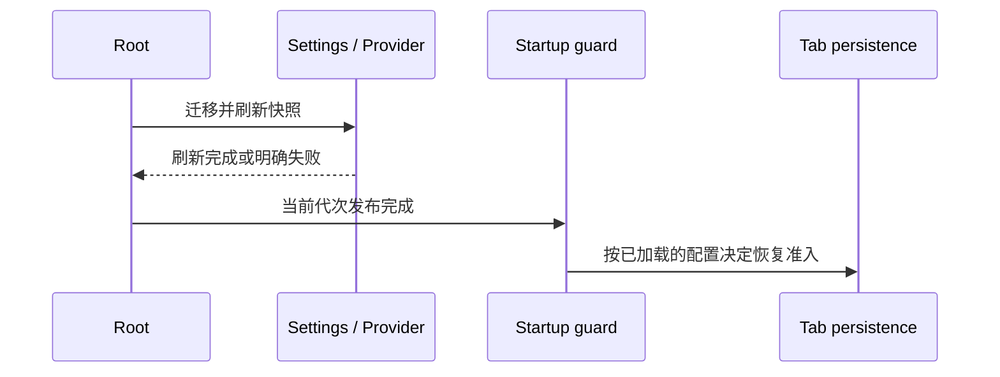

# Root Startup Render Block Desktop Boundary

## 背景

`isStartupRenderBlocked` 是桌面端启动保护：React 接管 root 后，等待 tab 恢复、初始 workspace 注入或鉴权状态落定，再展示正式界面。手机 Web 远控进入的是 shared-host attachment 链路，配对加载页已经覆盖 workspace bridge 建立过程；进入 `Root` 后不应该再使用桌面启动阻塞分支。

## 设计

- 使用 `RootProps.isDesktop` 作为唯一运行端边界。
- `Root.tsx` 只在 `isDesktop === true` 时调用 `shouldBlockRootRender(...)` 并进入 `isStartupRenderBlocked` 分支。
- Web 端、手机 Web 远控端不使用 `isStartupRenderBlocked`。
- 手机 Web 远控进入 `Root` 后，如果初始 workspace tab 还没有通过 effect 注入完成，`Root` 使用 Web 入口传入的 `initialWorkspaceLoadingFallback` 继续展示“已配对，正在加载工作区...”同款页面，直到 `workspaceShellPath` 出现。
- 桌面端和普通 Web server 入口不传 `initialWorkspaceLoadingFallback`，不会受手机过渡页影响。
- `RootStartupLoading` 保持桌面启动壳职责，不引入 viewport 或 user agent 判断。
- Provider 启动判定必须等待迁移后的应用设置与 Provider 快照刷新完成，再发布迁移完成事实；不能将尚未读取的 `providerFamilyDomain` 当成未配置，并由一次性登录判定永久阻断已有 workspace／pane 的恢复。组件已卸载或启动代次已失效时，不发布迟到的完成事实。

## 验证

- 新增 Root SSR 测试覆盖桌面阻塞启动时渲染 `data-testid="root-startup-loading"`。
- 新增 Root SSR 测试覆盖 Web 端不调用 `shouldBlockRootRender(...)`。
- 新增 Root SSR 测试覆盖手机 Web 初始 workspace 注入前渲染传入的 loading fallback。
- 执行 `pnpm typecheck` 和 `pnpm lint`。
