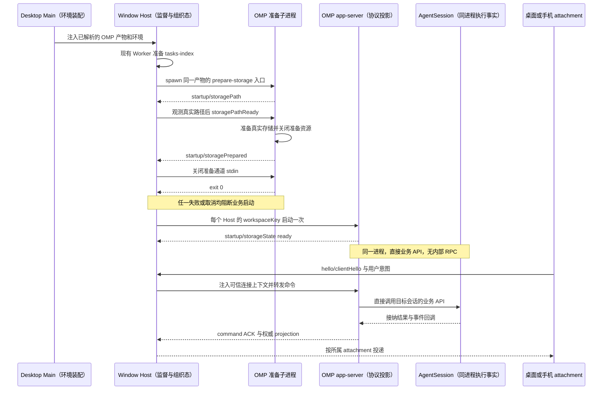

# Fork 需求文档

## 1. 文档定位

本文件是本 Fork 的需求入口，用于记录相对 ZCode 上游新增或调整的产品需求、行为边界和验收标准。上游已有能力继续以当前源码及对应需求文档为准，不在本文件重复定义。

## 2. 重新开始 Fork 的背景与决策

- `main` 分支基于老版本 Fork 改造，累计改动过大，已经不好管理。
- 因此，决定完全从头开始：以上游 ZCode 为起点重新进行 Fork 改造，不再以旧版 `main` 的改造结果作为新的开发起点。
- 新一轮 Fork 的第一步是先把测试跑通，建立基线，再开展后续改造。

## 3. 上游源码起点

以下信息记录于 2026-10-21，仅表示文档创建时的状态，不代表后续始终与上游同步。

| 项目         | 基线                                       |
| ------------ | ------------------------------------------ |
| Fork 仓库    | <https://github.com/jchanghong023/OmpCode> |
| 上游仓库     | <https://github.com/zai-org/ZCode>         |
| 当前开发分支 | `dev`                                      |
| 上游对比分支 | `upstream/main`                            |
| 初始化提交   | `3c5b2276`（`chore: sync ZCode source`）   |

创建文档前，本地 `dev` 与 `upstream/main` 指向同一提交，无代码差异；本地 `dev` 相对 `origin/dev` 领先 3 个提交。

上述记录仅说明源码起点，不代表测试已经跑通或测试基线已经建立。

## 4. FORK-001：先跑通测试，建立基线

### 目标

在从上游重新开始的代码上，先把测试跑通，建立后续 Fork 改造可对照、可复现的测试基线。

### 范围与边界

- 先确认当前仓库实际提供的测试入口及其运行条件，再执行测试并处理失败，直到测试跑通。
- 基线建立前，不开展后续功能改造；本阶段修改应限于让测试跑通所必需的问题。
- 不通过跳过失败测试、删除有效测试或放宽断言来制造通过结果。
- 记录基线对应的提交、运行环境、测试命令和实际结果，便于后续改造比较。
- 测试或环境受阻时，如实记录阻塞及未验证范围，不得将其记为基线已通过。
- 具体模块的行为和边界继续以对应需求文档为准，参见 [specs](specs/) 和 [docs](docs/)。

### 本轮执行范围：UT

- 按本轮要求，先执行根目录 `pnpm test:unit`，使用现有 Vitest 配置和测试范围，不额外缩小测试选择。
- 本轮不运行桌面 E2E，也不将根 UT 结果当作 CLI 独立测试或跨平台验证结果。
- 仅处理直接阻塞 UT 的依赖、环境和代码问题，通过后记录 UT 基线。

### 验收标准

1. 明确并记录测试入口、运行条件和执行命令。
2. 测试实际运行通过，失败项得到解决，不将未执行或受阻的测试标为通过。
3. 记录可复现的基线提交、运行环境及测试结果。
4. 在此基线上开展后续 Fork 改造，能够识别改造引入的测试回归。

### 当前状态

本轮根目录全量 UT 已通过，Windows UT 基线已建立。范围仅限本轮要求的根 UT，
不代表 CLI 独立测试、桌面 E2E 或其他平台已经验收；架构门禁仍有下述未通过项。

### UT 环境与复现步骤（2026-10-21）

- 源码起点：`3c5b2276`；UT 验收对象为本轮修复后的源码，随本文一同提交。
- 运行环境：Windows x64，Node `24.14.0`，pnpm `10.33.2`，实际测试运行器 Vitest `4.1.4`。
- 本机默认 Node 为 `24.20.0` 且未安装 mise，以下命令通过 pnpm 临时选择仓库声明的 Node 版本，不修改全局 Node。
- 最终全量沿用默认并发：普通 UT 最多 4 个 worker，`fork-isolated` 组单文件串行、最多 1 个 worker。

```bash
pnpm --config.use-node-version=24.14.0 install --frozen-lockfile
pnpm --config.use-node-version=24.14.0 typecheck
pnpm --config.use-node-version=24.14.0 --filter @zcode/adapters... build
pnpm --config.use-node-version=24.14.0 test:unit
```

准备步骤不可省略：首次执行时尚无依赖；安装后，部分 UT 还需要 `@zcode/e2e-report` 和
`@zcode/adapters/storage` 的包构建产物。根类型检查生成前者所需的 Node 产物，后者通过其现有依赖构建入口准备。

### UT 执行结果

| 全量轮次       | 通过文件 | 失败文件 | 通过用例 | 失败用例 | 跳过用例 | 耗时（秒） |
| -------------- | -------- | -------- | -------- | -------- | -------- | ---------- |
| 首轮基线调查   | 2031     | 17       | 19818    | 25       | 73       | 567.32     |
| 主要修复后     | 2047     | 1        | 19847    | 1        | 79       | 606.64     |
| 真实 IO 隔离后 | 2047     | 1        | 19843    | 5        | 79       | 915.28     |
| 最终验收       | 2048     | 0        | 19848    | 0        | 79       | 544.81     |

各轮均有 4 个测试文件按现有平台条件跳过。首轮存在收集失败的文件，补齐构建产物后恢复收集，
因此用例总数不同；权限用例修复了原定跳过条件的注册方式，不是删除失败用例。
最终全量命令退出码为 0；不将此前失败轮次或跳过项记为通过。

### 其他检查与证据边界

- `pnpm typecheck` 已实际执行通过。
- `pnpm lint` 已实际执行通过，保留 96 个警告、0 个错误；后续修改的测试和配置文件另经定向 lint 通过。
- 独立 smoke 使用实际源码生成远端安装脚本，经真实 Git Bash stdin 执行，完成安装并核对目标文件内容；临时夹具已删除。
- `pnpm architecture:check --changed` 未通过：本轮修改前已有 18 项 `unmanaged-new-file`；
  同步预加载调用方后，既有 `packages/desktop/wdio.conf.ts` 额外触发 1 项未登记规则，最终共 19 项。
  本轮不调整架构策略或扩大为模块治理改造，不能据此宣称所有质量门禁全绿。

### 本轮直接修复

- 远端组件安装器：锁心跳及其后代隔离标准 IO，避免前台命令退出后仍被后台 `sleep` 持有管道；
  Git Bash 测试后端通过 stdin 传递完整脚本，避免 Windows `-c` 参数破坏嵌套引号。
- 路径与 URL 夹具：使用当前 Host 的原生路径和合法 file URL，保留路径归一化、锚点剥离和非法 URL 拒绝验证。
- 子进程夹具：预加载入口统一使用 `file:` URL；Windows 管道存活场景显式分离后代进程，保留原超时和行为断言。
- 编码边界：PowerShell 测试明确输出 UTF-8；NSIS 编译与 electron-builder 一致，显式指定输入 UTF-8。
- 文件系统权限：Windows 用无需提权的 junction 验证拒绝链接边界；
  POSIX 权限用例改用正确的注册期跳过 API，保留原有 Windows/root 限制，不新增跳过条件。
- 真实并发 IO：固定随包配置的并发读取与 30 轮原子替换移入现有串行隔离组，
  保留文件内部并发、完整版本断言及原有重试预算。
- Manager 生命周期：仅验证 admission、重试、所有权或异常转发的 Agent 夹具按真实 stdin EOF 协议退出；
  protocol-close 场景改由实际通知触发非法帧，不再用固定启动延迟猜测时序。
  强制回收及后代进程覆盖仍保留在既有进程树测试中，未修改生产清理预算或身份校验。

远端安装器的管道所有权与事件顺序见[部署规范](docs/remote/zcode-agent-remote-deployment.md#retained-component-installer-failure-contract)。

### 后续验证节奏

- 修复期间定向执行失败文件或相关 UT，不因单个局部修复反复运行全量。
- 建立基线时执行一次最终全量 UT，不能以局部通过或 affected 的成功退出替代全量结果。
- 日常改造使用现有 `pnpm test:unit:affected` 选择受影响测试；这不是已通过结果缓存。
- `pnpm test:unit` 每次执行完整根 UT；模块转换缓存不代表可以跳过测试执行。
- affected 若选中整个套件，现有入口会说明并跳过，退出码 0 不代表全量 UT 通过，详见[选测规范](docs/testing/pre-push-hook.md#affected-unit-tests)。
- 可用 `pnpm test:unit --maxWorkers=2` 指定 worker 上限，或加 `--no-file-parallelism` 将测试文件串行执行；
  本轮最终全量没有使用这些覆盖参数。

## 5. FORK-002：移除推送时的自动架构门禁

### 目标

正常推送不再因架构合规扫描失败而被阻断，无需每次使用 `--no-verify` 绕过整个 pre-push 钩子。

### 范围与规则

- 从根 `verify:pre-push` 执行链删除 `pnpm run architecture:check -- --changed`。
- 保留 Lint、SQLite schema 兼容检查、架构规则自身的单测及 push 范围的受影响 UT；这些检查失败时仍阻止推送。
- `.husky/pre-push` 继续作为唯一推送钩子，保留 push ref 传递和 Git local env 清理，不新增旁路脚本或吞错分支。
- 手动 `pnpm architecture:check --changed`、架构策略及模块边界规则保持不变；移除推送阻断不等于架构违规已修复。
- 同步维护命令说明，不扩大为运行时代码或架构模块治理改造。

### 验收标准

1. 使用正常 `git push origin dev:dev`，不设置跳过钩子的参数或环境变量。
2. 实际钩子执行保留的检查，不再调用架构合规扫描。
3. 保留检查通过后推送成功，远端 `dev` 更新到本次提交。

## 6. FORK-003：通过 OMP app-server 替换 Agent 核心

### 目标与权威边界

带着 `ZCODE_AGENT_SERVER_COMMAND=omp` 启动 ZCode，由现有 Host 拉起支持 ZCode 协议的 OMP，保留 ZCode 的界面与宿主框架，以 OMP 作为实际 Agent 核心。

- 外部协议及既有产品合同以本仓库的 [ZCode Protocol](docs/zcode-protocol.md)、对应 spec 和固定兼容提交中的公开 schema 为准，不通过大改协议迁就 OMP，也不把 OMP 当作原 Agent 的 Model provider。
- OMP 入口、独立协议目录、与 AgentSession 同进程的业务 API 调用、存储准备生产端及功能／权限合同由 `F:/code2026/oh-my-pi/docs-zh-CN/requirements/rpc-ui-protocol.md` 维护；本节只维护 ZCode 侧启动消费、发行装配、宿主边界和源码保留。下文时序图是引用，不在本仓库另立一份 OMP 合同。
- 本仓库的接入逻辑集中在启动、初始化、打包、远端分发和必要的能力展示；协议适配不散落到 UI、Host 或原 Agent 核心中。
- [OMP 需求在线入口（浮动 main）](https://github.com/jchanghong023/oh-my-pi/blob/main/docs-zh-CN/requirements/rpc-ui-protocol.md) 仅用于发布导航，不能证明已包含本地确认的合同。未取得双方真实需求发布提交前，以各仓本地需求文件为准；发布时分别记录实际提交并更新引用，不虚构 SHA，也不把固定协议源码提交当作新需求已发布的证据。

### 启动选择与发行装配

- `ZCODE_AGENT_SERVER_COMMAND` 选择可执行程序，不自动转换协议。默认调用 `omp app-server --stdio`，桌面追加 `--surface desktop`；OMP 入口与桌面呈现的具体行为引用 OMP 需求，不在此重复定义。直接运行 `omp` 仍是 OMP 原生 TUI。
- 开发／手动启动保留显式环境变量覆盖的优先级；正式发行在 `packages/desktop/src/main/desktopRuntimeEnv.ts` 的 `buildHostProcessEnv()` 中，在没有显式覆盖时将已校验的随包 OMP 绝对路径和启动参数注入对应 Window Host 的子进程环境。不是由安装器写系统环境变量，也不修改用户 PATH、shell 配置或 OMP 偏好。
- `ZCODE_AGENT_SERVER_ARGS_JSON`、`ZCODE_AGENT_SERVER_CWD` 覆盖默认值时仍须满足同一 app-server、stdio、surface、cwd 和 profile 合同；不能因参数被清空而启动 TUI。准备与正常运行使用同一已解析产物、有效参数、profile 和执行环境。
- 显式选择 OMP 后，版本、参数、初始化或启动失败必须报错，不能静默回退原 Agent。不新增通用多 runtime 注册框架或长期双 Agent 设置开关。
- 本地和远端分别解析执行端路径、版本与环境；本地变量不代表 SSH、WSL 或 Docker 已部署 OMP。远端资产网络与发布接入遵守[现有远端部署说明](docs/remote/zcode-agent-remote-deployment.md)及其引用的 R3／Server CLI 规范，不重建旧 Remote Host 或平行下载策略。

### 存储启动消费与监督

- Host 的 tasks-index 准备继续由现有 Node Worker 执行；原配套 Node CLI 的准备路径保留。选中外部 OMP 时，`packages/desktop/src/host/database-startup/storagePreparationProcesses.ts` 必须通过子进程 spawn 执行同一 OMP 的 `app-server --stdio --prepare-storage --cwd <绝对路径>`，不得将 Bun 二进制作为 Node Worker 脚本，也不得因缺少原 Worker entry 跳过准备。
- OMP 准备进程的参数、帧形状、写入边界和退出行为以 OMP 需求“存储准备生产端合同”为准，wire 类型复用 ZCode 公开 schema。Host 负责校验帧、真实路径观测及确认、同轮成功资源的 reuse 判定、取消、时限和自有进程回收，不直接操作 OMP journal。
- 只有收到合法的路径与准备完成事实、进程退出码为 0 且无失败时，Host 才允许启动业务服务。非法帧、提前 EOF、超时、取消、失败状态或非零退出均阻断启动，保留原始错误；不能用 no-op 或放宽时限制造成功。
- 正常 app-server 仍受启动状态门约束，必要初始化 ready 前不发送执行命令；其 attempt、sequence 与终态按公开合同校验。准备成功不等于模型／认证已可用，模型执行保留独立就绪检查。

### 宿主所有权与事件顺序

- 每个 window-scoped Host 的每个 workspaceKey 最多一个 app-server，其内由同进程 AgentSession 托管多个主会话，不另起会话 RPC 宿主。两个窗口可各有 app-server；持久会话租约仍跨进程约束，不能同时写同一 OMP 会话。独立短生命周期存储准备进程不属于会话执行架构。
- Window Host 拥有可信连接路由、attachment、进程监督及 tasks-index 组织元数据；UI 只拥有草稿与展示态。OMP 正文／队列与 app-server 投影的所有权、`session/list` 与 `sessions-index` 的字段归属均引用 OMP 需求，不在 Host／Main／relay 重建事实。
- 身份路由沿用 `workspaceIdentity?.trim() || workspacePath`，路径仅用于执行和展示，远端保留 `remoteSessionId`；Host 负责 `desktop-continuous` 与 `web-remote-replayable` attachment 隔离，手机只 attach 已有运行时。



### 源码保留与持续合并

- 尽量保留 `apps/zcode-cli/` 及原 runtime、工具和配套源码，继续合并 ZCode 上游；不为更换核心批量删除、搬迁或重写上游实现，也不整体回灌旧 `main`。
- Fork 产品通过装配替换运行入口。源码保留不等于长期暴露两个 Agent；清理限于 Fork 自有临时开关和重复适配，不以删除上游源码实现切换。
- ZCode 依赖固定版本、可校验的 OMP 发行物，不跨仓深路径引用私有实现。发布组合记录 ZCode 协议基线、OMP 版本／提交与实际能力；schema 校验不替代行为联调。
- 合并上游、升级目标发行或修改协议、Host、启动、UI 消费链时，必须执行 OMP 需求中约定的兼容评估；只有目标合同变化才重钉基线并适配／验证，纯注释或排版变化不机械触发重钉。

### 单次完整交付与验收

不分阶段交付或分阶段验收。以下均为同一次完整交付的并列条件；内部工程依赖顺序不构成部分交付出口：

1. 在 FORK-001 的 UT 基线上，验证开发态显式覆盖、安装包默认注入、参数／cwd 覆盖、外部 OMP 存储准备和正常启动；失败不能启动业务或回落旧 Agent。
2. 通过真实 UI、Host 与 app-server 内同进程 AgentSession 完成全部约定功能，包括多会话隔离、消息／工具、停止／问答、历史／冷恢复、配置、命令／技能、执行中输入和队列；双方成功、失败与取消条件全部有效。
3. 验证同一 app-server 内多个主会话的配置／cwd／代理身份／事件隔离，单会话阻塞或停止不影响另一会话；同时验证双窗口 Host 隔离与写租约、索引归属、`existing-only` 及两种 delivery profile，不通过会话子进程规避同进程验收。
4. 桌面与远端实际运行同一兼容组合；取消、EOF、断线、版本不兼容和迟到结果均不能串会话、回落本地或遗留自有执行进程。
5. 全部约定能力验收后才切换正式发行入口。任一必需能力或验收未完成时整体仍为未完成／未验收，不把 UT 或既有独立 RPC 接口的局部通过当作完整替换完成。

### 当前状态

目标方案已确认；app-server 接入、启动装配、正式发行与 ZCode GUI 整体实现及验收尚未完成。现有 UT 或 OMP `rpc-ui` 的证据不替代上述验收，需求在线发布状态不等于功能状态。

## 7. 后续需求记录规则

- 新增或修改行为前，先记录对应需求，再实现代码。
- 每项需求明确目标、产品规则、状态所有者、接口边界和验收场景。
- 涉及已有模块时，复用并更新对应需求文档，在本文件引用，避免形成相互冲突的两份定义。
- 实现和验证状态以实际结果记录；未运行的验证不得标记为通过。
