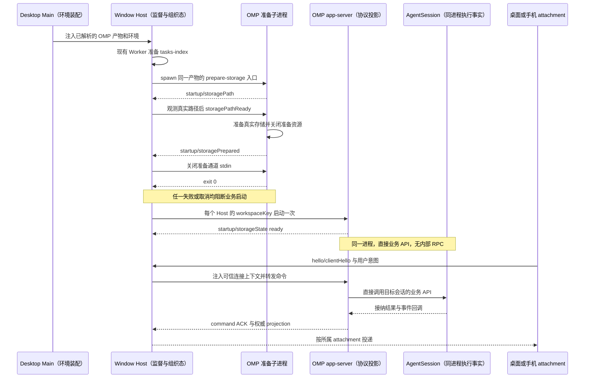

# Fork 需求文档

## 1. 文档定位

本文件是本 Fork 的需求入口，用于记录相对 ZCode 上游新增或调整的产品需求、行为边界和验收标准。上游已有能力继续以当前源码及对应需求文档为准，不在本文件重复定义。

## 2. 重新开始 Fork 的背景与决策

- `main` 分支基于老版本 Fork 改造，累计改动过大，已经不好管理。
- 因此，决定完全从头开始：以上游 ZCode 为起点重新进行 Fork 改造，不再以旧版 `main` 的改造结果作为新的开发起点。
- 新一轮 Fork 的第一步是先把测试跑通，建立基线，再开展后续改造。

## 3. 上游源码起点

以下信息记录于 2026-10-21，仅表示文档创建时的状态，不代表后续始终与上游同步。

| 项目         | 基线                                       |
| ------------ | ------------------------------------------ |
| Fork 仓库    | <https://github.com/jchanghong023/OmpCode> |
| 上游仓库     | <https://github.com/zai-org/ZCode>         |
| 当前开发分支 | `dev`                                      |
| 上游对比分支 | `upstream/main`                            |
| 初始化提交   | `3c5b2276`（`chore: sync ZCode source`）   |

创建文档前，本地 `dev` 与 `upstream/main` 指向同一提交，无代码差异；本地 `dev` 相对 `origin/dev` 领先 3 个提交。

上述记录仅说明源码起点，不代表测试已经跑通或测试基线已经建立。

## 4. FORK-001：先跑通测试，建立基线

### 目标

在从上游重新开始的代码上，先把测试跑通，建立后续 Fork 改造可对照、可复现的测试基线。

### 范围与边界

- 先确认当前仓库实际提供的测试入口及其运行条件，再执行测试并处理失败，直到测试跑通。
- 基线建立前，不开展后续功能改造；本阶段修改应限于让测试跑通所必需的问题。
- 不通过跳过失败测试、删除有效测试或放宽断言来制造通过结果。
- 记录基线对应的提交、运行环境、测试命令和实际结果，便于后续改造比较。
- 测试或环境受阻时，如实记录阻塞及未验证范围，不得将其记为基线已通过。
- 具体模块的行为和边界继续以对应需求文档为准，参见 [specs](specs/) 和 [docs](docs/)。

### 本轮执行范围：UT

- 按本轮要求，先执行根目录 `pnpm test:unit`，使用现有 Vitest 配置和测试范围，不额外缩小测试选择。
- 本轮不运行桌面 E2E，也不将根 UT 结果当作 CLI 独立测试或跨平台验证结果。
- 仅处理直接阻塞 UT 的依赖、环境和代码问题，通过后记录 UT 基线。

### 验收标准

1. 明确并记录测试入口、运行条件和执行命令。
2. 测试实际运行通过，失败项得到解决，不将未执行或受阻的测试标为通过。
3. 记录可复现的基线提交、运行环境及测试结果。
4. 在此基线上开展后续 Fork 改造，能够识别改造引入的测试回归。

### 当前状态

本轮根目录全量 UT 已通过，Windows UT 基线已建立。范围仅限本轮要求的根 UT，
不代表 CLI 独立测试、桌面 E2E 或其他平台已经验收；架构门禁仍有下述未通过项。

### UT 环境与复现步骤（2026-10-21）

- 源码起点：`3c5b2276`；UT 验收对象为本轮修复后的源码，随本文一同提交。
- 运行环境：Windows x64，Node `24.14.0`，pnpm `10.33.2`，实际测试运行器 Vitest `4.1.4`。
- 本机默认 Node 为 `24.20.0` 且未安装 mise，以下命令通过 pnpm 临时选择仓库声明的 Node 版本，不修改全局 Node。
- 最终全量沿用默认并发：普通 UT 最多 4 个 worker，`fork-isolated` 组单文件串行、最多 1 个 worker。

```bash
pnpm --config.use-node-version=24.14.0 install --frozen-lockfile
pnpm --config.use-node-version=24.14.0 typecheck
pnpm --config.use-node-version=24.14.0 --filter @zcode/adapters... build
pnpm --config.use-node-version=24.14.0 test:unit
```

准备步骤不可省略：首次执行时尚无依赖；安装后，部分 UT 还需要 `@zcode/e2e-report` 和
`@zcode/adapters/storage` 的包构建产物。根类型检查生成前者所需的 Node 产物，后者通过其现有依赖构建入口准备。

### UT 执行结果

| 全量轮次       | 通过文件 | 失败文件 | 通过用例 | 失败用例 | 跳过用例 | 耗时（秒） |
| -------------- | -------- | -------- | -------- | -------- | -------- | ---------- |
| 首轮基线调查   | 2031     | 17       | 19818    | 25       | 73       | 567.32     |
| 主要修复后     | 2047     | 1        | 19847    | 1        | 79       | 606.64     |
| 真实 IO 隔离后 | 2047     | 1        | 19843    | 5        | 79       | 915.28     |
| 最终验收       | 2048     | 0        | 19848    | 0        | 79       | 544.81     |

各轮均有 4 个测试文件按现有平台条件跳过。首轮存在收集失败的文件，补齐构建产物后恢复收集，
因此用例总数不同；权限用例修复了原定跳过条件的注册方式，不是删除失败用例。
最终全量命令退出码为 0；不将此前失败轮次或跳过项记为通过。

### 其他检查与证据边界

- `pnpm typecheck` 已实际执行通过。
- `pnpm lint` 已实际执行通过，保留 96 个警告、0 个错误；后续修改的测试和配置文件另经定向 lint 通过。
- 独立 smoke 使用实际源码生成远端安装脚本，经真实 Git Bash stdin 执行，完成安装并核对目标文件内容；临时夹具已删除。
- `pnpm architecture:check --changed` 未通过：本轮修改前已有 18 项 `unmanaged-new-file`；
  同步预加载调用方后，既有 `packages/desktop/wdio.conf.ts` 额外触发 1 项未登记规则，最终共 19 项。
  本轮不调整架构策略或扩大为模块治理改造，不能据此宣称所有质量门禁全绿。

### 本轮直接修复

- 远端组件安装器：锁心跳及其后代隔离标准 IO，避免前台命令退出后仍被后台 `sleep` 持有管道；
  Git Bash 测试后端通过 stdin 传递完整脚本，避免 Windows `-c` 参数破坏嵌套引号。
- 路径与 URL 夹具：使用当前 Host 的原生路径和合法 file URL，保留路径归一化、锚点剥离和非法 URL 拒绝验证。
- 子进程夹具：预加载入口统一使用 `file:` URL；Windows 管道存活场景显式分离后代进程，保留原超时和行为断言。
- 编码边界：PowerShell 测试明确输出 UTF-8；NSIS 编译与 electron-builder 一致，显式指定输入 UTF-8。
- 文件系统权限：Windows 用无需提权的 junction 验证拒绝链接边界；
  POSIX 权限用例改用正确的注册期跳过 API，保留原有 Windows/root 限制，不新增跳过条件。
- 真实并发 IO：固定随包配置的并发读取与 30 轮原子替换移入现有串行隔离组，
  保留文件内部并发、完整版本断言及原有重试预算。
- Manager 生命周期：仅验证 admission、重试、所有权或异常转发的 Agent 夹具按真实 stdin EOF 协议退出；
  protocol-close 场景改由实际通知触发非法帧，不再用固定启动延迟猜测时序。
  强制回收及后代进程覆盖仍保留在既有进程树测试中，未修改生产清理预算或身份校验。

远端安装器的管道所有权与事件顺序见[部署规范](docs/remote/zcode-agent-remote-deployment.md#retained-component-installer-failure-contract)。

### 后续验证节奏

- 修复期间定向执行失败文件或相关 UT，不因单个局部修复反复运行全量。
- 建立基线时执行一次最终全量 UT，不能以局部通过或 affected 的成功退出替代全量结果。
- 日常改造使用现有 `pnpm test:unit:affected` 选择受影响测试；这不是已通过结果缓存。
- `pnpm test:unit` 执行当前根配置启用的 UT；下述临时白名单生效期间不再代表原完整根 UT。模块转换缓存不代表可以跳过测试执行。
- affected 若选中整个套件，现有入口会说明并跳过，退出码 0 不代表全量 UT 通过，详见[选测规范](docs/testing/pre-push-hook.md#affected-unit-tests)。
- 可用 `pnpm test:unit --maxWorkers=2` 指定 worker 上限，或加 `--no-file-parallelism` 将测试文件串行执行；
  本轮最终全量没有使用这些覆盖参数。

## 5. FORK-002：移除推送时的自动架构门禁

### 目标

正常推送不再因架构合规扫描失败而被阻断，无需每次使用 `--no-verify` 绕过整个 pre-push 钩子。

### 范围与规则

- 从根 `verify:pre-push` 执行链删除 `pnpm run architecture:check -- --changed`。
- 保留 Lint、SQLite schema 兼容检查、架构规则自身的单测及 push 范围的受影响 UT；这些检查失败时仍阻止推送。
- `.husky/pre-push` 继续作为唯一推送钩子，保留 push ref 传递和 Git local env 清理，不新增旁路脚本或吞错分支。
- 手动 `pnpm architecture:check --changed`、架构策略及模块边界规则保持不变；移除推送阻断不等于架构违规已修复。
- 同步维护命令说明，不扩大为运行时代码或架构模块治理改造。

### 验收标准

1. 使用正常 `git push origin dev:dev`，不设置跳过钩子的参数或环境变量。
2. 实际钩子执行保留的检查，不再调用架构合规扫描。
3. 保留检查通过后推送成功，远端 `dev` 更新到本次提交。

## 6. FORK-003：通过 OMP app-server 替换 Agent 核心

### 目标与权威边界

带着 `ZCODE_AGENT_SERVER_COMMAND=omp` 启动 ZCode，由现有 Host 拉起支持 ZCode 协议的 OMP，保留 ZCode 的界面与宿主框架，以 OMP 作为实际 Agent 核心。

- 外部协议及既有产品合同以本仓库的 [ZCode Protocol](docs/zcode-protocol.md)、对应 spec 和固定兼容提交中的公开 schema 为准，不通过大改协议迁就 OMP，也不把 OMP 当作原 Agent 的 Model provider。
- OMP 入口、独立协议目录、与 AgentSession 同进程的业务 API 调用、存储准备生产端及功能／权限合同由 `F:/code2026/oh-my-pi/docs-zh-CN/requirements/rpc-ui-protocol.md` 维护；本节只维护 ZCode 侧启动消费、发行装配、宿主边界和源码保留。下文时序图是引用，不在本仓库另立一份 OMP 合同。
- 本仓库的接入逻辑集中在启动、初始化、打包、远端分发和必要的能力展示；协议适配由 OMP 负责，不散落到 UI、Host 或原 Agent 核心中。不得为迁就 OMP 改变既有问答字段、命令准入及 CAS 刷新路径，也不在 ZCode 回放夹具中建立第二套协议翻译层或改写原有行为断言。
- [OMP 需求在线入口（浮动 main）](https://github.com/jchanghong023/oh-my-pi/blob/main/docs-zh-CN/requirements/rpc-ui-protocol.md) 仅用于发布导航，不能证明已包含本地确认的合同。未取得双方真实需求发布提交前，以各仓本地需求文件为准；发布时分别记录实际提交并更新引用，不虚构 SHA，也不把固定协议源码提交当作新需求已发布的证据。

### 启动选择与发行装配

- `ZCODE_AGENT_SERVER_COMMAND` 选择可执行程序，不自动转换协议。默认调用 `omp app-server --stdio`，桌面追加 `--surface desktop`；OMP 入口与桌面呈现的具体行为引用 OMP 需求，不在此重复定义。直接运行 `omp` 仍是 OMP 原生 TUI。
- 开发／手动启动保留显式环境变量覆盖的优先级；正式发行在 `packages/desktop/src/main/desktopRuntimeEnv.ts` 的 `buildHostProcessEnv()` 中，在没有显式覆盖时将已校验的随包 OMP 绝对路径和启动参数注入对应 Window Host 的子进程环境。不是由安装器写系统环境变量，也不修改用户 PATH、shell 配置或 OMP 偏好。
- `ZCODE_AGENT_SERVER_ARGS_JSON`、`ZCODE_AGENT_SERVER_CWD` 覆盖默认值时仍须满足同一 app-server、stdio、surface、cwd 和 profile 合同；不能因参数被清空而启动 TUI。准备与正常运行使用同一已解析产物、有效参数、profile 和执行环境。
- 源码联调可将命令设为 Bun 绝对路径，参数设为 `["run","<OMP 仓库绝对路径>/packages/coding-agent/src/cli.ts","app-server","--stdio","--surface","desktop"]`；仍由 Host 注入实际 workspace 的 cwd，不将 `ZCODE_AGENT_SERVER_CWD` 改成 OMP 源码仓库。该路径直接加载当前源码，无需反复编译 exe；已有 OMP 源码依赖及本机 native addon 仍是前提，不将其结果冒充打包产物验收。
- 显式选择 OMP 后，版本、参数、初始化或启动失败必须报错，不能静默回退原 Agent。不新增通用多 runtime 注册框架或长期双 Agent 设置开关。
- 本地和远端分别解析执行端路径、版本与环境；本地变量不代表 SSH、WSL 或 Docker 已部署 OMP。远端资产网络与发布接入遵守[现有远端部署说明](docs/remote/zcode-agent-remote-deployment.md)及其引用的 R3／Server CLI 规范，不重建旧 Remote Host 或平行下载策略。
- 装配输入为显式 `ZCODE_OMP_ARTIFACT_ROOT`，根 `omp-release.json` 固定 `{version, commit, protocolBaseline, artifacts: {<目标平台>: <该平台 manifest 的 SHA-256>}}`；每个 `<os>-<arch>/omp-artifact.json` 记录 `schemaVersion: 1`、同一版本／完整源码提交／协议基线、`target`、相对 `executable` 与 `files: {<完整运行资产相对路径>: <SHA-256>}`。协议基线固定为 `c7c190724f3a00a2de998a0a5511201d5a2ba1a0`；manifest 不允许越界文件、符号链接或未列入校验表的入口。输入必须是真实构建产物，不能以示例版本、虚构摘要或另一平台二进制替代。
- `scripts/omp-artifact.mjs` 为 Desktop 和 Source Server 共用的装配／校验入口：Desktop `prepare-runtime-assets.mjs` 放入 `bundled-agents/<target>/omp`，electron-builder 放入 `resources/omp`；R3 `stageRelease()` 放入 `runtime/omp` 并纳入既有 `agent-runtime` 内容哈希与完整 archive。SSH、WSL、Docker 复用该目标平台 archive 的安装、更新、网络策略与原子切换，不增加独立下载器，也不借本机 OMP 执行远端任务。
- Desktop Main 在 `app.whenReady()` 内、创建任何 Window Host／scheduler 前通过 `prepareBundledOmpHostEnv()` 异步校验完整执行端资产；`buildHostProcessEnv()` 只消费校验成功的冻结结果，并拒绝未准备或执行端根／平台变化。Source Server `agentWiring.ts` 同样异步校验后注入绝对入口，Supervisor 等待候选发行校验／启动，stop/update 撤销代际并等待回收迟到自有进程后才释放锁。摘要使用流式读取，避免把大型内嵌 native 的可执行文件同步读入 Main。缺文件、版本／提交格式错误、协议／平台不匹配或任何文件摘要错误均阻断，不能退回保留的 `zcode.cjs`。显式命令及参数优先，空命令报错；参数是否满足 app-server 合同仍由现有启动解析负责。原 Agent 源码、Node runtime 与既有 TUI bundle 保留，不作为 OMP 失败后的备用 Agent。装配代码存在不代表已生成兼容发行组合或完成真实远端验收。
- OMP 平台签名／公证必须先于 manifest 摘要生成；Windows signer 与 macOS `signIgnore` 保留 `resources/omp` 原始字节，应用本身及其他资源仍遵循原签名策略。未签名本地构建只可作为明确的开发验证输入，不能据此宣称生产发行或公证通过。

### 存储启动消费与监督

- Host 的 tasks-index 准备继续由现有 Node Worker 执行；原配套 Node CLI 的准备路径保留。选中外部 OMP 时，`packages/desktop/src/host/database-startup/storagePreparationProcesses.ts` 必须通过子进程 spawn 执行同一 OMP 的 `app-server --stdio --prepare-storage --cwd <绝对路径>`，不得将 Bun 二进制作为 Node Worker 脚本，也不得因缺少原 Worker entry 跳过准备。
- OMP 准备进程的参数、帧形状、写入边界和退出行为以 OMP 需求“存储准备生产端合同”为准，wire 类型复用 ZCode 公开 schema。Host 负责校验帧、真实路径观测及确认、同轮成功资源的 reuse 判定、取消、时限和自有进程回收，不直接操作 OMP journal。
- 只有收到合法的路径与准备完成事实、进程退出码为 0 且无失败时，Host 才允许启动业务服务。非法帧、提前 EOF、超时、取消、失败状态或非零退出均阻断启动，保留原始错误；不能用 no-op 或放宽时限制造成功。
- 正常 app-server 仍受启动状态门约束，必要初始化 ready 前不发送执行命令；其 attempt、sequence 与终态按公开合同校验。准备成功不等于模型／认证已可用，模型执行保留独立就绪检查。

### 宿主所有权与事件顺序

- 每个 window-scoped Host 的每个 workspaceKey 最多一个 app-server，其内由同进程 AgentSession 托管多个主会话，不另起会话 RPC 宿主。两个窗口可各有 app-server；持久会话租约仍跨进程约束，不能同时写同一 OMP 会话。独立短生命周期存储准备进程不属于会话执行架构。
- Window Host 拥有可信连接路由、attachment、进程监督及 tasks-index 组织元数据；UI 只拥有草稿与展示态。OMP 正文／队列与 app-server 投影的所有权、`session/list` 与 `sessions-index` 的字段归属均引用 OMP 需求，不在 Host／Main／relay 重建事实。
- 身份路由沿用 `workspaceIdentity?.trim() || workspacePath`，路径仅用于执行和展示，远端保留 `remoteSessionId`；Host 负责 `desktop-continuous` 与 `web-remote-replayable` attachment 隔离，手机只 attach 已有运行时。



### 源码保留与持续合并

- 尽量保留 `apps/zcode-cli/` 及原 runtime、工具和配套源码，继续合并 ZCode 上游；不为更换核心批量删除、搬迁或重写上游实现，也不整体回灌旧 `main`。
- Fork 产品通过装配替换运行入口。源码保留不等于长期暴露两个 Agent；清理限于 Fork 自有临时开关和重复适配，不以删除上游源码实现切换。
- ZCode 依赖固定版本、可校验的 OMP 发行物，不跨仓深路径引用私有实现。发布组合记录 ZCode 协议基线、OMP 版本／提交与实际能力；schema 校验不替代行为联调。
- 合并上游、升级目标发行或修改协议、Host、启动、UI 消费链时，必须执行 OMP 需求中约定的兼容评估；只有目标合同变化才重钉基线并适配／验证，纯注释或排版变化不机械触发重钉。

### OMP 模型配置 GUI 与可选协议扩展

- `session/configure` 是向后兼容的可选公开方法；仅支持显式 `sessionId` 与 `operation`：`get_model_roles`、`set_model_role`、`get_team_config`、`get_team_models`、`set_team_config`。参数由对应严格 schema 校验，成功返回 `{operation,data}`，失败使用数值协议错误及结构化 `data`（保留保存回执）。不封装或调用内部 RPC；服务器直接调用所属会话的共享配置服务。
- 服务能力通过 `get_team_config` 的明确方法发现读取；旧 Agent 的 `-32601` 禁用此专用入口并说明原因，不回读文件、不假称支持。OMP 必须实现全部操作，不能以能力发现缩小交付。
- GUI 复用公开 `IZCodeAgentService` 与 hook，不使用 `window.zcode`。主模型临时切换使用既有会话模型命令，不持久化默认值；role 编辑展示完整目录、未配置及自定义 role、用户值／项目值／有效来源，使用对应 role revision 保存。
- 专用 Team 面板完整展示用户、持久、有效三份无损名单、读取状态、主模型、来源及问题。成员草稿可添加、替换、复制、排序、删除、清除及恢复默认；预览携带 `clientRevision`，只读计算与实际快照分开。保存全量具体身份与 CAS revision；失效原槽位保留直至用户修复，不写入原始 selector。
- 草稿由所属面板唯一持有，服务端独占已保存事实。事件／焦点刷新不覆盖脏草稿，显式重新读取可比较最新快照但不自动更新旧 CAS 基线；取消不保存。完整、覆盖、部分、未知、冲突分别显示，失败／断连先重读，不自动重放。会话／profile／连接代际及草稿版本的迟到结果不得改变当前面板。
- 自动化验收包括编辑／取消、预览版本、冲突与部分／未知回执、脏草稿外部刷新，以及切换目标后旧响应隔离；真实 GUI 保存与重启读回是完整交付验收的一部分。
- 既有已保存工作流、会话内定时任务与 Memory 的正常消费按 OMP 需求中「既有界面的工作流与记忆消费」接入：Host 继续持有调度，OMP 持有实际执行与原生记忆；不把旧 Agent 数据库布局当作 OMP 的验收前提，不以缺能力或空结果跳过仍然保留的界面行为。

### 单次完整交付与验收

不分阶段交付或分阶段验收。以下均为同一次完整交付的并列条件；内部工程依赖顺序不构成部分交付出口：

1. 在 FORK-001 的 UT 基线上，验证开发态显式覆盖、安装包默认注入、参数／cwd 覆盖、外部 OMP 存储准备和正常启动；失败不能启动业务或回落旧 Agent。
2. 通过真实 UI、Host 与 app-server 内同进程 AgentSession 完成全部约定功能，包括多会话隔离、消息／工具、停止／问答、历史／冷恢复、配置、命令／技能、执行中输入和队列；双方成功、失败与取消条件全部有效。
3. 验证同一 app-server 内多个主会话的配置／cwd／代理身份／事件隔离，单会话阻塞或停止不影响另一会话；同时验证双窗口 Host 隔离与写租约、索引归属、`existing-only` 及两种 delivery profile，不通过会话子进程规避同进程验收。
4. 桌面与远端实际运行同一兼容组合；取消、EOF、断线、版本不兼容和迟到结果均不能串会话、回落本地或遗留自有执行进程。
5. 全部约定能力验收后才切换正式发行入口。任一必需能力或验收未完成时整体仍为未完成／未验收，不把 UT 或既有独立 RPC 接口的局部通过当作完整替换完成。

### 当前临时 E2E 执行范围

- 本次 OMP 联调暂不运行用户指定的两档 E2E：第一档为 Browser、计费／营销／登录及指定纯 GUI 场景；第二档为指定的 Agent 预热、资源监控、进程生命周期及其他非协议场景。仅调整测试选择，不删除测试或功能代码，不将排除项计为通过；E2E 排除本身不改变 UT 选择，UT 执行范围由下述独立临时规范控制。
- 精确排除集合统一由 `packages/desktop/scripts/e2e-formal-spec-selection.mjs` 维护，WDIO 与分片入口共同消费；默认全量、显式 `--spec` 和环境变量选择均遵守该临时屏蔽。恢复时移除该集合，不另设永久功能开关。
- `conversation-session` 下的消息、工具、队列、Bot worker、压缩、历史、配置和恢复等协议联调，以及 `omp-app-server.e2e.ts` 仍保留。后续暂缓清单只改变首轮调度，不取消协议能力；`bots/bot-runtime-authority.test.ts` 恢复为首轮 Bot 代表，其他既有 Bot 硬屏蔽项不变。
- 第三档暂缓会话内 19 个纯 UI spec：预览卡片／视频／Markdown 选区、附件布局、输入与滚动／导航、工具栏／计划快捷键、问答默认焦点、侧聊提醒、Plugin 引用展示和搜索设置等。`hooks-lifecycle` 同属本轮屏蔽、留第二轮验证；这只是推迟该 E2E，不取消 OMP hooks 执行合同。精确文件仍在上述集合中维护；`plugin-reference-subagent` 另按下述已取消的 `plugin_reference` 投影合同硬屏蔽，不与纯展示场景混为一谈。
- 首轮另暂缓 7 个已知失败的大 spec：`background`、`goal-run-cases`、`guarded`、`tool-cross-product`、`bash-direct-output`、`compact-auto`、`anthropic-reasoning-history-replay`。这些是重要协议场景，不归为取消的功能；默认首轮不调度，修复时可用精确 `--spec` 单文件定向执行，修绿后从暂缓列表移回首轮。
- 模型／Provider GUI 的 `model-provider-restart-recovery`、`model-provider-turbo-switch`、`model-provider-turbo-recovery`、`model-provider-settings-transition` 同样从默认首轮移出、允许精确单文件定向执行。`model-output-token-preflight-smoke` 原先保留首轮，现仅根据下述独立实跑的旧私有日志依赖暂缓。`provider-readiness-agent-startup` 的只读启动／进程复用需求仍有效，但当前 driver 使用旧 `storage-migrate` 和旧 SQLite 历史 seed，不能靠 OMP 环境覆盖切换执行对象，按下述旧 CLI 专用夹具硬屏蔽。
- 首轮暂缓清单与前述临时硬屏蔽清单在同一选择模块内分开维护：仅精确指定的暂缓文件可解除本次默认排除，宽泛 glob 不会把整组暂缓文件重新纳入首轮。原临时硬屏蔽项仍不因 `--spec` 而执行；两类均保留原用例、断言和代码，不将未运行记为通过。
- 补充 19 个会话纯渲染／布局与 ToolSearch 展示变体进入硬屏蔽清单；补充 11 个 Bot／Feishu worker、可配置数据目录及自动化建档／编辑场景进入首轮暂缓清单。具体文件仍只在统一选择模块枚举，不以耗时估算代替实际通过证据。ToolSearch base 原先保留首轮，现按下述真实源码运行证据更正为暂缓；recovery、scope、TUI、catalog、feedback 的当前物理 driver 属原 CLI 专用，不能因 consumer 需求真实存在就视为可经 OMP 环境覆盖执行。native ToolSearch 目录、冷恢复和 feedback provider 请求体需求仍保留，旧 CLI 结果不能作为 OMP 验收。
- 联调使用显式指定的最新 OMP 实现，不以原 `zcode-cli` 运行结果代替；开发迭代可按上述配置直接用 Bun 加载当前源码，exe 验收则使用包含本次修复的最新构建，二者结果分别记录。复用已确认通过的 OMP fulltest，优先完成本仓 UT／E2E；已证实为旧 Agent 专用夹具、非 OMP 生产缺陷的用例可暂缓，逐项记录原始证据，不改断言、不在 replay 中增加协议翻译，也不把暂缓或首错取消的用例计为通过。当前新增暂缓 `fork-merged-assistant`：夹具返回旧 `Write(file_path,content)`，真实 OMP 广告 `_write(path,i,content)` 并明确返回 `Tool Write not found`。
- 自动化 `automation-run-title-stable` 当前因本地构建没有 telemetry endpoint 暂缓：业务执行和正文成功，但包含 Host 独有 `session_create` 在内的报告库存为空；`telemetryCore` 在端点为空时按既有可选能力合同不发送。此项不归因 OMP，不为联调开启真实遥测。
- 根据 run `desktop-e2e-20261022081214117-p46328-434bcd46fdfcbee9` 的原始请求与 journal，另仅暂缓 6 个精确 spec：`conversation-session-chat-loading-live-tail.test.ts`（OMP 标题 sidecar 误耗主 fixture 次数）、`conversation-session-automation-cron-relative.test.ts`（依赖已排除的 native permission 反馈）、`conversation-session-ask-user-question-keyboard-navigation.test.ts`（旧 `AskUserQuestion` 工具不存在）、`conversation-session-background-notification-batch.test.ts`（三次旧 `Agent` 工具不存在）、`conversation-session-built-in-subagent-model-overrides.test.ts`（旧 `Agent` 工具不存在）、`conversation-session-compact-stream-fallback.test.ts`（原生小会话 guard 阻止压缩，尚未进入 transport）。逐项原始错误和相对 run 证据见 [OMP 联调阻塞记录](docs/testing/omp-integration-blockers.md#当前新增暂缓项)；保留精确 `--spec` 定向执行，不改硬屏蔽、测试、fixture 或断言。
- `context-window-cold-resume` 的旧水位缺陷已修复，最新 exe 已通过原高 usage UI 断言；现仅因后续依赖旧 Agent 私有 `.zcode/cli/debug/model-io-*.jsonl` 格式而暂缓该 spec，不将其后 compact／再次冷恢复计为通过。`empty-completion-retry` 的显式 context stop 已正确进入 overflow maintenance；仅第二 case 的短历史压缩／旧持久化夹具暂缓，第一 case 保留，通过既有 `ZCODE_E2E_MOCHA_GREP` 排除该第二 case 的完整标题，不修改测试或断言。修复前的真实 OMP 缺陷与修复后夹具边界分别记录，不能追溯改称同一个原因。
- 未知的 `automations-workflows-hub`、`highspeed-card-draw-timeout` 继续保留。已通过的 Bot 两项与 conversation workspace 一项不调整。首错取消不是已完成失败或通过；CLI exclude 诊断意外纳入的 manual-review／缺 `SSH_CONTAINER` 不属于本轮 formal 集，不扩大排除范围。
- `automation-cron-create` 同样暂缓：实际 `_CronCreate` schema 已包含防递归自动化要求，但用例先硬编码旧 wire 名 `CronCreate`，且后续必须批准已排除的 native permission；不通过改名或开启权限界面迁就该夹具。
- 本轮新增 6 个旧 CLI 专用 driver 硬屏蔽：`toolsearch-recovery`、`toolsearch-scope`、`toolsearch-tui`、`toolsearch-catalog`、`toolsearch-feedback` 及顶层 `provider-readiness-agent-startup`。静态证据：`helpers/toolsearch-cli-process.ts:106,119-123` 固定原 `apps/zcode-cli/.../dist/zcode.cjs`，`helpers/toolsearch-feedback.ts:56-62` 的 `runFeedback` 调用该 fixture 的 `start`；`fixtures/toolsearch/runtime-driver.mjs:1-4` 导入原 bootstrap。不得启动这些旧执行对象，也不得把其结果记为 OMP 结果；这纠正原先 recovery／feedback／provider-readiness 总能由环境覆盖的假设，不取消真实业务需求。
- 本轮另新增 7 个合同硬屏蔽：`permission-hook-rewrite`、`permission-hook-race`、`v4-bash-command-prefix-permission`、`v4-permission`、`v4-refresh-permission` 依赖当前不支持的专用 permission 界面；`plugin-reference-subagent` 依赖已取消的 `plugin_reference` 投影；`hook-trust` 依赖旧 Host trust store，原生不制造平行信任存储，schema accepted 为 false。这组是合同排除，不表示全部已运行失败。最新源码 run `desktop-e2e-20261022084020260-p29896-cfa8bcf60372a0c8` 仅确证 `permission-hook-rewrite` 在 beforeAll `:97 → :219` 打不开旧 `cli/db/db.sqlite`；不是 OMP 库缺失，`permission-hook-race` 也没有同一 SQLite setup 或实测失败证据。
- 本轮仅按静态旧 Agent 夹具／私有存储边界新增 12 个首轮暂缓，均未取得该轮单 spec 实测失败结果：`model-output-token-preflight`、`model-output-token-budget`（旧 model-io／精确 preflight-v1 策略）；`send-message-resume-stop`、`subagent-runtime-catalog-reasoning`、`subagent-prompt-assembly`、`subagent-respond-to-coordinator`（旧 Agent／SendMessage／子代理目录与 prompt）；`memory`（旧 Extraction／存储／工具）；`background-bash-output`、`background-subagent-rate-limit`（旧 Bash／Agent／文件布局）；`pasted-image-path-projection`（旧 image-cache）；`tool-group-settings-persistence`（旧工具组合）；`v4-rewind-files`（旧 Read／Write 夹具不能创建其所需真实文件）。保留精确 `--spec` 定向机制，不复制旧日志、路径或工具别名，不取消原生 Memory 偏好、输出限制、子代理及文件回滚等真实需求。
- 另据真实源码 run `desktop-e2e-20261022084903410-p66240-0eabf19b4586d659`，仅将 `conversation-session-toolsearch.test.ts` 追加首轮暂缓而非硬屏蔽：`:48` 要求旧 `TodoWrite` schema 失败，capture 实际广告含原生 `_todo`（以及 `_read`／`_bash`），后续 tool_result 明确 `Tool TodoWrite not found` 且 `is_error:true`。此前保留判断经真实边界更正：旧 TodoWrite fixture 未走到 OMP `_todo`，不是原生待办业务缺失，也不能据此宣称 cold resume 已验收。真实 native Todo／ToolSearch 需求保留，不加旧工具别名、不翻译 replay、不改断言，仍可精确 `--spec` 定向执行。
- 上述新增清单不外推至混合 case 文件 `modified-submit-delivery`、`side-pane-full-view`、`v4-rewind-queue-background`，也不屏蔽 highspeed、`model-provider-add-send`、`unregistered-tool-cold-snapshot`、公开队列／Goal／模型隔离或 OMP 专用 GUI 用例。首错取消或静态旧依赖不等于业务失败；本轮只调整精确名单，不改产品、fixture、断言、exports 或选择实现，不新增 replay 翻译。
- 请求取证须按实际标题 sidecar 分类排除辅助生成，兼容原 CLI 与 OMP 的标题 system prompt；仍对主请求原样校验状态、模型及配置参数，不改写请求、响应、fixture matcher 或断言。仅因辅助标题返回不同而误选记录属于测试取证缺陷，不作为主 provider 配置失效证据。
- `side-pane-full-view` 保留普通浮窗 case。SPFV-E2E-008 先暴露的 OMP turnHeader 提前完成缺陷已修复并通过原工作时长断言；后续独立失败已确认是旧 `AskUserQuestion` fixture 未调用原生 `ask`，仅通过 `ZCODE_E2E_MOCHA_GREP` 精确暂缓这个标题，不排除整个文件或原生问答能力，也不把该旧夹具场景记为通过。
- `model-output-token-preflight-smoke` 独立源码 run `desktop-e2e-20261022093234491-p80224-4626d362622ab5d2` 已通过前置正文完成与 provider 输出 cap 断言，但 `:135-140,445` 必须读取旧 CLI 的 `compact.auto.skipped`／`below_threshold` 私有日志，在 `OTB11` 首错；仅此文件追加首轮暂缓，不复制旧日志或改原断言。该运行不证明后续 30K 压缩、48K 场景或完整 smoke 通过；公开输出上限与原生 context 恢复需求仍保留。
- `running-guide-steer` 保留混合文件，仅按两个完整 P06 标题暂缓：`P06 MCS：tool-batch 与 text-only drain 后 steer 按同轮时间线顺序显示` 与 `P06 non-MCS：tool-batch 与 text-only drain 后 steer 按同轮时间线顺序显示`。MCS 原始 capture 明确返回 `Tool Read not found`；non-MCS 共享同一旧 `Read(file_path)` 夹具及私有 wire 断言，仅属静态同源依赖，不记为实测失败。通过现有 `ZCODE_E2E_MOCHA_GREP` 精确排除这两个标题，不改测试或回放；plain guide 仍保留，两个 Goal case 按下述独立证据处理。
- 同文件仅另暂缓 `guide 模式下 active goal 运行中发送引导消息，不得 stop active target` 与 `guide 模式下 goal verifier 运行中发送消息，应保留为 future queue 且不 stop active target`：独立源码实跑证明 active objective 已经进入带原生 `<goal_context>` 的首次主请求，但原断言在发送 guide 前就要求旧私有 continuation 文案；不能据此判原生引导／调度失败。verifier 本轮未执行，仅同源旧 continuation/verifier 夹具阻塞，不能记为实测失败。plain running guide 已实际通过，不整文件屏蔽，不复制旧目标 prompt。
- 剩余 fixture 仅据静态必经旧工具路径新增两个默认文件暂缓：`conversation-session-v4-background-work.test.ts` 唯一 case 必须成功执行旧 `Bash(run_in_background:true)`；`conversation-session-subagent-interaction-delegate.test.ts` 的 T01 必经旧 `Agent → AskUserQuestion`，T02 除旧 `Agent → Bash` 外还强制当前不支持的 permission dock。两文件复用 `FORK_DEFERRED_E2E_SPECS`、仍可精确 `--spec` 点名；T01 不归为 permission 排除。这是静态同源边界，不声称本轮已实跑失败，不取消原生后台取消、子代理或问答需求。
- 混合文件不整文件暂缓，仅由父级通过既有 `ZCODE_E2E_MOCHA_GREP` 精确排除 `M06k MCS：工具结果后 Cmd/Ctrl+Enter 抢占，human reminder 全文与角色正确`、`M06k non-MCS：工具结果后 Cmd/Ctrl+Enter 抢占，human reminder 全文与角色正确`（必经旧 `Read(file_path)` 及真实文件结果），以及 `PV4-23 edit 前取消被裁 turn 的后台 Bash，新分支只启动一次`（编辑前必须成功启动旧后台 `Bash`）。这些是静态同源阻塞，未运行不记失败；modified-submit 的 pre-output 抢占／guide future queue、running-send-now 全部 case、PV4-20 held queue 和 PV4-18／19 compact/edit/restore 仍保留实际执行。旧 reminder golden 或 compact prompt matcher 仅作后续归因线索，不据此扩大过滤。精确 fixture／case 证据见[联调阻塞记录](docs/testing/omp-integration-blockers.md#剩余默认集合的静态旧工具边界)。
- `v4-compact` 当前唯一短种子 case 实跑被原生 `Nothing to compact (session too small)` 拒绝，没有摘要请求；仅暂缓该文件，不伪造 success，不连带排除 PV4-18／19／20。`settings/mcp-dual-era-version-negotiation` 两例依赖旧 `.zcode/cli/config.json`、`mcp/list` 管理面和旧 dual-era 日志：本次仅 MVN04 已实跑，未进入服务器握手；第二例未执行且旧合同不适用。该文件默认暂缓，不为其增加未承诺的 MCP 管理接口，native MCP 启动／工具调用合同保留。
- PV4-18／19／20 后续分别独立实跑，均在各自第一次压缩处由原生明确返回 `Nothing to compact (session too small)`，没有发出会话摘要请求。现将 `v4-rewind-compact-extended` 与 `v4-rewind-queue-background` 默认暂缓；前者两例分别有证据，后者 PV4-20 为短种子前置、PV4-23 为旧 Bash 前置，不能混称同一原因。未到达的附件 edit、两次 boundary/cold restore、held/edit 后各消费一次仍是验收缺口，不记通过；原生正向压缩另用专用 OMP GUI 场景验证，不降低产品阈值。
- `v4-edit` 的唯一用例已独立运行，首个 compact 在原生 journal 明确返回 small-session 错误；尚未执行 edit，不以该结果判断原生 branch cut。`v4-fork` 已完成真实派生、父问答继承、模型能力恢复及 child provider 请求，但旧断言强制模型上下文含固定英文 fork notice 和字符串 content；公共 lineage／marker 不依赖该私有提示词。两文件默认暂缓，不复制旧 prompt 或降低压缩阈值。
- `tool-input-validation-provider-content` 仅有的用例返回旧 `AskUserQuestion`，原生目录为 `ask`，真实 continuation 已回报工具不存在，未进入原生 schema validator；`unregistered-tool-cold-snapshot` 已真实持久化并上送全部 61 个失败结果，但 fixture 的旧 `Tool not found: Grep` 子串不匹配原生错误，主 continuation 返回 500。两文件默认暂缓，不增加工具别名或错误翻译；未到达的原生 malformed-tool、错误 cold restore、60-row tail 补齐仍不记通过。
- `running-send-now` 仅精确暂缓两个 `M07a MCS/non-MCS：running 中点击队首立即引导，消费原文并以 user reminder 降级` 标题。MCS 实跑已验证所选输入身份、队列移除及原生 user interjection 请求，失败在旧 `runtime-input-presentation.json` 全文；non-MCS 为同一回调的静态依赖，不冒充实测失败。非队首、Goal 和双击 case 继续运行，不能将 Goal 真正的准入失败归为私有 prompt 差异。

### 当前临时 UT 执行范围

- OMP 对接期优先快速验证：根 Vitest 只运行 OMP 对接白名单，包括用户列明的 fork／工作区改动 UT、Agent 传输及进程链路、OMP artifact 校验，以及必要的 OMP 配置和 E2E fail-fast 回归。`zcodeAgentService.v4` 保留，不以耗时为由屏蔽直接协议覆盖；不为协议补偿新增回放翻译器或配套测试。
- 只调整根配置的测试选择，保留全部测试文件、用例、断言及原全量范围定义，不改产品行为、不延长测试超时。无关普通 UT、串行隔离 UT 与 CUA 子项目暂不执行；不将屏蔽项记为通过。
- 白名单由 `vitest.config.ts` 单点维护，保留普通 threads 与真实进程串行 forks 的既有隔离规则。`test`、`test:unit`、coverage 和根 affected/pre-push 均受该根配置约束；“整个根套件”在临时配置期间指白名单范围，不含被屏蔽测试。架构合同测试仅保留白名单内项，`test:architecture` 的独立入口不变；CLI 独立套件不由本修改接管。
- 文件数量与耗时以当前真实 Vitest 选择和实跑为准；先前的“35 个／4.6 分钟”是分析估算，不作为新配置的通过证据。恢复时将根配置 `focusedUnitTests` 的数组初始化值替换为 `null`，由选择分支单点切回保留的 `fullUnitTests`、`fullForkIsolatedTests` 及 CUA 子项目定义，并根据届时改动处理冲突和实际验证；不以白名单通过替代原全量验收。

### 当前状态

本机既定联调范围已通过：Host 直接启动 OMP app-server，开发迭代使用 Bun 加载当前源码，不回退原 `zcode-cli`；协议适配仍由 OMP 承担，不在 Host/UI 或回放中增加协议翻译。已修复原生输入／Goal 准入、暂停队列、context 终态发布、模型覆盖、Highspeed 事实、工作流失败回收及启动恢复时序等联调问题，保留必要配置 GUI、启动／发行装配与通用会话恢复。最后一次重新构建 Desktop 的 10-shard 真实 GUI 运行通过 23 文件／45 用例；此前当前 UT 白名单通过 42 文件、893 passed／23 skipped，选择合同回归 162 项通过。类型检查、Lint 与受改动架构检查通过，Lint 仍为 96 warnings／0 errors。排除、暂缓、原始失败及证据边界见 [OMP 联调记录](docs/testing/omp-integration-blockers.md#本机联调收口)，不把白名单通过等同全产品验收；正式签名发行、跨平台部署及未覆盖组合仍未验收。已确认的 OMP fulltest 结果复用；源码运行结果不冒充已安装 exe 或正式发行结果。

## 7. 后续需求记录规则

- 新增或修改行为前，先记录对应需求，再实现代码。
- 每项需求明确目标、产品规则、状态所有者、接口边界和验收场景。
- 涉及已有模块时，复用并更新对应需求文档，在本文件引用，避免形成相互冲突的两份定义。
- 实现和验证状态以实际结果记录；未运行的验证不得标记为通过。
