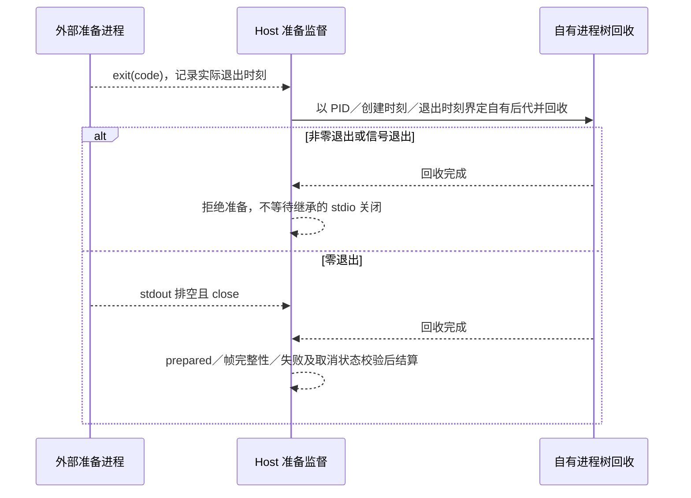

# Host database startup

Host Worker 是 app 库启动准备的唯一执行者。宿主验证 progress/done/failed 帧后更新启动状态；输入只携带数据库路径。

先读取旧 settings，再调用 project-storage 的启动入口迁移和维护索引，完成后发送 done，失败保留结构化错误及已经提交的迁移事实。所有退出路径关闭 MessagePort。此顺序避免空设置先记账、之后无法再恢复旧项目种子。

构建产物仍为 host/tasksStorageWorker.js，取消、超时及进程代际仍由宿主原有管理器负责；不改变历史 SQL、checksum 或 attachment。

Session 库准备按已解析命令的 `storagePreparation` 判别：`node-worker` 保留配套 Node bundle，`command` spawn 同一外部可执行文件与正常启动参数／profile／环境，仅追加准备标志。覆盖环境在解析命令前生效，不以缺少 Worker entry 跳过外部 OMP。

Host 是准备监督的唯一状态所有者：先接收合法绝对路径，完成真实路径观测后才确认；非 reuse 必须同一 attempt／database 的递增 sequence 到 ready 后才能接受 prepared。仅 prepared、完整 LF 帧、退出 0、清理屏障完成且无失败或取消可记入本轮 reuse 集合并允许业务初始化；取消监听保持至清理屏障结束，成功结算前再次核对 signal。异常、失败、提前 EOF、取消和原有 30 秒首帧超时阻断启动，回收本次自有进程树；不改正常 app-server 独立的启动状态门。

外部进程清理沿用正常 stdio transport 的归属语义：先捕获生前快照／独立进程组或按实际生命周期发现已退出 root 的后代，再关闭 stdin 请求 EOF 并调用既有进程树等待器。Windows 身份查询不可用时显式保留 `identityVerification: unavailable` 快照，由等待器观察原 ChildProcess 并报告存活 root；禁止把空 identities 当作成功清理或向未验证 PID 发信号，不另加超时策略。

