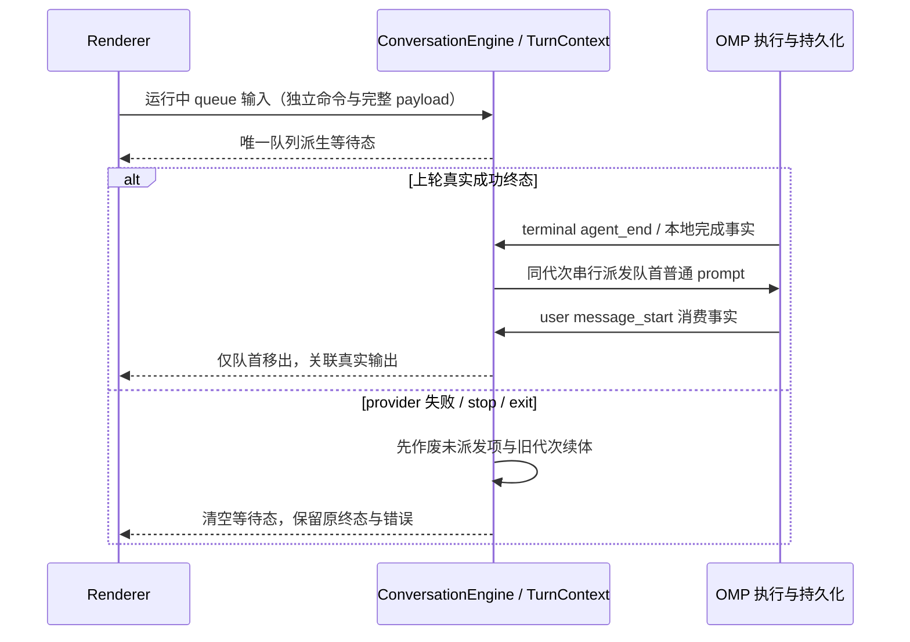

# omp-agent 模块契约

- 模块拥有每个会话的 omp 进程、命令收口、投影序列和订阅发布；Host 只拥有窗口级进程生命周期与路由。
- 桌面与通用 Web 订阅共享一份会话投影。桌面按原序连续交付；Web 按相同水位续传，超出保留范围后使用快照恢复；不恢复已取消的手机远控。
- `ConversationEngine` 的既有 `TurnContext`/队列是应用 queue 输入的唯一接纳与派发 owner；每项只持一份完整 text/originalText/images/modelSelection/sourceCommandId/clientId 与实例代次 payload。运行中 queue 只在该 owner 接纳，不预写 OMP `follow_up`；真实成功终态后通过同一串行屏障派发一条普通 `prompt`，仅真实用户消费事件激活该项并关联输出。失败、停止、退出先作废未派发 payload 与等待投影，保留原失败；旧代次续体不得启动新轮。native `prompt`/`steer` 的 request ID 使用同一 `sourceCommandId`，pending、ACK 与 `prompt_result` 按真实 ID 回到同一 owner；无 ID、旧 ID 或过时代次不能终结后来输入。native guide 仍发送 `steer`，消费前复用既有 pending-guide 落位，消费时才切换输出归属，失败不隐式重派发。Renderer 只读派生 queue，不另设 Map、已接受队列或持久日志；等待项与执行中时间线互斥，原能力禁用矩阵不变。
- Todo 的成功结果同时产出工具行清单和 v4 plan 状态，冷恢复从最后有效结果重建；子代理行、运行目录与已结束目录复用带父归属的详情地址。两者均由同一会话投影发布，UI 不另建事实状态。
- 会话身份由 Registry 绑定；临时 ID 迁移至稳定 UUID 后，旧订阅保持可用。
- 永久删除必须先确认 omp 会话文件删除成功，再发索引移除事件。关闭只释放进程。
- 所有跨包入口经 `contract.ts` 或包入口；omp RPC 词汇不进入 UI。
- 辅助主题借用父会话进程的原生 BTW；OMP 运行时与 BTW sidecar 拥有执行/历史，适配器只派生不透明地址、投影和订阅，不另建接受队列或主 transcript。
- 空辅助 pane 不执行模型；首问返回真实主题地址并绑定稳定父 UUID，追问/停止按该主题关联，冷恢复仅经真实历史查询。两条交付链路复用同一水位与进程实例 fence。
- 原生扩展的显式可见 custom 消息仅作为标准完成文本投影；隐藏消息不进入 UI 行/派生 transcript。不运行 TUI renderer，也不把该消息当模型响应参与用量、错误或轮次结算；live/cold 复用同一可见性规则。
- `session/agentInteractions` 是带 workspace/root-session scope 的只读查询。会话引擎观察经过校验的原始 IRC/custom 与 task/write/wait 结构，交互读面统一归并 live 与受控后代 JSONL；UI 不解析文件或拥有另一份通信事实。
- 观察页按文件 size/mtime 游标缓存原始记录；首查询刷新权威快照，分页游标绑定快照 revision。只保留最近两版，过期游标显式失败，不混合不同版本的 offset。读取预算为每文件 50,000 条、每树 256 个主体、8 层后代、live 20,000 条，预算不足标 partial。
- 消息 ID 是首选幂等键。缺 ID 的旧转发只有无歧义跨源观察才能归并，同源同正文消息保留。源中发送时间与落盘时间分别标 `sent`/`recorded`，缺失留未知；没有处理回执就不能生成已读/已处理状态。旧核全量审计缺口始终显式标 partial。
- 直接子代理状态读取原会话子代理目录与 revision，不新设运行状态 owner；嵌套状态只从已证明 task 归属的 `wait.jobs(type:task)` 更新，优先使用 `agentUrlId`。同名 bash/eval、未知身份和主会话结束不能推出子代理终态。
- 交互读面通过既有 SubagentBridge records 的进程归属读取现在状态；冷订阅虽可能启动 Main，但 roster 无该 child 的真实生命周期/快照证明时仍显示 `unknown`，不假定旧 pending/running 仍在执行。明确源终态不会被旧目录的 running 覆盖。进程实例变化参与缓存版本，旧进程的证明不跨实例复用；只读判断不启动进程、发新查询命令或执行模型。
- 诊断只观察既有请求、会话、进程实例与轮次，不拥有业务状态。app 经诊断端口提交稳定事件；adapters 在入口安装 stderr JSON sink 和异步请求上下文。stdout 始终只承载协议。Host 负责采集并追加其 runtime/workspace 身份，Main 仍是文件日志唯一 writer；产品规则与验收唯一见 [OMP 对接诊断日志](../../../docs/requirements/omp-core-integration.md#omp-对接诊断日志)。

