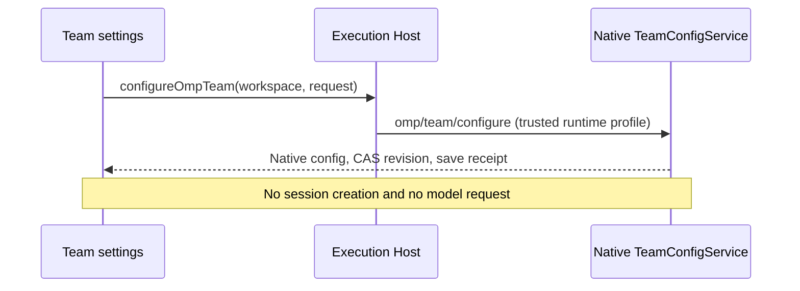

# OMP configuration

Owner: conversation UI. This module owns only unsaved role and Team drafts. Persisted Team members/models/order are the native runtime profile's global user configuration shared by every session, never per-conversation state.

Team reads, previews, model catalogs and saves call the public `IZCodeAgentService.configureOmpTeam` workspace-routing port and optional `omp/team/configure {workspace,request}` extension. No session is needed or created, including when opened from an existing chat. Roles and temporary session model controls retain the explicit-session `configureOmpSession`/`setModel` ports. The UI never accesses files, credentials or `window.zcode`. Profile comes from the trusted server response; workspace/identity route to that execution endpoint, not a separate Team configuration store. Draft preview is read-only and revision correlated. Scope, close, disconnect or process generation changes invalidate in-flight callbacks. External changes never overwrite dirty drafts or their original CAS revision. Only explicit Save submits; cancellation and defaults only edit local state. Conflict, partial and unknown outcomes never replay saves automatically.

Before the first native Team configuration baseline is available, editing controls are disabled; Refresh and Close remain usable. A local draft must not become dirty before its authoritative CAS baseline is known. Once the baseline is read, the existing editing and revision-checked save behavior resumes.

The mounted controller is scoped to service and workspace/session identity, not composer callback identity. Replacing a callback preserves the same target's dirty drafts and confirmed operation notices; completion uses the current callback. A different target still disposes the old controller and rejects its late results.

Role-specific directory reads merge returned descriptors by `roleId` into the mounted target's current directory: existing rows keep their order, matching IDs are replaced once, and new IDs append. Adding a custom role must not hide standard role controls or change any dirty draft or its original CAS revision. These reads never save, reset or rebase another role and remain subject to the same scope-generation invalidation as other requests.

Refreshes started before a save or while it is in flight cannot unlock readback after its outcome; only a new refresh after settlement can do so. A directory refresh rereads retained/requested custom roles absent from the directory through `get_model_roles {roleId}`, never copies old descriptors into fresh facts, and preserves draft selections and original CAS revisions until explicit adoption.

Model search uses the shared `get_team_models {query}` operation, including its verified aliases. Search results are correlated with query and controller connection generation, and affect only the catalog search projection; the complete model directory, saved members, role candidates and defaults remain unchanged.

`contract.ts` contains only shared-schema types and command/lifecycle ports; it does not import a service implementation or re-export runtime values. `module.ts` is the public composition entrypoint consumed by the toolbar. Implementations depend on the contract, never the reverse. Regression tests exercise preview races, scope isolation, conflict preservation, cancellation and receipt states through this composition entrypoint. Parent owns all test execution.

## Global native Team settings and chat execution

`module.ts` exports `TeamPage({workspacePath,workspaceIdentity?,remoteSessionId?,sessionId?})`. Opening it directly shows the global ordered model editor, without selecting/creating a session or opening a second full-screen configuration dialog. The existing controller remains the sole draft owner; the page supports selecting, adding, duplicating, removing and reordering native models plus explicit Save/Cancel. Default candidates prioritize genuinely selectable configured models; unavailable candidates retain accurate reasons and are not enabled by hiding authentication failures. Empty availability gives an actionable model-provider configuration explanation. The main surface contains no session-model prerequisite, runtime slot diagnostic, storage-side cards or revision fields; advanced source/storage/save facts remain available in collapsed details, and conflicts/partial failures remain visible. Role and temporary session configuration retain their existing chat entry. No task input or discussion start belongs on this page. Navigation is shell-owned.

Discussion remains `/team …` in the current chat, executed only by the native Team manager. Chat cards and the existing right SidePane read the same live/journal observations. Closing details does not stop work. Invocation IDs identify slots and actual causal edges; completed output stays in chat, renderer/cold recovery never reruns work. Disconnect disables live animation/cancellation, retains the last observation, and reconnect only rereads. Both desktop-continuous and web-remote-replayable consume the same native owner.

Missing optional capability retains the settings entry and sections with the real unsupported reason; never create a dummy session or fall back to the old Agent. Refresh and Close remain available. Pending profile selection must not write into the old active profile.
